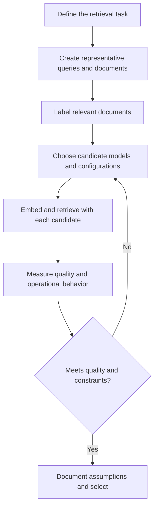
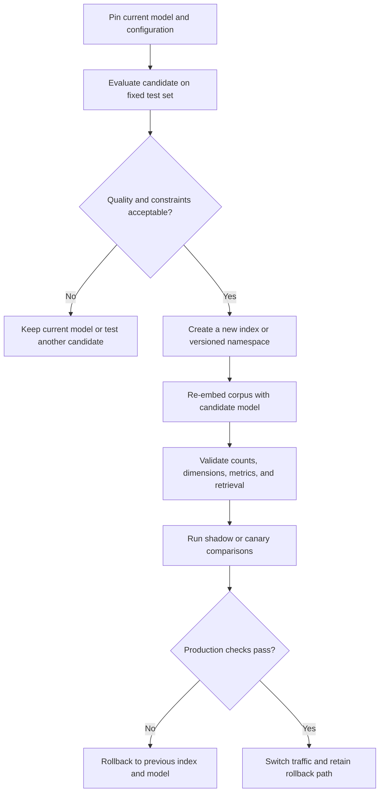

# 13. Embedding Model Selection

## Learning objectives

By the end of this chapter, you should be able to:

- Translate an application's retrieval requirements into embedding-model selection criteria.
- Compare candidate models or configurations using the same corpus, queries, and relevance judgments.
- Evaluate retrieval quality alongside dimensions, latency, throughput, infrastructure, privacy, licensing, and cost.
- Verify query/document encoding conventions and input-length behavior.
- Plan a safe model change without silently mixing incompatible embedding spaces.

<br/>

## 1. Why model selection matters

An embedding model maps text into a numerical vector intended to preserve useful relationships between texts. But “similarity” is not one universal property. A model that performs well on general semantic search may be weaker for specialist vocabulary, a particular language, exact identifiers, or short keyword-heavy queries.

For semantic search, select the model against the **application's retrieval task**, not just its reputation or a leaderboard score.



Separate two questions:

1. **Quality:** Does the model retrieve the documents users actually need?
2. **Deployment fitness:** Can it do so within latency, cost, privacy, licensing, and operational constraints?

A model that is marginally better on retrieval quality may not be the right choice if it is too slow, expensive, unavailable in the required region, or unsuitable for the application's data-handling requirements.

<br/>

## 2. Define application requirements first

Write down the requirements before comparing models. Otherwise, it is easy to optimize for convenient metrics rather than the user's actual task.

| Requirement | Questions to answer | Why it matters |
|---|---|---|
| Domain | General knowledge, customer support, medicine, finance, code, internal policies, or another specialist area? | Specialized terms and relationships may not be represented equally well by all models. |
| Language | Which languages, scripts, and mixed-language inputs occur? | Multilingual performance varies by model and language pair. |
| Document length | Short FAQs, paragraphs, long reports, or mixed-length records? | Input limits and truncation can remove relevant evidence. |
| Query style | Natural-language questions, fragments, keywords, product names, error messages, or identifiers? | Models may behave differently on conversational and keyword-heavy queries. |
| Relevance | Is a useful result top-ranked, merely present in the top 10, or required to be exact? | This determines metrics and acceptable failure rates. |
| Corpus and scale | How many records exist, how often do they change, and how many queries arrive per second? | These affect indexing time, serving throughput, and infrastructure requirements. |
| Constraints | Required region, private deployment, permitted data processing, budget, hardware, and license? | A candidate must be deployable under real constraints. |

<br/>

### Turn requirements into measurable criteria

Avoid vague requirements such as “the search should be good.” Define measurable targets where possible.

For example, a hypothetical support-search system might require:

- Recall@10 of at least 0.90 on a fixed evaluation set.
- p95 query latency below 200 ms for embedding plus retrieval under a specified load.
- No text sent to an external service if policy requires local-only processing.
- A documented license and acceptable estimated cost at expected traffic.

These are **illustrative targets**, not universal standards. Set thresholds based on the application's risk and user expectations.

<br/>

## 3. Build a fair comparison set

Every candidate should be tested on the same evaluation inputs.

Prepare a representative dataset containing:

- A fixed document corpus with stable document IDs.
- Representative queries, including common and difficult cases.
- Relevance judgments identifying which documents are relevant to each query.
- Metadata needed for the real retrieval task, such as language, document type, or access scope.

Include realistic cases, not only easy examples:

- Paraphrases that use different wording from the source document.
- Domain-specific vocabulary and abbreviations.
- Short, ambiguous, or keyword-heavy queries.
- Multilingual or code-switched inputs if users produce them.
- Long inputs close to the model's input limit.
- Misspellings, unusual punctuation, IDs, or exact terms when these matter.
- Queries with no clearly relevant document, if the application needs to detect empty results.

Keep the corpus, query set, relevance labels, metadata filters, and retrieval settings fixed when comparing candidates. If these change at the same time as the model, the experiment cannot reliably attribute differences to the model.

<br/>

### Relevance judgments

A simple judgment scheme can be binary:

- `1`: relevant to the query.
- `0`: not relevant to the query.

For tasks with graded relevance, use a documented scale, such as:

- `0`: not relevant.
- `1`: partially useful.
- `2`: relevant.
- `3`: highly relevant.

Use the same labeling instructions across experiments. When possible, have a second reviewer check a sample of labels, especially for high-impact applications.

<br/>

## 4. Compare retrieval quality

For each candidate model:

1. Encode the same corpus using the candidate's documented document-encoding convention.
2. Encode each fixed query using its documented query-encoding convention.
3. Retrieve the top $k$ documents with the same retrieval procedure.
4. Calculate metrics against the same relevance judgments.
5. Inspect individual wins and failures instead of relying on one aggregate score.

Useful retrieval metrics include:

- **Recall@k:** fraction of all known relevant documents retrieved in the top $k$.
- **Precision@k:** fraction of the top $k$ retrieved documents that are relevant.
- **MRR:** reciprocal rank of the first relevant result, averaged across queries.
- **nDCG@k:** ranking quality that can account for graded relevance and gives more credit to relevant documents ranked higher.

For a first comparison, Recall@k and MRR are often easy to interpret. If users care about the quality of the whole ranked list or labels have multiple relevance grades, consider nDCG@k as well.

<br/>

### Example

Suppose one query has four known relevant documents. Candidate A retrieves two of them in its top five, while Candidate B retrieves three.

- Candidate A's Recall@5 for this query is $2/4 = 0.50$.
- Candidate B's Recall@5 for this query is $3/4 = 0.75$.

This does not prove B is better overall. Repeat the evaluation over the full query set and inspect latency, cost, and failure patterns too.

<br/>

## 5. A small, reproducible evaluation pattern

The following example compares two embedding configurations using a fixed corpus, queries, and relevance labels. The `encode_documents` and `encode_query` functions are adapters: implement them using the chosen provider or library's documented API. Do not assume every model uses the same method names or prompt conventions.

```python
from collections.abc import Callable
import numpy as np

documents = [
    {"id": "d1", "text": "Reset your account password from Security Settings."},
    {"id": "d2", "text": "Refunds are usually processed within five business days."},
    {"id": "d3", "text": "Enable multi-factor authentication to protect your account."},
    {"id": "d4", "text": "Update your billing details from the Payments page."},
]

queries = [
    {"id": "q1", "text": "How can I change a forgotten password?"},
    {"id": "q2", "text": "When will my money be returned?"},
]

# Label relevant document IDs before running the comparison.
relevant = {
    "q1": {"d1"},
    "q2": {"d2"},
}

def recall_at_k(ranked_ids: list[str], relevant_ids: set[str], k: int) -> float:
    if not relevant_ids:
        return float("nan")
    return len(set(ranked_ids[:k]) & relevant_ids) / len(relevant_ids)

def reciprocal_rank(ranked_ids: list[str], relevant_ids: set[str]) -> float:
    for rank, doc_id in enumerate(ranked_ids, start=1):
        if doc_id in relevant_ids:
            return 1.0 / rank
    return 0.0

def evaluate_configuration(
    name: str,
    encode_documents: Callable[[list[str]], np.ndarray],
    encode_query: Callable[[str], np.ndarray],
    k: int = 3,
) -> dict:
    doc_texts = [d["text"] for d in documents]
    doc_vectors = np.asarray(encode_documents(doc_texts), dtype=np.float32)

    if doc_vectors.ndim != 2 or doc_vectors.shape[0] != len(documents):
        raise ValueError("Document embeddings must have shape (n_documents, dimensions).")
    if not np.isfinite(doc_vectors).all():
        raise ValueError("Document embeddings contain NaN or infinity.")

    query_results = []
    for query in queries:
        q_vector = np.asarray(encode_query(query["text"]), dtype=np.float32).reshape(-1)

        if q_vector.shape[0] != doc_vectors.shape[1]:
            raise ValueError("Query and document embedding dimensions do not match.")
        if not np.isfinite(q_vector).all():
            raise ValueError("Query embedding contains NaN or infinity.")

        # Cosine similarity; normalization is explicit.
        q_norm = np.linalg.norm(q_vector)
        d_norms = np.linalg.norm(doc_vectors, axis=1)
        if q_norm == 0 or np.any(d_norms == 0):
            raise ValueError("Zero vectors cannot be cosine-normalized.")

        scores = (doc_vectors @ q_vector) / (d_norms * q_norm)
        ranked_indices = np.argsort(-scores)
        ranked_ids = [documents[i]["id"] for i in ranked_indices]

        query_results.append({
            "query_id": query["id"],
            "recall_at_k": recall_at_k(ranked_ids, relevant[query["id"]], k),
            "reciprocal_rank": reciprocal_rank(ranked_ids, relevant[query["id"]]),
            "top_k_ids": ranked_ids[:k],
        })

    return {
        "configuration": name,
        "recall_at_k_mean": float(np.mean([r["recall_at_k"] for r in query_results])),
        "mrr": float(np.mean([r["reciprocal_rank"] for r in query_results])),
        "per_query": query_results,
    }

# Example adapter signatures:
# model_a_doc = lambda texts: provider_a.embed_documents(texts)
# model_a_query = lambda text: provider_a.embed_query(text)
# model_b_doc = lambda texts: provider_b.embed_documents(texts)
# model_b_query = lambda text: provider_b.embed_query(text)
#
# results_a = evaluate_configuration("model-a", model_a_doc, model_a_query)
# results_b = evaluate_configuration("model-b", model_b_doc, model_b_query)
# print(results_a)
# print(results_b)
```

**Important interpretation notes:**

- This is an evaluation template, not a runnable provider-specific integration until the adapters are implemented.
- The example uses exact dense retrieval with cosine similarity to keep the comparison focused on embeddings.
- If production uses metadata filters, hybrid retrieval, or approximate nearest-neighbor search, test those separately or keep them identical for all candidates.
- The mean of per-query Recall@k is a macro-average. State how queries are weighted when reporting results.
- For a larger test set, add confidence intervals or paired comparisons so small score differences are not overinterpreted.

<br/>

## 6. Operational and deployment trade-offs

Retrieval quality is only one part of the decision.

| Factor | What to measure or verify | Typical trade-off |
|---|---|---|
| Vector dimensions | Output dimension and index compatibility | Higher dimensions may increase storage, memory traffic, and search cost; they do not guarantee better retrieval. |
| Throughput | Documents encoded per second and queries encoded per second | Larger or more expensive models may need batching or more replicas. |
| Latency | p50 and p95 embedding latency, plus end-to-end search latency | Batching can improve throughput while increasing individual-request latency. |
| Hardware | CPU/GPU requirements, memory, concurrency, and deployment footprint | Local inference improves control but transfers serving and scaling responsibilities to the team. |
| Cost | Cost per token or measured compute cost per workload | Include document re-embedding, retries, peak traffic, and operational overhead—not just query-time cost. |
| Privacy and data handling | Where text is processed, retention, logging, region, and contractual terms | Hosted services must match organizational policy and applicable law. |
| Licensing | Model weights, code, commercial use, redistribution, and usage restrictions | “Open-weight” does not automatically mean unrestricted or open-source. Verify the actual license and terms. |
| Availability and reliability | Rate limits, quotas, service-level commitments, versioning, and fallback options | A high-quality model can still be unsuitable if it cannot meet availability requirements. |
| Input limits | Maximum tokens, truncation behavior, and supported input types | A model may omit relevant content if inputs exceed the allowed length. |
| Maintenance | Version changes, deprecations, reproducibility, and migration process | Pin versions and preserve evaluation results so changes are measurable. |

Measure performance under realistic conditions. Record hardware, batch size, concurrency, document/query lengths, warm-up behavior, and whether timing includes network overhead. Otherwise, latency and throughput figures from different tests may not be comparable.

<br/>

### Cost estimation

For a hosted model, estimate separately:

- **Initial indexing cost:** total corpus tokens embedded during first ingestion.
- **Update cost:** tokens in new or changed documents.
- **Query cost:** query tokens processed at expected request volume.
- **Migration cost:** the corpus may need to be embedded again when changing models.

A simple first-order estimate is:

$$
\text{Embedding cost} \approx
\frac{\text{input tokens}}{1{,}000{,}000}
\times
\text{price per million input tokens}
$$

Use the provider's current pricing and account for minimum charges, batching, retries, and infrastructure costs. For local models, estimate hardware, energy, deployment, monitoring, and engineering time instead of treating inference as free.

<br/>

## 7. Query/document encoding conventions

Do not assume that a model should encode a query and a document in exactly the same way.

Some embedding systems use a shared encoding method. Others are trained or configured for asymmetric retrieval and expect distinct query and document instructions, prefixes, task types, or API methods.

Before evaluating a candidate, verify:

- Whether query and document inputs use different encoders or instructions.
- Whether the provider requires a task type or specific prefix.
- Whether vectors from different model versions can be compared.
- Whether output vectors are normalized automatically.
- Which similarity metric is recommended or required.
- Whether dimensions can be selected, and whether doing so changes the output.
- Whether input text is truncated, rejected, or split when too long.

Use the documented conventions for the exact model version being tested. A correct model used with the wrong query/document convention can look deceptively weak.

<br/>

## 8. Test truncation and difficult inputs

Public benchmark scores cannot tell you how a candidate behaves on every application's inputs. Include tests for:

- Inputs just below, near, and above the documented token limit.
- Long documents where relevant evidence appears near the end.
- Very short queries, empty strings, whitespace-only input, and unusually long queries.
- Unicode, mixed scripts, code snippets, IDs, punctuation, and domain-specific abbreviations.
- Repeated or boilerplate text.
- Queries whose answer is not represented in the corpus.

Handle invalid inputs explicitly. Do not silently treat an empty or invalid embedding as an ordinary search query. Record whether the provider rejects, truncates, or otherwise transforms the input, and verify that behavior matches application requirements.

<br/>

## 9. Changing embedding models safely

Embeddings from different models generally inhabit different vector spaces. Even when two models produce vectors with the same number of dimensions, their vectors should **not** be assumed to be comparable. Do not query vectors from a new model against document vectors created by an old model unless compatibility has been explicitly established and tested.

A typical migration plan is:



Practical options include:

1. **Full re-embedding:** create a new index, encode the full corpus using the new model, validate it, then switch traffic.
2. **Versioned indexes or namespaces:** retain the old index while the new one is built and tested.
3. **Compatibility migration:** use only when the model provider or system explicitly supports compatible vectors, and confirm this with application-level tests.

Avoid a mixed index in which some documents use old embeddings and others use new embeddings. It can produce inconsistent ranking even if the dimensions match.

Before cutover, verify document counts, stable IDs, metadata, vector dimensions, normalization, filter behavior, deletion behavior, and retrieval metrics. Keep a rollback path until the new configuration is validated under realistic traffic.

<br/>

## 10. Common selection mistakes

- **Choosing by leaderboard alone:** public benchmarks may not reflect your domain, languages, or query patterns.
- **Changing multiple variables at once:** model, metric, filters, and index settings should not all change in a single comparison.
- **Ignoring query/document conventions:** asymmetric models may require different encoding instructions.
- **Comparing on a tiny or easy dataset:** results may not represent production queries.
- **Using aggregate scores only:** inspect per-query failures and language/domain slices.
- **Ignoring truncation:** relevant evidence near the end of a long input may be lost.
- **Treating equal dimensions as compatibility:** same-sized vectors are not necessarily in the same embedding space.
- **Ignoring lifecycle costs:** initial indexing and re-embedding can be substantial.
- **Treating local inference as free:** hardware, maintenance, and operational work still have costs.
- **Not recording assumptions:** model version, preprocessing, dimensions, normalization, metric, and dataset must be recorded to reproduce the result.

<br/>

## 11. Practice: compare two configurations

### Task

Choose two embedding models or configurations available to you. Keep the corpus, fixed query set, relevance judgments, filters, and retrieval metric the same.

1. Write down the application domain, languages, document-length distribution, and query styles.
2. Select at least 10 representative queries, including difficult cases.
3. Label relevant document IDs before inspecting candidate rankings, where practical.
4. Record the model/version, query/document encoding convention, dimensions, normalization, and similarity metric.
5. Run both candidates over the same corpus and queries.
6. Report Recall@5 and MRR, or justify other metrics that better match the application.
7. Inspect at least three queries where the candidates differ.
8. Measure embedding latency and throughput under the same test conditions.
9. Estimate initial indexing, ongoing query, and migration costs.
10. Record privacy, licensing, input-limit, and deployment constraints.
11. Make a recommendation and state what additional evidence might change it.

<br/>

### Experiment report template

| Field | Configuration A | Configuration B |
|---|---|---|
| Model and version | | |
| Query/document convention | | |
| Vector dimensions | | |
| Normalization and metric | | |
| Recall@5 | | |
| MRR | | |
| p50 / p95 embedding latency | | |
| Throughput and test hardware | | |
| Estimated indexing/query cost | | |
| Language/domain failures | | |
| Input-limit behavior | | |
| Privacy and license checks | | |
| Main advantages and risks | | |

<br/>

### Expected observations

There is no universally best model. One candidate may improve semantic recall but have higher latency or cost. Another may be sufficient for the task and easier to deploy. The correct conclusion is the one supported by measured results and documented constraints—not a predetermined winner.

<br/>

## 12. Checkpoint

You should be able to answer:

1. What characteristics of the target domain and query distribution matter most for model selection?
2. Why must candidate models use the same corpus, query set, labels, and retrieval procedure?
3. Which retrieval metrics reflect the application's actual success criteria?
4. What is the difference between retrieval quality and deployment fitness?
5. How would you test truncation and difficult inputs?
6. Why are equal vector dimensions insufficient to prove model compatibility?
7. When would full re-embedding be necessary?
8. What assumptions and evidence support your final recommendation?

**Checkpoint standard:** Support the selection with application-specific results, operational measurements, and documented assumptions. If evidence is incomplete, state the uncertainty and identify the next experiment.

<br/>

## Key takeaways

- Define requirements before choosing a model.
- Use a fixed, labeled evaluation set that represents real and difficult queries.
- Compare quality, latency, throughput, cost, privacy, licensing, and lifecycle effort.
- Follow the exact model's query/document encoding conventions.
- Test token limits and application-specific failure cases.
- Treat a model change as an embedding-space migration unless compatibility is proven.

<br/>

## References

Use the exact model/version documentation for current details; API behavior, dimensions, input limits, pricing, and licenses can change.

- [MTEB: Massive Text Embedding Benchmark](https://github.com/embeddings-benchmark/mteb) — broad benchmark suite; use it as context, not a substitute for application evaluation.
- [Sentence Transformers documentation](https://www.sbert.net/) — embedding and semantic-search implementation patterns.
- [Hugging Face model documentation](https://huggingface.co/docs) — model cards, usage, and licensing information for hosted repositories.
- [OpenAI Embeddings guide](https://platform.openai.com/docs/guides/embeddings) — hosted embedding API behavior and model-specific details.
- [BEIR benchmark](https://github.com/beir-cellar/beir) — heterogeneous information-retrieval evaluation benchmark.
