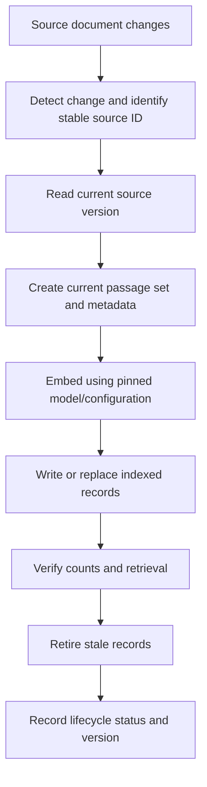
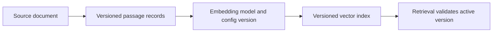
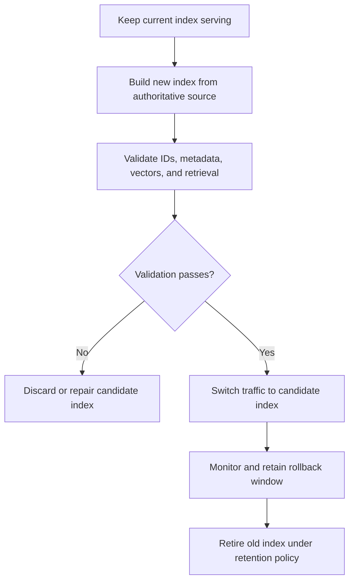

# 14. Index Updates and Deletion

## Learning objectives

By the end of this chapter, you should be able to:

- Design stable identifiers for source documents and indexed passages.
- Distinguish insertion, replacement, upsert, soft deletion, and physical removal.
- Keep vectors and metadata synchronized when source content changes.
- Remove stale passages and verify that deleted content is no longer retrievable.
- Track embedding model and index configuration versions.
- Explain how rebuilds, consistency, caches, replicas, snapshots, and retention affect deletion behavior.

<br/>

## 1. Why index lifecycle matters

A vector index is a derived representation of source data. It commonly stores a vector, an identifier, and metadata for each indexed record. If the source changes but the index does not, search can return stale or misleading results.

Examples of lifecycle failures include:

- A revised policy is updated in the source system, but the old policy remains searchable.
- A document becomes private, but its old vectors remain available to search.
- A source is deleted, but only its parent record is removed while passage-level vectors remain.
- A new embedding model is introduced, but old and new vectors are mixed in the same index.
- Search stops returning a record, but copies remain in caches, logs, snapshots, or backups.

Treat indexing as a maintained data pipeline, not a one-time upload.



The exact order of writes and stale-record removal depends on the backend and consistency requirements. The diagram shows the logical workflow; it is not a guarantee of atomicity.

<br/>

## 2. Model the source-to-index relationship

A useful design distinguishes a **source document** from the **indexed passages** derived from it.

Example:

- Source document ID: `policy-482`
- Source version: `v7`
- Passage IDs: `policy-482:v7:p0`, `policy-482:v7:p1`
- Metadata: source ID, version, passage number, access scope, update time, model version

The ID format is illustrative. Choose an encoding that avoids collisions and is stable under your application's rules.

A source can produce zero, one, or many indexed records. If one source becomes four passages and later becomes two, removing only the two new passages is not enough: the old extra passage records must also be removed.

<br/>

### Stable IDs

Use stable IDs to identify the logical source independently of its current text. Common patterns include:

- A source-system primary key.
- A UUID assigned when a document is first ingested.
- A deterministic ID derived from a stable source identifier and passage key.

Avoid using only the document's text as its identity. If the text changes, a content-derived ID changes too, which can leave the old record behind unless cleanup is explicit.

<br/>

### Source versions and content hashes

These serve different purposes:

- **Source version:** identifies the revision in the upstream system, such as a monotonically increasing revision number or version token.
- **Content hash:** detects whether normalized content has changed, often by hashing a canonical representation of the text and relevant metadata.

A content hash can prevent unnecessary re-embedding when content is unchanged. It does not replace a stable source ID: two different documents can have identical content, and one document can change content over time.

Example:

```python
import hashlib

def content_hash(text: str) -> str:
    # Use a documented normalization policy before hashing if required.
    canonical_text = text.strip()
    return hashlib.sha256(canonical_text.encode("utf-8")).hexdigest()

previous_hash = content_hash("Refunds are processed in five business days.")
current_hash = content_hash("Refunds are processed in five business days.")

if previous_hash == current_hash:
    print("Content unchanged; re-embedding may be unnecessary.")
```

Hash only the fields whose changes should trigger re-indexing. If access permissions or other searchable metadata changes, those fields may need updating even when the body text hash is unchanged.

<br/>

## 3. Insertion, replacement, upsert, soft deletion, and physical removal

These terms describe different operations. Backend APIs may use different names, so verify their exact semantics.

| Operation | Meaning | Typical use | Key risk |
|---|---|---|---|
| Insert | Add a new record that does not already exist | First indexing of a new document or passage | Duplicate IDs or conflicts if the record already exists |
| Replace | Replace the stored record or its current contents | Updating an existing record | Partial replacement semantics can differ by backend |
| Upsert | Insert if absent, or update/replace if the ID exists | Idempotent ingestion jobs | It may not remove old passage IDs that are no longer part of the source |
| Soft delete | Mark a record as deleted or inactive while retaining it | Recovery, audit, or delayed cleanup | Filters must consistently exclude deleted records |
| Physical removal | Remove a record from the active index/store | Deletion from active retrieval | Does not automatically prove removal from backups, logs, or all replicas |

An upsert is often convenient for repeatable ingestion, but **upserting the current passages does not automatically delete obsolete passages**. Track the full set of indexed IDs for each source and remove IDs that no longer belong to the current revision.

<br/>

## 4. Update all affected passages

When a source document changes, all indexed passages derived from that source must be considered. A safe update process is:

1. Fetch the current source revision.
2. Compare the source version and relevant content/metadata hashes.
3. Determine the complete set of passage IDs that should exist for the new revision.
4. Generate embeddings using the pinned model and configuration.
5. Write the new/current records.
6. Identify old passage IDs that are no longer valid.
7. Remove or deactivate stale records.
8. Verify that search returns the new content and no longer returns obsolete content.

<br/>

### Example: a source shrinks

Version 1 creates three passage records:

```text
manual-17:p0
manual-17:p1
manual-17:p2
```

Version 2 creates only two:

```text
manual-17:p0
manual-17:p1
```

Updating `p0` and `p1` leaves `p2` stale unless the ingestion process explicitly removes it. This is a common reason to store the source ID and current source version in every passage's metadata, and to keep a manifest of passage IDs per source.

<br/>

### Avoid partial-update gaps

If a backend cannot atomically replace all passages for a source, users may temporarily see a mixture of old and new records. The appropriate strategy depends on the required consistency:

- **Simple eventual consistency:** update records and clean up stale ones, then verify after the backend's documented consistency window.
- **Versioned records:** write a complete new revision under a new version, switch a current-version pointer or filter, then retire the old revision.
- **Build-and-swap index:** create a new index or namespace and switch traffic only after validation.

These are design patterns, not features every vector store supports natively.

<br/>

## 5. Track model and configuration versions

Each indexed record should be traceable to the embedding configuration that created it. Useful fields include:

- `embedding_model`
- `embedding_model_version` or a pinned model identifier
- `embedding_dimensions`
- `embedding_config_version`
- `source_id`
- `source_version`
- `content_hash`
- `indexed_at`
- `is_deleted` or a lifecycle status, if using soft deletion

Use metadata fields supported by the chosen backend. If a field is not filterable or is too large for metadata, maintain a separate manifest or catalog.

Vectors from different models generally should not be mixed for similarity search unless compatibility is explicitly documented and tested. Matching dimensions alone does not prove compatibility. Changing model, task prefix, pooling, normalization, or other embedding settings may require a new index or a controlled migration.



Record the query-side model/configuration too. A query embedded with an incompatible configuration can fail even when the document index is internally consistent.

<br/>

## 6. Deletion: active retrieval versus complete deletion

“Deleted” can mean several different things. State which guarantee your application provides.

### Level 1: excluded from active search

The record is physically removed from the active index, or a deletion/status filter reliably excludes it. Search should no longer return it through the supported retrieval path.

This is an application-level retrieval guarantee. It is the minimum expected behavior for ordinary document removal, but it is not equivalent to erasing every copy.

<br/>

### Level 2: removed from active storage and serving copies

The active vector records, metadata, replicas, caches, and derived serving data are addressed according to the backend's capabilities and documented consistency behavior. Some systems propagate deletions asynchronously, so a brief delay may occur.

<br/>

### Level 3: removed from retained copies

Backups, snapshots, exports, logs, analytics stores, and disaster-recovery copies are governed by separate retention and deletion processes. Some backups may not be individually editable; deletion may take effect only when the backup expires or is rebuilt.

Do not claim complete deletion merely because a search query no longer returns the document. Verify the actual storage, replication, cache, backup, and retention guarantees that apply to the system.

<br/>

### Soft deletion

Soft deletion can be useful for recovery and audit requirements, but it creates additional obligations:

- Every retrieval path must filter inactive records.
- Filters must be applied before results are exposed to the user.
- Old records must not reappear through fallback searches or alternate indexes.
- A separate retention policy must specify when, if ever, physical deletion occurs.

For sensitive content or access revocation, soft deletion alone may be insufficient if any search path can still expose the stored record.

<br/>

## 7. Caches, replicas, snapshots, and retention

These components have different lifecycle semantics.

| Component | What to check |
|---|---|
| Query/result cache | Can cached results contain deleted text or IDs? How are cache entries invalidated or expired? |
| Embedding cache | Are source text or vectors retained after a source deletion? What keys and expiration rules are used? |
| Replicas | How quickly do delete operations propagate? Can a stale replica still serve queries? |
| Snapshots and backups | What is the retention period? Can individual records be erased, or do copies expire as a whole? |
| Logs and traces | Are raw query text, document text, metadata, or vector IDs recorded? Who can access them and for how long? |
| Exports and downstream stores | Was content copied to analytics, evaluation datasets, or another database? |
| Application caches | Does the application cache retrieved passages or generated responses containing the content? |

Maintain a deletion workflow that covers the systems actually used by the application. If generated answers or logs can retain deleted information, the policy should explain whether those are in scope and how they are handled.

<br/>

## 8. Consistency, index rebuilds, and backend-specific support

Vector stores differ in how they implement upserts, deletes, filtering, namespaces, transactions, and replication. Do not infer guarantees from an operation's name alone.

Before selecting or configuring a backend, verify:

- Whether updates replace all fields or only specified fields.
- Whether deletion accepts record IDs, metadata filters, or both.
- Whether a delete is immediately visible to subsequent queries.
- Whether delete operations are asynchronous and how completion is checked.
- Whether filters apply to every search mode, including hybrid or fallback paths.
- Whether index rebuilds preserve IDs, metadata, permissions, and configuration.
- Whether snapshots and backups are included in the documented deletion guarantees.
- Whether a namespace or collection is isolated enough for a model migration.

<br/>

### Rebuild versus incremental update

**Incremental updates** are usually appropriate when a small fraction of the corpus changes and the backend supports reliable updates and deletions.

**Full rebuilds** can be useful when changing embedding models, changing the embedding configuration, correcting widespread indexing errors, or validating a clean index. They require additional compute/storage and a controlled traffic switch.

A common build-and-swap pattern is:



The old index may still contain data during the rollback window. Account for that in the deletion policy, especially when the rebuild was triggered by a deletion request or access revocation.

<br/>

## 9. Practice: insert, edit, and delete synthetic documents

This exercise uses an in-memory dictionary to demonstrate lifecycle bookkeeping. It is not a vector database and does not demonstrate physical erasure from backups or replicas. The same test cases should later be adapted to your chosen vector store.

```python
from dataclasses import dataclass
from typing import Optional

@dataclass
class Record:
    record_id: str
    source_id: str
    source_version: int
    text: str
    is_deleted: bool = False

index: dict[str, Record] = {}

def upsert(record: Record) -> None:
    index[record.record_id] = record

def soft_delete_source(source_id: str) -> None:
    for record_id, record in list(index.items()):
        if record.source_id == source_id:
            index[record_id] = Record(
                record_id=record.record_id,
                source_id=record.source_id,
                source_version=record.source_version,
                text=record.text,
                is_deleted=True,
            )

def physically_remove_source(source_id: str) -> None:
    for record_id in [
        rid for rid, record in index.items()
        if record.source_id == source_id
    ]:
        del index[record_id]

def active_records() -> list[Record]:
    return [record for record in index.values() if not record.is_deleted]

# 1. Insert two passages from one source.
upsert(Record("guide-1:p0", "guide-1", 1, "Change your password in settings."))
upsert(Record("guide-1:p1", "guide-1", 1, "Use a strong, unique password."))

assert len(active_records()) == 2

# 2. Edit the source: update current passages and remove the obsolete passage.
upsert(Record("guide-1:p0", "guide-1", 2, "Reset your password from Security Settings."))
physically_remove_source("guide-1")  # Demonstrates deletion only; do not use in this order in a real update.
```

The final lines above intentionally illustrate why lifecycle operations need careful ordering: calling `physically_remove_source` after the upsert removes the updated record too. In a real update, compute the **new expected IDs** and remove only obsolete IDs. The safer version is:

```python
def replace_source(source_id: str, source_version: int, passages: dict[str, str]) -> None:
    # `passages` maps complete, stable record IDs to their new text.
    expected_ids = set(passages)

    for record_id, text in passages.items():
        upsert(Record(record_id, source_id, source_version, text))

    stale_ids = [
        rid for rid, record in index.items()
        if record.source_id == source_id and rid not in expected_ids
    ]
    for rid in stale_ids:
        del index[rid]

replace_source("guide-1", 2, {
    "guide-1:p0": "Reset your password from Security Settings.",
})
assert {r.record_id for r in active_records()} == {"guide-1:p0"}
assert active_records()[0].source_version == 2

# 3. Delete the source and verify that no active record remains.
physically_remove_source("guide-1")
assert not any(r.source_id == "guide-1" for r in index.values())
```

For a real vector store, replace the in-memory functions with its documented upsert and delete operations. Also verify search results after each step; checking a local dictionary is not a substitute for testing index visibility and backend consistency.

<br/>

### Practice checklist

- [ ] Insert a synthetic source with at least two passages.
- [ ] Confirm both passages can be retrieved.
- [ ] Edit the source so one passage changes and another becomes obsolete.
- [ ] Confirm the updated passage is retrievable and the obsolete passage is not.
- [ ] Change access metadata and verify the old permissions are no longer effective.
- [ ] Soft-delete the source and test every supported retrieval path.
- [ ] Physically remove the source and verify active search no longer returns it.
- [ ] Record what is known—and unknown—about caches, replicas, snapshots, backups, and retention.

<br/>

## 10. Common failure modes

- **Deleting only the parent record:** passage-level vectors remain searchable.
- **Upserting without stale-ID cleanup:** old passages survive when a source shrinks or is restructured.
- **Using content as the only ID:** edits create new IDs and leave old records behind.
- **Removing the new version by mistake:** broad deletion filters can erase current records as well as stale ones.
- **Updating metadata but not vectors:** the record describes new content while its vector represents old content.
- **Updating vectors but not metadata:** filters or access controls operate on stale attributes.
- **Mixing model versions:** similarity scores become unreliable when incompatible vector spaces are combined.
- **Assuming deletion is immediate:** replicas, indexes, or caches may have documented propagation delays.
- **Equating search invisibility with erasure:** snapshots, backups, logs, and exports may retain copies.
- **Ignoring concurrent updates:** an older ingestion job can overwrite a newer source revision unless version ordering is enforced.

Use source-version checks or conditional writes where supported to prevent an older job from overwriting a newer revision. Make ingestion and deletion jobs idempotent so retries do not create duplicates or revive deleted records.

<br/>

## 11. Checkpoint

You should be able to answer:

1. Why should source IDs remain stable when document text changes?
2. How do source versions and content hashes differ?
3. Why does an upsert not necessarily remove obsolete passage records?
4. What must happen when a source changes from four passages to two?
5. Why must vectors and metadata be updated together?
6. Why should embedding model/configuration versions be recorded?
7. What is the difference between soft deletion, physical removal from active search, and complete deletion across retained copies?
8. What should be verified about caches, replicas, snapshots, backups, and logs?
9. When might a versioned index or full rebuild be safer than incremental updates?
10. How can you prevent an older ingestion job from restoring stale content?

**Checkpoint standard:** Demonstrate insert, update, and delete behavior; verify current search results and permissions; and explicitly distinguish active retrieval removal from deletion across all storage and retained copies.

<br/>

## Key takeaways

- Treat the vector index as derived data that must stay synchronized with authoritative sources.
- Use stable source IDs, source versions, content hashes, and passage manifests where useful.
- Upsert current records **and** remove stale records that no longer belong to the source.
- Keep vectors, metadata, permissions, and model/configuration versions consistent.
- Test deletion through the actual retrieval path, not only by inspecting application-side records.
- Do not promise complete erasure until caches, replicas, snapshots, backups, logs, and retention policies have been addressed.

<br/>

## References

Consult the selected backend's current documentation for exact operation semantics, consistency guarantees, and deletion support.

- [FAISS documentation and repository](https://github.com/facebookresearch/faiss) — vector indexing library; lifecycle and persistence are application responsibilities in many setups.
- [Chroma documentation](https://docs.trychroma.com/) — collections, record operations, and persistence behavior.
- [Pinecone documentation](https://docs.pinecone.io/) — vector upsert/delete operations, namespaces, and production guidance.
- [Weaviate documentation](https://docs.weaviate.io/) — object lifecycle, filtering, and deployment considerations.
- [NIST Privacy Framework](https://www.nist.gov/privacy-framework) — useful general framework for thinking about data processing and lifecycle risks.
