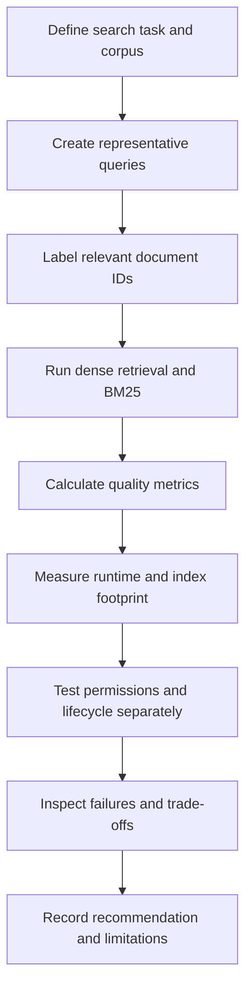
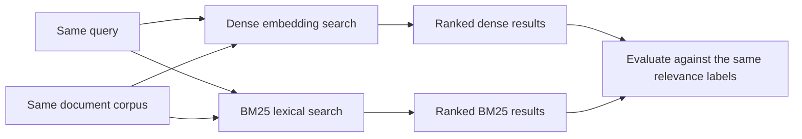

# 15. Semantic Search Testing and Evaluation

## Learning objectives

By the end of this chapter, you should be able to:

- Build a small evaluation set with representative queries and explicit document relevance judgments.
- Compare dense semantic search with BM25 using the same corpus and query set.
- Calculate and interpret Precision@k, Recall@k, and Mean Reciprocal Rank (MRR).
- Record retrieval latency, embedding runtime, index size, and failures.
- Test authorization and document lifecycle behavior separately from relevance.
- Run controlled experiments by changing one factor at a time.
- State the limitations of incomplete relevance labels and small evaluation datasets.

<br/>

## 1. Why evaluate semantic search?

A semantic-search system should retrieve useful documents for the queries people actually ask. It is not enough to inspect a few results and decide that they “look right.” A repeatable evaluation makes comparisons measurable and helps identify failure patterns.

For example, a user might ask, “How do I get back into my account?” while the relevant document says, “Reset your password in Security Settings.” Dense retrieval may recognize the semantic relationship even though the wording differs. A lexical system such as BM25 may perform well when the query includes distinctive words, product names, error codes, or identifiers.

Neither approach is guaranteed to win on every query. Evaluate both against the same labeled task.



This chapter establishes a **small evaluation baseline**. Larger datasets, nDCG, systematic experiment tracking, and production evaluation are expanded in Level 13.

<br/>

## 2. Build a representative evaluation set

Create a fixed corpus with stable document IDs and a set of queries that represent real usage. For each query, explicitly list the documents considered relevant.

A simple data format might look like this:

```python
documents = [
    {
        "id": "d1",
        "text": "Reset your password from Security Settings.",
        "metadata": {"category": "account"},
    },
    {
        "id": "d2",
        "text": "Refunds are usually processed within five business days.",
        "metadata": {"category": "billing"},
    },
    {
        "id": "d3",
        "text": "Enable multi-factor authentication to protect your account.",
        "metadata": {"category": "security"},
    },
    {
        "id": "d4",
        "text": "Find invoice history on the Payments page.",
        "metadata": {"category": "billing"},
    },
]

queries = [
    {"id": "q1", "text": "How can I recover access to my account?"},
    {"id": "q2", "text": "refund processing time"},
    {"id": "q3", "text": "Where can I see invoice history?"},
]

# Document IDs judged relevant to each query.
relevance = {
    "q1": {"d1", "d3"},
    "q2": {"d2"},
    "q3": {"d4"},
}
```

The labels above are illustrative. In a real evaluation, relevance should be decided using documented criteria and, where practical, by reviewers who do not know which retrieval system produced the results.

<br/>

### Include different query types

A useful small set should include both semantic and lexical cases:

- **Paraphrases:** query and document express the same idea using different words.
- **Exact-match queries:** product names, error codes, policy IDs, dates, or distinctive phrases.
- **Keyword-heavy queries:** short fragments such as “refund five days.”
- **Domain terms:** abbreviations, specialist vocabulary, and internal terminology.
- **Ambiguous queries:** multiple documents could plausibly match.
- **No-good-match queries:** no document in the corpus is truly relevant, if the application must handle this case.

Do not build a test set exclusively from queries for which the chosen model already performs well. That introduces selection bias.

<br/>

### Relevance judgments are not always complete

If a document is not labeled relevant, that does not always prove it is irrelevant. Reviewers may have missed it, or the judgment set may be incomplete. Record this limitation, especially when calculating Recall@k, because recall depends on knowing the relevant-document set.

For a small baseline, binary judgments are often sufficient:

- `1`: relevant.
- `0`: not relevant.

Use a consistent definition of relevance. If the application needs graded relevance (for example, “partially useful” versus “directly answers the question”), document that scale and apply it consistently.

<br/>

## 3. Compare dense retrieval with BM25 fairly

**Dense retrieval** encodes queries and documents into vectors, then ranks documents using a similarity or distance measure.

**BM25** is a lexical ranking method based on term matching, with weighting for term frequency, inverse document frequency, and document length. It can be particularly useful for exact terms, identifiers, and rare keywords.

For a fair comparison:

1. Use the same corpus and stable document IDs.
2. Use the same query texts and relevance judgments.
3. Keep any metadata filters and access rules equivalent.
4. Compare the top-$k$ result lists.
5. Use the same evaluation metrics.
6. Record the configuration of each method.

Do not compare a filtered dense search against an unfiltered BM25 search, or a new corpus against an old one, and attribute the difference only to the retrieval algorithm.

A simple conceptual comparison:



This baseline compares dense and lexical retrieval independently. Hybrid retrieval, fusion, and reranking can be explored later; they should not obscure the baseline comparison.

<br/>

## 4. Retrieval-quality metrics

Metrics answer different questions. Choose those that match how users benefit from search.

### Precision@k

Precision@k is the fraction of the top $k$ retrieved documents that are relevant:

$$
\operatorname{Precision@k} =
\frac{\text{relevant documents in top } k}{k}
$$

If only three results are returned when $k=5$, decide whether the evaluation treats the missing two slots as non-relevant or reports a denominator based on the number returned. For consistent comparisons, define this rule in advance. The common fixed-$k$ definition uses $k$ as the denominator.

<br/>

### Recall@k

Recall@k is the fraction of all known relevant documents that appear in the top $k$:

$$
\operatorname{Recall@k} =
\frac{\text{relevant documents in top } k}{\text{all known relevant documents}}
$$

Recall@k measures whether useful items are found. It depends on the relevance labels being sufficiently complete.

<br/>

### Mean Reciprocal Rank (MRR)

Reciprocal rank for one query is the inverse rank of the first relevant result. If the first relevant result is at rank 2, reciprocal rank is $1/2$. If no relevant result appears in the evaluated list, it is 0.

$$
\operatorname{RR}(q) =
\begin{cases}
1/r_q, & \text{if first relevant result has rank } r_q\\
0, & \text{if no relevant result is found}
\end{cases}
$$

MRR is the average reciprocal rank across queries:

$$
\operatorname{MRR} = \frac{1}{|Q|}\sum_{q \in Q}\operatorname{RR}(q)
$$

MRR focuses on how early the first relevant result appears. It does not fully describe the quality of every result in the ranking.

<br/>

### Worked example

Suppose a query has relevant documents `d1` and `d3`.

- Ranked list A: `d2, d1, d4`
- Ranked list B: `d1, d4, d2`

At $k=3$:

| Metric | List A | List B |
|---|---:|---:|
| Precision@3 | $1/3$ | $1/3$ |
| Recall@3 | $1/2$ | $1/2$ |
| Reciprocal rank | $1/2$ | $1$ |

Both lists contain one relevant document in the top three, but List B places the first relevant document at rank 1. This is why ranking-sensitive metrics add information beyond simply counting relevant results.

<br/>

## 5. Calculate metrics in Python

The following functions calculate Precision@k, Recall@k, and reciprocal rank for one query. They are small enough to inspect and use in a baseline evaluation.

```python
def precision_at_k(ranked_ids: list[str], relevant_ids: set[str], k: int) -> float:
    if k <= 0:
        raise ValueError("k must be positive")
    top_k = ranked_ids[:k]
    # Fixed-k denominator: missing result slots count as non-relevant.
    return len(set(top_k) & relevant_ids) / k

def recall_at_k(ranked_ids: list[str], relevant_ids: set[str], k: int) -> float:
    if k <= 0:
        raise ValueError("k must be positive")
    if not relevant_ids:
        raise ValueError("Recall is undefined when no relevant documents are labeled")
    top_k = ranked_ids[:k]
    return len(set(top_k) & relevant_ids) / len(relevant_ids)

def reciprocal_rank(ranked_ids: list[str], relevant_ids: set[str]) -> float:
    for rank, doc_id in enumerate(ranked_ids, start=1):
        if doc_id in relevant_ids:
            return 1.0 / rank
    return 0.0

ranked = ["d2", "d1", "d4"]
relevant_ids = {"d1", "d3"}

print("Precision@3:", precision_at_k(ranked, relevant_ids, k=3))
print("Recall@3:", recall_at_k(ranked, relevant_ids, k=3))
print("RR:", reciprocal_rank(ranked, relevant_ids))
```

For a dataset, calculate each metric per query and then report the average. Keep per-query results too: an aggregate score can hide failures on a particular language, query type, or content category.

A query with no known relevant documents requires special handling. Do not silently assign it Recall@k = 0 or 1, because the recall denominator is undefined. Evaluate no-match behavior separately, using a documented criterion such as whether the system avoids returning misleading results.

<br/>

## 6. Record operational measurements

Retrieval quality is not the only consideration. Capture operational behavior under comparable conditions.

| Measurement | What to record | Why it matters |
|---|---|---|
| Query embedding latency | p50 and p95, if enough samples are available | Measures the cost of turning each query into a vector. |
| Document encoding runtime | Time to encode the corpus or a fixed batch | Affects initial indexing and refresh time. |
| Search latency | p50 and p95 retrieval time under stated conditions | Helps evaluate interactive responsiveness. |
| End-to-end latency | Query encoding plus search and relevant application overhead | Reflects the user-visible search path. |
| Index size | Disk or memory footprint, including the stated components | Affects infrastructure cost and capacity. |
| Failures | Timeouts, invalid vectors, empty inputs, rate limits, and exceptions | Reliability issues can make a high-scoring method unusable. |
| Resource conditions | Hardware, batch size, concurrency, warm-up, corpus size | Makes performance measurements interpretable. |

Do not compare timings from different hardware or workloads without disclosing the difference. Separate document-embedding time from query-time latency: they affect different parts of the system.

<br/>

## 7. Evaluate authorization and lifecycle correctness separately

A search system can have excellent relevance scores and still be unsafe or incorrect.

Test these properties independently from relevance:

- **Authorization:** users must retrieve only documents they are permitted to access.
- **Metadata filtering:** the intended language, category, tenant, or access filters are consistently applied.
- **Updates:** changed documents return current content rather than stale passages.
- **Deletion:** deleted or retired documents no longer appear through the active retrieval path.
- **Model consistency:** query and document embeddings use compatible model/configuration versions.
- **Failure handling:** invalid inputs and backend errors do not silently expose stale or unauthorized results.

A useful test matrix:

| Test | Expected behavior |
|---|---|
| Authorized user queries an allowed document | Relevant permitted content can be returned |
| User queries a document outside their access scope | Restricted content is not returned |
| Document is edited | Current content is returned; stale passages are absent |
| Document is deleted | It is absent from active search after the documented consistency window |
| Query embedding has the wrong dimension | Request fails safely or is rejected before search |
| Retrieval backend times out | Application follows its defined error/fallback behavior without bypassing access checks |

Do not combine authorization correctness into Precision@k or Recall@k. A result can be relevant but forbidden. Report relevance quality and security/lifecycle correctness as separate dimensions.

<br/>

## 8. Change one factor at a time

A controlled experiment changes one primary factor while keeping the others fixed. Potential factors include:

- Embedding model or model version.
- Passage size or passage-generation strategy.
- Similarity metric and normalization.
- Metadata filters.
- Index configuration, such as exact search versus approximate nearest-neighbor search.

For example, to compare two embedding models, keep the corpus, passage set, queries, relevance labels, filters, and retrieval procedure fixed. Re-embed the corpus for each candidate using its correct conventions, then compare the results.

If model, passage size, metric, and index settings all change together, a score difference cannot be attributed to a single cause. Once individual effects are understood, test promising combinations deliberately.

<br/>

### Minimal experiment log

| Field | Example entry |
|---|---|
| Experiment ID | `dense-baseline-01` |
| Corpus revision | `support-corpus-v1` |
| Query set | `queries-v1` |
| Relevance labels | `judgments-v1` |
| Method | Dense cosine / BM25 |
| Model and configuration | Exact pinned identifier, or N/A for BM25 |
| Filters | Explicitly list active filters |
| Metrics | Precision@5, Recall@5, MRR |
| Runtime and index size | Measured values and conditions |
| Known limitations | Missing labels, narrow language coverage, small sample |
| Decision | What changed, what stayed fixed, and why |

Experiment tracking at larger scale is covered in Level 13; a simple table or version-controlled file is sufficient for this chapter's baseline.

<br/>

## 9. Analyze paraphrase and exact-match failures

For each method, inspect queries where the top results are wrong or differ substantially.

### Paraphrase failure

Query: “How can I get back into my account?”

Relevant document: “Reset your password from Security Settings.”

Possible explanations:

- The embedding model does not represent the domain-specific relationship well.
- The document text is incomplete or its useful passage was not indexed.
- Query/document encoding conventions are incorrect.
- The retrieval metric or filtering setup is inappropriate.
- The relevance labels are incomplete or incorrect.

Do not assume every paraphrase failure is a model failure; verify the corpus and pipeline first.

<br/>

### Exact-match failure

Query: “ERR-1042”

Relevant document: “Troubleshooting error code ERR-1042.”

Possible explanations:

- Tokenization or preprocessing changed the identifier.
- The lexical baseline or exact-term behavior was not configured as expected.
- The indexed passage omitted the identifier.
- Metadata filters excluded the correct document.
- The embedding model did not preserve the importance of the exact token.

Dense semantic retrieval may not be the strongest method for identifiers and rare strings. BM25 can be a useful baseline for these cases. Record the observed failure and its evidence rather than assuming one method should always win.

<br/>

### Failure analysis template

For each failure, record:

- Query ID and query text.
- Expected relevant document IDs.
- Dense top-$k$ results and scores, if available.
- BM25 top-$k$ results and scores, if available.
- Whether the relevant document exists and is indexed.
- Whether filters and permissions were correct.
- Likely failure category and supporting evidence.
- Next single variable to test.

<br/>

## 10. Distinguish three different kinds of evaluation

These terms are related but measure different things.

### Retrieval quality

Does the search system return relevant documents for a query? Metrics such as Precision@k, Recall@k, and MRR can help answer this question when relevance judgments are available.

<br/>

### Generation quality

If a downstream language model uses retrieved documents to generate an answer, does that answer correctly and faithfully address the user's question? This is a separate evaluation. Strong retrieval can still be followed by a poor answer, and a fluent answer does not prove retrieval was correct.

<br/>

### Approximate-nearest-neighbor (ANN) neighbor recall

ANN systems trade exactness for speed or memory efficiency. **ANN neighbor recall** compares the neighbors returned by approximate search with the neighbors returned by an exact nearest-neighbor baseline under the same vectors, metric, and filtering conditions.

For example, ANN Recall@10 of 0.95 means that, on average under the chosen calculation, the approximate method recovers 95% of the exact baseline's top-10 neighbors. It does **not** mean that 95% of those documents are relevant to users.

```mermaid
flowchart TD
    A[Search system] --> B[Application retrieval quality]
    A --> C[ANN approximation fidelity]
    B --> D[Compare results with relevance judgments]
    C --> E[Compare approximate neighbors with exact search]
    D --> F[Precision@k, Recall@k, MRR]
    E --> G[ANN neighbor recall]
    H[Generated answer] --> I[Generation quality evaluation]
```

Use the correct reference set for each question:

- Relevance judgments for application retrieval quality.
- Exact search results for ANN approximation fidelity.
- Answer-level criteria and evidence for generation quality.

<br/>

## 11. Practice: compare dense search and BM25

### Task

Use a small synthetic or public corpus. Create at least 10 queries and label relevant document IDs. Include paraphrases and exact-match cases.

1. Run dense search and BM25 on the same corpus and query set.
2. Calculate Precision@5, Recall@5, and MRR where their definitions apply.
3. Record query-embedding latency, document-encoding runtime, search latency, index size, and failures.
4. Inspect at least two paraphrase failures and two exact-match failures, if present.
5. Verify that both methods apply equivalent authorization and metadata filters.
6. Test an edited document and a deleted document.
7. Change one factor—such as the embedding model or similarity metric—and rerun the comparison while keeping other factors fixed.
8. Summarize quality, runtime, and operational trade-offs.
9. State which labels are incomplete and what conclusions the dataset cannot support.

<br/>

### Results template

| Metric or property | Dense retrieval | BM25 |
|---|---|---|
| Precision@5 | | |
| Recall@5 | | |
| MRR | | |
| Query latency (p50/p95) | | |
| Corpus encoding/indexing runtime | | |
| Index size | | |
| Paraphrase failure patterns | | |
| Exact-match failure patterns | | |
| Authorization/lifecycle tests | | |
| Known limitations | | |

<br/>

### Expected outcome

There is no guaranteed winner. Dense search may handle paraphrases well; BM25 may be strong for exact terms and identifiers. The measured outcome depends on the corpus, query distribution, model, preprocessing, filters, and labels. Your report should describe evidence and uncertainty, not simply declare one method universally superior.

<br/>

## 12. Checkpoint

You should be able to answer:

1. Why do semantic-search evaluation sets need explicit relevance judgments?
2. How do Precision@k, Recall@k, and MRR differ?
3. Why should dense search and BM25 use the same corpus, queries, labels, and filters?
4. Why must authorization and deletion correctness be tested separately from relevance?
5. Which runtime and index-size measurements matter for deployment?
6. Why should experiments change one primary factor at a time?
7. How can incomplete relevance judgments distort Recall@k?
8. How is retrieval quality different from generation quality?
9. How is ANN neighbor recall different from application Recall@k?
10. What conclusions are justified—and not justified—by a small evaluation set?

**Checkpoint standard:** Present a reproducible dense-versus-BM25 baseline, analyze paraphrase and exact-match failures, report measured trade-offs, and state dataset limitations. Keep relevance, authorization/lifecycle correctness, generation quality, and ANN fidelity conceptually separate.

<br/>

## Key takeaways

- Build a representative query set and document explicit relevance judgments.
- Compare dense retrieval and BM25 under equivalent conditions.
- Use metrics that answer distinct questions: Precision@k, Recall@k, and MRR.
- Record latency, encoding runtime, index size, and failures alongside quality.
- Test authorization and lifecycle correctness independently from relevance.
- Change one primary factor at a time and document incomplete labels.
- Do not confuse application retrieval metrics with generated-answer quality or ANN neighbor recall.

<br/>

## Depth boundary

This chapter establishes a small, reproducible evaluation baseline. Larger datasets, nDCG, experiment tracking, and production evaluation are expanded in **Level 13**.

<br/>

## References

- [BEIR: A Heterogeneous Benchmark for Information Retrieval](https://github.com/beir-cellar/beir) — background on evaluating retrieval across diverse tasks.
- [Sentence Transformers documentation](https://www.sbert.net/) — semantic search and embedding-based retrieval examples.
- [Rank-BM25 repository](https://github.com/dorianbrown/rank_bm25) — a lightweight implementation useful for small lexical-search experiments.
- [FAISS repository](https://github.com/facebookresearch/faiss) — vector search and exact/approximate nearest-neighbor indexing.
