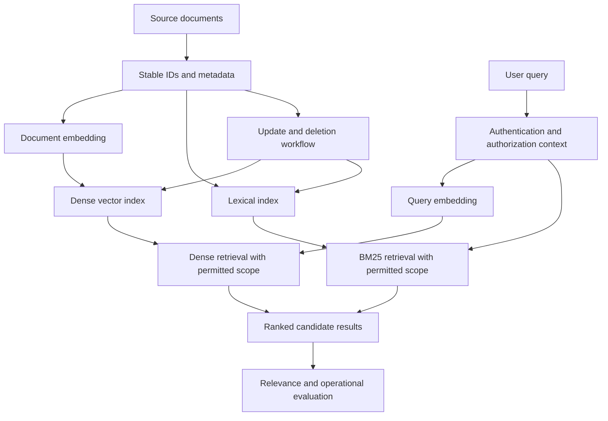

# 16. Practice and Revision

## Purpose

This chapter brings together the core Level 7 skills needed to build and evaluate a small semantic-search prototype. The goal is not to build a production-scale RAG system. It is to create a reproducible retrieval experiment, explain the evidence behind each result, and identify limitations.

<br/>

## Learning objectives

By the end of this chapter, you should be able to:

- Generate compatible document and query embeddings using the model's documented conventions.
- Compare dense retrieval with BM25 using a fixed query set and relevance judgments.
- Calculate retrieval metrics and interpret their limitations.
- Compare exact nearest-neighbor search with an approximate index where feasible.
- Apply metadata restrictions and server-enforced permissions.
- Verify that source updates and deletions are reflected in active retrieval.
- Explain why each returned document was eligible for retrieval and whether it was relevant.

<br/>

## 1. Prototype requirements

Build a small prototype using a synthetic or appropriately licensed corpus. Keep the scope manageable: a few dozen to a few hundred documents and at least 10 representative queries are sufficient for a first experiment.

The prototype should include:

1. Stable document IDs and source metadata.
2. A pinned embedding model and documented query/document encoding conventions.
3. A dense retrieval baseline.
4. A BM25 lexical baseline over the same corpus.
5. A relevance-labeled query set.
6. Precision@k, Recall@k, and MRR where the labels support those metrics.
7. Exact nearest-neighbor search and an approximate index comparison where feasible.
8. Metadata filtering and server-enforced authorization.
9. Tests for source updates and deletions.
10. A report of measured quality, latency, index size, failures, and known limitations.

Do not treat an approximate index as mandatory if the corpus or selected library makes the comparison impractical. If you omit it, document why and describe how you would test it at larger scale.

<br/>

## 2. System overview



This is a conceptual architecture. Actual index, filter, and permission mechanisms depend on the selected backend. The important property is that authorization must be enforced by a trusted server-side component before restricted content is exposed—not by a client-supplied filter alone.

<br/>

## 3. Prepare the corpus and labels

Use stable IDs for documents and record metadata required by the application. Example:

```python
documents = [
    {
        "id": "d1",
        "text": "Reset your password from Security Settings.",
        "metadata": {"category": "account", "tenant_id": "team-a"},
    },
    {
        "id": "d2",
        "text": "Refunds are usually processed within five business days.",
        "metadata": {"category": "billing", "tenant_id": "team-a"},
    },
    {
        "id": "d3",
        "text": "Enable multi-factor authentication to protect your account.",
        "metadata": {"category": "security", "tenant_id": "team-b"},
    },
    {
        "id": "d4",
        "text": "Find invoice history on the Payments page.",
        "metadata": {"category": "billing", "tenant_id": "team-a"},
    },
]
```

These four documents illustrate the data shape only; use a larger corpus for the actual exercise.

Create at least 10 queries that cover:

- Paraphrases and natural-language questions.
- Exact phrases, identifiers, or important keywords.
- Short and ambiguous queries.
- Domain-specific terminology.
- Queries for which no document is relevant, if your application must handle no-match cases.

For every query, record the relevant document IDs before comparing rankings where practical. Use consistent relevance instructions and state if labels are incomplete. A document that was not labeled relevant is not necessarily proven irrelevant if the judgment set is incomplete.

Example label format:

```python
relevance = {
    "q1": {"d1"},
    "q2": {"d2"},
    "q3": {"d4"},
}
```

<br/>

## 4. Generate compatible document and query embeddings

Use the chosen model's official documentation to determine how documents and queries should be encoded. Some models use the same encoding path; others require separate query and document methods, prefixes, or task instructions.

Record at least:

- Exact model identifier and version, where available.
- Query and document encoding convention.
- Vector dimensions.
- Normalization behavior.
- Similarity metric.
- Input-length limit and truncation behavior.

Conceptual adapter pattern:

```python
# Replace these functions with the exact provider/library implementation.
def encode_documents(texts: list[str]):
    """Return one vector per document using the documented document convention."""
    raise NotImplementedError

def encode_query(text: str):
    """Return one vector using the documented query convention."""
    raise NotImplementedError
```

Before indexing, validate that:

- The number of vectors equals the number of documents.
- Each vector has the expected dimension.
- All values are finite numbers.
- No unexpected zero vectors are present if cosine similarity is used.
- Query and document vectors are compatible under the selected model and metric.

Do not compare vectors from unrelated models merely because their dimensions match.

<br/>

## 5. Compare dense retrieval and BM25

Run both methods on the same document set and queries. Keep relevance labels, access restrictions, and other filters equivalent.

### Dense retrieval

1. Encode documents and queries using compatible conventions.
2. Score query vectors against document vectors with the selected metric.
3. Rank eligible documents by score.
4. Return the top \(k\) document IDs and scores.

<br/>

### BM25

1. Tokenize/index the same document text using the selected lexical implementation.
2. Apply the same eligibility and authorization constraints.
3. Score each query against eligible documents.
4. Rank and return the top \(k\) document IDs and scores.

BM25 and dense retrieval respond to different signals. Dense retrieval may match paraphrases even when words differ. BM25 may be strong for exact terms, product names, error codes, and rare identifiers. Treat these as hypotheses to test, not guarantees.

<br/>

### Metrics

For each query, calculate:

\[
\operatorname{Precision@k} =
\frac{\text{relevant results in top }k}{k}
\]

\[
\operatorname{Recall@k} =
\frac{\text{relevant results in top }k}{\text{all known relevant documents}}
\]

MRR averages the reciprocal rank of the first relevant result across queries. If no relevant result appears in the evaluated list, that query's reciprocal rank is zero. Recall is undefined when no relevant documents are labeled; handle no-match queries separately.

Report per-query results as well as averages. A single aggregate metric can hide failures for exact-match queries, particular languages, or a specific document category.

<br/>

## 6. Compare exact search with an approximate index

Exact nearest-neighbor search evaluates every eligible vector under the chosen scoring rule, or otherwise returns the exact top results for that setup. Approximate nearest-neighbor (ANN) indexes trade some retrieval fidelity for potential gains in latency, memory use, or scalability.

Where feasible:

1. Use the same vectors, metric, filters, and query vectors.
2. Run exact search to establish the reference top-\(k\) neighbors.
3. Run the ANN index with documented settings.
4. Measure query latency and index/resource footprint under comparable conditions.
5. Calculate ANN neighbor recall against the exact reference.
6. Separately evaluate application relevance using the human-labeled relevant documents.

**Do not confuse ANN neighbor recall with application Recall@k.** ANN neighbor recall measures how well the approximate method recovers the exact search neighbors. Application Recall@k measures how many known relevant documents are found.

If an ANN result differs from exact search, determine whether the difference affects relevant results and whether the performance gain justifies the approximation.

<br/>

## 7. Apply metadata restrictions and server-enforced permissions

Metadata filters narrow the eligible corpus by attributes such as category, language, date, or tenant. Authorization determines which records the current user is allowed to access. These concepts overlap in implementation but are not interchangeable: a filter supplied or modified by an untrusted client is not, by itself, a security boundary.

A safe high-level request flow is:

1. Authenticate the requester.
2. Resolve the user's permissions on the trusted server.
3. Derive the allowed document scope from trusted identity and policy data.
4. Apply that scope to retrieval through a backend-supported filter or isolated namespace/index.
5. Validate returned records against the authorized scope before exposing content.
6. Log the decision without unnecessarily logging sensitive text.

Never rely only on a client-provided `tenant_id`, `user_id`, or permission filter. The server should derive or validate authorization constraints from trusted identity and policy data. If the backend cannot reliably enforce the required scope, enforce it in a trusted server-side layer and test for leakage.

<br/>

### Authorization test matrix

| Test | Expected result |
|---|---|
| User searches for an allowed document | It may be returned if relevant |
| User searches for another tenant's document | It is never exposed |
| Client changes a tenant/filter parameter | Server policy still restricts results |
| Dense retrieval is used | Permission constraints still apply |
| BM25 fallback is used | Permission constraints still apply |
| Cached results are served | Cache keys and validation preserve authorization |
| Source permission is revoked | Content is no longer returned after the documented update/consistency window |

Measure authorization correctness separately from relevance metrics. A forbidden document can be semantically relevant and still be an invalid result.

<br/>

## 8. Test source updates and deletions

For each source, maintain a stable source ID and track the current set of indexed passage IDs. If a source changes, update current records and remove stale passage IDs that no longer belong to it.

Test this lifecycle:

1. Insert a source with one or more passages.
2. Confirm its expected content can be retrieved.
3. Edit the source so a passage changes.
4. Confirm the current content is searchable and the old content is no longer returned.
5. Shorten or restructure the source so a previous passage becomes obsolete.
6. Confirm obsolete passage IDs are removed or excluded.
7. Delete the source.
8. Confirm active retrieval no longer returns its content.
9. Record the backend's behavior for caches, replicas, snapshots, backups, and retention separately.

An absent result from one search is not sufficient proof of deletion. Use targeted tests, and distinguish removal from active retrieval from complete deletion across retained copies.

<br/>

## 9. Experiment log and results report

Change one primary factor at a time—for example, embedding model, similarity metric, filter, or index configuration. Keep the corpus, query set, relevance labels, and other settings fixed wherever possible.

Use a simple experiment table:

| Field | Dense baseline | BM25 baseline | ANN variant (if tested) |
|---|---|---|---|
| Corpus revision | | | |
| Query/relevance set | | | |
| Model/configuration | | N/A | |
| Metric/index settings | | Tokenizer and BM25 settings | |
| Precision@5 | | | |
| Recall@5 | | | |
| MRR | | | |
| Query latency (p50/p95) | | | |
| Document indexing/encoding time | | | |
| Index size / memory | | | |
| Failures | | | |
| Authorization tests | | | |
| Update/delete tests | | | |
| Known limitations | | | |

Record hardware, batch size, concurrency, warm-up behavior, corpus size, and timing methodology. Do not compare runtime values without describing the conditions.

<br/>

### Failure analysis

For each important failure, record:

- Query and expected relevant document IDs.
- Results returned by dense search and BM25.
- Whether the expected document exists and is indexed.
- Whether it was eligible under metadata and authorization rules.
- Whether an update or deletion left stale data.
- The likely cause, supporting evidence, and next experiment.

This is the key checkpoint: **explain both why a result was eligible for retrieval and whether it was relevant.** Eligibility is determined by corpus membership, filters, permissions, and lifecycle state; relevance is judged against the user's information need.

<br/>

## 10. Final practice checklist

- [ ] Use a documented embedding model and compatible query/document conventions.
- [ ] Validate vector dimensions, numeric values, and normalization assumptions.
- [ ] Prepare at least 10 representative queries and relevance labels.
- [ ] Compare dense retrieval and BM25 on the same corpus and queries.
- [ ] Calculate Precision@k, Recall@k, and MRR where appropriate.
- [ ] Compare exact and approximate nearest-neighbor search where feasible.
- [ ] Report ANN neighbor recall separately from application relevance.
- [ ] Record latency, document encoding time, index size, and failures.
- [ ] Enforce permissions on the server and test every retrieval path.
- [ ] Verify source edits and deletions, including stale passages.
- [ ] Change one primary factor at a time.
- [ ] Document incomplete relevance judgments and other dataset limitations.
- [ ] Produce a final recommendation with measured trade-offs.

<br/>

## 11. Deliverable: semantic-search prototype report

Submit a short report containing:

1. **Use case and corpus:** intended search task, source description, document count, metadata, and limitations.
2. **Embedding setup:** model/version, query/document conventions, dimensions, normalization, and metric.
3. **Evaluation set:** queries, relevance judgments, and labeling procedure.
4. **Baseline results:** dense retrieval and BM25 metrics, plus per-query examples.
5. **ANN comparison:** exact-search reference, ANN neighbor recall, latency, and index footprint, or a reason for omitting it.
6. **Security and lifecycle tests:** metadata restrictions, authorization, updates, and deletion results.
7. **Operational measurements:** runtime, index size, failures, and test conditions.
8. **Failure analysis:** paraphrase and exact-match cases, eligibility checks, and likely causes.
9. **Recommendation:** selected configuration, measured benefits, trade-offs, assumptions, and what should be tested next.

<br/>

### Example conclusion structure

> **Selected configuration:** [method/model and configuration]  
> **Evidence:** [quality metrics and representative query outcomes]  
> **Operational trade-off:** [latency, indexing time, index size, and cost if measured]  
> **Eligibility guarantees:** [how metadata, permissions, and lifecycle state are enforced]  
> **Limitations:** [label completeness, corpus coverage, query sample, and untested conditions]  
> **Next experiment:** [one specific factor to change]

Do not fill the report with invented results. Run the experiment and report measured values. If a metric cannot be measured, state why.

<br/>

## Checkpoint

You should be able to explain:

1. How query and document embeddings are made compatible.
2. Why dense retrieval and BM25 should be compared on the same corpus and query set.
3. What Precision@k, Recall@k, and MRR tell you.
4. How ANN neighbor recall differs from application relevance.
5. How metadata restrictions and server-enforced permissions determine eligibility.
6. How you verified that updates and deletions took effect.
7. Which measured trade-offs justify the selected configuration.
8. What limitations prevent stronger conclusions.

**Checkpoint standard:** Explain why each result was eligible for retrieval and assess whether it is relevant. Support the prototype recommendation with measurements, controlled comparisons, lifecycle/security tests, and clearly stated limitations.

<br/>

## Key takeaways

- A useful prototype must be reproducible and evaluated against explicit relevance judgments.
- Dense retrieval, BM25, and ANN indexes answer different technical questions and should be evaluated accordingly.
- Authorization and lifecycle correctness are separate from relevance quality.
- A returned document must be both **eligible** under policy and **relevant** to the query.
- Report measured results and limitations rather than assuming a method is best in advance.

<br/>

## References

- [Sentence Transformers documentation](https://www.sbert.net/) — embedding and semantic-search patterns.
- [Rank-BM25 repository](https://github.com/dorianbrown/rank_bm25) — lightweight BM25 implementation for experiments.
- [FAISS repository](https://github.com/facebookresearch/faiss) — exact and approximate vector-search indexing.
- [Chroma documentation](https://docs.trychroma.com/) — vector collection and retrieval operations.
- [Pinecone documentation](https://docs.pinecone.io/) — managed vector indexing, filtering, and operational concepts.
- [Weaviate documentation](https://docs.weaviate.io/) — vector search, filters, and deployment concepts.
