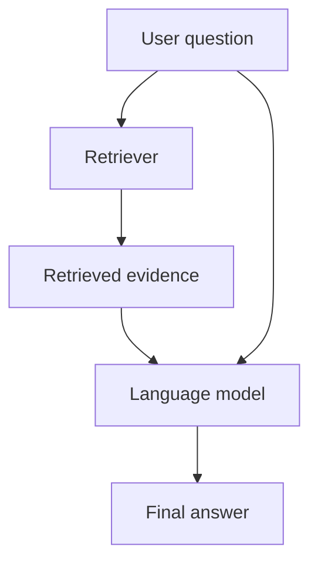
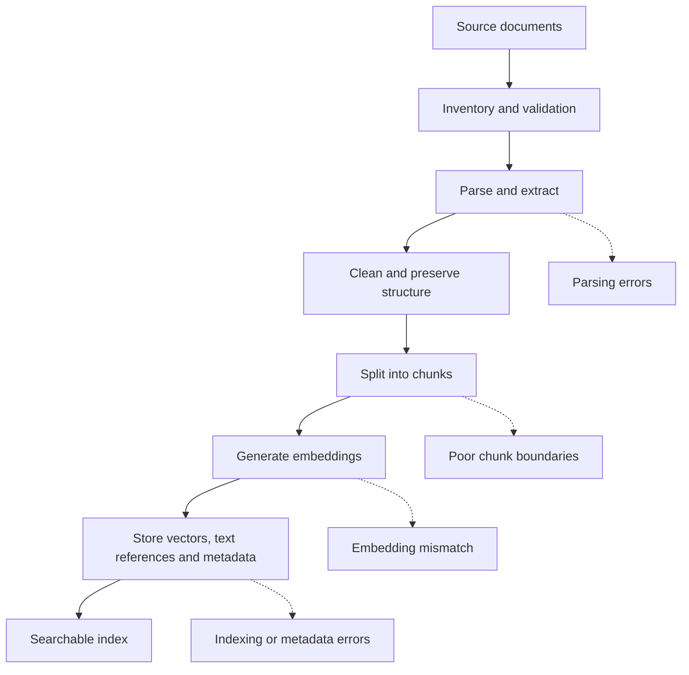
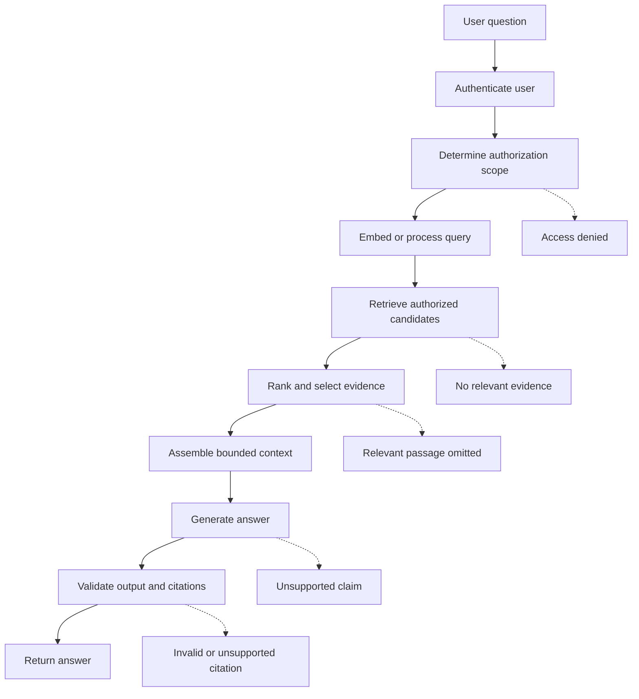
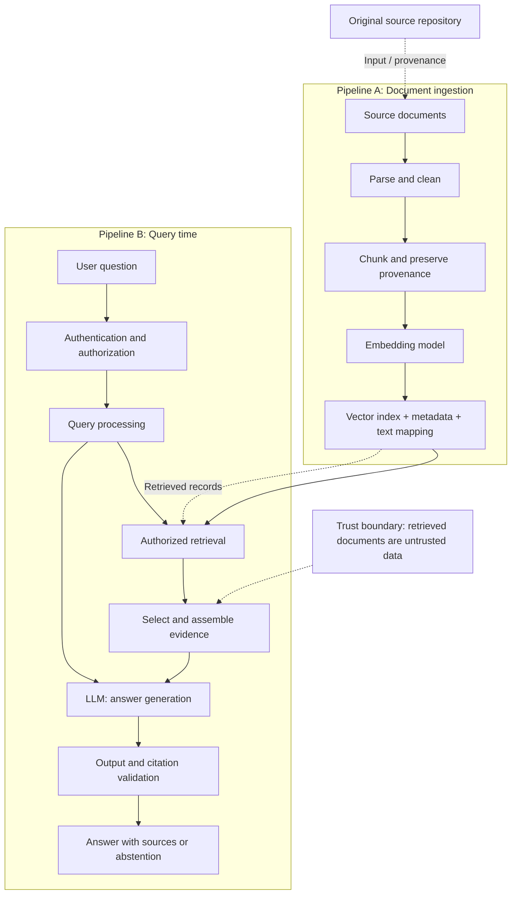
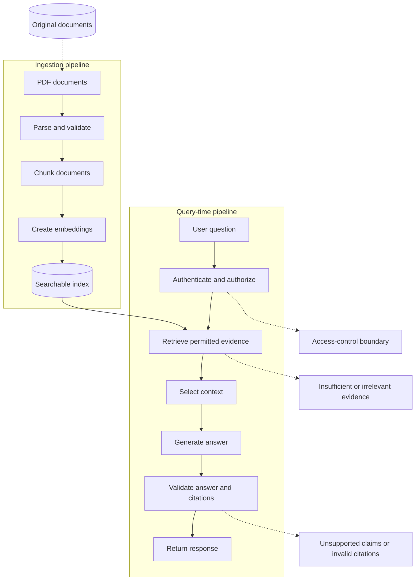

# 01. RAG Architecture and Data Flow

**Level 8: Retrieval-Augmented Generation (RAG) · Generative AI Engineering**

## 1. Learning Objectives

After completing this chapter, you should be able to:

- Define Retrieval-Augmented Generation (RAG) and distinguish it from fine-tuning.
- Explain the two major RAG pipelines: **document ingestion** and **query-time processing**.
- Trace how documents are parsed, chunked, embedded, and indexed.
- Explain how authorization, retrieval, context assembly, generation, and validation work together.
- Distinguish a model’s pretrained knowledge from evidence supplied by a retrieval system.
- Identify potential failure points and measurements at each pipeline stage.

<br/>

## 2. What Is Retrieval-Augmented Generation?

**Retrieval-Augmented Generation (RAG)** is an architecture that combines information retrieval with a generative model. Before generating an answer, the application retrieves relevant information from an external knowledge source and supplies that information to the model as context.

Instead of relying only on the information encoded in the model's parameters, a RAG application can use documents such as PDFs, technical manuals, company policies, research papers, product documentation, and database records.

<br/>

### Example

Suppose you build an AI assistant that answers questions about a company's leave policy.

The knowledge base contains this statement:

> Employees receive 18 days of annual leave per calendar year.

A user asks:

> How many annual leave days do employees receive?

A RAG application retrieves the relevant policy passage and supplies it to the language model. The model then generates an answer based on the supplied evidence.

<br/>

### Simplified RAG flow



This is a simplified illustration. A production implementation also needs access control, context budgeting, error handling, and checks that the answer is supported by the retrieved passage.

<br/>

### Main components of a RAG system

| Component | Responsibility |
|---|---|
| Knowledge source | Stores the original documents or records. |
| Parser | Extracts usable text and structure from source files. |
| Chunker | Divides documents into manageable passages. |
| Embedding model | Converts text into numerical vectors for semantic retrieval. |
| Index | Stores searchable vectors, text references, and metadata. |
| Retriever | Finds candidate passages relevant to a query. |
| Context assembler | Selects and arranges evidence for the model. |
| Generator | Produces an answer using the question and supplied context. |
| Validator | Checks output structure and, where implemented, evidence support. |

The generator does not perform every step itself. Most of the RAG workflow is application-controlled software that operates around the model.

<br/>

## 3. RAG Versus Fine-Tuning

RAG and fine-tuning are different approaches to improving a model-backed application. They solve different problems and can also be combined.

**RAG supplies relevant information at inference time. Fine-tuning changes model parameters through an additional training process.**

| Aspect | RAG | Fine-tuning |
|---|---|---|
| Primary purpose | Supply relevant external evidence | Adapt model behavior, capabilities, or response patterns |
| When it happens | During application inference, after retrieval | During a training or adaptation process |
| Model weights | Remain unchanged by retrieval | Updated during ordinary gradient-based fine-tuning |
| Knowledge updates | Update or re-index the knowledge source | May require another training run to incorporate changes |
| Source attribution | Can preserve document IDs and citations | Does not inherently provide source-level citations |
| Typical use case | Policy Q&A, document search, knowledge assistants | Specialized output formats, task behavior, domain-specific patterns |
| Main dependency | Quality and availability of retrieved evidence | Quality of training data and adaptation process |

Fine-tuning does not guarantee that every fact in its training data will be recalled accurately. Similarly, RAG does not guarantee correct answers merely because documents are retrieved.

<br/>

### Example: choosing the approach

- **Question:** What does the latest company policy say about parental leave?  
  **Likely approach:** RAG, because the application needs access to current policy documents.

- **Question:** How should a model consistently transform support tickets into a specialized classification format?  
  **Possible approach:** Prompting first, followed by fine-tuning if repeated evaluations show that adaptation is beneficial.

- **Question:** Can the model use a specialized response style while answering from the latest technical manuals?  
  **Possible approach:** Fine-tuning for behavior, combined with RAG for current evidence.

RAG is not a replacement for every form of model customization, and fine-tuning is not a substitute for a reliable, updateable knowledge repository.

<br/>

## 4. The Two Pipelines of a RAG Architecture

A RAG application is best understood as two connected but separate workflows.

1. **Ingestion pipeline:** Prepares source documents and makes them searchable. It usually runs when documents are first added or when they change.
2. **Query-time pipeline:** Processes a user's question, retrieves authorized evidence, and generates an answer. It runs whenever a question is submitted.

The ingestion pipeline prepares the knowledge base; the query-time pipeline uses it.

<br/>

### 4.1 Ingestion Pipeline

The ingestion pipeline transforms raw source documents into searchable records.



<br/>

#### Step 1: Source Collection

Collect the documents or records that the application is authorized to use.

Examples include:

- PDF files and technical manuals
- HTML pages and Markdown documents
- Company policies and internal documentation
- Database records and structured data

Record source identity, ownership, version, and access permissions where applicable.

<br/>

#### Step 2: Parsing and Extraction

Extract useful text and structure from each source.

For example, a PDF parser may extract paragraphs, headings, and page text. A scanned PDF may require Optical Character Recognition (OCR).

The extracted content should retain enough information to identify its original source and location.

<br/>

#### Step 3: Chunking

Divide the extracted content into smaller passages called *chunks*.

For example, a policy document might be divided into chunks covering eligibility, annual leave, sick leave, and parental leave.

Chunking helps retrieve focused evidence rather than sending an entire large document to the model. Poor chunk boundaries, however, can separate a fact from the qualifications needed to interpret it correctly.

<br/>

#### Step 4: Encoding

Pass each chunk through an embedding model to obtain a numerical vector.

Conceptually:

```text
Text chunk → Embedding vector
```

The vector represents learned semantic features of the text. Similarity calculations can then help locate passages relevant to a query.

Document and query embeddings must use compatible embedding conventions, as discussed in Level 7.

<br/>

#### Step 5: Indexing and Storage

Store the vectors in a searchable index and maintain the associated text or a reference to it, along with metadata.

A record might contain:

```python
{
    "source_id": "leave_policy_v1",
    "chunk_id": "leave_policy_v1_chunk_03",
    "text": "Employees receive 18 days of annual leave...",
    "page": 4,
    "version": 1
}
```

This is an illustrative record, not a complete production schema. A real implementation may also include document hashes, timestamps, tenant identifiers, and access-control metadata.

**Important:** Embedding a document does not itself make it searchable. The vectors and their mappings must be stored in a usable index, and the application must be able to retrieve the corresponding evidence.

<br/>

### 4.2 Query-Time Pipeline

The query-time pipeline takes a user question and returns an answer grounded in the available evidence.



<br/>

#### Step 1: Authentication and Authorization

Determine who is asking and which sources that user may access.

Authentication establishes identity; authorization determines what that identity is allowed to access.

Authorization must be enforced by application-controlled mechanisms, not merely by asking the language model to respect permissions.

<br/>

#### Step 2: Query Processing

Prepare the question for retrieval. Depending on the system, this may involve query embedding, normalization, or a controlled rewrite.

For example:

- Original question: “How many leave days do we get?”
- Contextualized query: “How many annual leave days do employees receive under the company leave policy?”

A rewrite must preserve the user's intent and must not invent assumptions.

<br/>

#### Step 3: Retrieval

Search the index for passages relevant to the question. The retriever may use dense vector search, lexical retrieval such as BM25, or a hybrid approach.

The system should apply mandatory access restrictions to every retrieval route before unauthorized information can reach later stages.

<br/>

#### Step 4: Context Assembly

Select the most useful evidence and organize it into a context packet.

The application must consider:

- Relevance to the question
- Duplicate or overlapping passages
- Conflicting or outdated information
- Available model context capacity
- Source identifiers needed for citations

Retrieving ten passages does not mean all ten should automatically be sent to the model.

<br/>

#### Step 5: Grounded Generation

Send the model the question, trusted instructions, and selected evidence.

The prompt should specify how the model should use the evidence and what to do when the evidence is insufficient.

<br/>

#### Step 6: Validation and Response

Check the generated result before returning it. Depending on the application's requirements, validation can include:

- Output schema validation
- Verification that cited source IDs exist in the supplied evidence
- Checks that citations support the associated claims
- Missing-evidence and uncertainty handling
- Removal of unauthorized information

A valid JSON response or a syntactically valid citation does not, by itself, establish factual correctness.

<br/>

## 5. End-to-End RAG Architecture

The following diagram connects the two pipelines and distinguishes the original knowledge source, the retrieval index, and the external language model.



*Conceptual architecture: the embedding model and generator may be separate services or components, and the vector index may be part of a larger search or database system.*

<br/>

### Important Data and Trust Boundaries

- **Source-to-parser boundary:** Files may be malformed, oversized, or contain untrusted content.
- **Index boundary:** Vectors, text, and metadata must remain correctly associated with source records and versions.
- **Authorization boundary:** The user's access scope must constrain retrieval and source access.
- **Retrieval-to-model boundary:** Retrieved documents are evidence, not trusted instructions. They may contain irrelevant or malicious text, including indirect prompt injection.
- **Model-to-application boundary:** Generated text must be treated as untrusted output until validated.

These boundaries matter because a RAG system is not just a model connected to a vector database. It is a data-processing and access-controlled application.

<br/>

## 6. Stored Model Knowledge Versus Supplied Evidence

A key concept in RAG engineering is the distinction between what the model has learned during training and what the application supplies at inference time.

### 6.1 Stored Model Knowledge

The model's parameters encode patterns learned from training data. These can support language understanding, reasoning-like behavior, and general knowledge, but they do not guarantee accurate recall of a particular fact.

<br/>

### 6.2 Supplied Evidence

Retrieved passages, document excerpts, metadata, and source identifiers are added to the current request. They provide task-specific evidence that the model can use when generating its response.

For example, a model may have general knowledge about employee leave policies but no reliable knowledge of your company's current policy.

RAG can retrieve the actual policy and include its relevant passage in the prompt.

| Property | Model parameters | Retrieved evidence |
|---|---|---|
| Where it resides | Learned model weights | External documents and retrieval records |
| How it becomes available | Training and adaptation | Retrieval and context assembly |
| How it is updated | Training or model replacement | Source updates and index maintenance |
| Source-level traceability | Not inherently available | Possible through preserved source metadata |
| Reliability | Can be incomplete or outdated | Depends on source quality, freshness, and retrieval |

<br/>

### Why Retrieval Does Not Update Model Weights

During ordinary RAG inference, the application reads evidence from an external knowledge source and includes selected text in the model's input.

The model then computes an output using its existing parameters and the supplied context. The retrieval operation does not perform backpropagation, an optimizer step, or a weight update.

Conceptually:

$$
\text{Answer} = f_\theta(\text{question}, \text{retrieved evidence})
$$

Here, $\theta$ represents the model's existing parameters. Ordinary retrieval and generation do not change $\theta$.

Therefore, updating a policy document and refreshing its index can make new information available without retraining the language model, provided the ingestion and indexing process succeeds.

This does not mean the model permanently learns the retrieved fact. A future request must retrieve or otherwise supply the relevant information again.

<br/>

## 7. Measuring the Two Pipelines

A RAG application should be evaluated stage by stage. Fluent answers alone are not enough to determine whether the system works correctly.

### 7.1 Ingestion Pipeline Measurements

| Stage | What to measure | Example failure |
|---|---|---|
| Source collection | Source coverage, duplicates, version counts | A required document is missing |
| Parsing | Extraction success rate, text completeness | PDF text is garbled |
| Chunking | Chunk counts, size distribution, boundary quality | A qualification is separated from its claim |
| Embedding | Processing errors, vector dimensions, model consistency | Query and document embeddings are incompatible |
| Indexing | Indexed record count, metadata completeness, retrieval checks | A chunk is missing or mapped to the wrong source |

For example, a document ingestion success rate can be calculated as:

$$
\text{Success rate} =
\frac{\text{Successfully processed documents}}
{\text{Documents attempted}}\times100\%
$$

If 95 out of 100 documents are processed successfully, the success rate is 95%. The five failures still need investigation; the rate alone does not establish that the remaining 95 documents were parsed correctly.

<br/>

### 7.2 Query-Time Pipeline Measurements

| Stage | What to measure | Example failure |
|---|---|---|
| Authorization | Allowed/denied decisions, cross-user access tests | Unauthorized evidence is retrieved |
| Retrieval | Recall@k, Precision@k, MRR, or nDCG | The correct passage is not in the results |
| Context assembly | Evidence coverage, duplicates, token usage | The relevant passage is dropped |
| Generation | Correctness, relevance, completeness, faithfulness | The model adds unsupported facts |
| Citation validation | Citation validity and claim support | A real source is cited for a claim it does not support |
| End-to-end service | Latency, token usage, cost, error rate | Slow or expensive responses |

Retrieval metrics are covered in greater depth in Chapter 18 and Level 13. At this stage, the key principle is to distinguish retrieval quality from answer quality.

<br/>

### 7.3 Diagnosing Failures by Stage

Consider this question:

> How many annual leave days do employees receive?

The correct answer in the source is 18 days.

- If parsing extracts `8 days`, the failure originates in ingestion.
- If parsing is correct but retrieval returns an unrelated policy section, investigate retrieval.
- If the correct passage is retrieved but excluded from the context packet, investigate context selection.
- If the model receives the correct passage but answers `20 days`, investigate generation and evidence adherence.
- If the answer says `18 days` but cites a source about sick leave, investigate citation support.

**Engineering rule:** Locate the failing stage before changing the prompt, embedding model, chunk size, or retrieval strategy. Changing multiple components simultaneously makes it difficult to identify the actual cause.

<br/>

## 8. Practice: Draw a Two-Pipeline RAG Diagram

**Objective:** Demonstrate that you understand the data flow, trust boundaries, and failure points in a RAG application.

### Exercise

Design a RAG architecture for an employee-policy assistant using a collection of PDF documents.

Your diagram should include:

1. **Ingestion:** PDF collection → parsing → chunking → embedding → indexing.
2. **Query time:** User question → authentication and authorization → retrieval → context assembly → generation → validation → response.
3. **Storage:** Original documents, searchable index, and source metadata.
4. **Trust boundaries:** Untrusted documents, access-control enforcement, and generated output.
5. **Failure points:** Parsing errors, missing evidence, retrieval errors, unsupported answers, and invalid citations.

You can use the following Mermaid diagram as a starting point and extend it.



<br/>

### Practice Questions

Try answering each question before checking the answer.

**1. Why does RAG need an ingestion pipeline?**

**Answer:** To parse source documents, create chunks and embeddings, preserve metadata, and build a searchable index before queries can retrieve evidence.

**2. Does creating an embedding update the language model's weights?**

**Answer:** No. Embedding generation produces a vector representation. It does not fine-tune the language model.

**3. What happens if the correct passage is not retrieved?**

**Answer:** The generator may lack the necessary evidence. The system should diagnose retrieval quality and avoid presenting unsupported claims as established facts.

**4. Why must authorization happen before evidence reaches the model?**

**Answer:** To prevent unauthorized content from entering the context, external model requests, citations, or responses.

**5. Can a RAG answer still be wrong when the correct passage was retrieved?**

**Answer:** Yes. The model may misinterpret the passage, omit qualifications, introduce unsupported claims, or produce incorrect citations.

<br/>

## 9. Chapter Checkpoint

**Question:** Explain why retrieval supplies evidence without updating model weights.

**Answer:** Retrieval searches an external knowledge source and supplies selected passages as input context to a language model. During ordinary RAG inference, the model generates a response using its existing parameters. No training step or parameter update occurs. Consequently, the knowledge source can be updated and re-indexed without retraining the model, and the new evidence becomes available to future queries when it is successfully retrieved.

<br/>

## 10. Key Takeaways

- RAG combines information retrieval with generation to ground answers in an external knowledge source.
- The ingestion pipeline prepares documents; the query-time pipeline retrieves evidence and generates answers.
- Embeddings and indexes make documents searchable but do not train the generator.
- Retrieved evidence must be relevant, current, authorized, and traceable to its source.
- Prompt instructions can encourage grounded answers, but validation is still necessary.
- Retrieval quality, answer quality, citation support, security, latency, and cost should be measured separately.
- Diagnose pipeline failures at the stage where they originate rather than relying on answer fluency.

<br/>

## 11. References

- [Retrieval-Augmented Generation for Knowledge-Intensive NLP Tasks — Original research paper](https://arxiv.org/abs/2005.11401)
- [Sentence Transformers — Semantic Search](https://www.sbert.net/examples/sentence_transformer/applications/semantic-search/README.html)
- [FAISS — Similarity Search and Clustering of Dense Vectors](https://github.com/facebookresearch/faiss)
- [OWASP — Top 10 for Large Language Model Applications](https://genai.owasp.org/)


<br/>


**Next chapter:** `02_document_ingestion_and_parsing.md` — Document source inventories, parsing, provenance, ingestion records, and handling malformed or partially processed files.
