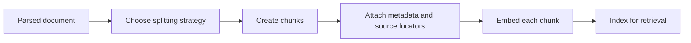
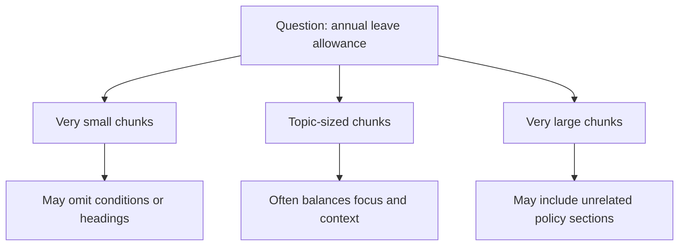

# 04. Chunking Strategies and Overlap

**Level 8: Retrieval-Augmented Generation (RAG) · Generative AI Engineering**

## 1. Learning Objectives

After completing this chapter, you should be able to:

- Explain why documents are divided into chunks before embedding and retrieval.
- Compare fixed-size, recursive, sentence-based, and structure-aware chunking.
- Choose chunk sizes with token limits and downstream context budgets in mind.
- Preserve headings, table context, source locators, and document provenance.
- Explain how overlap affects context continuity, duplicate results, indexing cost, and retrieval noise.
- Design stable passage IDs and source mappings for updates and citations.
- Compare chunking configurations with representative questions rather than assuming one size works best for every corpus.

<br/>

## 2. What Is Chunking?

**Chunking** is the process of dividing a document into smaller units called *chunks* so that a retrieval system can index and return useful passages rather than handling an entire document as one large unit.

Suppose a company policy contains these sections:

```text
Employee Leave Policy
├── Annual Leave
├── Sick Leave
├── Parental Leave
└── Leave Application Procedure
```

If the entire document is stored as one retrieval unit, a question about annual leave may return the complete policy, including unrelated sections. If it is divided into very small fragments, the answer may be separated from important conditions or definitions.

The goal is not simply to create small chunks. It is to create chunks that are **retrievable, sufficiently self-contained, traceable to their sources, and useful as evidence**.

<br/>

### Where chunking fits in RAG



Chunking usually happens during ingestion, after parsing and before embedding and indexing. When the source changes, affected chunks may need to be regenerated.

<br/>

## 3. Why Chunk Size Matters

Chunk size influences how much information each retrieval result contains.

### Chunks that are too small

Potential problems:

- A fact may be separated from its explanation or qualification.
- Pronouns such as “they” or references such as “this policy” may lose their antecedents.
- Table values may become detached from their column headers.
- Retrieval may return fragments that are difficult for the generator to interpret.
- More chunks may be created, increasing indexing and metadata overhead.

<br/>

### Chunks that are too large

Potential problems:

- A passage may discuss several unrelated topics.
- The embedding may represent multiple themes, making similarity less specific.
- Relevant evidence can be harder to identify within a large retrieved passage.
- More tokens may be consumed in the generation context.
- Retrieval may return redundant information that crowds out other useful evidence.

<br/>

### Conceptual comparison



A topic-sized chunk is not universally optimal. The right choice depends on the structure of the documents, the embedding model, retrieval method, questions, and context budget.

<br/>

## 4. Common Chunking Strategies

### 4.1 Fixed-Size Chunking

Fixed-size chunking divides text into units with a target size, often measured in characters or tokens. A configured overlap can allow adjacent chunks to share some content.

Example:

```text
Document: 1,000 tokens
Chunk size: 200 tokens
Overlap: 40 tokens

Chunk 1: tokens 0–199
Chunk 2: tokens 160–359
Chunk 3: tokens 320–519
...
```

<br/>

**Advantages**

- Simple to implement.
- Predictable approximate chunk sizes.
- Useful as a baseline for experiments.
- Can work well with consistently formatted text.

<br/>

**Limitations**

- May split sentences, paragraphs, table rows, or sections.
- May separate a heading from the content it describes.
- Character-based sizes do not correspond reliably to model token counts.

Use fixed-size chunking as a baseline, but inspect boundaries rather than assuming the result is meaningful.

<br/>

### 4.2 Recursive Chunking

Recursive chunking attempts to split text using increasingly fine-grained separators until chunks fit the configured size.

A typical separator preference might be:

1. Section or paragraph boundaries
2. Newlines
3. Sentence boundaries
4. Spaces
5. Individual characters as a last resort

Exact behavior depends on the implementation and configuration.

<br/>

**Advantages**

- Often preserves paragraphs and sentences better than blind fixed-size slicing.
- Provides a useful general-purpose baseline for prose.
- Can reduce awkward splits while respecting approximate size limits.

<br/>

**Limitations**

- Separator rules may not reflect the true structure of every document.
- Tables, code, and multi-column PDF output can still be split incorrectly.
- A recursive splitter does not automatically understand the semantic meaning of a section.

<br/>

### 4.3 Sentence-Based Chunking

Sentence-based chunking splits text at sentence boundaries and groups sentences until a target size is reached.

Example:

```text
Chunk 1:
Employees receive 18 days of annual leave.
Unused leave is handled according to company policy.

Chunk 2:
Submit leave requests through the employee portal.
Manager approval is required before leave begins.
```

<br/>

**Advantages**

- Avoids splitting many sentences in the middle.
- Can produce readable evidence passages.
- Useful when sentence boundaries are reliably detected.

<br/>

**Limitations**

- Sentence segmentation can fail with abbreviations, unusual punctuation, or OCR errors.
- One sentence may be too long or may depend on previous context.
- Grouping sentences by count alone does not guarantee a suitable token length.

<br/>

### 4.4 Structure-Aware Chunking

Structure-aware chunking uses document organization to determine boundaries. It may split by:

- Headings and subheadings
- Sections or paragraphs
- HTML elements or Markdown headings
- PDF page and layout regions
- Tables, lists, or code blocks
- Records or rows in structured data

Example:

```text
Document: Employee Leave Policy

Chunk A
Heading: Annual Leave
Content: Employees receive 18 days of annual leave...

Chunk B
Heading: Sick Leave
Content: Eligible employees may take sick leave...
```

The heading can be included in the chunk text or preserved in metadata. Often, doing both is useful when the heading provides essential context.

<br/>

**Advantages**

- Preserves meaningful boundaries.
- Supports more interpretable retrieval and source citations.
- Can retain table and section context.

<br/>

**Limitations**

- Requires reliable structure extraction.
- Sections can be much larger than the target size and may need secondary splitting.
- Poorly structured documents may not expose usable boundaries.

<br/>

### Strategy comparison

| Strategy | Main boundary | Strength | Main risk |
|---|---|---|---|
| Fixed-size | Target characters or tokens | Simple, predictable baseline | Can split meaningful units |
| Recursive | Preferred separators in sequence | Often preserves prose structure | Separator rules may miss document semantics |
| Sentence-based | Sentence boundaries | Readable text units | Sentence detection can be unreliable |
| Structure-aware | Headings, sections, tables, or layout | Preserves document organization | Depends on extraction quality and may create oversized chunks |

No strategy is automatically best for every corpus. A production decision should be based on representative retrieval tests.

<br/>

## 5. Token-Aware Chunk Sizes

Chunk size is often configured in characters for simplicity, but embedding models and language models operate on tokens.

A **token** is a unit produced by a tokenizer. It may represent a word, part of a word, punctuation, or another text unit. There is no universal conversion from characters to tokens.

For example, code, identifiers, numbers, and multilingual text can tokenize differently from ordinary English prose.

<br/>

### Two different limits

1. **Embedding input limit:** The maximum input length accepted by the embedding model or endpoint.
2. **Generation context budget:** The space available for system instructions, conversation history, user question, retrieved evidence, and the expected answer.

A chunk must fit within the embedding model's supported input length. The retrieved context must also fit within the generator's context budget.

A conceptual context budget is:

$$
B_{\text{evidence}} =
B_{\text{context}}
- B_{\text{instructions}}
- B_{\text{history}}
- B_{\text{question}}
- B_{\text{output reserve}}
$$

This is a planning approximation. Actual APIs may impose additional limits or account for message formatting and multimodal content.

<br/>

### Practical guidance

- Use a tokenizer compatible with the target embedding model when possible.
- Treat the model's documented input limit as a hard constraint.
- Leave room for headings and metadata that will be included in the embedding input.
- Budget generation context separately from embedding input.
- Measure truncation and token usage in the actual pipeline.

A chunk that fits the embedding model may still be too large to retrieve several such chunks within the generation context.

<br/>

## 6. Implementing Chunking with Python

The examples below illustrate chunking behavior. They are small educational implementations, not a replacement for testing a production splitter against a representative corpus.

### 6.1 Fixed-size chunking with overlap

This character-based implementation makes the mechanics visible. It does **not** guarantee token-based limits.

```python
def fixed_size_chunks(
    text: str,
    chunk_size: int = 500,
    overlap: int = 80,
) -> list[str]:
    if chunk_size <= 0:
        raise ValueError("chunk_size must be positive")

    if overlap < 0 or overlap >= chunk_size:
        raise ValueError("overlap must be >= 0 and < chunk_size")

    chunks = []
    start = 0

    while start < len(text):
        end = min(start + chunk_size, len(text))
        chunk = text[start:end].strip()

        if chunk:
            chunks.append(chunk)

        if end == len(text):
            break

        start = end - overlap

    return chunks
```

Example:

```python
text = (
    "Employees receive 18 days of annual leave. "
    "Submit requests through the employee portal. "
    "Manager approval is required."
)

chunks = fixed_size_chunks(text, chunk_size=70, overlap=15)

for index, chunk in enumerate(chunks):
    print(f"Chunk {index}: {chunk!r}")
```

Inspect the output to see where sentences are split and where text is repeated. Small values are used here only to make the boundaries easy to observe.

<br/>

### 6.2 Recursive splitting with LangChain

If using LangChain, install the text-splitting package:

```bash
pip install langchain-text-splitters
```

A recursive splitter can prefer paragraph and sentence-like boundaries:

```python
from langchain_text_splitters import RecursiveCharacterTextSplitter

splitter = RecursiveCharacterTextSplitter(
    chunk_size=500,
    chunk_overlap=80,
    separators=["\n\n", "\n", ". ", " ", ""],
    length_function=len,
)

text = """
# Annual Leave

Employees receive 18 days of annual leave per calendar year.

# Application

Submit requests through the employee portal.
Manager approval is required.
"""

chunks = splitter.split_text(text)

for i, chunk in enumerate(chunks):
    print(f"\n--- Chunk {i} ---\n{chunk}")
```

Here, `chunk_size=500` means characters because `length_function=len`. It is not a token limit. Also, the separator list is a simple example: real sentence segmentation and Markdown structure may require more deliberate handling.

<br/>

### 6.3 Structure-aware chunking for Markdown headings

A simple first step is to split a Markdown document at level-one or level-two headings, then apply a secondary splitter to sections that are too large.

```python
import re

def split_markdown_sections(markdown: str) -> list[dict]:
    heading_pattern = re.compile(r"(?m)^(#{1,2})\s+(.+?)\s*$")
    matches = list(heading_pattern.finditer(markdown))

    if not matches:
        return [{
            "heading": None,
            "text": markdown.strip(),
        }] if markdown.strip() else []

    sections = []

    # Preserve any text before the first recognized heading.
    prefix = markdown[:matches[0].start()].strip()
    if prefix:
        sections.append({
            "heading": None,
            "text": prefix,
        })

    for i, match in enumerate(matches):
        end = matches[i + 1].start() if i + 1 < len(matches) else len(markdown)
        section_text = markdown[match.start():end].strip()

        sections.append({
            "heading": match.group(2).strip(),
            "text": section_text,
        })

    return sections
```

This example handles basic Markdown headings. It does not fully parse Markdown syntax, nested heading hierarchies, code fences, or every possible edge case. Use a Markdown parser when accurate structural parsing is required.

<br/>

## 7. Preserve Headings, Tables, and Source Locators

A chunk should not lose the information needed to interpret or cite it.

A practical chunk record might include:

```python
chunk_record = {
    "source_id": "employee_leave_policy",
    "source_version": "v2",
    "content_hash": "example-hash",
    "chunk_id": "employee_leave_policy_v2_chunk_0003",
    "section_path": ["Employee Leave Policy", "Annual Leave"],
    "pdf_page_index": 3,
    "text": (
        "Section: Annual Leave\n"
        "Employees receive 18 days of annual leave per calendar year."
    ),
}
```

The hash is illustrative. Use the actual source hash in a real pipeline.

Useful metadata includes:

- Stable source ID and source version
- Chunk ID
- Section path or heading
- PDF page index or other source locator
- Content hash or source revision reference
- Access-control metadata where required

<br/>

### Tables need special care

A table chunk should retain column headers and the relationship between each row's values. For example:

```text
Table: Annual Leave Allowance

Leave type | Annual allowance | Eligibility
Annual leave | 18 days | Permanent employees
Sick leave | 10 days | Subject to policy conditions
```

If the table is too large, split it by rows or logical groups while repeating the relevant headers and preserving a locator back to the original table.

<br/>

## 8. Overlap: Benefits and Costs

**Overlap** is the content shared between consecutive chunks. It can help retain context when a meaningful passage crosses a chunk boundary.

For example, with a chunk size of 100 tokens and overlap of 20 tokens:

```text
Chunk 1: tokens   0–99
Chunk 2: tokens  80–179
Chunk 3: tokens 160–259
```

The overlap allows nearby chunks to share some context.

<br/>

### Benefits

- Reduces the chance that a boundary separates closely related information.
- Can preserve context for questions whose answers span adjacent passages.
- May help with fixed-size splitting of continuous prose.

<br/>

### Costs and risks

- Repeated text increases the number of stored and embedded tokens.
- Similar or duplicate chunks may appear together in retrieval results.
- Repeated evidence can crowd out other relevant passages in the context window.
- Index size, embedding cost, and ingestion time can increase.
- Overlap does not repair poor reading order, missing text, or incorrect table extraction.

Overlap is a parameter to evaluate, not a guarantee of better retrieval. Structure-aware boundaries may reduce the need for large overlap in well-structured documents.

<br/>

## 9. Stable Chunk IDs and Source Mapping

Chunk IDs help identify and update indexed passages. Their design matters when source documents change.

A simple ID can combine a stable source ID, version, and sequence number:

```text
employee_leave_policy_v2_chunk_0003
```

This is easy to read, but sequence-based IDs may shift when an earlier section is inserted or removed. That can cause many chunks to receive new IDs even when their content has not changed.

Possible strategies include:

- **Versioned sequence IDs:** Simple and explicit, but may change when chunk ordering changes.
- **Content-derived IDs:** Use a hash of normalized chunk content, optionally combined with source identity and section information. Identical text can produce the same identifier unless source identity is included.
- **Stable source locators:** Combine source identity with section or record identifiers when those identifiers remain stable.

No ID strategy is perfect. The application should explicitly define what happens when a document is edited, split differently, or deleted.

Keep source identity separate from chunk identity. A chunk is a retrieval unit; the source is the authoritative document from which it came.

<br/>

## 10. Compare Chunking Configurations with Representative Questions

Do not select chunk size solely because it is a common default. Compare alternatives using questions that reflect real retrieval needs.

For example, a policy corpus might contain these question types:

- A direct fact: “How many annual leave days are provided?”
- A question requiring a qualification: “Who is eligible for annual leave?”
- A cross-section question: “How do leave eligibility and application approval differ?”
- A table lookup: “What is the allowance for sick leave?”
- A boundary-sensitive question whose answer is near a section transition.

<br/>

### Example experiment plan

| Configuration | Strategy | Target size | Overlap |
|---|---|---:|---:|
| A | Fixed-size | 300 tokens | 0 |
| B | Fixed-size | 300 tokens | 50 |
| C | Recursive | 300-token target | 50-token target |
| D | Structure-aware, with secondary splitting | 300-token target | Minimal where boundaries suffice |

These are candidate settings for an experiment, not universal recommendations. The exact meaning of size and overlap depends on the implementation and length function.

Evaluate each configuration using the same questions and retrieval settings. Record:

- Whether the expected evidence appears in the top-k results
- Whether the returned chunk contains enough context
- Whether relevant information is diluted by unrelated content
- Duplicate result frequency
- Number of chunks and total indexed tokens
- Latency and indexing cost where relevant

Keep the embedding model, retrieval method, and other conditions fixed during the initial comparison. Change one major variable at a time where possible.

<br/>

## 11. Practice: Chunk One Document in Two Ways

### Task

Use one public or synthetic document with at least three sections and one fact that depends on a nearby qualification.

For example:

```markdown
# Employee Leave Policy

## Annual Leave
Permanent employees receive 18 days of annual leave per calendar year.

Unused leave is carried forward only where company policy permits.

## Sick Leave
Eligible employees may take up to 10 days of sick leave, subject to the policy conditions.

## Application
Submit leave requests through the employee portal.
Manager approval is required before leave begins.
```

<br/>

### Procedure

1. Parse the document and preserve its source ID and version.
2. Create chunks using fixed-size splitting with no overlap.
3. Create a second set using recursive or structure-aware splitting.
4. Record each chunk's text, ID, heading, and source mapping.
5. Run the same representative questions against both chunk sets.
6. Inspect top-k retrieved passages and their boundaries.
7. Compare missing context, unrelated content, duplicates, and retrieval relevance.
8. Record the configuration and results so the experiment can be reproduced.

<br/>

### Questions to test

- How many days of annual leave do permanent employees receive?
- Under what condition can unused annual leave be carried forward?
- What approval is required before leave begins?
- What is the sick-leave allowance and what qualification applies?

The expected evidence should be identified from the original document before running the comparison.

<br/>

## 12. Chapter Checkpoint

**Question:** Why can larger chunks preserve context while diluting retrieval specificity?

**Answer:** Larger chunks are more likely to keep a fact together with its heading, explanation, qualifications, or nearby table context. This can make a passage easier for the generator to interpret. However, a large chunk may also contain several unrelated topics. Its embedding and retrieval score may be influenced by those other topics, and the retrieved passage may consume more of the generation context than necessary. Smaller chunks can improve topical focus but risk separating facts from essential context. The appropriate balance should be determined through representative retrieval evaluation.

<br/>

## 13. Key Takeaways

- Chunking creates retrieval units from parsed documents; chunk quality affects every downstream RAG stage.
- Fixed-size, recursive, sentence-based, and structure-aware strategies have different trade-offs.
- Token-aware sizing must respect embedding limits and the separate generation context budget.
- Preserve headings, table headers, source locators, versions, and permissions in chunk records.
- Overlap can preserve boundary context but increases storage, processing, and duplicate-retrieval risks.
- Stable chunk IDs should support updates and citations without confusing chunk identity with source identity.
- Compare chunking configurations with representative questions and inspect actual retrieved passages.
- Larger chunks can retain more context but may reduce retrieval specificity; smaller chunks can be focused but lose necessary context.

<br/>

## 14. References

- [LangChain text splitters documentation](https://docs.langchain.com/oss/python/integrations/splitters)
- [LangChain RecursiveCharacterTextSplitter reference](https://python.langchain.com/api_reference/text_splitters/character/langchain_text_splitters.character.RecursiveCharacterTextSplitter.html)
- [Sentence Transformers — Semantic Search](https://www.sbert.net/examples/sentence_transformer/applications/semantic-search/README.html)
- [Tiktoken — OpenAI tokenizer library](https://github.com/openai/tiktoken)


<br/>


**Next chapter:** `05_metadata_design_and_filtering.md` — Source IDs, chunk IDs, versions, locators, ownership, relevance filters, and mandatory access-control predicates.
