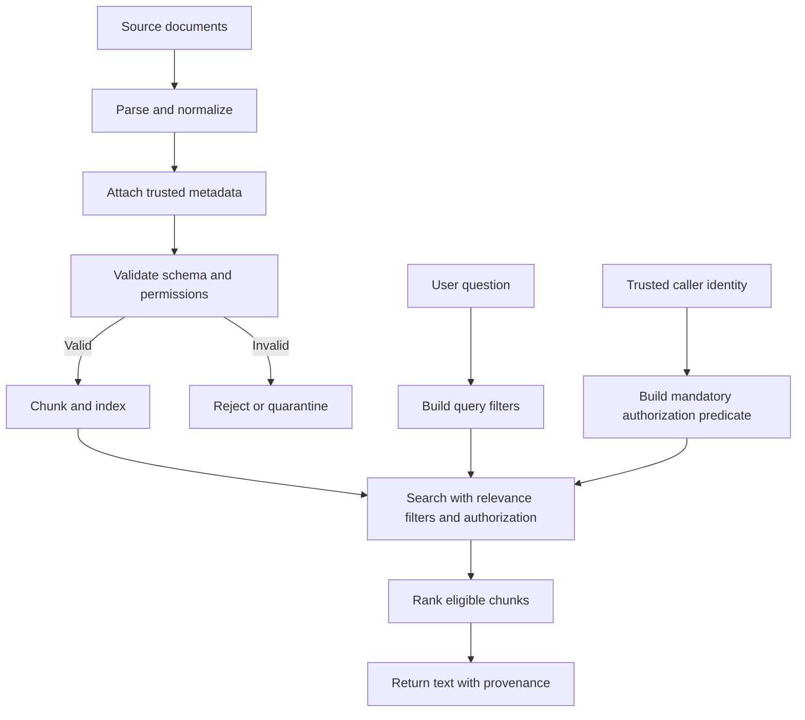

# Chapter 05 — Metadata Design and Filtering

## Learning Objectives

By the end of this chapter, you should be able to:

- Design a metadata schema for documents and chunks in a Retrieval-Augmented Generation (RAG) system.
- Distinguish identifiers, source locators, version fields, timestamps, descriptive metadata, and permission metadata.
- Validate required metadata and define predictable behavior for missing or malformed fields.
- Filter retrieval candidates by source, date, category, and language.
- Explain why relevance filters and authorization predicates serve different purposes.
- Retrieve chunks from a selected subset of sources while preserving provenance.

<br/>

## 1. Why Metadata Matters in RAG

A chunk's text tells the retriever *what the passage says*. Metadata tells the system *where the passage came from, what it describes, when it applies, and who may access it*.

Metadata supports three distinct responsibilities:

| Responsibility | Typical fields | Main question |
|---|---|---|
| Relevance and eligibility | `category`, `language`, `published_at`, `source_type`, `source_id` | Is this passage appropriate for the current question? |
| Provenance and traceability | `source_id`, `chunk_id`, `document_version`, `page_number`, `section_path`, `content_hash` | Can the system identify and verify the origin of this passage? |
| Authorization and isolation | `tenant_id`, `allowed_groups`, `classification`, `owner_id` | Is this caller permitted to retrieve this passage? |

A field can support more than one purpose. For example, `source_id` can narrow a search to a selected source and also help cite the source. However, metadata that improves relevance is not automatically an access-control mechanism.

<br/>

## 2. Document Metadata and Chunk Metadata

Use document-level metadata for facts shared by all chunks from one document. Use chunk-level metadata for the chunk's identity and location within that document.

### Example document record

```json
{
  "source_id": "policy-handbook-2026",
  "title": "Employee Policy Handbook",
  "source_type": "pdf",
  "document_version": "2026-03",
  "language": "en",
  "category": "human-resources",
  "published_at": "2026-03-01T00:00:00Z",
  "ingested_at": "2026-03-04T09:15:00Z",
  "owner_id": "hr-team",
  "tenant_id": "org-42",
  "allowed_groups": ["employees", "hr"],
  "classification": "internal"
}
```

<br/>

### Example chunk record

```json
{
  "chunk_id": "policy-handbook-2026:v2026-03:p12:c03",
  "source_id": "policy-handbook-2026",
  "document_version": "2026-03",
  "page_number": 12,
  "page_label": "10",
  "section_path": ["Leave", "Annual Leave", "Carryover"],
  "chunk_index": 3,
  "language": "en",
  "content": "Unused annual leave may be carried over ...",
  "content_hash": "sha256:...",
  "published_at": "2026-03-01T00:00:00Z",
  "tenant_id": "org-42",
  "allowed_groups": ["employees", "hr"],
  "classification": "internal"
}
```

The `page_number` is the zero- or one-based page position defined by the ingestion pipeline; document this convention and use it consistently. `page_label` stores the page number printed in the document when available. They may differ.

<br/>

## 3. Essential Metadata Fields

| Field | Meaning | Design guidance |
|---|---|---|
| `source_id` | Stable identity of the logical source/document | Do not use a temporary file path as the only identity. |
| `chunk_id` | Identity of one indexed chunk | Make it deterministic where possible; include version or content identity if needed. |
| `document_version` | Version of the source used to create the chunk | Keep versions distinguishable so stale chunks can be retired. |
| `page_number` / `section_path` | Location of the passage in the source | Preserve enough detail to show citations and inspect the original. |
| `language` | Language of the content | Use a consistent code system, such as BCP 47 (`en`, `en-GB`, `hi`). |
| `published_at` | Time the source became effective or was published | Define the business meaning precisely. |
| `ingested_at` | Time the pipeline processed the source | Store as a timezone-aware timestamp, normally UTC. |
| `updated_at` | Time the source was last updated upstream | Use only if the upstream system provides a trustworthy value. |
| `category` | Domain or content classification | Use controlled values where possible instead of arbitrary spellings. |
| `owner_id` | Account or team responsible for the source | Ownership is not, by itself, permission to read. |
| `tenant_id` | Organization or tenant boundary | Enforce it as part of authorization in multi-tenant systems. |
| `allowed_groups` | Groups permitted to read the source | Derive from a trusted identity/permission system, not user-supplied document text. |
| `classification` | Sensitivity label, such as `public` or `internal` | Define how each label maps to access policy. |
| `content_hash` | Hash of canonical source or chunk content | Helps detect changes and support deduplication/auditing. |

Avoid putting secrets, credentials, or unnecessary personal information into metadata. Metadata may be logged, indexed, copied into vector stores, or exposed in debugging tools.

<br/>

## 4. Stable IDs, Versions, and Timestamps

### IDs should be stable and unambiguous

- `source_id` identifies the logical source, not just one downloaded copy.
- `chunk_id` identifies a specific chunk within a source version.
- A useful scheme is `source_id:version:locator:chunk_index`, provided the locator and chunking rules are stable.
- If chunking changes, regenerate or version chunk IDs so old and new chunks do not collide.
- Store a content hash when content-based change detection is useful.

Example:

```text
source_id:       security-standard
document_version: 3.2
chunk_id:        security-standard:v3.2:section-4.1:c02
```

<br/>

### Do not confuse different timestamps

- `published_at`: when the source was published or became effective.
- `updated_at`: when the upstream source was last changed.
- `ingested_at`: when your pipeline processed it.
- `indexed_at`: when it became available in the retrieval index, if your platform tracks this.

Use ISO 8601 timestamps with timezone information. UTC (`Z`) is a practical default for storage and comparison. Define whether a date filter means publication date, effective date, update date, or ingestion date before implementing it.

<br/>

## 5. Trustworthy Ownership and Permission Metadata

Permission metadata is security-sensitive. A document must not be allowed to grant itself access by including text such as “all users may read this.”

Use trusted sources for authorization attributes:

1. Authenticate the caller and obtain identity and group membership from a trusted identity provider.
2. Obtain document ownership, tenant, and access-control information from a trusted source system or policy service.
3. Attach or synchronize those attributes during ingestion.
4. Apply authorization predicates before returning candidates to the application or language model.
5. Re-check permissions when policy changes, group membership changes, or source access is revoked.

A simplified authorization predicate might be:

```text
chunk.tenant_id == caller.tenant_id
AND (
  chunk.classification == "public"
  OR chunk.owner_id == caller.user_id
  OR intersects(chunk.allowed_groups, caller.groups)
)
```

This is illustrative only. A real policy must define how classifications, ownership, groups, explicit denials, inherited permissions, and tenant boundaries interact. Tenant isolation should not be bypassed by an `OR` clause.

**Important:** filtering after retrieval can be unsafe if unauthorized chunk text is already exposed to logs, rerankers, traces, or an LLM. Prefer server-enforced filtering at the retrieval boundary, and verify the behavior of the selected vector database or search engine.

<br/>

## 6. Metadata Validation and Missing-Field Behavior

Metadata should be validated before indexing, not discovered to be malformed during a production query.

Validation should check:

- Required fields are present and non-empty.
- IDs and versions follow expected formats.
- Timestamps parse and include a timezone.
- `language` and `category` use supported values.
- Permission fields have the expected types.
- `page_number` and `chunk_index` are valid integers when required.
- Metadata values are serializable and within the vector store's size/type limits.

<br/>

### Example using Pydantic

```python
from datetime import datetime, timezone
from typing import Literal
from pydantic import BaseModel, ConfigDict, Field, field_validator

class ChunkMetadata(BaseModel):
    model_config = ConfigDict(extra="forbid")

    source_id: str = Field(min_length=1)
    chunk_id: str = Field(min_length=1)
    document_version: str = Field(min_length=1)
    language: str = Field(min_length=2)
    category: str = Field(min_length=1)
    ingested_at: datetime
    tenant_id: str = Field(min_length=1)
    allowed_groups: list[str] = Field(default_factory=list)
    classification: Literal["public", "internal", "confidential"]
    page_number: int | None = Field(default=None, ge=1)
    section_path: list[str] = Field(default_factory=list)

    @field_validator("ingested_at")
    @classmethod
    def require_timezone(cls, value: datetime) -> datetime:
        if value.tzinfo is None or value.utcoffset() is None:
            raise ValueError("ingested_at must include a timezone")
        return value.astimezone(timezone.utc)
```

Example validation:

```python
record = ChunkMetadata.model_validate({
    "source_id": "policy-handbook-2026",
    "chunk_id": "policy-handbook-2026:v2026-03:p12:c03",
    "document_version": "2026-03",
    "language": "en",
    "category": "human-resources",
    "ingested_at": "2026-03-04T09:15:00Z",
    "tenant_id": "org-42",
    "allowed_groups": ["employees", "hr"],
    "classification": "internal",
    "page_number": 12,
    "section_path": ["Leave", "Annual Leave", "Carryover"]
})
```

The example uses Pydantic v2. Adapt field types and constraints to your actual index provider's metadata schema.

<br/>

### Choose explicit missing-field behavior

| Missing or invalid field | Safer default |
|---|---|
| `source_id` or `chunk_id` | Reject the record; provenance and deduplication would be unreliable. |
| `tenant_id` in a multi-tenant system | Reject or quarantine; never assume a default tenant. |
| Permission attributes | Fail closed or quarantine until permissions can be resolved. |
| `document_version` | Reject or assign an explicit, documented version policy. |
| `language` | Detect, mark as `unknown`, or quarantine depending on requirements; do not silently assume a language. |
| `page_number` | Allow `null` for sources without pages; preserve another locator such as `section_path`. |
| Optional category | Use `unknown` only if that value is supported by the filtering design. |
| Timestamp | Do not invent a publication date; use a separate ingestion timestamp when appropriate. |

Defaults are not universally safe. Decide the policy for each field and test it. In particular, missing authorization metadata must not accidentally make a private source broadly retrievable.

<br/>

## 7. Metadata Filtering at Retrieval Time

A filter narrows the candidate set before or during retrieval. Exact syntax varies by vector database and search backend.

Common filters include:

- **Source filter:** retrieve only selected documents or repositories.
- **Date filter:** retrieve sources published or effective within a defined interval.
- **Category filter:** search a content domain such as `human-resources`.
- **Language filter:** restrict to content in a selected language.
- **Version filter:** prefer or require an approved document version.
- **Authorization filter:** restrict results to resources the caller may access.

<br/>

### Example filter intent

```json
{
  "source_id": {"$in": ["policy-handbook-2026", "leave-policy"]},
  "language": "en",
  "category": "human-resources",
  "published_at": {"$gte": "2025-01-01T00:00:00Z"}
}
```

This is illustrative pseudocode, not a universal filter language. A particular database may use different operators, timestamp representations, or nesting rules.

<br/>

### Example: apply a source subset before ranking

```python
def eligible_for_query(chunk, selected_sources, language, category):
    """Relevance/eligibility filters only; NOT an authorization check."""
    return (
        chunk["source_id"] in selected_sources
        and chunk["language"] == language
        and chunk["category"] == category
    )

selected_sources = {"policy-handbook-2026", "leave-policy"}

candidates = [
    chunk for chunk in indexed_chunks
    if eligible_for_query(
        chunk,
        selected_sources=selected_sources,
        language="en",
        category="human-resources",
    )
]

# Send eligible candidates to your retriever/ranker.
```

This is a minimal in-memory illustration. Production systems should push supported filters into the search/index layer and must add independent, server-enforced authorization predicates.

<br/>

## 8. Relevance Filters vs. Mandatory Authorization Predicates

These are different classes of conditions and should be modeled separately.

| Dimension | Relevance / query filters | Authorization predicates |
|---|---|---|
| Purpose | Improve usefulness and constrain the requested search scope | Enforce what the caller is allowed to access |
| Examples | Source subset, language, date range, category | Tenant boundary, ACL, group membership, classification |
| Who controls it? | Often the user or application query | Trusted policy and identity systems |
| Can the user omit it? | Often yes, if broader search is allowed | No; mandatory policy still applies |
| If it is wrong | Irrelevant or incomplete answers | Potential data disclosure or cross-tenant leakage |
| Enforcement | Search planning / retrieval configuration | Server-side, fail-closed security boundary |

Conceptually, the candidate set should be:

```text
eligible_candidates =
    retrieved_chunks
    ∩ relevance_filters
    ∩ mandatory_authorization_predicates
```

The authorization conditions must remain mandatory even if a user requests a broad search or supplies their own filter. Never treat an LLM-generated filter as proof of authorization.

<br/>

## 9. Retrieval Flow with Metadata



The diagram separates query-derived relevance filters from identity-derived authorization predicates. The backend should enforce both before unauthorized content can leave the retrieval boundary.

<br/>

## 10. Practical Design Checklist

Before indexing a source, ask:

- Is `source_id` stable across file moves or re-downloads?
- Is each `chunk_id` unique for its source version?
- Can a retrieved chunk be traced to a page, section, timestamp, or another source locator?
- Are document version and timestamps defined unambiguously?
- Are language and category values normalized?
- Are ownership and permission fields derived from trusted systems?
- What happens when a required field is missing?
- Are authorization predicates mandatory and server-enforced?
- Can a source update or permission revocation remove stale indexed content?
- Are metadata filters tested against empty, malformed, and adversarial inputs?

<br/>

## 11. Practice: Design a Chunk Schema and Retrieve from Selected Sources

### Task A — Design the schema

Design a chunk metadata schema for a company knowledge base containing policy PDFs, engineering Markdown files, and support articles. Include at least:

- `source_id`, `chunk_id`, `document_version`
- `page_number` or `section_path`
- `language`, `category`
- `published_at`, `ingested_at`
- `tenant_id`, `owner_id`, `allowed_groups`, `classification`

State which fields are required, optional, or conditional on source type. Explain what happens when each required field is missing.

<br/>

### Task B — Filter by source subset

Assume the query asks: “What is the annual leave carryover policy?” Retrieve only chunks from `policy-handbook-2026` and `leave-policy`, in English, categorized as `human-resources`.

1. Apply source, language, and category filters.
2. Apply the caller's mandatory tenant and permission predicates independently.
3. Rank only the eligible chunks.
4. Return each selected chunk with its `source_id`, `document_version`, and page or section locator.
5. Explain why each returned chunk was eligible.

<br/>

### Task C — Test edge cases

Test at least these cases:

- A chunk has no `source_id`.
- A chunk has a different tenant ID.
- A chunk is relevant but its group ACL excludes the caller.
- A source is in the requested subset but its version is obsolete.
- A chunk has no page number but has a valid section path.
- A user asks to ignore the access restrictions.

Expected behavior: malformed identity/provenance data is rejected or quarantined; authorization mismatches exclude the chunk regardless of semantic relevance; missing page numbers can be acceptable when another valid locator exists; user instructions cannot override mandatory access control.

<br/>

## 12. Checkpoint — Model Answer

**Question:** Which metadata supports relevance, provenance, and access enforcement?

**Answer:**

- **Relevance:** fields such as `category`, `language`, `published_at`, `source_type`, and user-selected `source_id` subsets narrow the search to suitable content.
- **Provenance:** `source_id`, `chunk_id`, `document_version`, `page_number`, `section_path`, and `content_hash` identify the source, version, and location of retrieved evidence.
- **Access enforcement:** trusted `tenant_id`, `owner_id`, `allowed_groups`, `classification`, and the authenticated caller's identity/groups support mandatory authorization checks. These predicates must be enforced by trusted server-side code or the retrieval backend, not merely requested in the prompt.
- **Missing-field behavior:** required identity and authorization fields should not be silently fabricated. Reject, quarantine, or fail closed according to a documented policy.

A chunk should be returned only when it meets both the query's relevance constraints and the caller's mandatory access policy. Semantic similarity alone does not establish permission to disclose a passage.

<br/>

## Key Takeaways

1. Treat metadata as part of the retrieval contract, not as optional decoration.
2. Keep stable source identity, chunk identity, version, and source locators for traceability.
3. Normalize timestamps, language codes, and controlled categories.
4. Validate metadata before indexing and define explicit missing-field behavior.
5. Derive permission metadata from trusted systems.
6. Apply relevance filters and authorization predicates as separate concerns.
7. Enforce authorization before unauthorized text reaches application logs, rerankers, or an LLM.

<br/>

## References

- [Pydantic — Models](https://docs.pydantic.dev/latest/concepts/models/)
- [Pydantic — Fields](https://docs.pydantic.dev/latest/concepts/fields/)
- [W3C — PROV-O: The PROV Ontology](https://www.w3.org/TR/prov-o/)
- [RFC 3339 — Date and Time on the Internet: Timestamps](https://www.rfc-editor.org/rfc/rfc3339)
- [BCP 47 — Tags for Identifying Languages](https://www.rfc-editor.org/rfc/bcp/bcp47.txt)
- [OWASP — Authorization Cheat Sheet](https://cheatsheetseries.owasp.org/cheatsheets/Authorization_Cheat_Sheet.html)

<br/>

## Next Chapter

**Chapter 06 — Indexing and Baseline Retrieval**

Next, build a searchable index, retrieve an initial candidate set, and establish a baseline against which later retrieval improvements can be measured.
