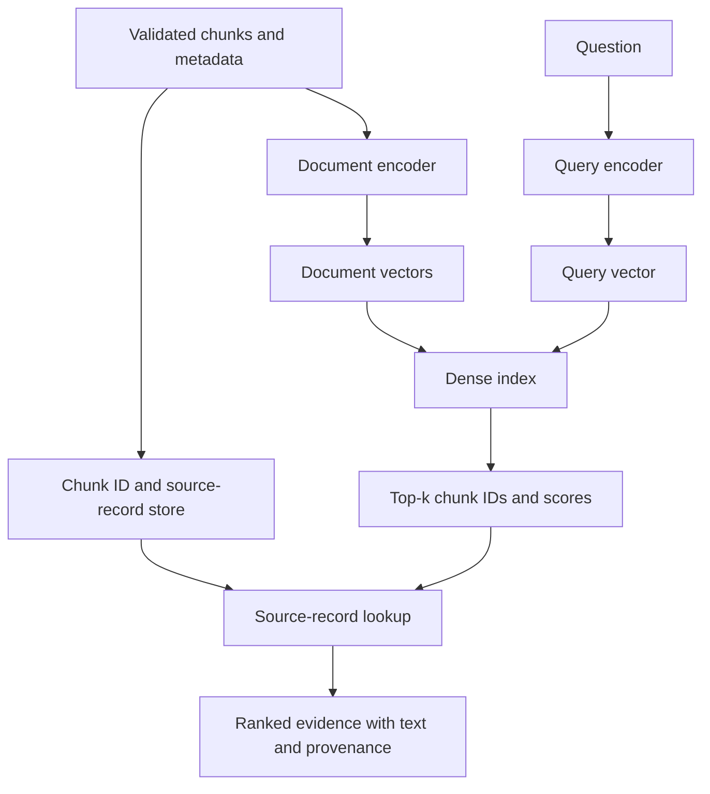

# Chapter 06 — Indexing and Baseline Retrieval

## Learning Objectives

By the end of this chapter, you should be able to:

- Reuse the embedding model, text preparation, query/document encoding conventions, and normalization policy established in Level 7.
- Store vectors alongside stable chunk IDs, source text, and validated metadata.
- Build a simple exact dense-retrieval baseline before adding more advanced retrieval stages.
- Inspect the top-*k* candidates, similarity scores, source text, and provenance.
- Check vector dimensions, normalization, and similarity-metric compatibility.
- Evaluate retrieval against a small labeled question set without generating answers.

<br/>

## 1. What Indexing and Retrieval Do

An **embedding** represents text as a numerical vector. An **index** stores vectors and the information needed to find and return the associated source passages.

In a basic dense-retrieval pipeline:

1. Prepare document chunks using the conventions already established in Level 7.
2. Encode each chunk into a document vector.
3. Store each vector with its stable `chunk_id`, source text, and metadata.
4. Encode a user question using the compatible query-encoding convention.
5. Score the query vector against indexed document vectors.
6. Select the top-*k* eligible chunks and return their scores and source information.

The result is a ranked set of **candidate evidence**. It is not yet an answer generated by an LLM.



<br/>

## 2. Reuse Level 7 Embedding Conventions

Level 8 indexing should not silently introduce a new embedding setup. Reuse the decisions already established in Level 7.

Record these settings together:

- **Model identifier and revision:** the exact model used to encode the corpus.
- **Query/document encoding mode:** whether the model expects a shared `encode` method or distinct query and document methods.
- **Input preparation:** text cleanup, prefixes, instruction templates, and maximum input length.
- **Vector dimension:** the number of values in each vector.
- **Normalization:** whether vectors are L2-normalized before storage or scoring.
- **Similarity metric:** cosine similarity, dot product, or another supported metric.
- **Chunking convention:** the source text and chunk boundaries used to create each vector.
- **Index configuration:** metric, dimensions, and any index-specific settings.

Query and document vectors must inhabit a compatible embedding space. Do not encode the corpus with one model and queries with another unless the models explicitly support a compatible shared space.

If the model documentation requires different query and document instructions or methods, follow those conventions. A model-specific prefix can be part of the embedding contract.

<br/>

### Why normalization and metric compatibility matter

For vectors $q$ and $d$, cosine similarity is:

$$
\operatorname{cosine}(q,d)=\frac{q\cdot d}{\|q\|_2\|d\|_2}
$$

If both vectors are L2-normalized, their dot product equals cosine similarity:

$$
\hat q\cdot\hat d=\operatorname{cosine}(q,d)
$$

This identity is useful, but only when normalization is applied consistently. A dot-product index over unnormalized vectors can rank by vector magnitude as well as direction. That may not match the intended cosine-similarity behavior.

**Do not assume one metric is universally best.** Use the metric recommended for the selected embedding model and configured consistently in the index.

<br/>

## 3. Define a Minimal Indexed Record

Store the vector separately from the source record if that better fits the chosen index, but preserve a reliable mapping between them.

Example source record:

```json
{
  "chunk_id": "leave-policy:v2026-03:section-2:c01",
  "source_id": "leave-policy",
  "document_version": "2026-03",
  "section_path": ["Annual Leave", "Carryover"],
  "language": "en",
  "category": "human-resources",
  "tenant_id": "org-42",
  "content": "Eligible employees may carry over up to five unused annual leave days into the next leave year, subject to the stated approval process."
}
```

Example index manifest:

```json
{
  "embedding_model": "sentence-transformers/all-MiniLM-L6-v2",
  "embedding_revision": "pin-a-specific-revision-in-production",
  "vector_dimension": 384,
  "normalization": "l2",
  "similarity_metric": "cosine",
  "query_document_encoding": "same encode method for this symmetric example",
  "chunking_version": "level8-chunking-v1"
}
```

The manifest values are illustrative. Verify the dimension, model behavior, supported metric, and exact revision for the model you actually use. Do not treat a placeholder revision as a deployable pin.

A vector without a trustworthy record mapping is difficult to cite, debug, update, or delete. Preserve at least:

- stable `chunk_id`;
- source text or a retrievable source-record pointer;
- `source_id` and document version;
- section/page locator where available;
- validated metadata required by the retrieval and authorization policies.

<br/>

## 4. Build an Exact Dense-Retrieval Baseline

An exact baseline compares the query vector with every eligible document vector. It is straightforward to inspect and useful as a quality reference before optimizing for scale.

For a small corpus, a NumPy matrix is enough. This example uses Sentence Transformers and cosine similarity through normalized vectors and dot products.

Install dependencies:

```bash
pip install sentence-transformers numpy
```

<br/>

### 4.1 Prepare a small corpus

```python
from sentence_transformers import SentenceTransformer
import numpy as np

model_name = "sentence-transformers/all-MiniLM-L6-v2"
model = SentenceTransformer(model_name)

chunks = [
    {
        "chunk_id": "leave-policy:v1:section-2:c01",
        "source_id": "leave-policy",
        "document_version": "v1",
        "section_path": ["Annual Leave", "Carryover"],
        "language": "en",
        "category": "human-resources",
        "tenant_id": "org-42",
        "content": (
            "Eligible employees may carry over up to five unused "
            "annual leave days into the next leave year."
        ),
    },
    {
        "chunk_id": "leave-policy:v1:section-3:c01",
        "source_id": "leave-policy",
        "document_version": "v1",
        "section_path": ["Annual Leave", "Approval"],
        "language": "en",
        "category": "human-resources",
        "tenant_id": "org-42",
        "content": (
            "Annual leave requests must be submitted through the "
            "employee portal and approved by the manager."
        ),
    },
    {
        "chunk_id": "security-guide:v2:section-1:c01",
        "source_id": "security-guide",
        "document_version": "v2",
        "section_path": ["Account Security"],
        "language": "en",
        "category": "engineering",
        "tenant_id": "org-42",
        "content": (
            "Use multi-factor authentication to protect company accounts."
        ),
    },
]

document_texts = [chunk["content"] for chunk in chunks]

# This example uses one shared encode method for a symmetric embedding setup.
# If your Level 7 model requires encode_document()/encode_query() or prompts,
# use those documented conventions instead.
document_vectors = model.encode(
    document_texts,
    convert_to_numpy=True,
    normalize_embeddings=True,
    show_progress_bar=False,
)

document_vectors = np.asarray(document_vectors, dtype=np.float32)

assert document_vectors.ndim == 2
assert document_vectors.shape[0] == len(chunks)
assert np.isfinite(document_vectors).all()
assert np.allclose(
    np.linalg.norm(document_vectors, axis=1),
    1.0,
    atol=1e-4,
)

print("Number of chunks:", len(chunks))
print("Vector matrix shape:", document_vectors.shape)
```

This small corpus is for demonstrating the retrieval mechanics. For a real application, use your validated Level 8 chunks and metadata from the preceding chapters.

<br/>

### 4.2 Retrieve the top-*k* candidates

```python
def retrieve_dense(question: str, chunks: list[dict], vectors: np.ndarray, k: int = 3):
    if not question.strip():
        raise ValueError("question must not be empty")
    if k < 1:
        raise ValueError("k must be at least 1")
    if vectors.ndim != 2 or vectors.shape[0] != len(chunks):
        raise ValueError("vectors and source records are not aligned")

    query_vector = model.encode(
        [question],
        convert_to_numpy=True,
        normalize_embeddings=True,
        show_progress_bar=False,
    )[0].astype(np.float32)

    if query_vector.shape[0] != vectors.shape[1]:
        raise ValueError("query/document vector dimensions do not match")
    if not np.isfinite(query_vector).all():
        raise ValueError("query vector contains non-finite values")

    # Both query and document vectors are L2-normalized,
    # so the dot product computes cosine similarity.
    scores = vectors @ query_vector
    ranked_indices = np.argsort(scores)[::-1][: min(k, len(chunks))]

    results = []
    for rank, index in enumerate(ranked_indices, start=1):
        results.append({
            "rank": rank,
            "score": float(scores[index]),
            **chunks[int(index)],
        })
    return results


question = "How many unused annual leave days can be carried over?"
for result in retrieve_dense(question, chunks, document_vectors, k=3):
    print(f"\nRank: {result['rank']} | Score: {result['score']:.4f}")
    print("Chunk:", result["chunk_id"])
    print("Source:", result["source_id"], "| Version:", result["document_version"])
    print("Section:", " > ".join(result["section_path"]))
    print("Text:", result["content"])
```

Scores are model- and corpus-dependent. A higher cosine score means greater vector similarity under this configuration; it does **not** guarantee that a passage fully answers the question. Do not interpret the score as a calibrated probability unless you have separately validated such an interpretation.

<br/>

## 5. Add Metadata Eligibility Before Ranking

The example above demonstrates dense similarity only. In a real application, candidate eligibility must also respect the filtering and authorization rules established in Chapter 05.

Keep the two categories distinct:

- **Relevance filters:** requested source subset, language, category, effective date, or approved version.
- **Mandatory authorization predicates:** tenant boundary, trusted access-control list, group membership, or classification policy.

A conceptual baseline for a small in-memory dataset is:

```python
def is_relevant_scope(chunk, selected_sources, language, category):
    """Query-scope filters; not an authorization check."""
    return (
        chunk["source_id"] in selected_sources
        and chunk["language"] == language
        and chunk["category"] == category
    )


def is_authorized(chunk, caller):
    """Illustrative only; use the application's trusted policy engine."""
    if chunk.get("tenant_id") != caller["tenant_id"]:
        return False

    allowed_groups = set(chunk.get("allowed_groups", []))
    caller_groups = set(caller.get("groups", []))

    return (
        caller["user_id"] == chunk.get("owner_id")
        or bool(allowed_groups.intersection(caller_groups))
        or chunk.get("classification") == "public"
    )


def retrieve_from_subset(
    question,
    chunks,
    vectors,
    selected_sources,
    language,
    category,
    caller,
    k=3,
):
    eligible_indices = [
        i for i, chunk in enumerate(chunks)
        if is_relevant_scope(chunk, selected_sources, language, category)
        and is_authorized(chunk, caller)
    ]

    if not eligible_indices:
        return []

    # For clarity, rank only eligible vectors. In production, enforce
    # authorization in the trusted retrieval backend whenever possible.
    eligible_chunks = [chunks[i] for i in eligible_indices]
    eligible_vectors = vectors[eligible_indices]

    return retrieve_dense(
        question,
        eligible_chunks,
        eligible_vectors,
        k=k,
    )
```

**Security note:** this simplified policy is not a universal ACL implementation. Real authorization rules may include explicit denials, inherited permissions, resource-level grants, classification hierarchies, and revocation. Never let user-supplied filters or LLM output override mandatory access-control rules. Prefer enforcing permissions in the retrieval service before unauthorized content can enter logs, traces, rerankers, or model context.

<br/>

## 6. Inspect Top-*k* Results, Not Just the Scores

For each result, inspect:

- rank and similarity score;
- chunk text and whether it contains the evidence needed;
- `source_id`, version, page/section locator;
- whether the chunk is in the permitted source subset;
- whether metadata and authorization checks were applied;
- duplicate or near-duplicate passages;
- relevant evidence that appears below the selected *k*.

A useful debugging table:

| Rank | Score | Source / locator | Evidence assessment |
|---:|---:|---|---|
| 1 | 0.82 | `leave-policy`, section 2 | Directly states the carryover limit |
| 2 | 0.67 | `leave-policy`, section 3 | Describes approval process, but not the limit |
| 3 | 0.41 | `security-guide`, section 1 | Semantically unrelated |

The scores and examples above are illustrative, not output from the sample code. In a real run, use the measured scores and actual retrieved text.

<br/>

## 7. Save and Reuse the Baseline Artifacts

For reproducibility, persist or version:

- source/chunk records and their IDs;
- embedding model identifier and revision;
- query/document encoding convention;
- vector dimension and normalization policy;
- similarity metric and index configuration;
- chunking version;
- evaluation questions and relevant chunk IDs;
- retrieval output, scores, and configuration used for each run.

For a small baseline, NumPy can save the vector matrix:

```python
import json
import numpy as np

np.save("document_vectors.npy", document_vectors)

with open("chunk_records.json", "w", encoding="utf-8") as file:
    json.dump(chunks, file, ensure_ascii=False, indent=2)
```

In production, choose a storage/index service that fits the scale, filtering requirements, durability needs, operational constraints, and security model. Treat vectors and their source records as linked artifacts: changing or deleting one without updating the other can cause incorrect citations or stale evidence.

<br/>

## 8. Exact Search vs. Approximate Indexing

| Approach | How it works | Advantages | Trade-offs |
|---|---|---|---|
| Exact dense search | Scores every eligible vector | Simple, deterministic for a fixed dataset and scoring implementation, strong baseline | Cost grows with corpus size |
| Approximate nearest-neighbor (ANN) index | Searches an index designed to find close vectors efficiently | Lower latency at scale in suitable configurations | May miss some true nearest neighbors; needs index tuning and recall testing |

Start with exact search when the dataset is small enough. It provides a reference for checking whether an ANN index sacrifices retrieval quality for speed. If an approximate index is introduced later, compare its results with exact search using the same vectors, metric, filters, and evaluation questions.

Do not confuse **exact vector search** with **correct retrieval**. Exact search returns the highest-scoring vectors under the selected metric; the embedding model may still rank irrelevant passages highly.

<br/>

## 9. Common Failure Modes

| Failure | Symptom | Checks and remedies |
|---|---|---|
| Query/document model mismatch | Results are unexpectedly weak or nonsensical | Confirm model ID, revision, encoding methods, prefixes, and vector space |
| Dimension mismatch | Index rejects vectors or query fails | Check vector dimensions and rebuild incompatible indexes |
| Normalization mismatch | Ranking differs from intended cosine behavior | Verify normalization at both encoding and scoring/index stages |
| Metric mismatch | Search scores or rankings conflict with assumptions | Align the index metric with model guidance and vector preparation |
| Broken ID-to-record mapping | Scores appear but source text is missing or incorrect | Validate record/vector ordering and key-based lookups |
| Stale vectors | Results quote outdated source content | Re-index changed chunks and retire superseded versions |
| Missing metadata | Filters exclude everything or allow unintended records | Validate metadata before indexing; define missing-field policy |
| Low top-*k* | Relevant evidence is ranked just below the cutoff | Evaluate several *k* values and inspect the ranked list |
| Similarity mistaken for probability | High score is treated as proof | Calibrate separately if a probability-like threshold is required |
| Unauthorized candidates reach downstream components | Sensitive text appears in logs or model context | Enforce authorization at the trusted retrieval boundary |

<br/>

## 10. Practice — Retrieve Evidence Without Generating Answers

Create a small labeled evaluation set of questions and relevant chunk IDs. Do not ask an LLM to answer these questions yet.

Example:

```python
evaluation_set = [
    {
        "question": "How many annual leave days can be carried over?",
        "relevant_chunk_ids": {"leave-policy:v1:section-2:c01"},
        "allowed_sources": {"leave-policy"},
    },
    {
        "question": "How should annual leave be requested?",
        "relevant_chunk_ids": {"leave-policy:v1:section-3:c01"},
        "allowed_sources": {"leave-policy"},
    },
]
```

For each question:

1. Encode the question using the Level 7 query-encoding convention.
2. Retrieve top-*k* chunks from the selected, authorized corpus subset.
3. Record rank, score, chunk ID, source, version, locator, and text.
4. Compare returned chunk IDs with the labeled relevant chunk IDs.
5. Record missed evidence, irrelevant candidates, duplicate chunks, and filter failures.
6. Repeat for several *k* values, such as 1, 3, and 5, if the corpus is large enough.
7. Save the embedding and index configuration with the results so the experiment can be repeated.

<br/>

### Basic Recall@k

For one question:

\[
\operatorname{Recall@k} =
\frac{\left|\text{relevant chunk IDs retrieved in top-}k\right|}
{\left|\text{relevant chunk IDs in the labeled set}\right|}
\]

If a question has two labeled relevant chunks and top-*k* returns one of them, Recall@k is \(1/2 = 0.5\).

This metric assumes the labeled relevant set is reasonably complete. If the denominator is empty, define a deliberate policy rather than dividing by zero.

Example calculation:

```python
def recall_at_k(retrieved_chunk_ids, relevant_chunk_ids):
    relevant = set(relevant_chunk_ids)
    if not relevant:
        return None  # No score: the question has no labeled relevant chunks.
    retrieved = set(retrieved_chunk_ids)
    return len(retrieved & relevant) / len(relevant)

print(recall_at_k(
    retrieved_chunk_ids=[
        "leave-policy:v1:section-2:c01",
        "leave-policy:v1:section-3:c01",
    ],
    relevant_chunk_ids={"leave-policy:v1:section-2:c01"},
))
# 1.0
```

For a fuller evaluation, add Precision@k, Mean Reciprocal Rank (MRR), or nDCG when they answer a specific evaluation question. Keep the labels and metric definitions fixed when comparing configurations.

<br/>

## 11. Checkpoint — Model Answer

**Question:** How do you separate retrieval correctness from whether a model can phrase an answer well?

**Answer:**

Evaluate the retrieval stage independently using labeled questions and relevant chunk IDs. Inspect the top-*k* results and calculate retrieval metrics such as Recall@k, Precision@k, MRR, or nDCG as appropriate. Confirm that retrieved passages are relevant, traceable to their source, and eligible under metadata and authorization filters.

Do not generate answers during this baseline test. A fluent answer can hide missing or incorrect evidence, while a correct passage can be retrieved even if a later language model phrases the answer poorly. Once retrieval quality is understood, evaluate grounded answer generation as a separate stage.

<br/>

## Key Takeaways

1. Reuse the Level 7 embedding contract; do not silently change model, encoding conventions, normalization, or metric.
2. Store vectors with stable chunk IDs and reliable source-record mappings.
3. Establish an exact dense-search baseline before adding ANN or advanced retrieval stages.
4. Inspect source text and provenance alongside similarity scores.
5. Enforce metadata filters and mandatory authorization rules before returning evidence.
6. Evaluate retrieval with labeled evidence before evaluating generated answers.
7. Version the model, chunking, vectors, index configuration, and evaluation set together.

<br/>

## References

- [Sentence Transformers — Semantic Search](https://www.sbert.net/examples/sentence_transformer/applications/semantic-search/README.html)
- [Sentence Transformers — Computing Embeddings](https://www.sbert.net/docs/sentence_transformer/usage/semantic_textual_similarity.html)
- [NumPy — `dot`](https://numpy.org/doc/stable/reference/generated/numpy.dot.html)
- [NumPy — `save`](https://numpy.org/doc/stable/reference/generated/numpy.save.html)
- [FAISS — Getting Started](https://github.com/facebookresearch/faiss/wiki/Getting-started)
- [OWASP — Authorization Cheat Sheet](https://cheatsheetseries.owasp.org/cheatsheets/Authorization_Cheat_Sheet.html)

<br/>

## Next Chapter

**Chapter 07 — Dense, Sparse, and Hybrid Retrieval**

Next, compare semantic dense retrieval with lexical sparse retrieval and combine their strengths using a hybrid retrieval strategy.
