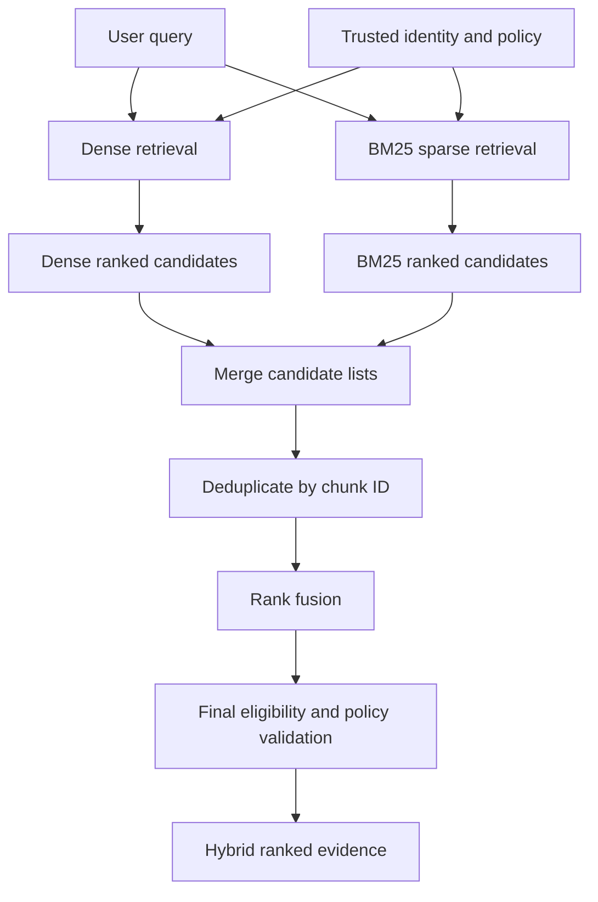

# Chapter 07 — Dense, Sparse, and Hybrid Retrieval

## Learning Objectives

By the end of this chapter, you should be able to:

- Explain how dense embedding retrieval differs from sparse lexical retrieval.
- Describe BM25 and recognize when exact terms, names, codes, and identifiers matter.
- Compare paraphrase-oriented questions with queries that require lexical matching.
- Combine ranked lists with Reciprocal Rank Fusion (RRF).
- Explain why raw scores from different retrieval systems should not be added without justification.
- Deduplicate candidates and enforce mandatory permissions across every retrieval branch.
- Evaluate dense, BM25, and hybrid retrieval against the same labeled query set.

<br/>

## 1. Why Compare Retrieval Methods?

A RAG system can only ground its answer in evidence that reaches the context-selection stage. If the retriever misses the right passage, a later language model may produce an incomplete or unsupported answer.

Different retrieval methods represent and match queries differently:

- **Dense retrieval** compares learned vector representations of queries and passages.
- **Sparse retrieval** matches terms using a sparse representation or lexical scoring function. BM25 is a widely used baseline.
- **Hybrid retrieval** combines candidates from more than one retrieval method, often dense and sparse, to improve coverage.

No method wins on every query. The right approach depends on the corpus, embedding model, query patterns, identifiers, language, filtering needs, and evaluation results.

<br/>

## 2. Dense Retrieval

Dense retrieval encodes a query and each document chunk into vectors. It ranks candidates using a vector similarity or distance measure.

### Strengths

- Can retrieve semantically related passages even when the wording differs.
- Often useful for natural-language questions and paraphrases.
- Can match related concepts without requiring every query term to appear literally.

<br/>

### Limitations

- May miss exact product codes, ticket IDs, legal clause numbers, filenames, or uncommon names.
- A high similarity score does not guarantee that a passage contains the exact requested fact.
- Performance depends on the embedding model, input preparation, chunking, and scoring configuration.

Example:

- Query: “How can staff move unused vacation days into the next year?”
- Relevant passage: “Annual leave carryover is permitted under the following conditions…”

The query and passage use different wording but express a similar concept. Dense retrieval may rank this passage highly.

Dense retrieval is not inherently “fuzzy search for everything.” If a user asks for a specific identifier, exact lexical matching may be more reliable.

<br/>

## 3. Sparse Retrieval and BM25

Sparse retrieval represents documents and queries using vocabulary terms, term weights, or lexical matching rules. In a typical bag-of-words sparse representation, most vocabulary dimensions are zero for any individual text.

**BM25** is a term-based ranking function that estimates document relevance using factors including:

- query-term matches;
- inverse document frequency, which gives rarer terms more weight;
- term frequency, with diminishing returns for repeated occurrences;
- document-length normalization.

BM25 is a strong baseline for many keyword-oriented search tasks. Exact behavior depends on the analyzer, tokenizer, stemming, stop-word handling, and index configuration.

<br/>

### Strengths

- Often strong for names, error messages, identifiers, codes, filenames, and exact phrases.
- Can be easier to debug because matching terms are inspectable.
- Does not require a semantic embedding model.

<br/>

### Limitations

- A relevant passage may be missed when it uses synonyms or a paraphrase with little lexical overlap.
- Tokenization and text analysis choices affect matching.
- Character-level or domain-specific identifiers may need special analyzers or exact-match fields.

Example:

- Query: `ERR_AUTH_403`
- Relevant passage: “The service returns `ERR_AUTH_403` when the token lacks the required scope.”

A lexical retriever is well suited to this exact identifier. Dense retrieval may retrieve the passage, but that outcome should be measured rather than assumed.

<br/>

## 4. Dense vs. Sparse: Query Patterns

| Query pattern | Dense retrieval | BM25 / sparse retrieval | Evaluation note |
|---|---|---|---|
| Natural-language paraphrase | Often useful | May miss with little term overlap | Check whether the intended evidence appears in top-*k*. |
| Exact error code | May or may not rank it highly | Often strong if tokenization preserves the code | Test punctuation and identifier analyzers. |
| Product name or person name | Depends on embedding and context | Often strong with lexical overlap | Verify exact spelling and variants. |
| Policy concept with alternate wording | Often useful | Depends on shared terms | Include realistic paraphrases in the test set. |
| Rare technical acronym | Context-dependent | Often strong if preserved as a token | Test acronym expansion and tokenization. |
| Misspelled query | May be robust in some cases, but not guaranteed | Depends on fuzzy matching and analyzer settings | Test realistic misspellings explicitly. |
| Numeric ID or version string | Not guaranteed to prioritize exact match | Often strong when indexed appropriately | Consider a dedicated exact-match field. |

These are tendencies, not guarantees. The corpus and implementation can change the outcome. Measure each query type with representative examples.

<br/>

## 5. Hybrid Retrieval

Hybrid retrieval combines candidates from different retrieval branches, commonly dense and BM25. It can improve coverage by combining semantic matches with exact lexical matches.

A simple architecture is:

1. Apply the same mandatory authorization constraints to each branch.
2. Run dense retrieval and retain its top-*k* candidates.
3. Run BM25 and retain its top-*k* candidates.
4. Merge candidate lists.
5. Deduplicate by a stable key such as `chunk_id`.
6. Combine rankings or scores.
7. Return the final ranked candidate set with source text and provenance.



The diagram is conceptual. In production, authorization should be enforced at each retrieval boundary, not only as a late-stage check. A final policy validation can provide defense in depth, but it does not replace branch-level enforcement.

<br/>

## 6. Reciprocal Rank Fusion (RRF)

The dense and sparse branches may produce incomparable scores. **Reciprocal Rank Fusion (RRF)** avoids directly combining those raw scores by combining ranks.

A common form is:

$$
\operatorname{RRF}(d)=\sum_{r \in R}\frac{1}{k_0+\operatorname{rank}_r(d)}
$$

where:

- $d$ is a candidate document or chunk;
- $R$ is the set of ranked retrieval lists;
- $\operatorname{rank}_r(d)$ is the one-based rank of $d$ in list $r$;
- $k_0$ is a smoothing constant, often chosen around 60 in common implementations.


A candidate absent from a branch contributes zero from that branch. Lower rank numbers contribute more than higher rank numbers.

<br/>

### Worked example

Suppose dense retrieval returns:

| Chunk | Dense rank |
|---|---:|
| A | 1 |
| B | 2 |
| C | 3 |

BM25 returns:

| Chunk | BM25 rank |
|---|---:|
| B | 1 |
| D | 2 |
| A | 3 |

Using $k_0=60$:

$$
\operatorname{RRF}(A)=\frac{1}{61}+\frac{1}{63}
$$

$$
\operatorname{RRF}(B)=\frac{1}{62}+\frac{1}{61}
$$

$$
\operatorname{RRF}(C)=\frac{1}{63}
$$

$$
\operatorname{RRF}(D)=\frac{1}{62}
$$

B ranks above A in this example because it is first in BM25 and second in dense retrieval. The numerical values are small; compare their relative ordering, not their magnitude as probabilities.

<br/>

### Python implementation

```python
from collections import defaultdict

def reciprocal_rank_fusion(ranked_lists, k0=60):
    """
    ranked_lists: list of ranked lists.
    Each item can be a chunk ID string or a dict containing 'chunk_id'.
    Returns unique chunk IDs ordered by descending RRF score.
    """
    if k0 <= 0:
        raise ValueError("k0 must be positive")

    scores = defaultdict(float)

    for ranked_list in ranked_lists:
        seen_in_this_list = set()

        for rank, item in enumerate(ranked_list, start=1):
            chunk_id = item if isinstance(item, str) else item["chunk_id"]

            # Do not allow duplicate entries in one branch to inflate a score.
            if chunk_id in seen_in_this_list:
                continue

            seen_in_this_list.add(chunk_id)
            scores[chunk_id] += 1.0 / (k0 + rank)

    return sorted(scores.items(), key=lambda pair: pair[1], reverse=True)


dense_ranked = ["chunk-A", "chunk-B", "chunk-C"]
bm25_ranked = ["chunk-B", "chunk-D", "chunk-A"]

for chunk_id, score in reciprocal_rank_fusion(
    [dense_ranked, bm25_ranked],
    k0=60,
):
    print(chunk_id, round(score, 6))
```

RRF combines rankings, not relevance labels. A chunk ranked highly by two weak retrievers can still be irrelevant. Inspect the results and evaluate them against labeled evidence.

<br/>

## 7. Why Raw Scores Should Not Be Added Automatically

Dense and sparse retrieval commonly use different scoring scales and distributions.

For example:

- A dense branch may output cosine similarity between -1 and 1, or another model-specific score range.
- A BM25 branch may output nonnegative relevance scores whose scale depends on the query, corpus statistics, analyzer, and implementation.
- A distance-based index may return smaller values for better matches, while a similarity score may assign larger values to better matches.

Therefore, this expression is not automatically meaningful:

```text
combined_score = dense_score + bm25_score
```

The larger-scale score can dominate the sum, even if the other signal contains useful ranking information. The resulting ordering may depend more on score scale than on relevance.

<br/>

### Safer combination options

1. **Rank fusion:** RRF combines ordinal ranks and is a useful baseline when raw scores are not calibrated to a common scale.
2. **Score normalization:** Transform scores to a common scale only when the transformation is appropriate and validated.
3. **Learned fusion or reranking:** Train or tune a combination model using labeled relevance data when the use case justifies the added complexity.

<br/>

### Score normalization considerations

Possible approaches include min-max scaling, z-score standardization, or calibrated transformations. None is automatically correct:

- **Min-max scaling** depends on the candidates and score range in the current result set. One extreme value can change the normalized values.
- **Z-score standardization** depends on the distribution and can be unstable with small or unusual result sets.
- **Calibration** requires suitable labeled data and validation; it is not the same as merely rescaling numbers.

Before using score-based fusion, determine:

- whether higher or lower means better for each branch;
- whether the scores are comparable across queries;
- whether the normalization is fitted on representative data;
- how missing candidates are handled;
- whether the fused ranking improves retrieval metrics on held-out queries.

<br/>

## 8. Deduplication and Source Mapping

A chunk may appear in both dense and sparse results. Hybrid merging should normally return one candidate per stable `chunk_id`, with both branch ranks retained for debugging.

Recommended candidate record:

```json
{
  "chunk_id": "leave-policy:v1:section-2:c01",
  "source_id": "leave-policy",
  "document_version": "v1",
  "dense_rank": 2,
  "bm25_rank": 1,
  "rrf_score": 0.032522,
  "content": "Eligible employees may carry over ..."
}
```

This is illustrative. The exact RRF score depends on the ranks and chosen smoothing constant.

Deduplicate by a stable identity rather than by text alone. Two chunks can contain identical text but differ in source, version, permission scope, or provenance. If text-level deduplication is also used, preserve the origins and do not merge records in a way that bypasses access controls.

After fusion, look up source text and metadata using the chunk ID. If a source record has been deleted or superseded, do not silently return stale text.

<br/>

## 9. Apply Mandatory Permissions to Every Branch

Hybrid retrieval does not weaken access-control requirements. Dense and BM25 retrieval must each enforce the same mandatory policy, including tenant boundaries and applicable access-control lists.

Do not rely on this unsafe pattern:

1. Search every tenant's content.
2. Merge all results.
3. Pass candidates to an LLM or external reranker.
4. Remove unauthorized results only at the very end.

Unauthorized text may already have been exposed to logs, traces, rerankers, or model context.

Prefer:

- constructing authorization predicates from authenticated identity and trusted policy data;
- applying the predicates within each retrieval branch;
- ensuring fusion only sees eligible candidates;
- validating the final result set as defense in depth;
- testing revocation, tenant isolation, and missing-permission metadata.

User-controlled query filters are not authorization. An LLM-produced filter must never be treated as proof that the caller may access a resource.

<br/>

## 10. Practice — Evaluate Dense, BM25, and Hybrid Retrieval

Use the same corpus, chunking, metadata rules, labeled queries, and authorization constraints for all three configurations.

### Suggested query set

Include a mix of:

1. Paraphrase questions, such as “How can unused leave be moved into the next year?”
2. Exact identifiers, such as `ERR_AUTH_403`.
3. Product names or uncommon technical terms.
4. Questions containing a clause number, version, ticket ID, or filename.
5. Questions whose wording differs from the source passage.
6. Queries that require a particular source subset or category.

For each query, label the relevant chunk IDs. Labels should reflect the evidence needed to satisfy the question, not whether a generated answer sounds fluent.

<br/>

### Experiment procedure

1. Run dense retrieval and save the top-*k* chunk IDs, ranks, scores, and source text.
2. Run BM25 over the same eligible corpus and save its results.
3. Apply RRF to the two ranked lists.
4. Deduplicate hybrid candidates by stable chunk ID.
5. Verify that authorization predicates were enforced independently in both branches.
6. Calculate Recall@k and, where useful, Precision@k, MRR, or nDCG.
7. Compare dense, BM25, and hybrid results per query type.
8. Record latency, index configuration, and retrieval parameters.
9. Inspect regressions: hybrid may help one query type while harming another.
10. Repeat after changing one configuration at a time.

<br/>

### Results table template

| Query ID | Query type | Dense Recall@k | BM25 Recall@k | Hybrid Recall@k | Notes |
|---|---|---:|---:|---:|---|
| Q1 | Paraphrase | — | — | — | Which method found the evidence? |
| Q2 | Exact identifier | — | — | — | Did tokenization preserve the identifier? |
| Q3 | Technical name | — | — | — | Were spelling and aliases relevant? |
| Q4 | Policy section | — | — | — | Did source and version filters work? |

Fill the table with measured results. Do not assume hybrid is better merely because it combines two methods.

<br/>

## 11. Checkpoint — Model Answer

**Question:** Why should raw scores from different retrieval systems not be added without justification?

**Answer:**

Dense and sparse systems may produce scores with different meanings, ranges, directions, and distributions. For example, cosine similarity and BM25 relevance scores are not naturally calibrated to the same scale. Adding them directly can allow one branch to dominate because of its numerical scale rather than its relevance contribution.

Use rank fusion such as RRF as a robust starting point when score comparability is unknown. If score-based fusion is used, define and validate the normalization or calibration method on representative labeled data. Compare the fused ranking against both component baselines using the same evaluation set.

<br/>

## Key Takeaways

1. Dense retrieval is often useful for semantic similarity and paraphrases; BM25 is often useful for exact terms and identifiers.
2. These are tendencies, so evaluate realistic query types on the target corpus.
3. Hybrid retrieval combines candidates; RRF is a practical rank-based baseline.
4. Raw scores from different systems should not be added unless their semantics and scales are justified.
5. Deduplicate by stable chunk ID while preserving source, version, and branch-rank information.
6. Enforce mandatory authorization independently in every retrieval branch.
7. Compare hybrid results against both dense and BM25 baselines before adopting them.

<br/>

## References

- [Sentence Transformers — Semantic Search](https://www.sbert.net/examples/sentence_transformer/applications/semantic-search/README.html)
- [Elastic — Okapi BM25](https://www.elastic.co/guide/en/elasticsearch/reference/current/index-modules-similarity.html)
- [Cormack, Clarke, and Buettcher — Reciprocal Rank Fusion Outperforms Condorcet and Individual Rank Learning Methods (2009)](https://doi.org/10.1145/1571941.1572114)
- [FAISS — Getting Started](https://github.com/facebookresearch/faiss/wiki/Getting-started)
- [OWASP — Authorization Cheat Sheet](https://cheatsheetseries.owasp.org/cheatsheets/Authorization_Cheat_Sheet.html)

<br/>

## Next Chapter

**Chapter 08 — Query Rewriting and Expansion**

Next, explore how carefully transforming a user's query can improve retrieval while preserving the user's intent and the system's access-control boundaries.
