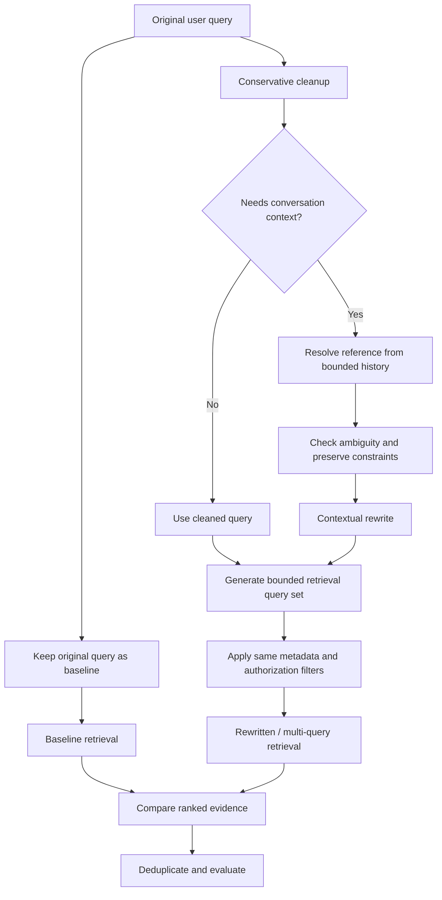

# Chapter 08 — Query Rewriting and Expansion

## Learning Objectives

By the end of this chapter, you should be able to:

- Explain why the wording of a user query can affect retrieval quality.
- Distinguish query cleanup, contextual reformulation, and alternative query generation.
- Resolve conversational references using a bounded amount of relevant history.
- Preserve names, identifiers, dates, intent, and authorization scope during rewriting.
- Limit generated queries to control latency, cost, and retrieval noise.
- Compare original-query retrieval with rewritten-query and multi-query retrieval.
- Detect cases where rewriting hurts retrieval because it changes the user's actual question.

<br/>

## 1. What Is Query Rewriting?

**Query rewriting** transforms a user's query into a form that may work better for retrieval. It should clarify or express the same information need—not silently replace it with a different one.

A user might ask:

> “What does it say about carrying it over?”

This query is difficult to retrieve by itself because “it” and “carrying it over” depend on prior context. If the conversation was about unused annual leave, a contextual reformulation could be:

> “What does the policy say about carrying unused annual leave into the next leave year?”

The rewritten version makes the topic explicit while preserving the likely intent.

Query rewriting can improve retrieval when the original query is vague, conversational, abbreviated, or uses terms that differ from the source. It can also harm retrieval when it adds assumptions, removes exact identifiers, changes dates, or broadens the query too far.

**Core rule:** treat the original query as the authoritative record of the user's request. A rewritten query is a retrieval aid, not permission to change the task.

<br/>

## 2. Three Common Query Transformations

### 2.1 Query cleanup

Cleanup makes the query easier to process without changing its meaning.

Examples:

- Trim accidental leading or trailing whitespace.
- Normalize repeated whitespace.
- Correct obvious formatting problems where doing so is unambiguous.
- Preserve meaningful punctuation, capitalization, numbers, and identifiers.

Original:

```text
   How   do I reset   my password?   
```

Cleaned:

```text
How do I reset my password?
```

Cleanup should be conservative. Do not “correct” a product code, username, file path, error string, or legal reference just because it looks unusual.

<br/>

### 2.2 Contextual reformulation

Contextual reformulation resolves references or makes implicit context explicit using relevant conversation history.

Conversation:

```text
User: Find the annual leave carryover rule in the employee handbook.
Assistant: The handbook has sections on carryover and approval.
User: What is the maximum?
```

Possible reformulation:

```text
What is the maximum annual leave carryover allowed by the employee handbook?
```

The rewrite should only use context that is sufficiently clear. If multiple possible referents exist, ask a clarification question or retrieve against the original query rather than inventing a referent.

<br/>

### 2.3 Alternative query generation

Alternative-query generation produces a small set of equivalent ways to express the same information need. These alternatives can improve recall when the source uses different terminology.

Original:

```text
How can unused vacation days be moved to next year?
```

Possible alternatives:

```text
What is the annual leave carryover policy?
How many unused leave days can be carried into the next leave year?
What rules govern transferring unused vacation entitlement to the next year?
```

Alternatives should not introduce new policy questions, assumed eligibility conditions, or unsupported facts. More queries do not automatically mean better retrieval; every additional query can introduce irrelevant candidates.

<br/>

## 3. Query Rewriting in the RAG Pipeline



This flow keeps the original query available so that rewritten retrieval can be compared with a baseline. Both paths must use the same mandatory authorization policy. Rewriting must never expand the caller's access rights.

<br/>

## 4. Resolve References Using Bounded Conversation History

Conversation context can clarify pronouns and ellipses:

- “What about the second option?”
- “Does it support that?”
- “What is the limit?”
- “Compare it with the previous version.”

However, the entire conversation is not always relevant. A rewrite component should use a bounded and relevant window of history rather than indiscriminately passing every previous message.

A practical policy:

1. Start with the latest user query.
2. Include only the recent turns needed to resolve references.
3. Prefer explicit entities and decisions from the immediately relevant topic.
4. Identify whether the reference has one clear interpretation.
5. If the referent is ambiguous, do not guess silently.
6. Preserve the original query and record the context used for the rewrite.
7. Do not use prior context to override explicit constraints in the latest query.

Example:

```python
def build_rewrite_input(original_query: str, recent_relevant_turns: list[dict]) -> dict:
    """
    The caller is responsible for selecting a bounded, relevant history window.
    This function packages it; it does not decide what context is trustworthy.
    """
    return {
        "original_query": original_query,
        "recent_relevant_turns": recent_relevant_turns[-4:],
    }
```

The number of turns is illustrative, not a universal setting. Choose the history window based on conversation behavior, token budget, privacy requirements, and evaluation. Do not include sensitive history merely because it is available.

<br/>

## 5. Preserve Meaning and Constraints

A rewrite must preserve the user's information need and all constraints that affect retrieval.

### Critical items to preserve

- **Names:** people, organizations, products, services, and documents.
- **Identifiers:** ticket numbers, error codes, version strings, filenames, URLs, clause numbers, and account-independent reference IDs.
- **Dates and ranges:** “before 1 June,” “between 2024 and 2025,” or “the version released last month.”
- **Intent:** explain, compare, summarize, find a limit, or retrieve a particular procedure.
- **Scope:** selected source, category, language, jurisdiction, product version, or date range.
- **Negation and qualifiers:** “not approved,” “only for contractors,” “excluding archived policies.”
- **Authorization scope:** tenant, ACL, group, classification, and other mandatory server-enforced constraints.

A query rewrite should not change a request for “the 2024 policy” into a request for “the latest policy.” It should not turn “Does policy X permit this?” into “What are the best practices for this?” It should not remove a restrictive source condition.

<br/>

### Example: preserve identifiers

Original:

```text
Why does API error ERR_AUTH_403 occur in client v2.4.1?
```

Unsafe rewrite:

```text
Why does authentication fail in the latest client?
```

Problems:

- The exact error code was removed.
- The specific client version was replaced by “latest.”
- The query broadened from one known error to authentication failures generally.

Safer alternative:

```text
What causes API error ERR_AUTH_403 in client version v2.4.1?
```

Even a plausible rewrite can be harmful if it changes a detail that matters to retrieval.

<br/>

## 6. A Structured Rewrite Contract

For an engineering implementation, make the rewriting contract explicit. Ask the rewrite model or component to return a small, validated object rather than unstructured commentary.

Example schema:

```json
{
  "original_query": "What is the maximum?",
  "rewritten_query": "What is the maximum annual leave carryover allowed by the employee handbook?",
  "alternatives": [
    "How many unused annual leave days can be carried over?"
  ],
  "requires_clarification": false,
  "preserved_constraints": {
    "source_ids": ["employee-handbook"],
    "date_range": null,
    "language": "en",
    "identifiers": []
  }
}
```

This is an illustrative contract, not a universal schema. The application should preserve trusted filters separately from model-generated text. Do not accept model-generated metadata or authorization claims as authoritative.

Validation should check:

- output parses against the schema;
- the original query remains unchanged;
- the rewritten query is non-empty;
- the number of alternatives stays within a configured limit;
- protected identifiers, dates, negations, and scope constraints are retained;
- no alternative broadens access or removes mandatory filters;
- ambiguous references are flagged rather than guessed.

For high-risk or highly constrained questions, a conservative no-rewrite path may be preferable.

<br/>

## 7. Bounded Query Expansion

Query expansion creates additional retrieval queries to improve recall. It can help when:

- the source uses a synonym for the user's wording;
- an acronym and its expansion are both common;
- a user asks a broad but well-defined question;
- different sections use consistent alternate terminology.

It can hurt when:

- alternatives become broader than the original request;
- a generated query adds an unsupported assumption;
- many alternatives retrieve redundant or irrelevant passages;
- the system uses excessive model calls;
- one alternative loses a version, date, identifier, or negation.

<br/>

### Set explicit bounds

Choose and document:

- maximum number of alternatives;
- maximum query length or token budget;
- maximum history window;
- model timeout and retry limits;
- whether the original query is always retrieved;
- deduplication rules for identical or near-identical alternatives;
- whether alternatives run in parallel and the resulting latency budget.

For a first experiment, the original query plus two or three alternatives is a reasonable starting point—not a guaranteed optimum. Tune the limit against retrieval metrics, cost, and latency.

<br/>

## 8. Example: Generate and Validate Alternatives

The following example demonstrates a deterministic validation boundary. It does not call an LLM; a real application could pass model-generated alternatives into the same validation step.

```python
import re

def normalize_whitespace(text: str) -> str:
    return re.sub(r"\s+", " ", text).strip()


def validate_alternatives(
    original_query: str,
    alternatives: list[str],
    max_alternatives: int = 3,
    max_chars: int = 300,
) -> list[str]:
    if max_alternatives < 0:
        raise ValueError("max_alternatives must be non-negative")

    cleaned = []
    seen = {normalize_whitespace(original_query).casefold()}

    for candidate in alternatives:
        if not isinstance(candidate, str):
            continue

        candidate = normalize_whitespace(candidate)
        if not candidate or len(candidate) > max_chars:
            continue

        key = candidate.casefold()
        if key in seen:
            continue

        seen.add(key)
        cleaned.append(candidate)

        if len(cleaned) >= max_alternatives:
            break

    return cleaned


original = "How many unused annual leave days can be carried over?"
proposed = [
    "What is the annual leave carryover limit?",
    "How many unused annual leave days can be transferred to the next leave year?",
    "What are all employee benefits and compensation rules?",
    "How many unused annual leave days can be carried over?",  # duplicate
]

print(validate_alternatives(original, proposed, max_alternatives=3))
```

This function limits count, length, and duplicates. It **does not prove semantic equivalence**. Semantic validation requires additional checks, representative evaluation, or human review. Exact constraint checks should be implemented explicitly when identifiers, dates, negations, or source scope are critical.

<br/>

## 9. Compare Original and Rewritten Retrieval

Always retain an original-query baseline. Compare retrieval results on the same corpus, with the same chunking, embedding configuration, filters, and authorization rules.

Recommended experiment:

1. Retrieve with the original query.
2. Retrieve with a cleaned query.
3. Retrieve with a contextual rewrite, where relevant.
4. Retrieve using a bounded set of alternatives.
5. Merge and deduplicate results if using multi-query retrieval.
6. Compare the returned chunks with the same labeled relevant chunk IDs.
7. Inspect examples where the rewrite improves retrieval and where it hurts.
8. Record latency, token usage, number of retrieval calls, and candidate count.
9. Repeat across paraphrase, identifier, date-sensitive, negated, and ambiguous-reference queries.

<br/>

### Evaluation table

| Query ID | Query type | Original Recall@k | Rewritten Recall@k | Expanded Recall@k | Latency change | Notes |
|---|---|---:|---:|---:|---|---|
| Q1 | Conversational reference | — | — | — | — | Was the referent resolved correctly? |
| Q2 | Exact identifier | — | — | — | — | Was the identifier preserved? |
| Q3 | Date-constrained question | — | — | — | — | Were dates and boundaries preserved? |
| Q4 | Negated constraint | — | — | — | — | Did the rewrite preserve the negation? |
| Q5 | Clear direct query | — | — | — | — | Did rewriting add unnecessary noise? |

Fill this table with measured results. A rewrite should not be considered successful only because it retrieves more chunks. The additional chunks must be relevant, eligible, and useful for the original information need.

<br/>

## 10. Cases Where Rewriting Hurts

### Case A — Exact identifier removed

Original:

```text
What does error PAY-00917 mean in release 5.2?
```

Bad rewrite:

```text
Why do payment errors happen in the latest release?
```

Why it hurts: the exact identifier and version are gone. BM25 or an exact-match index may no longer retrieve the intended passage.

<br/>

### Case B — Date constraint changed

Original:

```text
Find the retention policy that applied on 1 January 2024.
```

Bad rewrite:

```text
Find the current retention policy.
```

Why it hurts: historical applicability was replaced by present-day applicability.

<br/>

### Case C — Negation removed

Original:

```text
Which requests are not eligible for automatic approval?
```

Bad rewrite:

```text
Which requests are eligible for automatic approval?
```

Why it hurts: the rewrite reverses the information need.

<br/>

### Case D — Unsupported assumption introduced

Original:

```text
How do I request leave?
```

Bad rewrite:

```text
How do full-time employees request paid annual leave through the HR portal?
```

Why it hurts: employment type, leave type, payment status, and portal use were introduced without evidence.

<br/>

### Case E — Expansion creates noise

Original:

```text
How do I rotate the service API key?
```

Generated alternatives include queries about password resets, account recovery, user login, and multi-factor authentication.

Why it hurts: related security topics are not necessarily equivalent to API-key rotation. Extra candidates may crowd out the relevant passage and increase downstream cost.

<br/>

## 11. Failure Handling and Observability

Record enough information to debug rewriting without unnecessarily logging sensitive content.

Useful telemetry includes:

- a request or trace ID;
- the original and rewritten query, subject to privacy policy;
- the rewrite model/version and configuration;
- which history window or context references were used;
- the number of generated alternatives;
- validation failures and fallback decisions;
- retrieval metrics for original and rewritten paths;
- added latency, retries, and token usage.

Possible fallback rules:

- If rewriting times out, use the original query.
- If output fails schema validation, use the original query.
- If a protected identifier or explicit constraint is changed, reject the rewrite.
- If the referent is ambiguous, ask for clarification when the ambiguity materially affects results.
- If expansion adds excessive noise or latency, disable expansion for that query type.
- If no rewrite is needed, skip the extra model call.

Do not assume the rewrite model is always correct. Treat its output as an untrusted proposal that must pass application-level validation.

<br/>

## 12. Practice — Compare Original and Rewritten Queries

Build a small evaluation set with at least these categories:

1. A short follow-up that depends on previous context.
2. A clear direct question that needs no rewriting.
3. A question containing an exact identifier.
4. A date- or version-constrained question.
5. A question containing negation.
6. A query with an ambiguous pronoun or referent.
7. A query for which extra alternatives are likely to add noise.

For each item:

- record the original query and the relevant history, if any;
- write a conservative cleanup and/or contextual rewrite;
- generate no more than the chosen alternative limit;
- list names, identifiers, dates, negations, and scope constraints that must be preserved;
- retrieve with the original and rewritten variants;
- compare Recall@k and inspect the actual returned text;
- record latency and candidate count;
- document one case where rewriting helps and one where it hurts.

**Success criterion:** any improvement must come from retrieving better evidence for the same user request, not from replacing the request with an easier or broader question.

<br/>

## 13. Checkpoint — Model Answer

**Question:** How do you verify that retrieval improvements do not come from changing the user's question?

**Answer:**

Keep the original query as a baseline and evaluate original and rewritten retrieval against the same labeled relevant chunk IDs, corpus, metadata filters, and authorization policy. Inspect the rewritten text to verify that it preserves intent, names, identifiers, dates, negations, and source constraints. Include cases where rewriting can fail, such as exact codes, historical dates, and ambiguous references.

Measure retrieval quality, latency, and candidate noise together. If a rewrite retrieves more passages but changes the requested version, removes a negation, or adds unsupported assumptions, it is not a valid improvement. Fall back to the original query or ask for clarification when equivalence cannot be established.

<br/>

## Key Takeaways

1. Query rewriting should clarify the same information need, not redefine it.
2. Use cleanup, contextual reformulation, and alternative-query generation for different problems.
3. Resolve references from a bounded, relevant history window; do not guess when ambiguity matters.
4. Preserve names, identifiers, dates, intent, negation, source scope, and authorization boundaries.
5. Bound alternatives to manage latency, cost, and retrieval noise.
6. Keep original-query retrieval as a baseline and fallback.
7. Evaluate both improvements and regressions with labeled evidence, not generated-answer fluency alone.

<br/>

## References

- [LangChain — Retrievers](https://python.langchain.com/docs/concepts/retrievers/)
- [LangChain — How to add chat history](https://python.langchain.com/docs/how_to/chatbots_memory/)
- [Sentence Transformers — Semantic Search](https://www.sbert.net/examples/sentence_transformer/applications/semantic-search/README.html)
- [Cormack, Clarke, and Buettcher — Reciprocal Rank Fusion (2009)](https://doi.org/10.1145/1571941.1572114)
- [OWASP — Authorization Cheat Sheet](https://cheatsheetseries.owasp.org/cheatsheets/Authorization_Cheat_Sheet.html)

<br/>

## Next Chapter

**Chapter 09 — Reranking**

Next, learn how a second-stage ranker can reorder an initial candidate set and how to measure whether reranking improves the evidence that reaches answer generation.
