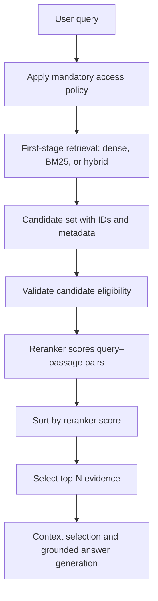

# Chapter 09 — Reranking

## Learning Objectives

By the end of this chapter, you should be able to:

- Explain why candidate retrieval and reranking are separate stages.
- Distinguish a fast first-stage retriever from a more expensive relevance scorer.
- Describe how cross-encoder rerankers compare a query with each candidate passage.
- Understand the trade-offs among candidate count, relevance quality, latency, and model input limits.
- Preserve chunk IDs, source metadata, and provenance throughout reranking.
- Prevent unauthorized candidate text from being sent to external reranking services.
- Evaluate a reranked list against relevance judgments and the original ranking.

<br/>

## 1. What Is Reranking?

RAG retrieval commonly uses two stages:

1. **Candidate retrieval:** quickly find a broad set of potentially relevant passages.
2. **Reranking:** score and reorder those candidates using a more query-specific relevance model.

The first-stage retriever is usually optimized to search a large collection efficiently. It may use dense embeddings, BM25, hybrid retrieval, or another search method. The reranker then evaluates a smaller candidate set in greater detail.

For example, a retriever might return 50 candidate chunks for a question. A reranker scores those 50 query–passage pairs and moves the most relevant evidence toward the top. The answer-generation stage can then select a smaller set from the improved ranking.

The candidate count of 50 is only an illustration, not a recommended universal value.

**Critical limitation:** a reranker can reorder only the candidates it receives. If the relevant passage was not retrieved, reranking cannot add it unless a separate retrieval stage searches for it.

<br/>

## 2. Candidate Retrieval vs. Reranking

| Property | First-stage retrieval | Reranking |
|---|---|---|
| Main purpose | Find candidate passages from a large corpus | Improve the ordering of a candidate set |
| Typical input | Query and searchable index | Query plus each candidate passage |
| Typical scale | Potentially millions of indexed chunks | Usually a much smaller candidate list |
| Common approaches | Dense search, BM25, hybrid search | Cross-encoder, learned relevance model, model-based scoring |
| Primary trade-off | Search coverage and efficiency | More detailed relevance scoring at added cost |
| Output | Candidate IDs and initial scores/ranks | Reordered candidates with reranker scores |
| Main limitation | May miss relevant evidence or rank it low | Cannot recover evidence that is absent from its input set |

A strong reranker cannot compensate for a first-stage retriever that consistently misses the correct source. Conversely, a good candidate set can still be improved if the first-stage ordering is imperfect.

<br/>

## 3. Cross-Encoder Rerankers

A **cross-encoder** processes the query and candidate passage together, allowing the model to attend jointly to both texts when producing a relevance score.

Conceptually:

```text
(query, candidate passage) → cross-encoder → relevance score
```

The reranker repeats this operation for each candidate passage, or batches multiple query–passage pairs if the implementation supports it.

<br/>

### Why cross-encoders can improve ranking

Because the query and passage are evaluated together, a cross-encoder can model detailed interactions between query terms and passage content. It may distinguish a passage that merely shares vocabulary from one that directly addresses the question.

### Trade-offs

- More computational work per candidate than comparing precomputed dense vectors.
- Additional inference latency, especially with large candidate sets or remote APIs.
- A maximum input length: long passages may be truncated or rejected.
- Scores are model-specific and generally should not be interpreted as calibrated probabilities without validation.
- Model quality depends on language, domain, training data, and the kind of relevance judgment required.

<br/>

### Other model-based ranking approaches

A system may use a learned ranking model, a provider's reranking API, or an LLM instructed to judge query–passage relevance. These approaches differ in cost, output consistency, latency, privacy, and score interpretation. Treat them as alternatives to evaluate, not interchangeable implementations with guaranteed equal behavior.

<br/>

## 4. A Two-Stage RAG Flow



Authorization must be enforced before candidate text is sent to a reranker, particularly when reranking is performed by an external service. The validation step in the diagram is defense in depth; it does not replace access control at the retrieval boundary.

<br/>

## 5. Choosing Candidate Count and Final Top-N

Two different values matter:

- **Candidate count (C):** how many results the first-stage retriever sends to the reranker.
- **Final top-N:** how many reranked passages continue to context selection.

Increasing `C` may improve the chance that relevant evidence appears in the candidate set, but it also increases reranking work. Increasing final top-N may improve evidence coverage but can add redundancy, distractors, and context-token cost.

| Configuration | Potential benefit | Potential cost or risk |
|---|---|---|
| Small candidate set | Lower latency and cost | Relevant evidence may never reach the reranker |
| Large candidate set | Better chance of including useful evidence | More scoring work and potentially more noise |
| Small final top-N | Compact, focused context | May omit complementary evidence |
| Large final top-N | More coverage | More redundancy and context consumption |

Do not choose candidate count or final top-N from intuition alone. Tune them on representative questions and relevance judgments. Measure both retrieval quality and end-to-end latency.

<br/>

## 6. Input Limits and Passage Preparation

Rerankers have input constraints. A model may limit the combined query and passage length, the maximum number of passages per request, or the request payload size.

Practical safeguards:

- Keep chunking aligned with the reranker's input limits and the evidence granularity needed by the application.
- Avoid silently truncating the only passage that contains the answer.
- If a passage is too long, consider splitting it earlier in ingestion or reranking smaller, source-linked segments.
- Preserve the original chunk ID and locator if text is shortened for scoring.
- Record truncation or preprocessing so results can be debugged.
- Batch candidates only within documented model and provider limits.
- Set timeouts and bounded retries for remote reranking calls.

A model's maximum token length and the provider's request-size limit are not necessarily the same. Check the actual implementation's documentation.

<br/>

## 7. Preserve IDs, Metadata, and Provenance

The reranker should change candidate order—not erase the identity of the evidence.

For each candidate, preserve fields such as:

- `chunk_id`;
- `source_id` and `document_version`;
- page number or section locator;
- validated metadata required by filtering and authorization;
- initial retrieval rank and score;
- reranker score and new rank.

Example candidate before reranking:

```json
{
  "chunk_id": "leave-policy:v1:section-2:c01",
  "source_id": "leave-policy",
  "document_version": "v1",
  "section_path": ["Annual Leave", "Carryover"],
  "initial_rank": 8,
  "initial_score": 0.61,
  "content": "Eligible employees may carry over up to five unused annual leave days."
}
```

Example after reranking:

```json
{
  "chunk_id": "leave-policy:v1:section-2:c01",
  "source_id": "leave-policy",
  "document_version": "v1",
  "section_path": ["Annual Leave", "Carryover"],
  "initial_rank": 8,
  "initial_score": 0.61,
  "reranker_score": 0.94,
  "reranker_rank": 1,
  "content": "Eligible employees may carry over up to five unused annual leave days."
}
```

The numerical scores are illustrative, not outputs from a real model. They are also not directly comparable: the initial retriever score and reranker score may have different meanings and scales.

Join results back to source records using stable IDs, not list position. Do not assume that a reranker returns candidates in the same order as the input.

<br/>

## 8. Python Example with a Cross-Encoder

The following example uses the `sentence-transformers` CrossEncoder API. Select a model appropriate for your language and domain, and verify its current model card and usage requirements before deployment.

Install dependencies:

```bash
pip install sentence-transformers
```

Example:

```python
from sentence_transformers import CrossEncoder

reranker = CrossEncoder("cross-encoder/ms-marco-MiniLM-L-6-v2")

question = "How many unused annual leave days can be carried over?"

candidates = [
    {
        "chunk_id": "leave-policy:v1:section-3:c01",
        "source_id": "leave-policy",
        "section_path": ["Annual Leave", "Approval"],
        "content": "Annual leave requests must be approved by a manager.",
        "initial_rank": 1,
    },
    {
        "chunk_id": "leave-policy:v1:section-2:c01",
        "source_id": "leave-policy",
        "section_path": ["Annual Leave", "Carryover"],
        "content": "Eligible employees may carry over up to five unused annual leave days.",
        "initial_rank": 2,
    },
    {
        "chunk_id": "security-guide:v2:section-1:c01",
        "source_id": "security-guide",
        "section_path": ["Account Security"],
        "content": "Use multi-factor authentication to protect company accounts.",
        "initial_rank": 3,
    },
]

# This assumes candidates have already passed trusted authorization checks.
pairs = [(question, item["content"]) for item in candidates]
scores = reranker.predict(pairs)

reranked = []
for item, score in zip(candidates, scores):
    updated = dict(item)
    updated["reranker_score"] = float(score)
    reranked.append(updated)

reranked.sort(key=lambda item: item["reranker_score"], reverse=True)

for rank, item in enumerate(reranked, start=1):
    print(
        rank,
        round(item["reranker_score"], 4),
        item["chunk_id"],
        item["content"],
    )
```

This code demonstrates the ranking mechanics. The score direction and interpretation depend on the chosen model. Many relevance models use higher scores for more relevant pairs, but confirm this in the selected model's documentation.

The sample uses an illustrative candidate list. Actual ordering and scores must be measured when you run the code.

<br/>

## 9. Avoid Sending Unauthorized Candidates to External Services

If the reranker runs outside your trusted infrastructure, candidate text may be transmitted to a third party. Apply the same data-governance and access-control requirements as for any external processing service.

Before reranking:

1. Authenticate the caller.
2. Apply mandatory tenant and permission predicates at retrieval time.
3. Confirm each candidate is eligible for this caller and this request.
4. Send only authorized, necessary candidate text and metadata to the reranker.
5. Avoid transmitting unrelated metadata, secrets, or unnecessary personal data.
6. Review the service's data retention, logging, residency, and contractual settings.
7. Handle access revocation and stale indexed permissions.
8. Keep sensitive content out of diagnostic logs unless explicitly permitted and appropriately protected.

Do not retrieve from all tenants and then rely on a post-reranking filter. Unauthorized text may already have left your environment. If the external service cannot meet the required security and data-handling conditions, use an approved service or an in-boundary reranker.

<br/>

## 10. Evaluation: Did Reranking Improve the Order?

Use a fixed candidate set when evaluating the reranker. This isolates the effect of reordering from changes in candidate retrieval.

### Experiment procedure

1. Build a labeled set of queries and relevant chunk IDs.
2. Run the first-stage retriever with fixed settings.
3. Save its top-C candidate set and initial ordering.
4. Pass exactly those eligible candidates to the reranker.
5. Save the reranked ordering and scores.
6. Compare initial and reranked rankings against the same relevance judgments.
7. Inspect queries where the correct passage moved up, moved down, or was absent.
8. Record inference latency, candidate count, token lengths, and failures.
9. Repeat with multiple candidate counts and final top-N values.

Useful metrics include:

- **MRR (Mean Reciprocal Rank):** rewards placing the first relevant result near the top.
- **nDCG@k:** evaluates ranking quality when relevance judgments have graded levels.
- **Recall@k:** measures how much of the labeled relevant evidence appears in the top-*k* results.
- **Precision@k:** measures the proportion of top-*k* results judged relevant.

Metrics answer different questions. Reranking can improve MRR or nDCG by moving relevant candidates higher even though it cannot improve candidate-set recall beyond the set it receives.

<br/>

### Results table template

| Query ID | Initial MRR / nDCG | Reranked MRR / nDCG | Relevant candidate present? | Latency | Notes |
|---|---|---|---|---|---|
| Q1 | — | — | — | — | Did relevant evidence move up? |
| Q2 | — | — | — | — | Was a misleading lexical match demoted? |
| Q3 | — | — | — | — | Was the correct chunk absent from top-C? |

Use actual measured values. Do not conclude that a reranker works because a single example looks better.

<br/>

## 11. Failure Modes

| Failure | Symptom | Response |
|---|---|---|
| Relevant passage absent from candidates | Reranker never returns the evidence | Improve first-stage recall or candidate count |
| Candidate set too small | Correct evidence is just outside top-C | Tune C using labeled queries |
| Candidate set too large | Latency and cost increase | Tune C; use batching within documented limits |
| Long passage truncated | Key condition is omitted during scoring | Adjust chunking or input preparation; log truncation |
| Domain mismatch | Ranking favors superficially similar passages | Evaluate a domain-appropriate model or train/tune if justified |
| Score misinterpreted | Score treated as probability or compared with dense score | Check model documentation and validate calibration separately |
| Metadata lost | Correct text is returned without reliable citation | Join by stable `chunk_id` and preserve source fields |
| Unauthorized text sent externally | Sensitive candidate leaves trusted boundary | Enforce authorization before external processing |
| Reranker worsens results | Relevant passages move down | Compare per-query metrics; retain baseline or disable for affected query types |

<br/>

## 12. Practice — Rerank a Fixed Candidate Set

Create a small candidate set for each question and label the relevant chunks.

For every query:

1. Save the initial top-C candidates, IDs, scores, and ranks.
2. Record which candidates are relevant and why.
3. Rerank the exact same candidate set.
4. Compare initial and new ordering against the labels.
5. Identify any relevant passage that moved down.
6. Check whether a relevant passage was absent from the candidate set before reranking.
7. Record latency and input-length constraints.
8. Verify that IDs and source metadata survive the ranking step.
9. Ensure every candidate was authorized before any external service received its text.

Include at least one case where reranking improves the order and one where it fails. For the failure case, distinguish a ranking failure from a candidate-recall failure.

<br/>

## 13. Checkpoint — Model Answer

**Question:** Why cannot reranking recover evidence that is absent from its candidate set?

**Answer:**

A reranker scores and reorders the passages supplied to it. It does not normally search the entire document collection for missing passages. If the first-stage retriever excludes the relevant chunk, that chunk is not available for the reranker to promote.

This is why candidate retrieval and reranking must be evaluated separately. Candidate retrieval should provide adequate recall; reranking should improve the ordering of the available candidates. When the relevant evidence is missing, improve the first-stage retrieval configuration, query handling, filtering, or candidate count rather than expecting the reranker to invent or retrieve the missing passage.

<br/>

## Key Takeaways

1. Candidate retrieval finds passages; reranking improves their order.
2. Cross-encoders jointly score a query and candidate passage, often at higher per-candidate cost than first-stage retrieval.
3. Candidate count and final top-N affect recall, latency, cost, and context size.
4. Preserve chunk IDs, source metadata, versions, locators, and initial ranking information.
5. Do not compare reranker scores directly with dense or BM25 scores without a justified calibration method.
6. Enforce authorization before candidate text reaches an external reranking service.
7. A reranker cannot recover evidence that never entered its candidate set.

<br/>

## References

- [Sentence Transformers — Cross-Encoder Usage](https://www.sbert.net/docs/cross_encoder/usage/usage.html)
- [Sentence Transformers — Cross-Encoder Models](https://www.sbert.net/docs/cross_encoder/pretrained_models.html)
- [Sentence Transformers — Retrieve & Re-Rank](https://www.sbert.net/examples/sentence_transformer/applications/retrieve_rerank/README.html)
- [TREC — Text REtrieval Conference](https://trec.nist.gov/)
- [OWASP — Authorization Cheat Sheet](https://cheatsheetseries.owasp.org/cheatsheets/Authorization_Cheat_Sheet.html)

<br/>

## Next Chapter

**Chapter 10 — Parent-Child and Multi-Stage Retrieval**

Next, explore how to retrieve focused child chunks while recovering broader parent context, and how multiple retrieval stages can improve evidence coverage without losing provenance.
