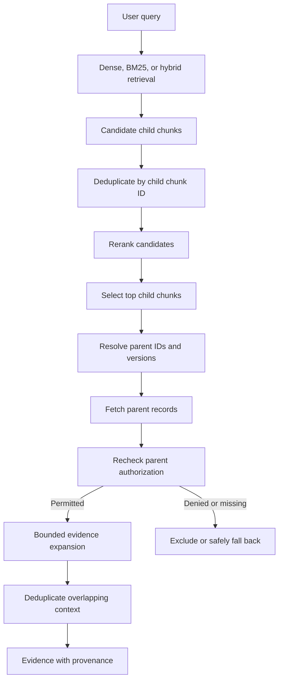

# Chapter 10 — Parent-Child and Multi-Stage Retrieval

## Learning Objectives

By the end of this chapter, you should be able to:

- Explain the difference between a retrieval unit and a context unit.
- Retrieve a small child passage and fetch its permitted parent section or document.
- Trace candidate generation, deduplication, reranking, and evidence expansion.
- Preserve source IDs, versions, locators, and parent-child relationships.
- Bound parent expansion so that context remains relevant and fits the application's budget.
- Recheck authorization when fetching broader content.
- Compare passage-only context with parent-section expansion using the same questions and relevance judgments.

<br/>

## 1. Why Parent-Child Retrieval?

A RAG system often needs two different levels of text:

- **Retrieval unit:** a relatively small passage used for matching a query.
- **Context unit:** the passage or broader source section provided to the answer-generation stage.

Small chunks can be easier to retrieve precisely. However, a small chunk may omit a definition, exception, preceding condition, table heading, or nearby sentence needed to interpret it correctly.

Parent-child retrieval addresses this tension by indexing smaller child chunks while preserving a link to a larger parent section or document. When a child is retrieved, the system can optionally fetch the permitted parent content for additional context.

Example:

**Child chunk**

> “Up to five unused days may be carried over.”

This is a useful retrieval match, but by itself it may not say who is eligible or whether approval is required.

**Parent section**

> “Annual Leave Carryover. Eligible full-time employees may carry over up to five unused days into the next leave year, subject to manager approval by 15 December.”

The parent section adds conditions that affect the meaning. However, a whole document may contain many unrelated topics, so expansion should be selective and bounded.

<br/>

## 2. Retrieval Units vs. Context Units

| Dimension | Retrieval unit | Context unit |
|---|---|---|
| Primary goal | Find relevant evidence precisely | Give the model enough surrounding information to interpret evidence |
| Typical size | Small chunk, paragraph, or passage | Parent section, group of adjacent chunks, or selected document excerpt |
| Indexing | Commonly embedded and/or indexed lexically | May be stored separately or assembled from source records |
| Main risk if too small | Missing conditions, definitions, or context | Not applicable in the same way |
| Main risk if too large | Less precise matching and more noise | Irrelevant content, higher token cost, or sensitive material |
| Typical identifier | `child_chunk_id` | `parent_section_id` or `parent_document_id` |

The retrieval unit and context unit do not have to be the same size. They must, however, retain a trustworthy relationship so the application can expand evidence without losing provenance.

<br/>

## 3. Model the Parent-Child Relationship

Store explicit identifiers for both the child chunk and its parent. Avoid relying only on text similarity or array positions to reconstruct the relationship.

Example child record:

```json
{
  "chunk_id": "leave-policy:v2026-03:section-2:c03",
  "source_id": "leave-policy",
  "document_version": "2026-03",
  "parent_section_id": "leave-policy:v2026-03:section-2",
  "section_path": ["Annual Leave", "Carryover"],
  "page_number": 12,
  "content": "Up to five unused days may be carried over.",
  "tenant_id": "org-42",
  "classification": "internal"
}
```

Example parent record:

```json
{
  "parent_section_id": "leave-policy:v2026-03:section-2",
  "source_id": "leave-policy",
  "document_version": "2026-03",
  "section_path": ["Annual Leave", "Carryover"],
  "page_start": 12,
  "page_end": 13,
  "content": "Annual Leave Carryover. Eligible full-time employees may carry over up to five unused days into the next leave year, subject to manager approval by 15 December.",
  "tenant_id": "org-42",
  "classification": "internal"
}
```

The content and IDs are illustrative. Your ingestion pipeline should define how parent sections are extracted, identified, versioned, and updated.

<br/>

### Relationship invariants

- A child must reference a parent from the same logical source and document version.
- Parent identifiers must be stable within the versioning scheme.
- A missing or deleted parent must be handled explicitly; do not silently fetch an unrelated current version.
- Parent lookup must return source metadata and authorization attributes, not just text.
- A child match does not automatically authorize access to the entire parent document.

<br/>

## 4. A Multi-Stage Retrieval Pipeline

A common pipeline is:

1. **Candidate generation:** dense, BM25, or hybrid retrieval returns small child chunks.
2. **Deduplication:** merge duplicate child IDs from multiple retrieval branches.
3. **Reranking:** reorder the candidate children by query-specific relevance.
4. **Parent lookup:** map selected child IDs to their version-matched parent sections.
5. **Authorization check:** verify the caller may access the parent content being fetched.
6. **Bounded expansion:** choose relevant parent text or a limited surrounding window.
7. **Evidence assembly:** return context with source IDs, versions, and locators.



A system may choose to authorize children earlier in retrieval and then recheck the parent at fetch time. The parent check is important because permission to read a small child record does not necessarily imply permission to read all surrounding parent content.

<br/>

## 5. Candidate Generation, Deduplication, and Reranking

Parent-child retrieval builds on earlier retrieval stages rather than replacing them.

### Candidate generation

Retrieve a broad enough set of child chunks to give the reranker useful options. If the child containing the needed evidence is not retrieved, parent expansion cannot reliably recover it unless another stage searches for it.

<br/>

### Deduplication

A child may appear in both dense and sparse candidate lists. Deduplicate by stable `chunk_id` while preserving branch ranks and scores for analysis.

After parent lookup, multiple children may point to the same parent. This is not necessarily a problem: several different passages in one section may support the answer. But the system should avoid repeating the full parent section several times.

<br/>

### Reranking

Rerank child passages before expansion when the goal is to identify the most relevant evidence anchors. Alternatively, a system may rerank expanded parent sections if its reranker is designed for longer passages and the extra latency is acceptable. Evaluate both designs rather than assuming one is universally better.

<br/>

### Evidence expansion

Use the selected child IDs as anchors. Fetch only their permitted, version-matched parent sections or a bounded excerpt. Preserve the original child-level evidence so that the system can show exactly which passage triggered retrieval.

<br/>

## 6. Bounded Parent Expansion

Expansion should be explicit, deterministic where possible, and limited by policy.

Potential controls include:

- maximum number of child anchors;
- maximum number of unique parent sections;
- maximum parent characters or tokens;
- maximum number of adjacent chunks;
- whether to include a heading, definition, preceding paragraph, or following paragraph;
- maximum total evidence tokens;
- deduplication of overlapping excerpts;
- behavior when a parent is missing or too large.

<br/>

### Common expansion strategies

| Strategy | How it works | Useful when | Main risk |
|---|---|---|---|
| Full parent section | Fetch the whole section containing the child | Sections are short and self-contained | Section may contain unrelated material |
| Adjacent-window expansion | Add a limited number of neighboring chunks | Context depends on nearby text | Window can miss distant definitions or exceptions |
| Heading-aware expansion | Include the relevant heading and section body | Headings provide important context | Parsing errors can misidentify boundaries |
| Selected-span expansion | Return the child plus chosen surrounding sentences | Token budget is tight | May omit a distant condition |
| Parent-document expansion | Fetch a larger document excerpt or document | Question genuinely spans multiple sections | High noise, token cost, and access risk |

Prefer the smallest context unit that supplies the needed evidence. Larger is not automatically better.

<br/>

## 7. Preserve Source and Version Relationships

A child record should not be expanded into a parent from a different document version merely because the source ID matches.

For example, if the retrieved child belongs to `leave-policy` version `2026-03`, parent lookup should resolve the corresponding parent section from that same version. Otherwise, the child may contain an old rule while the parent contains a newer or contradictory one.

Recommended provenance fields for expanded evidence:

```json
{
  "child_chunk_id": "leave-policy:v2026-03:section-2:c03",
  "parent_section_id": "leave-policy:v2026-03:section-2",
  "source_id": "leave-policy",
  "document_version": "2026-03",
  "section_path": ["Annual Leave", "Carryover"],
  "page_start": 12,
  "page_end": 13,
  "expansion_method": "full_parent_section"
}
```

Record the expansion method because it helps debug whether a result came from the child passage alone, an adjacent window, or a full parent section.

If a source is updated or deleted, update child and parent records coherently. Stale parent mappings can undermine both answer accuracy and source citations.

<br/>

## 8. Authorization During Parent Lookup

Parent expansion can expose more text than the original child chunk. Authorization must apply to the content actually returned, not just to the initial match.

A safe high-level sequence:

1. Authenticate the caller.
2. Apply mandatory authorization to the retrieval candidates.
3. Rerank only authorized candidates.
4. Resolve the exact parent ID and document version.
5. Fetch the parent through a trusted service.
6. Re-evaluate authorization for the parent or selected parent excerpt.
7. Apply data-classification and field-level restrictions where required.
8. Limit expansion to the minimum content needed.
9. Exclude denied or missing parent content, or use an explicitly permitted child-only fallback.
10. Ensure unauthorized text does not enter logs, traces, external rerankers, or model context.

Do not assume that authorization on the child automatically grants access to the parent. Access models may allow selected excerpts while restricting the broader document, or the parent may have changed permissions since indexing.

A fallback to child-only context is appropriate only if the child itself remains authorized and its use is permitted by policy. Otherwise, exclude it.

<br/>

## 9. Python Example: Expand Selected Children to Parents

The following in-memory example demonstrates the relationship lookup and a basic permission check. It is educational pseudocode, not a production authorization engine. In a real system, enforce access through a trusted retrieval or policy service.

```python
children = [
    {
        "chunk_id": "leave-policy:v1:section-2:c01",
        "source_id": "leave-policy",
        "document_version": "v1",
        "parent_section_id": "leave-policy:v1:section-2",
        "content": "Up to five unused days may be carried over.",
        "tenant_id": "org-42",
        "allowed_groups": ["employees", "hr"],
    },
    {
        "chunk_id": "leave-policy:v1:section-3:c01",
        "source_id": "leave-policy",
        "document_version": "v1",
        "parent_section_id": "leave-policy:v1:section-3",
        "content": "Leave requests must be approved by a manager.",
        "tenant_id": "org-42",
        "allowed_groups": ["employees", "hr"],
    },
]

parents = {
    "leave-policy:v1:section-2": {
        "parent_section_id": "leave-policy:v1:section-2",
        "source_id": "leave-policy",
        "document_version": "v1",
        "content": (
            "Annual Leave Carryover. Eligible employees may carry over "
            "up to five unused days into the next leave year, subject "
            "to manager approval by 15 December."
        ),
        "tenant_id": "org-42",
        "allowed_groups": ["employees", "hr"],
    },
    "leave-policy:v1:section-3": {
        "parent_section_id": "leave-policy:v1:section-3",
        "source_id": "leave-policy",
        "document_version": "v1",
        "content": (
            "Annual Leave Approval. Submit requests through the employee "
            "portal and obtain manager approval before taking leave."
        ),
        "tenant_id": "org-42",
        "allowed_groups": ["employees", "hr"],
    },
}


def is_authorized(record, caller):
    # Simplified illustration only. Use your trusted policy service in production.
    return (
        record.get("tenant_id") == caller["tenant_id"]
        and bool(
            set(record.get("allowed_groups", []))
            & set(caller.get("groups", []))
        )
    )


def expand_selected_children(
    selected_children,
    parent_store,
    caller,
    max_parents=2,
    max_chars_per_parent=1200,
):
    if max_parents < 1 or max_chars_per_parent < 1:
        raise ValueError("Expansion limits must be positive")

    expanded = []
    seen_parent_ids = set()

    for child in selected_children:
        # Do not expand an unauthorized child.
        if not is_authorized(child, caller):
            continue

        parent_id = child["parent_section_id"]
        if parent_id in seen_parent_ids:
            continue
        if len(seen_parent_ids) >= max_parents:
            break

        parent = parent_store.get(parent_id)
        if parent is None:
            # Missing parent: no silent lookup of another version.
            continue

        # Confirm that source and version still match the child.
        if (
            parent.get("source_id") != child.get("source_id")
            or parent.get("document_version") != child.get("document_version")
        ):
            continue

        # Parent permissions must be checked separately.
        if not is_authorized(parent, caller):
            continue

        seen_parent_ids.add(parent_id)
        expanded.append({
            "child_chunk_id": child["chunk_id"],
            "parent_section_id": parent_id,
            "source_id": parent["source_id"],
            "document_version": parent["document_version"],
            "content": parent["content"][:max_chars_per_parent],
        })

    return expanded


caller = {
    "tenant_id": "org-42",
    "groups": ["employees"],
}

selected = [children[0], children[1]]
for item in expand_selected_children(
    selected,
    parents,
    caller,
    max_parents=2,
    max_chars_per_parent=1200,
):
    print(item["parent_section_id"], item["content"])
```

The example checks tenant and group membership, but real policies may include explicit denials, inherited permissions, classification rules, ownership, user-specific grants, and revocation. The simple character limit is not a token counter; production systems should enforce an appropriate token budget as well.

<br/>

## 10. Passage-Only vs. Parent-Section Context

Compare both approaches using the same queries and candidate-generation configuration.

### Passage-only context

Provide only the selected child chunks.

Potential advantages:
- focused evidence;
- lower token usage;
- less unrelated material;
- smaller exposure surface.

Potential disadvantages:
- missing headings, definitions, exceptions, or conditions;
- pronouns and references may be unclear;
- table rows may be separated from headers or notes.

<br/>

### Parent-expanded context

Provide a permitted parent section or bounded excerpt for selected child chunks.

Potential advantages:
- surrounding conditions and definitions may become visible;
- headings and section structure can clarify meaning;
- related clauses may support a more complete answer.

Potential disadvantages:
- unrelated passages may be added;
- duplicate parent sections may inflate context;
- token use and latency may increase;
- broader text can contain information the caller is not permitted to access.

<br/>

### Evaluation plan

For each labeled question:

1. Retrieve and rerank the same child candidates.
2. Build a passage-only evidence set.
3. Build a parent-expanded evidence set using the same selected child anchors.
4. Enforce the same authorization policy and expansion limits.
5. Compare evidence completeness, irrelevant content, context tokens, latency, and answer-grounding potential.
6. Inspect cases where expansion changes the interpretation or introduces unrelated material.

A useful evaluation table:

| Query ID | Passage-only evidence | Parent-expanded evidence | Extra context useful? | Noise / token cost | Permission result |
|---|---|---|---|---|---|
| Q1 | — | — | — | — | — |
| Q2 | — | — | — | — | — |
| Q3 | — | — | — | — | — |

Populate the table from measured results. Do not assume that the expanded version is better for every question.

<br/>

## 11. Failure Modes

| Failure | Symptom | Response |
|---|---|---|
| Parent relationship missing | Child cannot be expanded reliably | Validate parent IDs during ingestion |
| Version mismatch | Child evidence conflicts with parent content | Resolve parent within the exact source version |
| Full document returned by default | Context contains unrelated sections | Prefer section or bounded-span expansion |
| Duplicate parents | Same section appears repeatedly | Deduplicate by versioned parent ID |
| Parent is unauthorized | Broader text exposes restricted information | Recheck parent permissions before returning text |
| Parent was deleted or superseded | Stale evidence or broken citations | Handle deletion and version updates coherently |
| Expansion exceeds token budget | Context truncates or downstream latency rises | Enforce explicit parent and token limits |
| Child-only passage is insufficient | Answer misses a condition or exception | Compare selective parent expansion |
| Expansion adds misleading context | Model attends to unrelated nearby text | Reduce expansion scope and evaluate by query type |

<br/>

## 12. Practice — Compare Passage-Only and Parent-Section Expansion

Choose a small set of documents with clear section structure. Create child chunks and versioned parent sections.

For each labeled question:

1. Retrieve and rerank child chunks.
2. Save child IDs, scores, source IDs, versions, and locators.
3. Build the passage-only context.
4. Fetch the exact version-matched parent sections for selected children.
5. Recheck permissions on each parent.
6. Apply a maximum-parent and context-token limit.
7. Deduplicate repeated parent sections and overlapping text.
8. Compare the two evidence sets for completeness and irrelevant content.
9. Record token count and latency.
10. Include at least one case where expansion helps and one where it adds noise or must be denied.

**Success criterion:** expansion should add context that improves interpretation of the retrieved evidence without changing its source/version relationship or crossing an authorization boundary.

<br/>

## 13. Checkpoint — Model Answer

**Question:** When does expansion improve evidence, and when can it add irrelevant or unauthorized material?

**Answer:**

Expansion helps when the retrieved child passage is too small to convey a relevant heading, definition, condition, exception, table context, or neighboring explanation. A version-matched parent section can restore that context and help the application interpret the evidence accurately.

Expansion can hurt when the parent contains unrelated topics, duplicates content already selected, exceeds the context budget, or introduces distracting information. It can also create a security failure if the caller may access the child but not the broader parent content. Therefore, expansion should be bounded, deduplicated, tied to the exact source version, and authorized at the parent-fetch boundary. Compare passage-only and expanded evidence empirically rather than assuming more context is always better.

<br/>

## Key Takeaways

1. Use small retrieval units for precision and context units large enough to interpret the evidence.
2. Store explicit, versioned parent-child relationships; do not infer them from array positions or text similarity.
3. Candidate generation, deduplication, reranking, parent lookup, and expansion are separate stages.
4. Bound expansion by parent count, excerpt size, and total context budget.
5. Preserve child IDs, parent IDs, source IDs, versions, and locators throughout the pipeline.
6. Recheck authorization when fetching broader parent content.
7. Measure whether expansion improves evidence completeness enough to justify added noise, latency, and token use.

<br/>

## References

- [LangChain — Parent Document Retriever](https://python.langchain.com/docs/how_to/parent_document_retriever/)
- [LangChain — Multi Vector Retriever](https://python.langchain.com/docs/how_to/multi_vector/)
- [Sentence Transformers — Retrieve & Re-Rank](https://www.sbert.net/examples/sentence_transformer/applications/retrieve_rerank/README.html)
- [OWASP — Authorization Cheat Sheet](https://cheatsheetseries.owasp.org/cheatsheets/Authorization_Cheat_Sheet.html)

<br/>

## Next Chapter

**Chapter 11 — Context Selection and Compression**

Next, learn how to choose and compress retrieved evidence so that the final context is relevant, non-redundant, traceable, and within the model's context budget.
