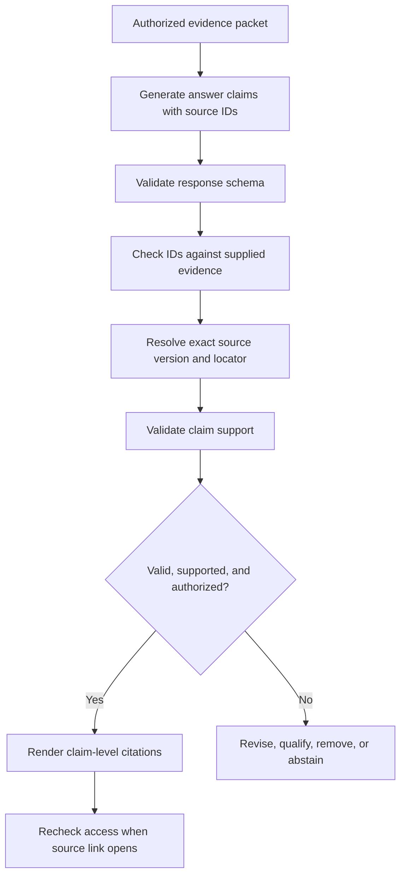

# Chapter 13 — Citations and Source Attribution

## Learning Objectives

By the end of this chapter, you should be able to:

- Assign application-controlled source identifiers and resolvable page or section locators.
- Require citations for factual claims that depend on retrieved evidence.
- Verify that returned source identifiers belong to the evidence packet supplied to the model.
- Evaluate whether a cited passage actually supports the statement attached to it.
- Preserve authorized links to the correct source view and document version.
- Prevent citation metadata from exposing private titles, snippets, URLs, or other restricted information.
- Distinguish citation validity from citation support when evaluating RAG answers.

<br/>

## 1. Why Citations Matter in RAG

A RAG answer should not merely sound plausible. Readers and downstream applications should be able to inspect the evidence behind important factual claims.

**Source attribution** connects an answer or claim to the document, passage, version, and location from which its evidence came. A useful citation helps a reader answer:

- Which source supports this claim?
- Which version of that source was used?
- Where in the source can I verify the statement?
- Does the cited passage actually establish the claim?
- Am I authorized to open the linked source?

A list of source names at the end of an answer is not necessarily sufficient. A source may be relevant to the general topic without supporting every claim in the response.

<br/>

## 2. Distinguish Citation Validity from Citation Support

These are separate checks.

- **Citation validity:** Does the citation refer to a real, permitted source or evidence item that was supplied to the generation step?
- **Citation support:** Does the cited passage actually support the claim associated with it?

A citation can be valid but fail to support the statement. A model might cite a real policy section that discusses annual leave, then claim that contractors are eligible even though the section only describes full-time employees.

A citation can also be invalid: the model may invent a chunk ID, page number, URL, or source title that does not exist in the supplied evidence.

| Citation case | Identifier valid? | Claim supported? | Assessment |
|---|---|---|---|
| Real chunk ID; passage directly states the claim | Yes | Yes | Valid and supported |
| Real chunk ID; passage discusses the topic but not the claim | Yes | No | Valid citation, unsupported claim |
| Fabricated chunk ID or page locator | No | Cannot be established | Invalid citation |
| Real passage supports only part of a compound claim | Yes | Partially | Claim needs narrowing or additional evidence |
| Real, relevant source but wrong document version | May resolve | Not for the requested version | Version/provenance failure |
| Citation points to a restricted source the caller cannot open | It may exist | May or may not | Access-control and disclosure failure |

Never treat a citation's existence as proof that the associated statement is true.

<br/>

## 3. Use Application-Controlled Source Identifiers

The application—not the language model—should assign stable source and chunk identifiers.

Typical fields include:

- `source_id`: identity of the logical source or document.
- `chunk_id`: identity of a retrieved passage.
- `document_version`: the version used to produce the evidence.
- `page_number` or `page_label`: page locator, where available.
- `section_path`: hierarchy of headings or sections.
- `source_uri` or internal source reference: a controlled pointer to the source.
- `content_hash`: optional integrity/change-detection field.

Example evidence record:

```json
{
  "chunk_id": "leave-policy:v2026-03:section-2:c03",
  "source_id": "leave-policy",
  "document_version": "2026-03",
  "section_path": ["Annual Leave", "Carryover"],
  "page_number": 12,
  "text": "Eligible full-time employees may carry over up to five unused days into the next leave year, subject to manager approval by 15 December."
}
```

This is illustrative. The identifier format is an application design choice; it should be stable, unique within the relevant scope, and resolvable by trusted server-side code.

<br/>

### Identifier design rules

- Do not let the model invent source IDs or page numbers.
- Keep identifiers distinct across source versions when the underlying evidence changes.
- Preserve page labels separately if printed page numbers differ from internal PDF page positions.
- Use section paths when page numbers are unavailable.
- Validate that each chunk maps to a known source record.
- Define what happens when a source is updated, moved, deleted, or access is revoked.
- Avoid using private filenames or internal storage paths as public citation labels.

<br/>

## 4. Design Resolvable Page and Section Locators

A citation should point to a location a reader can inspect. Depending on the source, the locator may be:

- PDF page index or printed page label;
- section heading path;
- paragraph or span identifier;
- table name and row/column reference;
- article anchor;
- source-system record ID;
- timestamp or time range for audio/video transcripts.

Locators must be consistent with the parser's conventions. If `page_number` is one-based but a viewer URL expects a zero-based page index, convert this in trusted application code and test the mapping.

Example:

```json
{
  "source_id": "leave-policy",
  "document_version": "2026-03",
  "locator": {
    "type": "pdf_page",
    "page_number": 12,
    "section_path": ["Annual Leave", "Carryover"]
  }
}
```

The application should resolve this locator against the exact source version. If the viewer cannot open a page directly, provide the source and a clear locator rather than inventing a deep link.

<br/>

## 5. Require Claim-Level Citations

Citations should be attached to the factual statements they support. Decorative citations—references added to make an answer look researched—do not establish support.

A useful approach is to represent the answer as claims, each with one or more source IDs.

Example:

```json
{
  "answer": "Eligible full-time employees may carry over up to five unused days, subject to manager approval by 15 December.",
  "claims": [
    {
      "text": "Eligible full-time employees may carry over up to five unused days.",
      "source_chunk_ids": ["leave-policy:v2026-03:section-2:c03"]
    },
    {
      "text": "Manager approval is required by 15 December.",
      "source_chunk_ids": ["leave-policy:v2026-03:section-2:c03"]
    }
  ]
}
```

The claims and source IDs are illustrative. For compound statements, decide whether one citation supports the entire statement or whether it should be split into smaller claims.

<br/>

### Citation policy guidelines

- Cite factual claims that depend on retrieved sources.
- Use a source that directly supports the claim, not merely one that shares the topic.
- Attach citations close enough to the relevant statement that the mapping is clear.
- If several sources support different parts of an answer, cite the appropriate source for each part.
- If a claim is an inference, make the inference clear and cite the source premises.
- If evidence is insufficient, state the limitation rather than attaching a weakly related citation.
- If sources conflict, cite the relevant conflicting sources and explain the conflict or apply a documented source-priority policy.

Do not require a citation for every connective phrase or obvious conversational transition. Focus on verifiable factual claims.

<br/>

## 6. Validate Returned Identifiers

The generation model should select from source identifiers included in the evidence packet. The application must validate those identifiers before rendering citations or constructing links.

A minimal check:

```python
def validate_source_ids(answer: dict, evidence_packet: list[dict]) -> list[str]:
    allowed_ids = {
        item["chunk_id"]
        for item in evidence_packet
        if isinstance(item.get("chunk_id"), str)
    }

    errors = []
    claims = answer.get("claims", [])

    if not isinstance(claims, list):
        return ["claims must be a list"]

    for index, claim in enumerate(claims):
        if not isinstance(claim, dict):
            errors.append(f"claims[{index}] must be an object")
            continue

        ids = claim.get("source_chunk_ids")
        if not isinstance(ids, list) or not ids:
            errors.append(f"claims[{index}] needs source_chunk_ids")
            continue

        for source_id in ids:
            if source_id not in allowed_ids:
                errors.append(
                    f"claims[{index}] references unknown evidence ID: {source_id}"
                )

    return errors
```

This verifies membership in the supplied evidence packet. It does not prove that the cited passage supports the claim, nor does it replace a current authorization check when opening the source.

A production implementation should also validate field types, duplicate IDs, source versions, locator formats, and the permitted response schema.

<br/>

## 7. Validate Claim Support

Support validation asks whether the cited passage entails the statement—not simply whether it contains similar words.

For each claim:

1. Retrieve the exact source passage identified by the citation.
2. Confirm source identity and version.
3. Check that the passage is relevant to the claim.
4. Compare key entities, quantities, dates, qualifiers, and negation.
5. Identify whether the claim is explicit, inferred, only partially supported, contradicted, or unsupported.
6. Verify that the citation's locator points to the passage being assessed.
7. Revise or remove claims that cannot be supported.

<br/>

### Example

Source passage:

> “Eligible full-time employees may carry over up to five unused days, subject to manager approval.”

Answer claim:

> “All employees can carry over five days automatically.”

The source ID may be perfectly valid, but the claim is not supported. The answer changed “eligible full-time employees” to “all employees” and removed the approval condition.

A support validator should flag the claim even though the citation points to a real and relevant passage.

<br/>

### Useful support labels

A review workflow may classify each claim as:

- **Supported:** the evidence directly establishes the claim.
- **Partially supported:** some parts are supported, but the full claim is not.
- **Inferred:** the claim follows from evidence but is not explicitly stated.
- **Contradicted:** the evidence conflicts with the claim.
- **Unsupported:** the evidence does not establish the claim.
- **Unverifiable:** the source or locator cannot be accessed or resolved.

Define these labels consistently before using them in an evaluation dataset.

<br/>

## 8. Preserve Authorized Links and Source Versions

A citation may lead to a source view in a document system, internal knowledge base, or external site. Links should be created by trusted application code from validated source records.

Recommended behavior:

- Resolve links using the source ID and version stored by the application.
- Prefer a version-specific or immutable source view where available.
- Re-check current authorization when the reader opens a private source.
- Do not assume that access allowed during retrieval remains valid indefinitely.
- Handle deleted, replaced, or revoked sources explicitly.
- Avoid exposing private storage paths, internal hostnames, signed URLs, or access tokens in rendered citation metadata.
- Use safe link construction and validate any externally supplied URL against an allowlist or trusted source registry.

The model should not be allowed to construct arbitrary source URLs from its own text. A citation ID should resolve through a controlled lookup.

<br/>

## 9. Avoid Leaking Private Citation Metadata

Citation metadata itself can disclose sensitive information. A private document title, snippet, source URL, customer name, project code, or internal path may reveal protected facts even if the full document is not shown.

Examples of risky metadata:

```text
Private source title: "Acquisition Plan for Company X"
Snippet: "The planned layoffs begin on..."
Internal URL: https://intranet.example/private/acquisition/
Storage path: /restricted/legal/customer-name/...
```

These are illustrative examples. Whether a field is sensitive depends on the application's data classification and access policy.

Controls include:

- Apply authorization before creating citation metadata for a response.
- Return only metadata fields the caller may see.
- Use opaque public-facing citation IDs when titles or paths are sensitive.
- Resolve opaque IDs server-side to an authorized source view.
- Avoid putting private titles or snippets into error messages and logs.
- Do not expose restricted sources merely because a source ID appeared in an LLM response.
- Re-check permission before opening the link, not just when generating the answer.
- Avoid including secrets or signed access tokens in citations that may be copied or logged.

A citation should make verification possible for authorized readers without becoming a side channel for unauthorized information.

<br/>

## 10. Citation and Attribution Flow



The checks are distinct: schema validity, identifier validity, semantic support, and authorization should not be collapsed into a single “citation passed” flag.

<br/>

## 11. Practice — Identify Citation Failure Types

Review each example and classify it.

### Case A — Fabricated citation

The evidence packet contains chunks `policy:v1:c01` and `policy:v1:c02`. The answer cites `policy:v1:c99`.

**Expected assessment:** invalid identifier. The cited chunk was not supplied and must not be rendered as a verified citation.

<br/>

### Case B — Valid identifier, unsupported claim

The answer cites a real passage that says only eligible full-time employees may carry over leave. The answer claims that all contractors may do so.

**Expected assessment:** identifier valid, claim unsupported. The statement must be narrowed, supported by additional evidence, or removed.

<br/>

### Case C — Valid and supported citation

The answer states that eligible full-time employees may carry over up to five unused days, and cites a supplied passage that explicitly says so.

**Expected assessment:** valid and supported, assuming the source version and authorization are also correct.

<br/>

### Case D — Partially supported compound claim

The answer states that employees may carry over five days and that approval must be obtained by 15 December. The cited passage supports the five-day limit but says nothing about the deadline.

**Expected assessment:** partially supported. Split the claim or retrieve a source that establishes the deadline.

<br/>

### Case E — Correct source, wrong version

The question asks about the policy effective in 2024, but the answer cites a 2026 policy version.

**Expected assessment:** provenance/version failure. A valid source identifier alone does not establish applicability to the requested date.

<br/>

### Case F — Citation leaks a private title

The answer's citation label exposes the title of a restricted legal document even though the caller cannot read it.

**Expected assessment:** metadata disclosure. Remove or replace the private label and ensure unauthorized source details are not returned.

<br/>

## 12. Practice — Build a Citation Validation Test Set

Create a small set of questions, evidence packets, and expected claim-to-source mappings.

Include examples of:

- a valid ID with direct support;
- a fabricated ID;
- a valid ID with a claim that changes a number or date;
- a valid ID that omits a condition or negation;
- a claim supported by multiple passages;
- a claim that is only an inference;
- conflicting source versions;
- a deleted or inaccessible source;
- an unauthorized title or URL in citation metadata.

For each generated answer:

1. Validate the output schema.
2. Check every citation ID against the supplied evidence packet.
3. Resolve each citation to its exact source version and locator.
4. Compare the associated claim with the source passage.
5. Inspect numbers, names, dates, qualifiers, and negation.
6. Check whether the reader is authorized to see the citation label and open the source.
7. Record citation validity and citation support as separate results.
8. Revise, qualify, remove, or abstain on failed claims.

<br/>

### Suggested evaluation table

| Claim ID | Citation exists? | Correct version? | Supports claim? | Authorized metadata? | Outcome |
|---|---|---|---|---|---|
| C1 | — | — | — | — | — |
| C2 | — | — | — | — | — |
| C3 | — | — | — | — | — |

Use measured outcomes from your test set rather than assuming a citation is correct because it looks plausible.

<br/>

## 13. Checkpoint — Model Answer

**Question:** What is the difference between citation validity and citation support?

**Answer:**

Citation validity checks whether a citation refers to a real, permitted evidence item supplied to the generation step and whether its source/version/locator can be resolved. Citation support checks whether the cited passage actually establishes the associated claim.

A citation can be valid but unsupported when a real source is cited for a statement it does not justify. A fabricated chunk ID or page locator is invalid even if the claim sounds plausible. Reliable RAG systems must validate both dimensions independently, preserve source versions, and enforce access controls on citation metadata and source links.

<br/>

## Key Takeaways

1. Use application-controlled source and chunk identifiers; never trust the model to invent citations.
2. Make locators resolvable and consistent with the exact source version.
3. Attach citations to the claims they support rather than adding decorative source lists.
4. Validate identifier existence and semantic support separately.
5. Preserve version, date, qualifier, and source-scope distinctions.
6. Generate links through trusted application code and re-check access when opened.
7. Treat citation titles, snippets, URLs, and paths as potentially sensitive metadata.

<br/>

## References

- [W3C — PROV-O: The PROV Ontology](https://www.w3.org/TR/prov-o/)
- [Pydantic — Models](https://docs.pydantic.dev/latest/concepts/models/)
- [OWASP — Authorization Cheat Sheet](https://cheatsheetseries.owasp.org/cheatsheets/Authorization_Cheat_Sheet.html)
- [OWASP — LLM Prompt Injection Prevention Cheat Sheet](https://cheatsheetseries.owasp.org/cheatsheets/LLM_Prompt_Injection_Prevention_Cheat_Sheet.html)
- [OpenAI — Prompt Engineering](https://platform.openai.com/docs/guides/prompt-engineering)

<br/>

## Next Chapter

**Chapter 14 — Missing Evidence and Unanswerable Questions**

Next, define how a RAG system should respond when retrieval finds no relevant evidence, the available sources are incomplete, or the evidence conflicts.
