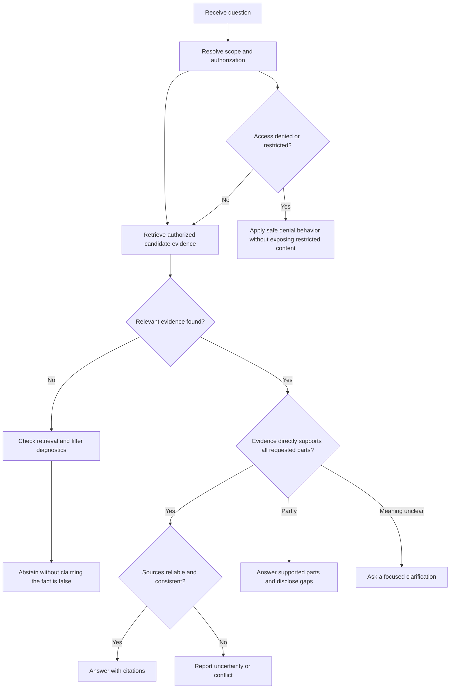

# Chapter 14: Missing Evidence and Unanswerable Questions

## Learning Objectives

By the end of this chapter, you should be able to:

- Distinguish between no relevant evidence, incomplete evidence, ambiguity, and conflicting evidence.
- Decide when a RAG application should answer, answer with qualifications, ask a clarifying question, or abstain.
- Explain why similarity scores are retrieval signals rather than calibrated probabilities of answerability.
- Communicate uncertainty when sources disagree or may be outdated.
- Handle permission-restricted evidence without confirming or exposing inaccessible content.

<br/>


## 1. Why Missing Evidence Matters

Retrieval-Augmented Generation (RAG) grounds answers in retrieved source material. However, retrieving documents does not guarantee that the retrieved material contains enough reliable evidence to answer the user's exact question.

A robust system must distinguish between:

1. **Retrieval failure:** relevant evidence may exist, but the retrieval pipeline did not find it.
2. **Evidence absence:** the available, authorized knowledge base contains no relevant evidence.
3. **Evidence insufficiency:** some relevant information is available, but it does not support a complete answer.
4. **Question ambiguity:** the system cannot determine which meaning, entity, time period, or scope the user intends.
5. **Evidence conflict:** sources make incompatible claims or provide different values.
6. **Access restriction:** potentially relevant information is outside the user's authorization scope.

These situations require different responses. A generic “I don't know” can be safe, but it hides useful distinctions needed for debugging, evaluation, and user experience.

<br/>

### A key principle

**The system should answer only to the extent justified by relevant, authorized, and sufficiently reliable evidence.**

An empty retrieval result is a statement about the current search operation—not proof that the underlying fact is false or that no evidence exists anywhere.


<br/>


## 2. Four Core Evidence States

| State | Meaning | Example | Appropriate behavior |
|---|---|---|---|
| No relevant evidence | Retrieved material does not support the requested fact | A policy knowledge base contains no information about a requested benefit | State that the available sources do not establish the answer; do not invent it |
| Incomplete evidence | Some requested facts are supported, but one or more parts are missing | A page gives eligibility criteria but not the application deadline | Answer the supported part and identify the missing part |
| Ambiguity | Multiple interpretations are plausible | “What is the limit?” with no indication of which limit or product | Ask a targeted clarification if the distinction changes the answer |
| Conflicting evidence | Relevant sources disagree | Two current-looking documents list different limits | Surface the conflict, assess source authority and freshness, and avoid silently choosing one |

These states can overlap. For example, a question may be ambiguous and the available sources may also conflict.

<br/>

### 2.1 No relevant evidence

Possible causes include:

- The fact is genuinely absent from the indexed knowledge base.
- The correct document was never ingested.
- Parsing or OCR lost the relevant content.
- Chunking separated a condition from the statement it qualifies.
- Metadata filters excluded the document.
- The query used different terminology from the source.
- The embedding model or retrieval configuration failed to find the relevant passage.
- Access-control filtering removed results the user is not permitted to see.

The answer-generation layer usually cannot determine which cause occurred from an empty result set alone. Instrument the pipeline so retrieval, ingestion, filtering, and authorization failures can be investigated separately.

<br/>

### 2.2 Incomplete evidence

A source may support only part of a multi-part question. Do not fill gaps with plausible assumptions.

For example:

- Supported: “The policy requires manager approval.”
- Missing: “The policy does not state how many days approval takes.”

A useful response answers the supported portion and explicitly identifies the missing information.

<br/>

### 2.3 Ambiguity

Ask a clarification when different interpretations would lead to materially different answers.

Good clarification questions are narrow and actionable:

- “Do you mean the monthly spending limit or the per-transaction limit?”
- “Which policy version or effective date should I use?”

Do not ask for clarification when the intent is already clear enough to answer safely. When possible, state a reasonable interpretation and label it rather than adding unnecessary friction.

<br/>

### 2.4 Conflicting evidence

Sources can conflict because of:

- Different publication or effective dates.
- Draft and approved versions both being indexed.
- Different scopes, regions, products, or customer groups.
- Duplicate documents that were updated inconsistently.
- Genuine disagreement between authorities.
- Parsing errors or incomplete context.

A practical conflict-resolution order is:

1. Check whether the documents refer to the same entity, scope, and time period.
2. Check publication date, effective date, version, and status.
3. Apply the knowledge base's documented source-of-truth hierarchy.
4. If the conflict remains unresolved, report it rather than hiding it.

Do not assume that the newest file is automatically authoritative. Use the application's documented precedence rules.


<br/>


## 3. Answer, Qualify, Clarify, or Abstain

A RAG application should define explicit response behavior instead of relying on the language model to improvise.

| Decision | Use when | Response pattern |
|---|---|---|
| Answer | Authorized evidence directly supports the requested claim | Give the answer with appropriate citations |
| Answer with qualification | Evidence supports only part of the answer or has a material limitation | State what is supported and what remains uncertain |
| Clarify | The user's intended meaning materially changes the answer | Ask one focused question |
| Abstain | Available authorized evidence is insufficient or unreliable for the requested claim | Say that the available sources do not establish the answer |
| Report a conflict | Credible sources disagree and precedence rules do not resolve it | Describe the disagreement with citations and dates where available |

<br/>

### 3.1 Define abstention precisely

**Abstention** means declining to assert a factual answer when the evidence available to the application does not justify one.

Good abstention language is specific:

> “I couldn't verify the application deadline in the available policy documents.”

Less useful:

> “I can't answer that.”

Avoid wording that overstates what the system knows. Prefer “I couldn't find supporting evidence in the available sources” over “That information does not exist.”

<br/>

### 3.2 Partial answers

If one part is supported and another is not, preserve the supported information.

Example:

**Question:** “Who is eligible, and when is the deadline?”

**Evidence:** The policy defines eligibility but gives no deadline.

**Appropriate response:** “The policy says full-time employees are eligible. I could not verify the application deadline in the available source.”

This is more useful than refusing the entire question or inventing a deadline.


<br/>


## 4. Similarity Scores Are Not Answerability Probabilities

Dense retrieval systems often rank passages using cosine similarity or another vector similarity measure. Sparse retrieval systems may use BM25 scores. These scores help rank candidates; they do not automatically represent the probability that a question is answerable.

### Why the distinction matters

- Similarity scores depend on the embedding model, corpus, query, and scoring method.
- A high-scoring passage can be topically related but fail to answer the question.
- A low score may still correspond to a useful passage when terminology differs.
- BM25 and vector similarity scores have different scales and meanings.
- A score threshold that works for one dataset may fail on another.
- Hybrid retrieval and reranking change score distributions and candidate ordering.

Therefore, avoid rules such as “similarity above 0.8 means answerable” unless that decision rule has been validated for the specific application and task. Even then, describe it as an empirically evaluated heuristic or classifier—not a universal probability.

<br/>

### Better answerability assessment

Use several signals together:

- Does the passage directly support the requested claim?
- Does it cover every required part of the question?
- Is the source authoritative, current, and in scope?
- Are relevant citations available for the proposed answer?
- Do retrieved sources conflict?
- Was retrieval performed over the correct authorized corpus?
- Does a validated answerability classifier or evaluation policy support answering?

Evaluate the resulting decision on a labeled dataset that includes answerable, partially answerable, unanswerable, ambiguous, conflicting, and permission-filtered cases.


<br/>


## 5. A Practical Decision Flow



This is a conceptual decision flow. Production systems may use separate retrieval, policy, and response-generation components, but the behavior should remain explicit and testable.


<br/>


## 6. Outdated and Conflicting Sources

Freshness is part of evidence quality. A statement may have been correct when written but no longer be valid.

Useful metadata includes:

- `published_at`
- `effective_from`
- `effective_until`
- `updated_at`
- `version`
- `status` such as `draft`, `approved`, or `superseded`
- `source_authority`
- `jurisdiction` or `scope`

The meaning of each field should be defined consistently. For example, `updated_at` may indicate when a file was modified, while `effective_from` indicates when its policy takes effect. These dates are not interchangeable.

<br/>

### Handling stale evidence

1. Identify whether the question depends on current information.
2. Inspect effective dates, status, and version.
3. Apply documented source precedence.
4. If freshness cannot be established, qualify the answer or abstain.
5. Avoid presenting a historical value as current without labeling its date.

<br/>

### Handling disagreement

If two sources disagree and neither is clearly authoritative, do not merge them into a fabricated compromise. Explain the disagreement, cite each source, and state that the available evidence does not resolve it.


<br/>


## 7. Permission-Restricted Evidence

Authorization is a separate requirement from relevance. A passage can be highly relevant and still be ineligible for use in a user's answer.

### Required behavior

- Enforce permissions in retrieval or in a trusted authorization layer before evidence reaches the answer generator.
- Apply the same access rules to dense, sparse, hybrid, reranking, parent-child expansion, cached results, and citations.
- Recheck authorization when expanding from a child chunk to its parent document.
- Do not reveal restricted text, titles, snippets, metadata, citations, identifiers, or the existence of a sensitive document unless the policy permits that disclosure.
- Avoid comparing accessible and inaccessible content in a way that leaks restricted facts.
- Log access-denied events safely for authorized operators, without putting sensitive content into ordinary application logs.

<br/>

### Avoid existence leaks

A response such as “I found the confidential salary policy, but you cannot access it” may reveal the existence of a sensitive document. Depending on the security policy, the safer response may be:

> “I couldn't provide an answer from the sources available to your account.”

The correct message depends on the application's disclosure policy. The answer generator should not be responsible for deciding whether a restricted document's existence is itself confidential.

<br/>

### Authorization and abstention

If all relevant candidates are removed by permission filtering, the user-facing behavior should not reveal what was filtered out. Internally, record enough diagnostic information for permitted administrators to distinguish an empty corpus from a permission-filtered result set.


<br/>


## 8. Implementing a Simple Evidence Decision Policy

The following Python example illustrates a deterministic policy layer. It is intentionally small: a real system should derive these fields from validated retrieval results, authorization checks, source metadata, and evaluation—not ask an LLM to invent them.

```python
from dataclasses import dataclass
from enum import Enum
from typing import Sequence


class EvidenceState(str, Enum):
    NO_RELEVANT_EVIDENCE = "no_relevant_evidence"
    INCOMPLETE = "incomplete"
    AMBIGUOUS = "ambiguous"
    CONFLICTING = "conflicting"
    SUFFICIENT = "sufficient"
    PERMISSION_FILTERED = "permission_filtered"


@dataclass
class EvidenceAssessment:
    state: EvidenceState
    supported_parts: Sequence[str] = ()
    missing_parts: Sequence[str] = ()
    clarification_question: str | None = None


def decide_response(assessment: EvidenceAssessment) -> str:
    if assessment.state == EvidenceState.PERMISSION_FILTERED:
        return (
            "I couldn't provide an answer from the sources available "
            "to your account."
        )

    if assessment.state == EvidenceState.NO_RELEVANT_EVIDENCE:
        return (
            "I couldn't find supporting evidence in the available sources. "
            "That does not establish that the underlying fact is false."
        )

    if assessment.state == EvidenceState.INCOMPLETE:
        supported = "; ".join(assessment.supported_parts) or (
            "Some information is supported"
        )
        missing = "; ".join(assessment.missing_parts) or (
            "some requested details remain unverified"
        )
        return f"{supported}. However, {missing}."

    if assessment.state == EvidenceState.AMBIGUOUS:
        return assessment.clarification_question or (
            "Could you clarify which meaning or scope you intend?"
        )

    if assessment.state == EvidenceState.CONFLICTING:
        return (
            "The available sources disagree, and I could not resolve "
            "the conflict using the applicable source-precedence rules."
        )

    if assessment.state == EvidenceState.SUFFICIENT:
        return "Evidence is sufficient for answer generation with citations."

    raise ValueError(f"Unsupported evidence state: {assessment.state}")
```

<br/>

### Important implementation notes

- `Sufficient` means the evidence assessment has passed the application's checks; it does not mean the answer is guaranteed correct.
- The function returns response guidance, not a completed factual answer.
- The system should attach only citations that the user is authorized to access.
- Permission filtering must happen in a trusted layer. A model-generated label alone is not an access-control mechanism.
- Add explicit states for application-specific conditions if needed, such as stale evidence or unresolved source authority.


<br/>


## 9. Practice: Test Different Evidence Conditions

Use a small test set with expected behavior before deploying a RAG application.

| Test case | Evidence condition | Expected behavior |
|---|---|---|
| A. Answerable | One current, authoritative passage directly answers the question | Answer with a supporting citation |
| B. Partially answerable | Evidence supports two of three requested details | Answer the two supported parts and disclose the missing detail |
| C. Unanswerable | No relevant passage is retrieved from the authorized corpus | Abstain; do not claim the fact is false |
| D. Ambiguous | The question could refer to two different policies | Ask a focused clarification |
| E. Conflicting | Two applicable sources give different values, with no established precedence | Explain the conflict and cite both sources if authorized |
| F. Outdated | Only a superseded policy supports the requested value | Label it as historical or abstain on the current value |
| G. Permission-filtered | Relevant evidence is excluded by access controls | Give the approved generic response without revealing restricted content |
| H. Retrieval failure | The relevant document exists but parsing or retrieval failed | User-facing behavior remains cautious; diagnose the pipeline separately |

<br/>

### Evaluation questions

For each case, record:

- Was the answer factually supported?
- Did it answer only the supported parts?
- Did it abstain when evidence was insufficient?
- Did it ask for clarification only when needed?
- Were conflicts and freshness limitations communicated?
- Were all citations authorized and valid?
- Did the response leak restricted content or document existence?
- Was the reason for failure observable to authorized operators?

Do not evaluate only answer accuracy. Measure abstention quality, unsupported-claim rate, unnecessary-abstention rate, clarification usefulness, citation support, and permission-leakage tests.


<br/>


## 10. Checkpoint: Why an Empty Result Set Does Not Prove a Fact Is False

**Model answer:**

An empty result set shows only that the current retrieval operation returned no eligible candidates under its query, index state, filters, ranking method, and access permissions. Relevant evidence may still exist but be missing from ingestion, lost during parsing or chunking, excluded by metadata filters, expressed with different terminology, missed by the retrieval model, or inaccessible to the current user. The corpus may also genuinely lack the information. Because these possibilities cannot be distinguished from the empty result alone, the system should say that it could not find supporting evidence in the available sources—not that the underlying fact is false. Pipeline diagnostics and a validated evaluation set are needed to investigate the cause.

<br/>

### Self-check

You should be able to explain:

1. The difference between “not found” and “false.”
2. Why partial evidence calls for a qualified answer rather than an invented completion.
3. When ambiguity warrants clarification.
4. Why similarity scores are not calibrated answerability probabilities by default.
5. How to communicate unresolved conflicts without hiding them.
6. Why permission filtering must be enforced outside the language model.


<br/>


## 11. Key Takeaways

- Retrieval success and answerability are different concepts.
- Distinguish absent, incomplete, ambiguous, conflicting, stale, and permission-filtered evidence.
- Answer only the parts supported by relevant, authorized sources.
- Abstain clearly when evidence does not justify a factual claim.
- Treat similarity scores as ranking signals unless a task-specific decision rule has been validated.
- Use source authority, scope, version, and effective dates to investigate conflicts and freshness.
- Enforce permissions throughout retrieval, expansion, caching, generation, and citation.
- Test abstention and information-leakage behavior, not just answer accuracy.


<br/>


## 12. References

- [Retrieval-Augmented Generation for Knowledge-Intensive NLP Tasks (original RAG paper)](https://arxiv.org/abs/2005.11401)
- [Sentence Transformers — Semantic Search](https://www.sbert.net/examples/sentence_transformer/applications/semantic-search/README.html)
- [BEIR: A Heterogeneous Benchmark for Zero-shot Evaluation of Information Retrieval Models](https://arxiv.org/abs/2104.08663)
- [NIST AI Risk Management Framework](https://www.nist.gov/itl/ai-risk-management-framework)
- [OWASP Top 10 for Large Language Model Applications](https://owasp.org/www-project-top-10-for-large-language-model-applications/)


<br/>


## Next Chapter

**Chapter 15: Ingestion Updates, Reindexing, and Deletion**

The next chapter covers how to keep a RAG knowledge base synchronized as documents are added, changed, superseded, or deleted.
