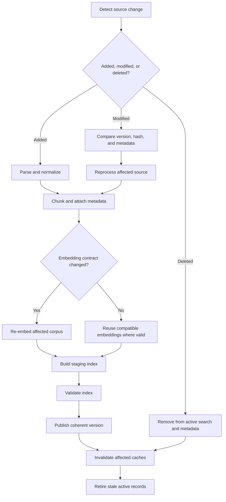
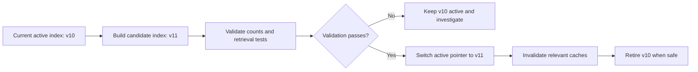
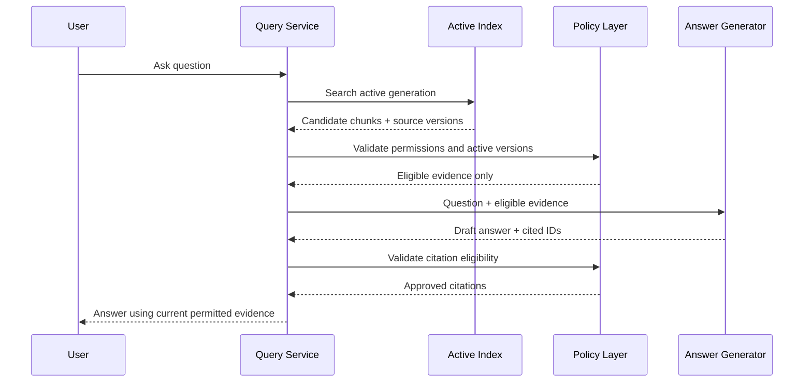

# Chapter 15: Ingestion Updates, Re-indexing, and Deletion

## Learning Objectives

By the end of this chapter, you should be able to:

- Detect when source documents are added, changed, superseded, or deleted.
- Reprocess only affected documents when safe, and know when a full re-embedding is required.
- Manage embedding and index configuration changes without mixing incompatible vectors.
- Publish coherent index versions and prevent stale or duplicate passages from being served.
- Remove deleted content from active retrieval and related metadata.
- Invalidate caches that may contain outdated answers or citations.
- Distinguish removal from active search from backup, audit, and retention requirements.

<br/>

## 1. Why Source Lifecycle Management Matters

A RAG system is not a one-time indexing job. Its knowledge base changes as policies are revised, product documentation is updated, records are removed, and permissions change.

If the source lifecycle is not managed carefully, the system may:

- Retrieve an obsolete chunk after a document has changed.
- Return duplicate passages from old and new versions.
- Generate an answer from a deleted source.
- Cite a document version that is no longer active.
- Mix vectors produced by incompatible embedding models.
- Serve a cached answer after its supporting source has changed.
- Remove content from the live index but leave copies in logs or caches.
- Claim that content has been erased everywhere when only active retrieval was updated.

**Core principle:** treat the source of truth, parsed documents, chunks, embeddings, search index, metadata, caches, and retained backups as related but distinct lifecycle layers.

A successful update must keep these layers consistent enough that query-time retrieval returns the intended current and authorized version.


<br/>


## 2. Model the Source Lifecycle

A typical lifecycle is:

1. Discover a source addition, modification, or deletion.
2. Identify the source and determine whether its content or relevant metadata changed.
3. Parse and normalize the current source version.
4. Generate chunks and metadata.
5. Generate embeddings if required.
6. Write the new records to a staging area or versioned index.
7. Validate counts, IDs, metadata, and retrieval behavior.
8. Publish the new version or atomically switch the active pointer.
9. Invalidate affected caches.
10. Retire superseded records from active retrieval.
11. Record an audit event and apply retention policy separately.



This is a logical workflow, not a requirement that every vector database use the same deployment mechanism. Backend capabilities and consistency guarantees differ.


<br/>


## 3. Detecting Changes Reliably

A filename or URL alone is not enough to determine whether content changed. Use stable source identity plus version information.

### 3.1 Useful source fields

| Field | Purpose |
|---|---|
| `source_id` | Stable identity of the logical source |
| `source_uri` | Location or reference used to obtain the source |
| `content_hash` | Detects byte-level changes, commonly with SHA-256 |
| `source_version` | Source-system version, ETag, revision, or application version |
| `updated_at` | Last observed or reported modification time |
| `parser_version` | Identifies the parsing implementation/configuration |
| `chunking_version` | Identifies the chunking strategy and configuration |
| `embedding_model` | Identifies the model used to generate vectors |
| `embedding_dimensions` | Records the vector dimensionality |
| `metadata_hash` | Detects relevant metadata changes |
| `index_version` | Identifies the published index snapshot or generation |

Keep the meaning of each field explicit. A source's modification time may be unreliable, and a URL can serve changed content without changing its path.

<br/>

### 3.2 Hashes and source versions

A content hash can detect byte-level changes:

```python
import hashlib
from pathlib import Path

def sha256_file(path: str) -> str:
    digest = hashlib.sha256()
    with Path(path).open("rb") as file:
        for block in iter(lambda: file.read(1024 * 1024), b""):
            digest.update(block)
    return digest.hexdigest()
```

This hash detects changes to the downloaded bytes. It does not establish semantic equivalence: a PDF can be re-saved with different metadata while its visible text stays the same.

A practical decision process can compare:

- Source identity and version.
- Raw content hash.
- Normalized text hash, if useful.
- Parsing and chunking configuration versions.
- Metadata relevant to filtering or authorization.

If only a non-retrieval-relevant field changed, a full re-embedding may not be necessary. If access permissions changed, however, authorization metadata and active retrieval behavior must be updated even if the text and embedding are identical.


<br/>


## 4. Replacing Affected Chunks

When a source changes, do not simply append its new chunks to the existing index. That can leave old passages searchable.

### Recommended per-source replacement pattern

1. Identify all active chunks associated with the source's previous version.
2. Parse and chunk the new version.
3. Assign stable IDs that distinguish the source, version, and chunk.
4. Write new chunks and vectors to staging.
5. Validate the new records and their metadata.
6. Publish the new source version.
7. Mark previous-version chunks inactive or remove them from the active index.
8. Invalidate affected caches.

<br/>

### Chunk identity

A chunk ID should be deterministic within the chosen identity scheme. For example:

```text
source_id + source_version + chunking_version + chunk_ordinal
```

An alternative is to include a hash of the chunk content. Choose a strategy deliberately: IDs based only on ordinal position can change when earlier content is inserted, while content-hash IDs may cause identical text from different sources to collide unless source identity is included.

Do not rely on chunk IDs alone to enforce freshness. Query-time filtering should use a trusted active-version or publication mechanism.

<br/>

### Metadata to preserve

Each chunk should retain enough provenance to identify its source and version:

```json
{
  "source_id": "employee-handbook",
  "source_version": "rev-12",
  "chunk_id": "employee-handbook:rev-12:chunk-004",
  "is_active": true,
  "index_version": "kb-2026-10-15",
  "parser_version": "parser-v3",
  "chunking_version": "recursive-v2"
}
```

The values above are illustrative. A real schema may use immutable records plus an active-version pointer instead of updating an `is_active` field on every chunk.


<br/>

## 5. When Must You Re-Embed?

Re-embedding means generating new vectors from text using an embedding model or embedding configuration.

| Change | Re-parse? | Re-chunk? | Re-embed? |
|---|---:|---:|---:|
| Source text changed | Usually | Usually | Changed chunks at minimum |
| Source deleted | No new parse | No | No; remove active vectors and records |
| Non-search metadata changed | Usually not | No | Usually not |
| Authorization metadata changed | Usually not | No | Usually not, but enforce the new access state immediately |
| Parser behavior changed | Yes | Often | If resulting text/chunks change or policy requires it |
| Chunking strategy or size changed | Usually | Yes | Yes for newly formed chunks |
| Embedding model changed | Depends on text availability | Depends on chunking | Yes for the corpus being migrated |
| Embedding model version/configuration changed materially | Depends | Depends | Validate compatibility; often re-embed |
| Vector dimension changed | Depends | Depends | Re-embed into a compatible index/schema |
| Distance metric changed | Not necessarily | No | Not always, but rebuild/configuration migration and evaluation may be required |
| Reranker model changed | No | No | Document embeddings may remain reusable; reevaluate ranking |
| Metadata filter logic changed | Not necessarily | No | Usually not, but validate retrieval eligibility |

This table is a guide, not a universal backend contract. Follow the selected vector store's requirements and the embedding model's documented compatibility guarantees.

<br/>

### Never mix incompatible vector spaces

Vectors from different embedding models or incompatible model versions generally should not be compared as though they belong to one shared vector space. Build a separate index or namespace for the new embedding contract, validate it, then switch traffic coherently.

<br/>

### Embedding contract

Record a reproducible contract such as:

- Provider and model identifier.
- Model revision, if available.
- Output dimensions.
- Text preprocessing and normalization.
- Query/document encoding modes, if the model distinguishes them.
- Similarity metric and vector normalization assumptions.

A change to the contract should trigger an explicit compatibility review rather than silently reusing old vectors.


<br/>


## 6. Publish Coherent Index Versions

A user should not receive an accidental mixture of partially updated records. Index publication should have a clear consistency model.

### Versioned publication pattern



This pattern is often safer than mutating every live record in place, especially when a large reindex is required. Some systems support aliases, collection swapping, namespaces, transactions, or snapshots; others need application-level version filtering.

<br/>

### Validation before publication

Check at least:

- Expected source and chunk counts.
- No duplicate active chunk IDs.
- Every chunk references an existing source version.
- Embedding dimensions and model identifiers match the target index.
- Metadata and authorization fields are populated correctly.
- Deleted or superseded content is not eligible for active retrieval.
- A fixed retrieval test set returns expected current passages.
- Citation identifiers resolve to the intended active source version.

<br/>

### Atomicity and consistency

An atomic alias switch or pointer update can make publication coherent from the application's perspective. If the backend does not support atomic publication, use an explicit version filter or another controlled migration pattern.

Document backend-specific behavior, including:

- Write visibility delays.
- Eventual consistency after upserts or deletes.
- Whether deletes are immediately reflected in queries.
- Whether filters apply consistently to every search path.
- How aliases, snapshots, and namespaces behave.
- What happens during retries and partial failures.

Do not claim immediate deletion or atomic publication unless the backend and application architecture actually guarantee it.


<br/>


## 7. Preventing Stale and Duplicate Passages

Duplicates can occur when an update appends new chunks without retiring old ones, or when ingestion retries are not idempotent.

### Common safeguards

- Use stable source identity and explicit source versions.
- Make ingestion operations idempotent.
- Use deterministic IDs or a deduplication key.
- Replace or deactivate previous-version records.
- Keep one authoritative active version per logical source where the use case requires it.
- Deduplicate candidates before context assembly.
- Apply active-version filters in retrieval.
- Validate citation version and source identity at response time.

A useful invariant is:

> For a given logical source, only the intended published version is eligible for normal retrieval.

If the application intentionally searches historical versions, model that as an explicit query scope rather than allowing historical passages to leak into default retrieval.

<br/>

### Idempotent ingestion

An ingestion job is idempotent when retrying the same operation does not create extra logical copies or change the intended result. Deterministic record IDs, source-version keys, and carefully designed upserts help achieve this.

Retries must also handle partial failures. For example, if chunk writes succeed but the job fails before publication, the candidate version should remain unpublished and be safe to resume or discard.

<br/>


## 8. Deleting Sources and Their Derived Data

Deleting a source from active retrieval requires more than removing its original file. The source may have derived records in several places.

### Deletion inventory

| Layer | Required consideration |
|---|---|
| Source connector or source of truth | Is the source actually deleted or merely moved/hidden? |
| Raw document storage | Remove or retain according to applicable policy |
| Parsed text and extracted tables | Remove or invalidate derived content |
| Chunk store | Remove or make ineligible for active retrieval |
| Vector index | Delete vectors/records or exclude them through a trusted active-state mechanism |
| Metadata/catalog | Remove active source records and related mappings |
| Parent-child relationships | Remove or update both child and parent references |
| Retrieval caches | Invalidate entries derived from the source |
| Answer/response caches | Invalidate answers that cite or depend on the source |
| Logs and analytics | Apply separate access, minimization, and retention rules |
| Backups and snapshots | Follow documented backup expiry and deletion policy |

<br/>

### Logical deletion vs physical deletion

- **Logical deletion:** mark a record inactive or remove its version from the active set so normal queries cannot retrieve it.
- **Physical deletion:** remove the stored record from a specified storage system.
- **Retention expiration:** remove retained copies according to a policy or schedule.

Logical deletion can make a document unavailable to ordinary search before every physical copy has expired. It must not be described as complete erasure from all storage.

For sensitive or regulated data, coordinate deletion with the organization's retention and legal requirements. Do not assume that every log or backup should be deleted immediately, and do not assume that it may be retained indefinitely.

<br/>

### Deletion verification

After a delete operation:

1. Query using the original exact wording.
2. Query using synonyms and related terms.
3. Search by source ID and old chunk IDs through authorized administrative tools.
4. Verify that old citations no longer resolve as active evidence.
5. Verify that caches cannot return an answer derived from the deleted source.
6. Check backend deletion status and documented consistency delays.
7. Record what was removed, what remains under retention policy, and when follow-up verification is due.


<br/>


## 9. Cache Invalidation

A cache can preserve stale information even after the index is updated.

Common cache layers include:

- Query-rewrite cache.
- Embedding cache.
- Retrieval-result cache.
- Reranking cache.
- Context/evidence-packet cache.
- Final-answer cache.
- Citation-resolution cache.

<br/>

### Cache strategies

**Versioned cache keys:** include an index version or relevant source version in the cache key. Publishing a new index naturally separates new queries from old cache entries.

**Targeted invalidation:** record source IDs or chunk IDs used by each cached result, then invalidate entries affected by a source update or deletion.

**TTL (time to live):** limits how long an entry can persist, but does not guarantee immediate freshness.

**Explicit generation checks:** verify that cached evidence still belongs to an active index version before using it.

For final-answer caches, invalidation is harder because the answer may depend on multiple sources. A practical design stores the evidence IDs and versions used to produce each answer.

<br/>

### Example cache dependency record

```json
{
  "cache_key": "answer:query-hash:kb-2026-10-15",
  "index_version": "kb-2026-10-15",
  "evidence": [
    {
      "source_id": "employee-handbook",
      "source_version": "rev-12",
      "chunk_id": "employee-handbook:rev-12:chunk-004"
    }
  ]
}
```

This record helps the application decide which cache entries are affected by a source update. Avoid storing sensitive source text in cache metadata when identifiers and versions are sufficient.


<br/>


## 10. Query-Time Behavior During Updates and Deletions

Ingestion lifecycle correctness must be visible at query time.

A typical query path should:

1. Resolve the active index generation or namespace.
2. Apply the current authorization scope.
3. Retrieve candidates from that generation.
4. Filter out inactive or superseded versions if the backend does not enforce this at index level.
5. Recheck authorization before parent expansion and context assembly.
6. Verify source/version metadata before citing evidence.
7. Avoid serving a cached answer whose index generation or evidence dependencies are stale.



This is a reference architecture. In some applications, the index itself enforces permissions and version eligibility. The key requirement is that no untrusted model output can bypass the authoritative checks.


<br/>


## 11. A Simple Source-Manifest Comparison

The following example illustrates how a pipeline might classify a source as unchanged, changed, or new. It does not implement vector-store operations or deletion; those are backend-specific.

```python
from dataclasses import dataclass


@dataclass(frozen=True)
class SourceManifest:
    source_id: str
    content_hash: str
    parser_version: str
    chunking_version: str
    embedding_contract: str
    metadata_hash: str


def classify_source(
    old: SourceManifest | None,
    new: SourceManifest | None,
) -> str:
    if old is None and new is None:
        return "invalid_no_source"

    if old is None:
        return "added"

    if new is None:
        return "deleted"

    if old == new:
        return "unchanged"

    if old.embedding_contract != new.embedding_contract:
        return "embedding_contract_changed"

    if old.parser_version != new.parser_version:
        return "parser_changed"

    if old.chunking_version != new.chunking_version:
        return "chunking_changed"

    if old.content_hash != new.content_hash:
        return "content_changed"

    if old.metadata_hash != new.metadata_hash:
        return "metadata_changed"

    return "configuration_or_manifest_changed"
```

<br/>

### Production considerations

- This classifier uses a simplified precedence order; real pipelines may need multiple simultaneous change flags.
- A parser change does not always alter extracted text, but the result should be validated.
- A metadata change can affect filtering and authorization without requiring new vectors.
- An embedding-contract change usually requires a coherent migration of the vectors that will be compared together.
- A deletion event should be processed even if the source is no longer downloadable.
- Persist the old manifest so the pipeline can identify and retire previous records.
- Use a durable job queue, retries, checkpoints, and audit records for production ingestion.


<br/>


## 12. Practice: Update a Fact and Delete a Document

Use a small test knowledge base with a versioned source and at least one cached answer.

### Exercise A: Update a source fact

1. Ingest a document that says: “The standard review period is 10 business days.”
2. Verify that retrieval returns the expected chunk and citation.
3. Update the source to say: “The standard review period is 7 business days.”
4. Re-run change detection and confirm that the source is classified as changed.
5. Re-parse and re-chunk the source; re-embed the affected chunks if needed.
6. Publish the new source version.
7. Query using the exact wording and a paraphrase.
8. Verify that the new answer cites the new version and the old passage is not eligible for default retrieval.
9. Check whether retrieval and final-answer caches were invalidated or versioned.

**Expected result:** the active query path returns the current value, and any historical result is available only through an explicitly historical scope.

<br/>

### Exercise B: Delete a document

1. Ingest a document containing a unique test fact.
2. Retrieve it and record its source ID, chunk IDs, and citation.
3. Delete the source from the source system.
4. Process the deletion event even though the source content is no longer downloadable.
5. Remove or deactivate its active chunks, vectors, metadata, and parent-child references.
6. Invalidate caches that depend on those records.
7. Repeat the original query and a paraphrased query.
8. Verify that the deleted content is not returned and its old citation is not presented as active evidence.
9. Document any copies that remain under backup or retention policy.

**Expected result:** normal retrieval no longer serves the deleted source, while the system accurately reports the scope of deletion rather than claiming that all retained copies have been erased.

<br/>

### Exercise C: Change the embedding contract

1. Record the current model identifier, dimensions, preprocessing, and similarity assumptions.
2. Build a candidate index using the new embedding contract.
3. Re-embed the intended corpus into the candidate index.
4. Validate dimensions, retrieval metrics, authorization filters, and citations.
5. Switch the active generation coherently.
6. Confirm that query embeddings and document vectors come from compatible configurations.

**Expected result:** the active search path does not compare incompatible vector spaces.


<br/>


## 13. Evaluation Checklist

| Check | Passing condition |
|---|---|
| Change detection | A changed source is identified even when its URL remains the same |
| Idempotency | Retrying ingestion does not create duplicate active chunks |
| Version coherence | Queries use one intended published generation or an explicitly defined migration policy |
| Re-embedding | Model/configuration changes are handled according to the embedding contract |
| Stale content | Superseded chunks are not eligible for normal retrieval |
| Deletion | Deleted content is absent from active retrieval and current citations |
| Cache correctness | Cached answers and evidence cannot bypass current version checks |
| Authorization | Updated permissions apply to retrieval, expansion, caches, and citations |
| Backend consistency | Visibility and deletion delays are documented and tested |
| Retention accuracy | The system distinguishes active-search removal from backup/retention expiration |
| Failure recovery | Partial jobs can resume safely without publishing an incomplete index |
| Observability | Operators can trace source changes through indexing and query-time behavior |


<br/>


## 14. Checkpoint: Trace Source Lifecycle Changes

**Model answer:**

When a source changes, the ingestion pipeline detects the change using stable source identity and version or content hashes. It re-parses and re-chunks the affected source, generates new embeddings when required, writes the records to a staging or versioned index, validates them, and publishes a coherent version. Previous chunks must become ineligible for normal retrieval, and caches that depend on the old source version must be invalidated or separated by versioned keys.

When a source is deleted, the pipeline processes a deletion event, removes or deactivates its active chunks, vectors, metadata, and relationships, and invalidates related retrieval and answer caches. Query-time retrieval must use the intended active index generation, current authorization rules, and valid source versions; citation validation must reject superseded or deleted evidence. Backend-specific write visibility and delete consistency must be tested. Finally, active-search removal must be reported separately from the status of backups, logs, and other retained copies governed by retention policy.

<br/>

### Self-check

You should be able to trace:

1. A source modification from change detection to current citation.
2. A source deletion from event processing to query-time exclusion.
3. An embedding model change through re-embedding and index migration.
4. A cache invalidation path for an answer that used an updated source.
5. A permission change even when source text is unchanged.
6. The difference between removing content from active search and erasing every retained copy.


<br/>


## 15. Key Takeaways

- Treat ingestion as a repeatable lifecycle process, not a one-time import.
- Detect changes with stable source identity, hashes, versions, and configuration metadata.
- Replace affected chunks instead of blindly appending new records.
- Re-embed when text, chunking, or embedding compatibility requires it.
- Never silently mix incompatible vector spaces.
- Publish coherent index generations and validate before switching traffic.
- Make retries idempotent and partial failures recoverable.
- Deletion must cover active vectors, chunks, metadata, relationships, caches, and citations.
- Query-time logic must enforce current versions and authorization.
- Be precise about backend consistency and the difference between active-search removal and retention-controlled copies.


<br/>


## 16. References

- [Sentence Transformers — Semantic Search](https://www.sbert.net/examples/sentence_transformer/applications/semantic-search/README.html)
- [Qdrant Documentation](https://qdrant.tech/documentation/)
- [Pinecone Documentation](https://docs.pinecone.io/)
- [Weaviate Documentation](https://docs.weaviate.io/)
- [Chroma Documentation](https://docs.trychroma.com/)
- [NIST Privacy Framework](https://www.nist.gov/privacy-framework)

Consult the chosen backend's current documentation for its exact upsert, deletion, filtering, aliasing, snapshot, and consistency semantics.


<br/>


## Next Chapter

**Chapter 16: Retrieval Permissions and Data Isolation**

The next chapter focuses on enforcing tenant boundaries and document-level authorization throughout retrieval, context assembly, and citation generation.
