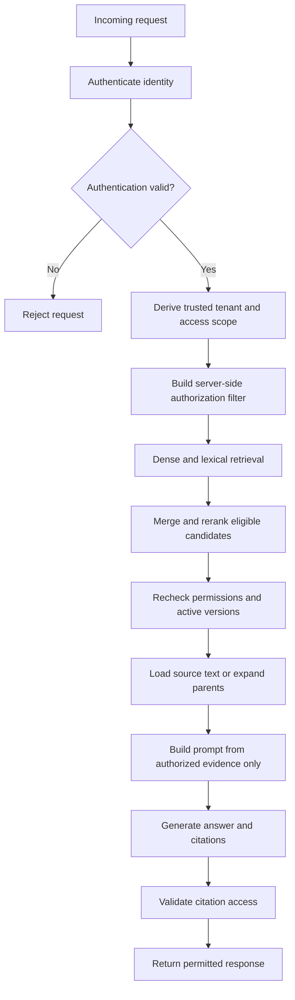

# Chapter 16: Retrieval Permissions and Data Isolation

## Learning Objectives

By the end of this chapter, you should be able to:

- Derive a user's identity and access scope from authenticated server-side application state.
- Enforce authorization consistently across dense, lexical, hybrid, reranked, and expanded retrieval.
- Choose tenant-isolation strategies for indexes, namespaces, metadata filters, caches, and conversation state.
- Recheck access when loading source text, expanding parent documents, and resolving citations.
- Fail closed when authorization metadata is missing, invalid, or inconsistent.
- Prevent unauthorized content from entering prompts, external services, logs, caches, or user-facing responses.

<br/>

## 1. Why Retrieval Permissions Are a Security Boundary

In a RAG application, retrieval determines which source material becomes available to the language model. If retrieval returns content that a user is not authorized to access, the application has already crossed a security boundary—even if the final answer does not explicitly quote that content.

The model should not be responsible for deciding whether a user is allowed to see a document. Model instructions such as “do not reveal confidential information” are not access-control mechanisms. The application must enforce authorization before restricted content is passed to the model.

<br/>

### Core principle

**Authorization is a server-side decision that must be enforced independently of model behavior.**

A secure system follows this order:

1. Authenticate the user or calling service.
2. Derive trusted identity, tenant, roles, and access scope from authenticated application state.
3. Apply authorization constraints to retrieval.
4. Recheck authorization before loading source content, expanding context, calling external services, and returning citations.
5. Prevent unauthorized content from entering prompts, caches, logs, and responses.

A model-generated claim that the user is authorized must never override the application's policy decision.


<br/>


## 2. Authentication vs Authorization

These concepts are related but distinct.

| Concept | Question answered | Example |
|---|---|---|
| Authentication | Who or what is making the request? | A verified user session identifies a user |
| Authorization | Which resources may that identity access? | The user can read documents in their team workspace |
| Tenant isolation | Which organization's data belongs to this request? | Tenant A cannot retrieve Tenant B's records |
| Data filtering | Which records match the authorized scope and query? | Search only approved documents for the user's tenant |
| Auditability | Can authorized operators investigate access decisions? | Record a policy decision ID without logging confidential document text |

A valid login does not imply access to every document in the knowledge base. Authorization should be evaluated for the specific operation and resource.

<br/>

### Trusted identity context

A request may carry identity information from a session, verified token, or trusted gateway. The application should validate that context and derive the access scope on the server.

Do not trust a client-supplied `tenant_id`, `user_id`, or `role` merely because it appears in JSON. Client values may be useful as requested parameters, but the server must verify them against authenticated identity and policy.


<br/>


## 3. A Secure Retrieval Flow



The authorization layer can be integrated at multiple points. The important property is that every path that can expose content is protected.

<br/>

### Fail closed

If the application cannot establish the user's authorization scope, it should not fall back to unrestricted retrieval.

Examples of fail-closed behavior:

- Missing tenant identity → reject the request or return no protected results.
- Invalid or expired access token → reject the request.
- Missing document ACL metadata → treat access as denied until repaired, unless a documented policy explicitly defines a safe default.
- Authorization service unavailable → do not bypass the check.
- Citation target cannot be authorized → do not return the target or its restricted metadata.

Failing closed may reduce availability during an authorization failure, but it prevents uncertainty from becoming unauthorized disclosure.


<br/>


## 4. Enforce Access Across Every Retrieval Path

A RAG application may have several routes to evidence. Applying a filter to only one route is insufficient.

| Retrieval or data path | Security requirement |
|---|---|
| Dense/vector search | Apply trusted tenant and access filters, or search an isolated index |
| Lexical/BM25 search | Apply equivalent authorization constraints |
| Hybrid retrieval | Enforce access independently on every branch before merging results |
| Reranking | Send only authorized candidates to the reranker |
| Parent-document retrieval | Recheck permission on the parent before loading its full text |
| Child-to-parent expansion | Do not assume a permitted child grants access to the entire parent |
| Neighboring-chunk expansion | Authorize every added chunk, not just the original result |
| Metadata lookup | Avoid exposing restricted titles, tags, owners, or existence information |
| Citation resolution | Recheck access to the exact source version and locator |
| Query/result cache | Partition or validate cache entries against the current access scope |
| Conversation history | Do not reuse evidence from a prior user or tenant without reauthorization |
| External reranking or model service | Do not transmit unauthorized content to the service |

<br/>

### Apply authorization before reranking

A reranker does not make a candidate safe. If restricted text is sent to a reranking model, that service has already received the content. Filter candidates before sending them to any model or external service.

<br/>

### Recheck after expansion

Suppose a user is allowed to read one paragraph from a shared document, but not the entire parent document. Retrieving the paragraph does not automatically authorize loading the full parent. Parent, sibling, and neighboring chunks need their own policy checks.

<br/>


## 5. Tenant Isolation Strategies

The appropriate design depends on risk, scale, backend capabilities, and operational cost.

| Strategy | How it works | Advantages | Trade-offs |
|---|---|---|---|
| Separate database or collection per tenant | Tenant data lives in distinct storage boundaries | Stronger separation and clearer operational boundaries | More resources and lifecycle operations |
| Separate index or namespace per tenant | Search is directed to a tenant-specific partition | Easier scoping and tenant-level maintenance | Namespace selection must be trusted and correctly enforced |
| Shared index with mandatory tenant filters | Records share storage but each query has server-derived filters | Efficient for many tenants | A missing or incorrect filter can cause cross-tenant exposure |
| Document-level ACL filters | Each record carries access metadata | Supports fine-grained sharing | ACL updates, group membership, and filter logic add complexity |
| Hybrid isolation | Separate storage for higher-risk tenants plus ACL filters within each tenant | Flexible security and scale trade-offs | More complex to operate and test |

No single strategy is universally correct. A shared index can be secure when authorization is implemented correctly, but its isolation controls require rigorous testing. Separate namespaces do not help if an attacker can choose an arbitrary namespace through an untrusted client parameter.

<br/>

### Defense in depth

For sensitive applications, combine controls where appropriate:

- Derive the tenant from authenticated server state.
- Use tenant-specific storage or namespace selection.
- Apply document-level authorization filters.
- Validate retrieved record metadata against the request context.
- Enforce permissions again before source loading and citation resolution.
- Log access decisions without logging protected content.


<br/>


## 6. Authorization Metadata and Safe Defaults

Documents and chunks may include metadata such as:

```json
{
  "tenant_id": "tenant-a",
  "document_id": "policy-104",
  "allowed_user_ids": ["user-17"],
  "allowed_group_ids": ["hr-team"],
  "classification": "internal",
  "acl_version": "acl-v8",
  "source_version": "rev-3"
}
```

This is an illustrative schema. Choose metadata that matches the organization's actual authorization model. Avoid copying large or sensitive ACL structures into every chunk if a trusted policy service or normalized permission table is more appropriate.

<br/>

### Important rules

- Authorization metadata must come from trusted ingestion or policy systems, not arbitrary document text.
- Missing or malformed metadata should not silently mean “public.”
- Keep permission updates synchronized with retrieval eligibility.
- Treat ACL changes as lifecycle events even if source text is unchanged.
- Version ACL metadata where doing so helps detect stale records.
- Normalize tenant and identity identifiers consistently.
- Define how group membership, inherited permissions, and public documents work.
- Avoid placing secrets or unnecessary personal information in chunk metadata.

<br/>

### Example: conservative eligibility check

```python
from dataclasses import dataclass


@dataclass(frozen=True)
class RequestScope:
    tenant_id: str
    user_id: str
    group_ids: frozenset[str]


@dataclass(frozen=True)
class DocumentACL:
    tenant_id: str | None
    allowed_user_ids: frozenset[str] | None
    allowed_group_ids: frozenset[str] | None


def can_read(scope: RequestScope, acl: DocumentACL) -> bool:
    # Fail closed if essential authorization metadata is missing.
    if not scope.tenant_id or not scope.user_id:
        return False

    if not acl.tenant_id or acl.allowed_user_ids is None:
        return False

    if scope.tenant_id != acl.tenant_id:
        return False

    if scope.user_id in acl.allowed_user_ids:
        return True

    if acl.allowed_group_ids is None:
        return False

    return bool(scope.group_ids.intersection(acl.allowed_group_ids))
```

This example is intentionally conservative and simplified. A production ACL model may include public access, inherited access, service accounts, resource ownership, deny rules, or policy-engine decisions. Implement those semantics explicitly rather than weakening the default behavior.

The example's `None` values mean that authorization metadata is unknown. They do not mean “allow everyone.”


<br/>


## 7. Source Loading, Parent Expansion, and Citations

Authorization must be enforced not only during initial search but also whenever content is fetched by ID or reference.

### Source-loading requirements

Before loading a document or chunk by ID:

1. Resolve the ID within the trusted tenant or storage boundary.
2. Verify the source version is active and eligible.
3. Evaluate the current user's authorization policy.
4. Return only fields the user is allowed to see.
5. Avoid revealing whether an inaccessible identifier exists if existence is sensitive.

Do not implement an endpoint such as `GET /documents/{id}` that returns source text solely because the caller knows the ID.

<br/>

### Citation access

A citation may expose more than the answer itself. It can reveal:

- A restricted document title.
- A URL containing sensitive identifiers.
- A page number or passage snippet.
- The existence of a private policy or case.
- A source version that the user cannot access.

At response time, validate that each citation refers to evidence that was authorized for this request and remains eligible under the current policy. If permission changed during processing, suppress the citation and, when necessary, regenerate or revise the answer without that evidence.

<br/>

### Time-of-check vs time-of-use

Permissions can change between retrieval and response. A robust application can minimize this risk by rechecking access when loading source text and when resolving citation targets. For highly sensitive systems, define how long an authorization decision remains valid and what happens when ACL updates occur mid-request.


<br/>


## 8. Caches and Conversation State

A cache can accidentally bypass authorization if its key ignores tenant or access scope.

### Cache risks

- User B receives User A's cached retrieval results.
- A cached answer includes a source that has since become restricted.
- A cache is keyed only by question text, not by tenant or permission context.
- Conversation history carries source excerpts across users or workspaces.
- A final-answer cache returns citations without checking current access.

<br/>

### Safer cache design

Include the relevant authorization and data-generation context in cache keys, such as:

- Tenant or security partition.
- User or permission-scope fingerprint, when required.
- ACL/policy version.
- Active index generation.
- Source versions or evidence IDs for answer caches.

Example:

```text
retrieval:{tenant}:{scope_fingerprint}:{index_version}:{query_hash}
```

The exact key depends on the authorization model. Do not use a raw access token as a cache key or log field. Use a stable, non-secret scope fingerprint when appropriate.

For cached answers, store the evidence IDs and versions used to generate the answer. Reauthorize those sources before returning the cached result, or invalidate the entry when access changes.

<br/>

### Conversation isolation

Conversation state should be bound to the authenticated principal and the intended tenant/workspace. Do not trust a client-provided conversation ID without verifying ownership. When conversations can be shared, sharing should be explicit and should not automatically transfer access to every source previously retrieved in the conversation.


<br/>

## 9. Keep Unauthorized Content Out of Prompts and External Services

Once restricted text enters a prompt, the application cannot reliably undo the disclosure by adding another instruction.

Apply access checks before:

- Building the context window.
- Sending candidates to a reranking model.
- Calling a hosted LLM or embedding service.
- Writing request or response traces.
- Recording evaluation examples.
- Populating shared caches.
- Producing source snippets, summaries, or citations.

<br/>

### Logging safely

Operational logs should normally capture security-relevant metadata rather than full document content:

- Request or trace ID.
- Authenticated principal or approved pseudonymous identifier.
- Tenant/security partition.
- Policy decision and reason code.
- Index generation.
- Source and chunk IDs where authorized and appropriate.
- Counts of candidates filtered or denied.
- Error category and latency.

Avoid logging access tokens, full prompts containing sensitive retrieved text, unrestricted document snippets, or raw ACL payloads. If detailed traces are required for debugging, protect them with strict access controls, retention limits, and redaction.

<br/>

### External services

Before sending retrieved evidence to an external provider, determine whether the application is permitted to disclose that content to the provider. Authorization to read a document does not necessarily imply authorization to transmit it to every third-party service.


<br/>


## 10. Test Two Synthetic Users for Cross-User Leakage

Create two isolated synthetic users and two synthetic tenants or workspaces.

| Fixture | Tenant | Access |
|---|---|---|
| User A | `tenant-a` | May read `doc-a` only |
| User B | `tenant-b` | May read `doc-b` only |
| `doc-a` | `tenant-a` | Contains unique marker `ALPHA-ONLY-741` |
| `doc-b` | `tenant-b` | Contains unique marker `BETA-ONLY-852` |

Use synthetic markers rather than real personal or confidential data.

<br/>

### Test plan

1. Authenticate as User A and ask a question whose answer depends on `doc-a`.
2. Confirm that User A can retrieve the relevant passage and citation.
3. Authenticate as User B and ask the same question.
4. Confirm that User B cannot retrieve `doc-a`, its marker, its title, or its citation.
5. Repeat with dense retrieval, lexical retrieval, and hybrid retrieval.
6. Attempt parent-document expansion from a permitted child chunk whose parent has a stricter ACL.
7. Attempt direct source loading using the other user's document ID.
8. Attempt citation resolution for the other user's source.
9. Warm the retrieval and answer caches as User A, then repeat the query as User B.
10. Change a document ACL and verify that old cache entries and conversation evidence do not bypass the new policy.
11. Remove or corrupt required ACL metadata and confirm that access is denied.
12. Inspect prompts, external-service requests, logs, and traces to ensure unauthorized content was never sent or recorded.

<br/>

### Expected results

- User A can access only authorized evidence from User A's scope.
- User B can access only authorized evidence from User B's scope.
- A document ID, citation ID, or namespace supplied by a client cannot bypass authorization.
- Parent expansion and neighboring-chunk retrieval enforce permissions independently.
- Cache hits do not cross tenant or permission boundaries.
- Missing or invalid authorization metadata results in denial.
- Error messages do not reveal restricted source existence unless policy explicitly permits it.


<br/>


## 11. Example Test Assertions

The following pseudocode illustrates the properties to test. Replace the functions with your application's actual API or service calls.

```python
def test_cross_tenant_retrieval(user_a, user_b, search, load_document):
    result_a = search(user_a, "What is the ALPHA-only procedure?")
    assert all(hit.tenant_id == "tenant-a" for hit in result_a)

    result_b = search(user_b, "What is the ALPHA-only procedure?")
    assert all(hit.document_id != "doc-a" for hit in result_b)
    assert all("ALPHA-ONLY-741" not in hit.text for hit in result_b)

    # Knowing an ID must not grant access.
    denied = load_document(user_b, "doc-a")
    assert denied.status in {403, 404}


def test_missing_acl_fails_closed(user_a, search):
    # Fixture: a relevant chunk exists but has missing ACL metadata.
    result = search(user_a, "What does the unclassified fixture say?")
    assert all(hit.document_id != "doc-missing-acl" for hit in result)


def test_citation_must_be_authorized(user_b, resolve_citation):
    citation = resolve_citation(user_b, "citation-for-doc-a")
    assert citation.status in {403, 404}
```

These are illustrative assertions, not a complete security test suite. Adapt status codes to the application's disclosure policy: `403` communicates denial, while `404` can avoid confirming that a restricted resource exists. Test response bodies as well as status codes.


<br/>


## 12. Security Evaluation Checklist

| Control | Passing condition |
|---|---|
| Identity derivation | Tenant and user scope come from validated authenticated state |
| Client parameter tampering | Changing a client-supplied tenant or user ID cannot change effective access |
| Dense retrieval | Only authorized candidates are eligible |
| Lexical retrieval | Uses equivalent authorization rules |
| Hybrid retrieval | No unfiltered branch can reintroduce restricted candidates |
| Reranking | Unauthorized content is filtered before being sent to the reranker |
| Parent expansion | Parent and neighboring chunks are individually authorized |
| Direct source loading | Knowing a resource ID does not grant access |
| Citation resolution | Restricted source titles, snippets, and URLs are not exposed |
| Cache partitioning | Cache entries cannot cross tenant or access-scope boundaries |
| Conversation state | Conversation ownership and sharing rules are verified |
| Missing metadata | Unknown or invalid ACL state fails closed |
| ACL updates | Permission changes take effect within documented consistency bounds |
| Prompt construction | Only authorized evidence is included |
| External services | Data transfer complies with the application's authorization and disclosure policy |
| Logs and traces | Restricted content and secrets are not exposed through observability systems |
| Error behavior | Denial responses do not leak sensitive resource existence |
| Regression testing | Cross-user tests run after changes to retrieval or authorization code |


<br/>


## 13. Checkpoint: How Server-Side Controls Enforce Access Independently of Model Instructions

**Model answer:**

Server-side controls derive identity and access scope from a validated session, token, or trusted gateway, then apply authorization rules before retrieval results are passed to the language model. Dense search, lexical search, hybrid merging, reranking, parent expansion, source loading, cache access, and citation resolution must all respect those rules. The application fails closed when identity or authorization metadata is missing or invalid. It also isolates tenant-specific indexes, namespaces, caches, and conversation state as required, and prevents unauthorized content from entering prompts, external services, logs, or responses.

The language model receives only evidence that the application has already authorized. Its instructions can guide how it uses evidence, but they cannot grant access to a document, override a denied policy decision, or safely compensate for an unfiltered retrieval path.

<br/>

### Self-check

You should be able to explain:

1. Why authentication alone does not grant document access.
2. Why a client-provided tenant ID cannot be trusted without server validation.
3. Why every retrieval branch and expansion step must enforce access.
4. Why parent and citation access need independent checks.
5. How caches and conversation history can cause cross-user leakage.
6. Why missing ACL metadata must fail closed.
7. Why model instructions are not a substitute for application authorization.


<br/>


## 14. Key Takeaways

- Treat authorization as an application security boundary, not a prompt instruction.
- Derive user and tenant scope from authenticated server-side state.
- Apply access rules consistently across every retrieval and content-fetching path.
- Filter unauthorized candidates before reranking or external model calls.
- Recheck permissions for parent expansion, source loading, and citations.
- Partition or validate caches and conversation state against the current access scope.
- Fail closed when identity or ACL metadata is missing, invalid, or unavailable.
- Keep unauthorized content out of prompts, logs, traces, caches, and responses.
- Test cross-user leakage with synthetic fixtures and automated regression tests.
- Choose and document tenant-isolation and backend consistency guarantees appropriate to the application's risk.


<br/>


## 15. References

- [OWASP Top 10 for Large Language Model Applications](https://owasp.org/www-project-top-10-for-large-language-model-applications/)
- [OWASP Authorization Cheat Sheet](https://cheatsheetseries.owasp.org/cheatsheets/Authorization_Cheat_Sheet.html)
- [NIST SP 800-207: Zero Trust Architecture](https://csrc.nist.gov/pubs/sp/800/207/final)
- [NIST Privacy Framework](https://www.nist.gov/privacy-framework)
- [Qdrant Documentation](https://qdrant.tech/documentation/)
- [Pinecone Documentation](https://docs.pinecone.io/)
- [Weaviate Documentation](https://docs.weaviate.io/)

Consult the chosen database, identity provider, and policy engine documentation for exact filtering, namespace, token validation, and consistency behavior.


<br/>


## Next Chapter

**Chapter 17: Basic and Advanced RAG Patterns**

The next chapter compares common RAG architectures and explains when to use straightforward retrieval, hybrid retrieval, query transformation, reranking, and multi-stage retrieval.
