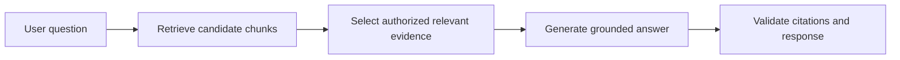
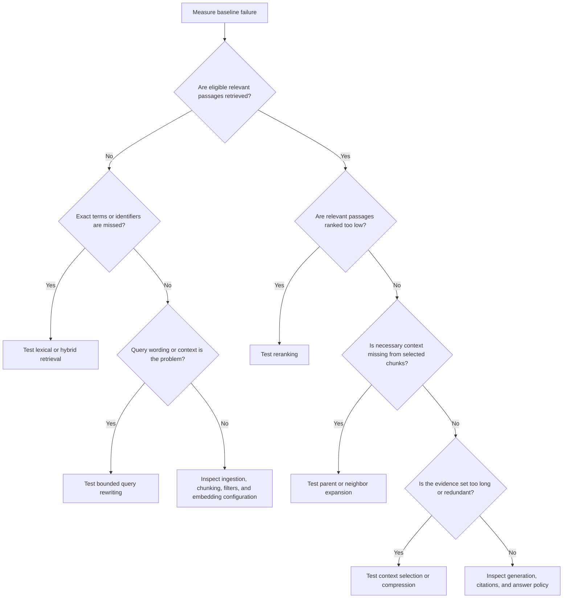

# Chapter 17: Basic versus Advanced RAG Patterns

## Learning Objectives

By the end of this chapter, you should be able to:

- Build and explain a simple retrieve-select-generate RAG baseline.
- Compare optional improvements such as hybrid retrieval, query rewriting, reranking, parent expansion, and context compression.
- Choose the next improvement based on an observed failure and measured evidence.
- Assess the effects of additional stages on complexity, latency, cost, and maintenance.
- Run controlled experiments that isolate the contribution of each change.
- Keep query-processing workflows deterministic, bounded, and within the scope of this RAG course.

> **Scope boundary:** Autonomous retrieval planning, agent loops, and agent orchestration belong to the separate Agentic AI course. This chapter covers fixed, application-defined RAG workflows.

<br/>

## 1. What Is a RAG Pattern?

A **RAG pattern** is a repeatable design for retrieving evidence and using it to generate a grounded answer. Patterns differ in how they retrieve candidate passages, select evidence, transform queries, rerank results, expand context, and prepare the final prompt.

The goal is not to build the most complicated pipeline. The goal is to build the simplest pipeline that meets the application's quality, security, latency, and cost requirements.

A useful progression is:

1. Establish a measurable baseline.
2. Identify a specific failure.
3. Select one intervention designed to address that failure.
4. Compare the intervention with the baseline under controlled conditions.
5. Keep it only if the measured benefit justifies its costs and risks.

<br/>

## 2. The Simple Retrieve–Select–Generate Baseline

A basic RAG application has three main stages:

1. **Retrieve:** search an indexed knowledge base for candidate chunks.
2. **Select:** choose a bounded set of relevant, authorized evidence that fits the context budget.
3. **Generate:** provide the question and selected evidence to the language model and produce a grounded answer with citations where supported.



A production baseline also needs authorization, error handling, observability, and source attribution. “Simple” does not mean “unsecured” or “unmeasured.”

<br/>

### 2.1 Baseline responsibilities

| Stage | Responsibilities | Common failure |
|<br/>|<br/>|<br/>|
| Retrieve | Search the correct index and apply access restrictions | Relevant evidence is not found |
| Select | Remove irrelevant or duplicate candidates and respect context limits | Useful evidence is omitted or too much noise remains |
| Generate | Answer from evidence, disclose gaps, and cite sources | Unsupported claims or invalid citations |
| Validate | Check source IDs, permissions, output schema, and safety rules | Incorrect or unauthorized output is returned |

<br/>

### 2.2 Establish a baseline before optimizing

Record at least:

- A fixed evaluation dataset and expected behavior.
- Retrieval metrics such as Recall@k, where appropriate.
- Answer correctness and groundedness.
- Citation validity and support.
- Abstention behavior on unanswerable questions.
- End-to-end latency and, where possible, per-stage latency.
- Model and retrieval costs.
- Index, embedding, prompt, and configuration versions.

Without a baseline, an apparent improvement may simply reflect a different test set, prompt, corpus, or model configuration.

<br/>

## 3. Optional Improvements and the Failures They Address

Advanced patterns should be introduced in response to a diagnosed weakness—not added by default.

| Pattern | What changes | Consider when | Main risks or costs |
|<br/>|<br/>|<br/>|<br/>|
| Hybrid retrieval | Combines dense semantic search with lexical retrieval such as BM25 | Exact terms, identifiers, product codes, or rare phrases are missed by dense search | More retrieval work, fusion configuration, duplicate candidates |
| Query rewriting | Produces a clearer or more context-complete search query | Pronouns, shorthand, or conversational context make the original query hard to search | Rewrite can change intent, remove constraints, or add unsupported assumptions |
| Reranking | Reorders an initial candidate set using a stronger relevance model | Relevant chunks are retrieved but appear too low in the ranking | Additional model call or compute, latency, candidate-limit sensitivity |
| Parent expansion | Retrieves a focused chunk, then adds authorized surrounding or parent context | A chunk is relevant but lacks definitions, conditions, or neighboring context | More tokens, noise, access-control complexity, stale-parent risk |
| Context compression | Shortens selected evidence before generation | Useful evidence exceeds the context budget or contains substantial redundancy | Important qualifiers can be lost; generated summaries can introduce errors |
| Metadata filtering | Restricts retrieval by source, date, type, tenant, or permissions | The query has a meaningful scope and metadata is trustworthy | Incorrect filters can exclude valid evidence or weaken isolation if misapplied |

Hybrid retrieval, rewriting, reranking, parent expansion, and compression solve different problems. They are not interchangeable, and no single one is guaranteed to improve every dataset.

<br/>

### Diagnose before choosing

- **Missing exact identifiers?** Investigate lexical retrieval or hybrid search.
- **Relevant chunks are retrieved but ranked too low?** Evaluate reranking.
- **Question depends on prior conversation or ambiguous wording?** Test bounded query rewriting.
- **Retrieved chunk lacks its defining conditions?** Test parent or neighbor expansion.
- **Evidence is relevant but too long or repetitive?** Test context selection and compression.
- **Wrong tenant or document scope?** Fix authorization and filtering first; do not attempt to compensate with a stronger model.

<br/>

## 4. A Pattern-Selection Decision Guide



This guide is a starting point, not an automatic optimizer. Some failures have multiple causes. For example, poor retrieval can result from ingestion errors, bad metadata filters, or unsuitable chunking—not only from the retrieval algorithm.

<br/>

## 5. Keep Each Workflow Fixed and Bounded

Within this course, a RAG query workflow should be an application-defined sequence of stages. For example:

```text
Question
  -> validate request and access scope
  -> optional bounded rewrite
  -> retrieve candidates
  -> optional fusion
  -> optional reranking
  -> select or expand evidence
  -> optional compression
  -> generate grounded answer
  -> validate citations and output
```

The sequence and optional branches should be configured by the application, with explicit limits.

Useful bounds include:

- Maximum rewrite attempts: normally one rewrite operation per query.
- Maximum number of alternative queries: a small configured count.
- Maximum retrieval candidate count.
- Maximum reranking candidate count.
- Maximum parent or neighbor expansions.
- Maximum evidence tokens.
- Maximum external model calls and retry attempts.
- Request deadline and cancellation behavior.

A fixed workflow improves reproducibility, makes costs easier to estimate, and helps operators identify which stage caused a failure.

**Out of scope here:** a system that autonomously decides which tools to call, repeatedly plans new retrieval actions, or runs an open-ended agent loop. Those topics belong to the separate Agentic AI course.

<br/>

## 6. Compare Quality, Latency, Cost, and Complexity

A pattern should be judged on more than answer quality.

| Dimension | Questions to ask |
|<br/>|<br/>|
| Retrieval quality | Does it improve Recall@k, Precision@k, MRR, or nDCG on the relevant failure cases? |
| Answer quality | Does it improve correctness, groundedness, completeness, and citation support? |
| Abstention quality | Does it reduce unsupported answers without causing excessive abstention? |
| Latency | What is the p50 and p95 end-to-end latency? Which stage adds the delay? |
| Cost | Does it add model calls, embedding work, reranking compute, or more generated tokens? |
| Reliability | Does it add new failure modes, timeouts, rate limits, or dependency outages? |
| Security | Does it preserve authorization, tenant isolation, and source-level permissions at every stage? |
| Maintainability | Does the team have to manage more configuration, model versions, fallbacks, and monitoring? |
| Reproducibility | Can the result be repeated using fixed data, prompts, models, and configuration? |

A quality improvement may be worthwhile for a high-risk use case but unnecessary for a low-latency FAQ endpoint. The acceptable trade-off depends on application requirements and should be documented.

<br/>

### Added calls and latency

A rough sequential latency model is:

$$
T_{\text{total}} \approx T_{\text{rewrite}} + T_{\text{retrieve}} +
T_{\text{rerank}} + T_{\text{expand}} + T_{\text{compress}} +
T_{\text{generate}} + T_{\text{validate}}
\$$

This is a simplified model. Some operations may run in parallel, while queueing, network overhead, retries, and serialization add further latency.

Additional stages can also increase cost indirectly. Parent expansion and weak deduplication may enlarge the prompt, raising generation cost even if they do not add a separate model call.

<br/>

## 7. Controlled Experiments: Change One Thing at a Time

To understand whether a pattern helps, keep the rest of the system as constant as practical.

### Recommended experiment protocol

1. Define a specific failure and hypothesis.
2. Choose a representative evaluation slice containing that failure.
3. Freeze the dataset, source versions, permissions, model versions, prompts, and baseline configuration.
4. Change one main component.
5. Run the baseline and treatment on the same cases.
6. Compare quality, latency, cost, and failure rates.
7. Inspect examples where the treatment improves and where it regresses.
8. Repeat or use statistical analysis when results are noisy.
9. Keep, modify, or reject the change based on predefined criteria.
10. Record the experiment and configuration.

<br/>

### Example hypothesis

**Observed failure:** Questions containing exact policy IDs often fail to retrieve the correct passage.

**Hypothesis:** Adding BM25 candidates and fusing them with dense results will improve retrieval for exact policy IDs.

**Experiment:**

- Baseline: dense retrieval only.
- Treatment: dense plus BM25, with the same corpus, authorization filters, final candidate budget, reranker status, and answer-generation configuration.
- Primary metric: Recall@10 on the policy-ID evaluation slice.
- Guardrails: citation support, permission correctness, p95 latency, and cost per query.

If hybrid retrieval improves Recall@10 but creates unacceptable latency or introduces unauthorized candidates through an unfiltered branch, it is not ready for deployment.

<br/>

### Avoid confounded experiments

Do not simultaneously change the embedding model, chunk size, hybrid fusion, reranker, prompt, and generation model, then attribute the result to one change. You may learn that the combined system behaves differently, but you will not know which change caused the gain or regression.

For interactions between components, use a deliberate factorial or ablation design after each component has been evaluated individually.

<br/>

## 8. Ablation Studies and Regression Analysis

An **ablation study** removes or disables one component from a system to estimate its contribution.

For a pipeline with hybrid retrieval, rewriting, reranking, and compression, compare controlled configurations such as:

| Experiment | Hybrid | Rewrite | Rerank | Compress |
|<br/>|<br/>:|<br/>:|<br/>:|<br/>:|
| Baseline | No | No | No | No |
| A | Yes | No | No | No |
| B | No | Yes | No | No |
| C | No | No | Yes | No |
| D | No | No | No | Yes |
| E | Best justified combination | As selected | As selected | As selected |

Do not assume every combination must be tested. Start with the change most directly connected to the diagnosed failure, then test combinations when evidence suggests that components complement one another.

<br/>

### Look beyond aggregate scores

An improvement in average performance can conceal a regression in a critical slice:

- Exact identifiers improve, but natural-language questions worsen.
- Average quality improves, but p95 latency becomes too high.
- Answer completeness improves, but unsupported claims increase.
- Retrieval recall improves, but source diversity decreases.
- Compression reduces tokens, but removes a qualifying exception.
- More candidates improve recall, but introduce more irrelevant context.

Report overall metrics and important slices separately.

<br/>

## 9. Why More Stages Can Introduce Regressions

Each additional stage is another transformation or dependency. It can improve one property while harming another.

### Common regression mechanisms

1. **Query drift:** rewriting changes the user's meaning, scope, negation, or identifiers.
2. **Candidate loss:** a fusion, filtering, or reranking step drops a relevant passage.
3. **Ranking error:** a reranker prefers a passage that is semantically similar but does not answer the question.
4. **Context dilution:** parent expansion adds broad material that distracts the generator.
5. **Compression loss:** a summary drops a number, exception, date, or condition.
6. **Error propagation:** a mistake early in the pipeline becomes input to every later stage.
7. **Latency accumulation:** sequential calls push responses beyond the deadline.
8. **Cost growth:** extra candidates and context increase inference and token costs.
9. **Security gaps:** one new retrieval branch or cache bypasses an authorization filter.
10. **Operational complexity:** more components introduce configuration drift, failure modes, and monitoring requirements.

<br/>

### Practical rule

**Every additional stage needs a hypothesis, a bounded implementation, an evaluation, and a rollback path.**

More stages are justified only when the measured benefit is worth the added risk and operational burden.

<br/>

## 10. Practice: Choose the Next Experiment

For each scenario, choose one next experiment and justify it. Do not add multiple stages at once.

### Scenario A: Exact identifier failures

The system answers general questions well, but often misses passages containing exact policy IDs and product codes.

**Suggested next experiment:** Add a lexical/BM25 branch and fuse it with dense results. Evaluate exact-identifier Recall@k and citation support while keeping the rest of the pipeline fixed.

<br/>

### Scenario B: Good candidates, poor ordering

The correct passage appears in the top 30 retrieved chunks but is often outside the final top 5.

**Suggested next experiment:** Add a reranker to the existing candidate set. Compare ranking metrics and answer quality while keeping candidate generation fixed.

<br/>

### Scenario C: Missing conditions

The selected chunk states a rule but omits an exception that appears in the surrounding section.

**Suggested next experiment:** Test bounded parent or neighbor expansion. Measure whether the exception is included and whether irrelevant context or unauthorized content increases.

<br/>

### Scenario D: Conversational references

Follow-up questions such as “Does that apply to contractors too?” fail because the retriever does not know what “that” refers to.

**Suggested next experiment:** Test one bounded rewrite that incorporates relevant conversation context while preserving the user's intent and constraints. Measure rewrite correctness as well as retrieval quality.

<br/>

### Scenario E: Long, redundant context

Retrieval finds relevant passages, but the prompt contains repeated material and exceeds the context budget.

**Suggested next experiment:** Improve deduplication and context selection first. If evidence still exceeds the budget, test compression and verify that key conditions, dates, and exceptions survive.

<br/>

### Scenario F: Wrong-tenant evidence

A query occasionally retrieves a document from another tenant.

**Suggested next experiment:** Do not add a ranking or generation stage. Fix the authorization boundary and add cross-tenant regression tests before further quality tuning.

<br/>

### Write-up template

For your chosen scenario, document:

- **Observed failure:**
- **Hypothesis:**
- **One change to test:**
- **Baseline configuration:**
- **Primary metric:**
- **Guardrail metrics:**
- **Expected benefit:**
- **Possible regression:**
- **Decision rule:**

<br/>

## 11. Checkpoint: Why Can Adding More Stages Introduce Regressions?

**Model answer:**

Each RAG stage transforms the query, candidate set, context, or output. A transformation can discard useful evidence, alter the user's intent, misrank passages, omit important qualifiers during compression, or add irrelevant context. Additional stages also add model calls, latency, cost, external dependencies, and operational failure modes. Security can regress if a new retrieval branch, cache, or expansion step does not enforce the same authorization rules. Therefore, each stage should address a diagnosed failure, have explicit bounds, and be evaluated independently before it is combined with other changes.

<br/>

### Self-check

You should be able to explain:

1. Why a simple baseline is necessary before advanced patterns are added.
2. Which failure types suggest hybrid retrieval, rewriting, reranking, parent expansion, or compression.
3. Why quality, latency, cost, security, and maintainability must be evaluated together.
4. How controlled experiments prevent incorrect attribution.
5. How ablation studies help estimate the contribution of a component.
6. Why fixed, bounded query workflows are different from autonomous agent loops.

<br/>

## 12. Key Takeaways

- Start with a secure, measurable retrieve-select-generate baseline.
- Add a pattern only when it addresses a diagnosed failure.
- Select improvements based on evidence rather than architectural fashion.
- Measure quality, latency, cost, security, and maintenance burden.
- Change one main component at a time and keep the evaluation set fixed.
- Use ablations and targeted evaluation slices to understand gains and regressions.
- Keep workflows fixed and bounded within this RAG course.
- Autonomous retrieval planning, agent loops, and agent orchestration belong to the separate Agentic AI course.

<br/>

## 13. References

- [Retrieval-Augmented Generation for Knowledge-Intensive NLP Tasks](https://arxiv.org/abs/2005.11401)
- [BEIR: A Heterogeneous Benchmark for Zero-shot Evaluation of Information Retrieval Models](https://arxiv.org/abs/2104.08663)
- [Sentence Transformers — Semantic Search](https://www.sbert.net/examples/sentence_transformer/applications/semantic-search/README.html)
- [Elasticsearch — Hybrid Search](https://www.elastic.co/what-is/hybrid-search)
- [OWASP Top 10 for Large Language Model Applications](https://owasp.org/www-project-top-10-for-large-language-model-applications/)

<br/>

## Next Chapter

**Chapter 18: RAG Failure Modes and Evaluation**

The next chapter brings the RAG pipeline together by diagnosing failure categories and evaluating retrieval, generation, citations, abstention, and end-to-end behavior.
