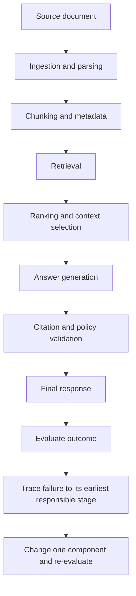

# Chapter 18: Common RAG Failure Modes and Evaluation

## Learning Objectives

By the end of this chapter, you should be able to:

- Diagnose failures in ingestion, chunking, retrieval, ranking, context selection, generation, and citation handling.
- Distinguish unsupported answers, false abstention, fabricated citations, and stale-source errors.
- Build a fixed evaluation dataset with relevant evidence labels and expected answer criteria.
- Use Precision@k, Recall@k, MRR, and nDCG to evaluate retrieval where appropriate.
- Evaluate answer correctness, faithfulness, completeness, citation support, and abstention as separate dimensions.
- Track per-stage latency, token usage, cost, permissions, and source lifecycle correctness.
- Recognize limitations of human and model-based judgments.
- Locate the failing stage before changing the prompt or retrieval configuration.

> **Depth boundary:** This chapter establishes practical RAG evaluation fundamentals. Larger evaluation programs, judge calibration, experiment tracking, and regression gates are expanded in Level 13.

<br/>

## 1. Why RAG Evaluation Must Be Stage-Aware

A RAG application is a pipeline. An incorrect final answer may originate at any stage:

1. The source was never ingested.
2. Parsing or OCR lost relevant content.
3. Chunk boundaries separated a fact from its conditions.
4. Retrieval failed to find the relevant chunk.
5. Ranking placed the best chunk too low.
6. Context selection omitted the relevant evidence.
7. Generation misread or ignored the evidence.
8. Citation generation pointed to an invalid or unsupported source.
9. The system used a stale version or bypassed a permission restriction.

Changing the generation prompt when the relevant document was never retrieved will not fix the root cause. Similarly, increasing top-k will not fix an ingestion process that dropped the required table.

**Core principle:** diagnose the earliest failing stage that explains the observed behavior, then test a targeted change.



<br/>

## 2. Common Failure Modes and Their Signals

| Failure mode | Observable signal | Likely stage to inspect | Example corrective direction |
|<br/>|<br/>|<br/>|<br/>|
| Ingestion loss | Source contains a fact but extracted text does not | Ingestion, parsing, OCR, table extraction | Inspect source extraction and parser output |
| Broken chunk boundary | A condition or exception is separated from the claim | Chunking | Preserve section structure or include bounded overlap |
| Weak retrieval | Relevant evidence is absent from the candidate set | Query processing, index, retrieval, filters | Inspect query, index, embeddings, metadata filters, and retrieval method |
| Poor ranking | Relevant passage is retrieved but appears too low | Ranking, fusion, reranking | Evaluate candidate depth, scoring, or reranking |
| Context omission | Relevant passage is retrieved but not passed to the generator | Selection, deduplication, context budget | Inspect selection logic and token budget |
| Unsupported answer | Output contains claims not supported by evidence | Generation, evidence contract | Improve grounding rules and evidence coverage; validate claims |
| False abstention | Sufficient evidence exists but the system refuses to answer | Retrieval, selection, answerability policy, generation | Determine whether evidence was available and correctly interpreted |
| Fabricated citation | Citation ID or source locator does not exist or does not support the claim | Citation generation and validation | Validate citation IDs against the authorized evidence set |
| Stale source | Answer relies on an obsolete version | Ingestion updates, active-index selection, cache | Inspect source versions, publication, deletion, and cache invalidation |
| Permission failure | Unauthorized content appears in results, prompts, citations, or logs | Authorization across all paths | Fix the security boundary before quality tuning |
| Conflicting evidence hidden | Output presents one value without acknowledging a real unresolved conflict | Source precedence and generation | Inspect source scope, dates, authority, and conflict policy |
| Cost or latency regression | Quality is stable but service becomes slower or more expensive | Added stages, retries, context size | Measure per-stage latency, tokens, calls, and retries |

These signals are diagnostic clues, not proof of root cause. Verify them against the actual pipeline trace and source data.

<br/>

## 3. Build a Fixed Evaluation Dataset

A fixed evaluation dataset allows configurations to be compared on the same questions and evidence conditions.

Each evaluation case should contain enough information to judge retrieval and answer behavior consistently.

### Recommended fields

| Field | Purpose |
|<br/>|<br/>|
| `case_id` | Stable identifier for the test case |
| `question` | User question to evaluate |
| `scope` | Relevant date, product, tenant, or other intended constraints |
| `expected_behavior` | Answer, partial answer, clarify, abstain, or report conflict |
| `relevant_source_ids` | Sources expected to contain relevant evidence |
| `relevant_chunk_ids` | Known relevant chunks, where stable IDs are available |
| `expected_answer_criteria` | Required facts, conditions, and exclusions—not necessarily one exact wording |
| `required_citations` | Evidence that should support important claims |
| `permission_context` | Synthetic user/tenant and expected access scope |
| `source_version` | Intended version of the source |
| `failure_category` | Optional label for the failure being tested |

<br/>

### Example evaluation case

```json
{
  "case_id": "policy-deadline-001",
  "question": "What is the application deadline?",
  "scope": {
    "policy_version": "rev-12"
  },
  "expected_behavior": "abstain",
  "relevant_source_ids": [],
  "relevant_chunk_ids": [],
  "expected_answer_criteria": [
    "Do not invent a deadline",
    "State that the available source does not establish the deadline"
  ],
  "required_citations": [],
  "permission_context": {
    "tenant_id": "tenant-a",
    "user_id": "user-a"
  },
  "source_version": "rev-12",
  "failure_category": "unanswerable"
}
```

This is an illustrative record. In a real dataset, distinguish “no evidence exists in the approved corpus” from “the retrieval system failed to find the evidence.” Both may require a cautious user-facing response, but they have different diagnostic labels.

<br/>

### Dataset quality

- Include easy and difficult cases.
- Include answerable, partially answerable, ambiguous, conflicting, and unanswerable questions.
- Include paraphrases and exact identifiers.
- Include current and superseded source versions.
- Include permission-filtered cases using synthetic data.
- Record the corpus and configuration version used for the expected labels.
- Have a reviewer verify evidence labels and expected criteria.
- Keep evaluation examples separate from prompt-development examples where practical.

<br/>

## 4. Retrieval Metrics

Retrieval metrics evaluate whether relevant evidence appears among the ranked results. They do not, by themselves, prove that the final answer is correct.

Let $R_q$ be the set of known relevant documents or chunks for query $q$, and let $L_k(q)$ be the top-$k$ ranked results.

<br/>

### 4.1 Precision@k

Precision@k measures the fraction of the top-$k$ results that are relevant:

$$
\operatorname{Precision@k}(q)=
\frac{|L_k(q)\cap R_q|}{k}
$$

Use it when the amount of irrelevant material returned matters, such as when context space is limited.

<br/>

### 4.2 Recall@k

Recall@k measures the fraction of known relevant items retrieved in the top $k$:

$$
\operatorname{Recall@k}(q)=
\frac{|L_k(q)\cap R_q|}{|R_q|}
$$

Use it when missing necessary evidence is a major concern. Recall depends on having a reasonably complete set of relevant evidence labels.

<br/>

### 4.3 Mean Reciprocal Rank (MRR)

MRR rewards placing the first relevant result near the top. If the first relevant result appears at rank \(r_q\), the reciprocal rank is $1/r_q$. MRR averages reciprocal ranks across queries:

$$
\operatorname{MRR}=\frac{1}{|Q|}
\sum_{q\in Q}\frac{1}{r_q}
$$

If no relevant result appears within the evaluated ranking, its reciprocal rank is zero.

<br/>

### 4.4 Normalized Discounted Cumulative Gain (nDCG)

nDCG evaluates ranking quality when relevance has graded levels. Highly relevant results at higher ranks contribute more than less relevant or lower-ranked results.

A common definition is:

$$
\operatorname{DCG@k}=
\sum_{i=1}^{k}\frac{2^{rel_i}-1}{\log_2(i+1)}
$$

$$
\operatorname{nDCG@k}=
\frac{\operatorname{DCG@k}}{\operatorname{IDCG@k}}
$$

Here, $rel_i$ is the relevance grade at rank$(i$, and IDCG is the ideal DCG for the same relevance labels. If the ideal score is zero, define handling explicitly in the evaluation implementation.

<br/>

### Which metric should you choose?

| Metric | Best suited for | Limitation |
|<br/>|<br/>|<br/>|
| Precision@k | Relevance density in the returned set | Does not show how much relevant evidence was missed |
| Recall@k | Coverage of known relevant evidence | Can reward returning many candidates unless k is fixed or cost is considered |
| MRR | Position of the first relevant result | Does not fully evaluate multiple relevant results |
| nDCG | Ranking with graded relevance | Requires consistent relevance grades |

Do not compare metrics computed with different k values, relevance labels, corpora, or filtering rules as though they were directly equivalent.

<br/>

## 5. Small Retrieval-Metric Example

Suppose the relevant chunk IDs for one question are `{C2, C4}`. The top four retrieved chunks are `[C2, C7, C4, C9]`.

- Precision@4 = 2 / 4 = 0.50
- Recall@4 = 2 / 2 = 1.00
- First relevant result is at rank 1, so reciprocal rank = 1.00

The retrieval found all known relevant chunks, but half of the top four candidates were irrelevant. Whether that is acceptable depends on the context budget and the cost of irrelevant evidence.

For nDCG, assign relevance grades to results and compare their ranking against an ideal ordering. A passage that is essential to answer the question may receive a higher grade than a passage that is only tangentially useful.

<br/>

## 6. Evaluate Answer Quality as Separate Dimensions

A single “answer quality” score can hide important failures. Score distinct dimensions separately.

| Dimension | What to assess | Example failure |
|<br/>|<br/>|<br/>|
| Correctness | Are the factual claims correct under the intended scope? | Wrong deadline |
| Faithfulness/groundedness | Are claims supported by the supplied evidence? | Adds an unsupported condition |
| Completeness | Does the response cover all required parts and qualifications? | Omits an exception |
| Citation validity | Do cited IDs and links resolve to permitted sources? | Invented source ID |
| Citation support | Does each citation actually support the associated claim? | Citation exists but discusses a different rule |
| Abstention behavior | Does the system answer when evidence is sufficient and abstain when it is not? | Refuses despite clear evidence |
| Ambiguity handling | Does it clarify when interpretations materially differ? | Answers for the wrong product |
| Conflict and freshness handling | Does it disclose unresolved conflicts or outdated evidence? | Presents an old value as current |
| Permission correctness | Is all evidence authorized for this request? | Cross-tenant passage in the prompt |
| Format compliance | Does output satisfy the required schema or format? | Invalid JSON |

A structurally valid citation is not necessarily a supporting citation. Similarly, an answer can be factually correct by coincidence while still being ungrounded in the retrieved evidence.

<br/>

### Abstention has two sides

- **False answer:** the system answers when evidence is insufficient.
- **False abstention:** the system refuses when sufficient evidence is available.

Both matter. Optimizing only for fewer unsupported answers may cause the system to refuse too often; optimizing only for answer rate may increase hallucinations.

<br/>

## 7. Evaluate the Pipeline in Stages

Use a staged investigation so the team can isolate the source of failure.

### Stage A: Ingestion and parsing

- Does extracted text preserve the relevant statement?
- Are tables, headings, footnotes, and page structure represented correctly?
- Are source IDs, versions, and metadata accurate?

<br/>

### Stage B: Chunking and indexing

- Does at least one chunk contain the required fact and its qualifiers?
- Are embeddings produced with the intended model and configuration?
- Are vectors, metadata, and source records synchronized?

<br/>

### Stage C: Retrieval

- Is relevant evidence present in the candidate set?
- Are filters excluding valid evidence?
- Is the query appropriate for the retrieval method?
- Are exact terms, identifiers, and paraphrases handled as expected?

<br/>

### Stage D: Ranking and context selection

- Does the relevant evidence rank highly enough?
- Is it retained after deduplication and context-budget selection?
- Did expansion add necessary context or introduce noise?

<br/>

### Stage E: Generation and citations

- Did the model use the evidence correctly?
- Are all important claims supported?
- Are citations valid, authorized, and claim-relevant?
- Did the answer disclose missing or conflicting evidence?

<br/>

### Stage F: Operational and security behavior

- Did the request meet latency and cost targets?
- Were the correct index and source versions used?
- Were permissions enforced through retrieval, expansion, cache access, and citations?
- Did errors or retries create stale or partial results?

<br/>

## 8. Hold the Model and Prompt Fixed When Comparing Retrieval

When the goal is to compare retrieval configurations, hold the generation model and prompt fixed. Otherwise, it becomes difficult to determine whether a result came from retrieval or generation.

### Controlled comparison procedure

1. Freeze the corpus, chunking, source versions, and evaluation cases.
2. Keep the generation model, system prompt, decoding settings, and output validation fixed.
3. Change one retrieval configuration, such as dense-only versus hybrid retrieval.
4. Compare retrieval metrics on the same queries.
5. Pass each configuration's selected evidence to the same generation setup.
6. Compare answer correctness, faithfulness, completeness, citation support, and abstention separately.
7. Record latency, token usage, and cost for each configuration.
8. Inspect cases where retrieval improved but answer quality did not, and vice versa.

<br/>

### Example experiment table

| Measure | Dense baseline | Hybrid treatment |
|<br/>|<br/>:|<br/>:|
| Recall@10 | Record measured value | Record measured value |
| Precision@10 | Record measured value | Record measured value |
| Answer correctness | Record measured value | Record measured value |
| Citation support | Record measured value | Record measured value |
| False abstention rate | Record measured value | Record measured value |
| p95 latency | Record measured value | Record measured value |
| Cost per query | Record measured value | Record measured value |

Do not fill the table with guessed values. Use the same dataset, permissions, source versions, and evaluation protocol for both columns.

<br/>

### Analyze retrieval and answer failures separately

- If Recall@k is low and the answer is wrong, investigate ingestion, filters, query processing, and retrieval first.
- If Recall@k is high but the answer is wrong, inspect context selection, generation, and citation support.
- If the answer is correct but citations are invalid, inspect citation construction and validation.
- If the answer uses an obsolete source, inspect version publication, active-index selection, and caches.
- If unauthorized evidence appears, stop quality tuning and fix the access-control failure.

<br/>

## 9. Operational Metrics: Latency, Tokens, Cost, and Correctness

For each request, record stage-level measurements where practical.

| Measurement | Example fields |
|<br/>|<br/>|
| End-to-end latency | `request_latency_ms` |
| Retrieval latency | `retrieval_latency_ms` |
| Reranking latency | `rerank_latency_ms` |
| Generation latency | `generation_latency_ms` |
| Input/output tokens | `input_tokens`, `output_tokens` |
| External calls | `embedding_calls`, `reranker_calls`, `generation_calls` |
| Cost | `estimated_request_cost` |
| Retrieval version | `index_version`, `embedding_model` |
| Source freshness | `source_version`, `published_at` |
| Security | `authorization_decision`, `filtered_candidate_count` |
| Citation status | `citation_validation_passed` |
| Lifecycle status | `active_version_check_passed` |

Use the provider's actual billing rules when estimating costs. Token counts alone do not provide a universal cost calculation because prices and billing units vary by model and service.

<br/>

### Useful summary statistics

- **p50 latency:** median request latency.
- **p95 latency:** latency below which 95% of observed requests fall.
- **Average cost per query:** total measured or estimated cost divided by the number of evaluated queries.
- **Failure rate:** fraction of requests with a defined failure.
- **Permission violation rate:** unauthorized exposure events divided by relevant tested or observed opportunities. Any confirmed unauthorized exposure should be treated as a security incident, not merely as an ordinary quality regression.

Report distributions and failure slices, not only averages.

<br/>

## 10. Human and Model-Based Evaluation

Both human review and model-based evaluation can be useful, but neither is automatically reliable.

### Human evaluation

**Strengths**

- Can judge nuance, practical usefulness, and domain-specific requirements.
- Can identify subtle omissions or misleading phrasing.
- Can review whether evidence truly supports a claim.

**Limitations**

- Reviewers may disagree.
- Annotation takes time and can be expensive.
- Domain knowledge varies.
- Reviewers can be influenced by answer fluency or source presentation.
- Rubrics may be interpreted inconsistently.

Improve consistency with explicit criteria, representative examples, reviewer training, and adjudication for important disagreements.

<br/>

### Model-based evaluation

An LLM judge can score answers against a rubric or compare an answer with evidence. It can help scale review, but its output is itself a model prediction—not ground truth.

Potential limitations include:

- Preference for fluent or lengthy answers.
- Failure to detect subtle unsupported claims.
- Sensitivity to judge prompt and model version.
- Position or presentation bias in pairwise comparisons.
- Shared blind spots between the answer model and judge.
- Inconsistent scoring across repeated runs.

Use model-based evaluation as an aid, not as the sole authority for high-impact decisions. Inspect disagreements, calibrate against human-labeled examples, and report the evaluation method.

<br/>

### A practical evaluation mix

- Deterministic checks for schema, required fields, citation IDs, source versions, and permission constraints.
- Retrieval metrics for evidence coverage and ranking.
- Human review for nuanced correctness and support.
- Model-based scoring for scalable triage or comparison, validated against reviewed cases.
- Separate tests for unanswerable, ambiguous, conflicting, stale, and permission-filtered inputs.

<br/>

## 11. Practice: Compare Retrieval Configurations

### Task

Compare two retrieval configurations while holding the generation model and prompt fixed.

**Baseline:** dense retrieval with a fixed top-k.

**Treatment:** hybrid dense plus lexical retrieval, using the same source corpus and authorization rules.

<br/>

### Procedure

1. Select a fixed set of evaluation questions.
2. Label relevant source/chunk IDs and expected answer criteria.
3. Verify that both configurations use the same source versions and permission scope.
4. Record Precision@k, Recall@k, MRR, or nDCG as appropriate.
5. Use the same generation model, prompt, decoding settings, and output validation for both.
6. Score answer correctness, faithfulness, completeness, citation support, and abstention separately.
7. Record per-stage latency, token usage, and estimated cost.
8. Inspect examples where retrieval scores improved but the final answer did not.
9. Identify the earliest stage responsible for each failure.
10. Write a short recommendation supported by measured results.

<br/>

### Analysis questions

- Did the treatment retrieve evidence that the baseline missed?
- Did it add irrelevant candidates?
- Did the relevant passage survive ranking and context selection?
- Did answer correctness improve, remain stable, or regress?
- Were citation support and abstention behavior affected?
- Did latency or cost exceed the application's limits?
- Were permissions and source-version checks correct for every case?

<br/>

## 12. Checkpoint: Locate the Failing Stage Before Changing the Prompt or Retrieval Configuration

**Model answer:**

Start with the source and trace the evidence through the pipeline. Confirm that the relevant information exists in the source, survives parsing and chunking, is indexed with correct metadata, and is eligible under the user's permissions. Then inspect whether retrieval returns it, whether ranking and context selection retain it, and whether generation uses it correctly. Finally, validate citations, source versions, caches, latency, and access controls. If the evidence never reaches the generator, changing the prompt is unlikely to solve the root cause. If the evidence is present but ignored or misrepresented, investigate generation and answer-policy behavior instead. Change the component that explains the observed failure and evaluate the result on the same fixed dataset.

<br/>

### Self-check

You should be able to explain:

1. Why a wrong answer does not automatically mean the prompt is the problem.
2. How ingestion loss differs from retrieval failure and context omission.
3. What Precision@k, Recall@k, MRR, and nDCG measure.
4. Why correctness, faithfulness, completeness, citations, and abstention should be scored separately.
5. How stale sources, permissions, latency, and cost fit into evaluation.
6. Why human and model-based judgments both have limitations.

<br/>

## 13. Key Takeaways

- Diagnose RAG failures by stage instead of treating every wrong answer as a generation problem.
- Use a fixed, labeled evaluation dataset with expected behavior and evidence criteria.
- Choose retrieval metrics that match the evaluation objective and relevance labels.
- Assess answer correctness, faithfulness, completeness, citation support, and abstention separately.
- Record source versions, permissions, latency, token usage, and cost alongside quality metrics.
- Keep the generation model and prompt fixed when comparing retrieval configurations.
- Human and LLM-based evaluation are useful but imperfect; validate and interpret their judgments.
- Fix security, authorization, and stale-source defects before optimizing answer quality.
- Larger evaluation programs, judge calibration, experiment tracking, and regression gates are covered in Level 13.

<br/>

## 14. References

- [BEIR: A Heterogeneous Benchmark for Zero-shot Evaluation of Information Retrieval Models](https://arxiv.org/abs/2104.08663)
- [Retrieval-Augmented Generation for Knowledge-Intensive NLP Tasks](https://arxiv.org/abs/2005.11401)
- [Sentence Transformers — Information Retrieval Evaluation](https://www.sbert.net/docs/package_reference/sentence_transformer/evaluation.html)
- [Ragas Documentation](https://docs.ragas.io/)
- [NIST AI Risk Management Framework](https://www.nist.gov/itl/ai-risk-management-framework)
- [OWASP Top 10 for Large Language Model Applications](https://owasp.org/www-project-top-10-for-large-language-model-applications/)

<br/>

## Next Chapter

**Chapter 19: PDF Question-Answering Project**

The next chapter applies the RAG workflow to a practical PDF question-answering project, from document ingestion and indexing through retrieval, grounded answers, and evaluation.
