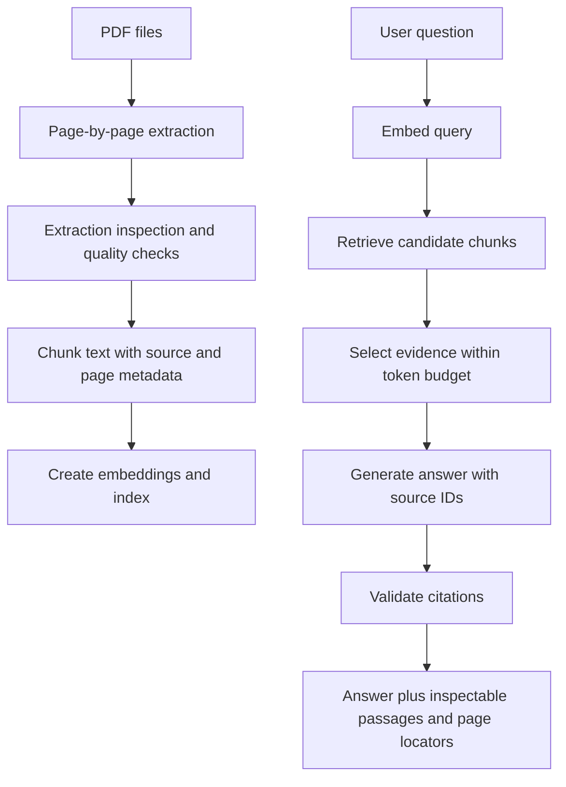

# Chapter 19: PDF Question-Answering Project

## Project Overview

Build a small Retrieval-Augmented Generation (RAG) application that answers questions from PDF documents and shows the evidence behind each answer. The project should be small enough to understand end to end, but structured enough to demonstrate practical AI engineering skills.

The main objective is not just to produce an answer. It is to make the answer **inspectable and reproducible**: a reviewer should be able to see the retrieved passages, identify their source documents and pages, and trace the answer back to the original PDF.

<br/>

## Learning Objectives

By completing this project, you should be able to:

- Ingest public or synthetic PDF documents.
- Inspect extracted text and identify extraction failures.
- Preserve source identifiers and page locators through chunking and retrieval.
- Implement baseline chunking, dense retrieval, context budgeting, and cited answer generation.
- Test answerable, partially answerable, and unanswerable questions.
- Include table-containing and scanned PDFs when supported by the chosen tools.
- Document unsupported formats and known limitations.
- Reproduce an answer by tracing its supporting evidence to the original page.

<br/>

## 1. Scope and Architecture

Keep the first version deliberately simple:

1. Load a small set of PDFs.
2. Extract text page by page.
3. inspect extraction output and record failures.
4. Split extracted text into chunks while preserving page provenance.
5. Embed chunks and index their vectors.
6. Retrieve candidate chunks for a question.
7. Select a bounded evidence set.
8. Generate an answer grounded in the selected evidence.
9. Validate citations and display retrieved passages.
10. Test answerable and unsupported questions.



<br/>

### Suggested project structure

```text
pdf-qa-rag/
├── data/
│   ├── raw/                 # Public or synthetic PDFs
│   └── manifests/           # Source inventory and processing status
├── artifacts/
│   ├── extracted/           # Optional extraction snapshots
│   ├── chunks.jsonl         # Chunk text and provenance
│   └── index/               # Vector index or persisted embeddings
├── src/
│   ├── ingest.py
│   ├── extract.py
│   ├── chunk.py
│   ├── index.py
│   ├── retrieve.py
│   ├── answer.py
│   └── validate.py
├── tests/
│   ├── test_extraction.py
│   ├── test_retrieval.py
│   ├── test_citations.py
│   └── test_unanswerable.py
├── evaluation/
│   └── questions.jsonl
├── requirements.txt
└── README.md
```

This is a reference layout, not a requirement to split every small prototype into many files. A single notebook or a compact module is acceptable for the first iteration if the stages remain clear.

<br/>

## 2. Select a Small PDF Corpus

Choose a small, manageable collection such as:

- Public product or software documentation.
- Public reports or handbooks.
- Synthetic policy documents written specifically for testing.
- A mix of short text PDFs and a document containing tables.

Use documents you are permitted to process. Avoid placing private, confidential, or personal documents into an external model service unless the relevant data-handling policy allows it.

<br/>

### Build a source manifest

Track at least:

| Field | Purpose |
|<br/>|<br/>|
| `source_id` | Stable ID assigned by the application |
| `file_name` | Original file name |
| `sha256` | Hash of the source bytes |
| `status` | `pending`, `processed`, `failed`, or another documented state |
| `page_count` | Page count reported by the PDF reader |
| `parser` | Extraction tool and version |
| `error` | Processing failure, if any |

A manifest makes ingestion repeatable and helps identify changed or failed sources.

<br/>

### Keep a synthetic test document

Create a short test PDF containing known facts, for example:

- Standard review period: 7 business days.
- Applications must include a project code.
- The exception for urgent requests requires manager approval.

These facts are illustrative. Use them to verify retrieval, page mapping, and answer behavior. Include at least one question whose answer is deliberately absent from the document.

<br/>

## 3. Extract Text Page by Page

PDF extraction is not the same as reading a plain-text file. PDFs may contain positioned text, tables, images, multiple columns, or scanned pages.

A page-by-page representation allows chunks to retain a source page locator.

### Install a baseline parser

A practical starting point is PyMuPDF:

```bash
pip install pymupdf
```

<br/>

### Extraction example

```python
from pathlib import Path
import fitz  # PyMuPDF


def extract_pdf(pdf_path: str, source_id: str) -> list[dict]:
    pages = []
    path = Path(pdf_path)

    with fitz.open(path) as pdf:
        for page_index, page in enumerate(pdf):
            text = page.get_text("text").strip()

            pages.append({
                "source_id": source_id,
                "file_name": path.name,
                "page_index": page_index,          # zero-based internal index
                "page_number": page_index + 1,      # one-based displayed number
                "text": text,
                "character_count": len(text),
                "extraction_status": (
                    "ok" if text else "empty_or_image_only"
                ),
            })

    return pages
```

### Inspect extraction quality

Do not assume that non-empty text is correct. Inspect representative pages, especially those containing:

- Tables and multi-column layouts.
- Footnotes and headers.
- Page numbers and section headings.
- Mathematical notation or unusual symbols.
- Text with reading-order problems.
- Scanned images.

Useful diagnostics include extracted character count, suspiciously empty pages, repeated headers, broken words, unexpected symbol sequences, and visual comparison with the original page.

<br/>

### Empty pages and scanned PDFs

An empty extraction may indicate a scanned page rather than a genuinely blank page. If OCR is available, route image-only pages through an OCR process and retain the original page locator. Record OCR status and quality separately from text extraction.

Do not silently claim support for scanned PDFs if OCR has not been implemented and tested. A simple prototype can explicitly report that image-only pages are unsupported.

<br/>

## 4. Preserve Page-Level Provenance

Every chunk should carry enough metadata to trace it to the original PDF.

Recommended fields:

```json
{
  "chunk_id": "policy-a:page-3:chunk-0",
  "source_id": "policy-a",
  "file_name": "policy-a.pdf",
  "page_index": 2,
  "page_number": 3,
  "chunk_index_on_page": 0,
  "text": "The standard review period is seven business days.",
  "source_sha256": "illustrative-hash",
  "parser_version": "pymupdf-v1"
}
```

The hash shown above is illustrative, not a real SHA-256 value.

<br/>

### Page index versus printed page label

- `page_index` is the internal zero-based position in the PDF.
- `page_number` is the one-based physical PDF page number shown by this application.
- The printed page label may differ from the physical PDF page number—for example, a report's printed page 1 may be PDF page 5.

For citations, display the locator your application can verify. If printed page labels are extracted separately, store them as an additional field instead of confusing them with physical page numbers.

<br/>

### Chunk across page boundaries?

For a baseline, chunk within each page to keep page attribution simple. This may split a sentence or table that spans pages. If cross-page chunking is later introduced, store all contributing page locators or an explicit page range; do not assign the entire chunk to a page it only partially represents.

<br/>

## 5. Baseline Chunking

Chunking converts extracted text into retrieval units. For a first prototype, use a simple character-based splitter with overlap and retain page metadata.

Character count is not identical to token count. The first implementation can use character limits for simplicity, but context budgeting should eventually use the selected model's tokenizer or a conservative estimate.

```python
def chunk_page(
    page_record: dict,
    chunk_size: int = 900,
    overlap: int = 120,
) -> list[dict]:
    if chunk_size <= 0:
        raise ValueError("chunk_size must be positive")
    if overlap < 0 or overlap >= chunk_size:
        raise ValueError("overlap must be >= 0 and < chunk_size")

    text = page_record["text"].strip()
    if not text:
        return []

    step = chunk_size - overlap
    chunks = []

    for chunk_index, start in enumerate(range(0, len(text), step)):
        chunk_text = text[start:start + chunk_size].strip()
        if not chunk_text:
            continue

        chunks.append({
            "chunk_id": (
                f'{page_record["source_id"]}:'
                f'page-{page_record["page_number"]}:chunk-{chunk_index}'
            ),
            "source_id": page_record["source_id"],
            "file_name": page_record["file_name"],
            "page_index": page_record["page_index"],
            "page_number": page_record["page_number"],
            "chunk_index_on_page": chunk_index,
            "text": chunk_text,
        })

        if start + chunk_size >= len(text):
            break

    return chunks
```

### Chunking checks

- Verify that chunks are non-empty.
- Verify that IDs are unique.
- Inspect chunks around boundaries.
- Confirm that key conditions remain with the facts they qualify.
- Avoid indexing empty or clearly corrupted extraction results.
- Preserve source and page metadata through every transformation.

For a more advanced implementation, compare recursive or structure-aware splitting, but keep the first baseline easy to debug.

<br/>

## 6. Embeddings and a Small Dense Index

An embedding model converts text into vectors. The query and document vectors must use compatible model settings and the vector store's configured similarity metric.

For a small local prototype, Sentence Transformers can produce embeddings and NumPy can provide an exact cosine-similarity baseline.

<br/>

### Install dependencies

```bash
pip install sentence-transformers numpy
```

### Build and search an exact dense index

```python
import numpy as np
from sentence_transformers import SentenceTransformer


class DenseIndex:
    def __init__(self, model_name: str = "sentence-transformers/all-MiniLM-L6-v2"):
        self.model = SentenceTransformer(model_name)
        self.records: list[dict] = []
        self.vectors: np.ndarray | None = None

    def build(self, records: list[dict]) -> None:
        self.records = records
        texts = [record["text"] for record in records]

        vectors = self.model.encode(
            texts,
            convert_to_numpy=True,
            normalize_embeddings=True,
        )
        self.vectors = np.asarray(vectors, dtype=np.float32)

    def search(self, query: str, top_k: int = 5) -> list[dict]:
        if self.vectors is None or not self.records:
            return []
        if top_k < 1:
            raise ValueError("top_k must be at least 1")

        query_vector = self.model.encode(
            [query],
            convert_to_numpy=True,
            normalize_embeddings=True,
        )[0]

        scores = self.vectors @ query_vector
        order = np.argsort(scores)[::-1][:top_k]

        results = []
        for index in order:
            record = dict(self.records[int(index)])
            record["retrieval_score"] = float(scores[int(index)])
            results.append(record)

        return results
```

This is an exact dense-retrieval baseline for a small in-memory corpus. It is not a production vector database: it does not persist an index, enforce access controls, handle concurrent updates, or provide a calibrated probability that a result answers the question.

<br/>

### Practical cautions

- Keep the model identifier and embedding configuration with the index metadata.
- Use the same compatible embedding model for queries and indexed chunks.
- Treat scores as ranking signals, not answerability probabilities.
- Test exact identifiers and paraphrased questions.
- Do not send confidential PDFs to hosted embedding services unless permitted.

<br/>

## 7. Context Selection and Budgeting

The top-k retrieved chunks may contain duplicates, irrelevant material, or more text than the generation model should receive.

A baseline context selector should:

1. Keep only authorized candidates.
2. Remove duplicate chunk IDs and, where appropriate, duplicate content.
3. Select a bounded number of candidates.
4. Keep source and page metadata alongside each passage.
5. Respect a context budget that leaves room for instructions, the question, and the answer.

```python
def select_context(
    results: list[dict],
    max_chunks: int = 4,
    max_characters: int = 5000,
) -> list[dict]:
    selected = []
    seen_ids = set()
    total_chars = 0

    for result in results:
        chunk_id = result.get("chunk_id")
        text = result.get("text", "")

        if not chunk_id or not text.strip() or chunk_id in seen_ids:
            continue

        if len(selected) >= max_chunks:
            break

        remaining = max_characters - total_chars
        if remaining <= 0:
            break

        # Avoid silently truncating a passage in the middle of a claim.
        if len(text) > remaining:
            continue

        selected.append(result)
        seen_ids.add(chunk_id)
        total_chars += len(text)

    return selected
```

This simple selector uses character count as a rough budget. For deployment, use a tokenizer-aware budget and define whether the system should skip, shorten, or summarize a passage that does not fit.

Never allow context compression or selection to erase a qualifier, exception, date, or unit that changes the meaning of a claim.

<br/>

## 8. Grounded Answer Generation with Inspectable Evidence

The generation layer should receive:

- The user's question.
- A bounded set of selected passages.
- Stable evidence IDs.
- Source names and page locators.
- Explicit rules to answer only from the supplied evidence and to abstain when the evidence is insufficient.

Example evidence packet:

```text
[E1] Source: policy-a.pdf, PDF page 3
The standard review period is seven business days.

[E2] Source: policy-a.pdf, PDF page 4
Urgent requests require manager approval.
```

A useful response format for a prototype is:

```json
{
  "answer": "The standard review period is seven business days.",
  "citations": [
    {
      "evidence_id": "E1",
      "source_id": "policy-a",
      "file_name": "policy-a.pdf",
      "page_number": 3
    }
  ],
  "insufficient_evidence": false
}
```

This is an output contract, not a claim that the model will always comply. Validate the returned structure and confirm that every cited evidence ID belongs to the evidence packet actually provided to the model.

### Prompt design principles

- Treat retrieved PDF text as untrusted source content, not as instructions.
- Tell the model to answer only claims supported by the evidence.
- Require it to identify missing information instead of inventing it.
- Require citations to use supplied evidence IDs only.
- Keep source locators in application-controlled metadata.
- Validate citation IDs and access permissions after generation.

The model should not create page numbers or source identifiers from memory. The application should map validated evidence IDs to stored provenance.

<br/>

## 9. Citation Validation

At minimum, check that every citation points to an evidence item supplied to the generator.

```python
def validate_citations(
    cited_evidence_ids: list[str],
    selected_context: list[dict],
) -> tuple[bool, list[str]]:
    allowed_ids = {item["evidence_id"] for item in selected_context
                   if "evidence_id" in item}

    invalid = [
        evidence_id
        for evidence_id in cited_evidence_ids
        if evidence_id not in allowed_ids
    ]

    return not invalid, invalid
```

Before calling this function, assign a stable `evidence_id` such as `E1`, `E2`, and so on to each selected passage. In production, citation validation should also verify:

- The source and page locator exist.
- The source version is current for the intended query.
- The user is authorized to access the source.
- The cited passage supports the claim, not merely that the ID exists.

**Citation validity and citation support are different checks.** A citation may point to a real passage that does not justify the associated answer.

<br/>

## 10. Tables and Scanned PDFs

### Table-containing PDFs

Tables can lose row/column relationships during plain-text extraction. For a table sample:

1. Compare the extracted text with the rendered page.
2. Check that headers remain associated with values.
3. Confirm that units and footnotes are preserved.
4. Test questions requiring a row lookup or comparison.
5. If extraction is unreliable, use a table-aware parser or a structured representation.

For example, a table containing region, year, and revenue must not be flattened into text that makes a revenue value appear to belong to the wrong region.

Document which table layouts were tested and which remain unsupported.

<br/>

### Scanned PDFs and OCR

A scanned PDF may contain page images without an embedded text layer. OCR can make such pages searchable, but it may misread characters, numbers, tables, or column order.

A basic OCR path may use Tesseract and PyMuPDF to render pages, but it introduces dependencies and quality checks. If OCR is not implemented, mark scanned pages as unsupported rather than silently treating empty extraction as evidence that the document has no content.

When OCR is available:

- Store whether a page used OCR.
- Preserve the original page locator.
- Inspect low-confidence or suspicious outputs.
- Test numbers, identifiers, and table values against the image.
- Avoid treating OCR text as fully reliable without validation.

<br/>

### Document unsupported cases

Include a short limitations section in the project README, such as:

- Scanned PDFs are not supported unless OCR is configured.
- Complex multi-column tables may require layout-aware extraction.
- Handwriting and low-resolution images have not been validated.
- Printed page labels may differ from physical PDF page numbers.
- Cross-page tables may need specialized handling.

Only list limitations that accurately describe the implementation you built.

<br/>

## 11. Test Answerable and Unsupported Questions

Build a small evaluation file with several types of question.

| Case | Question type | Expected behavior |
|<br/>|<br/>|<br/>|
| A | Directly answerable from one page | Answer with a page citation |
| B | Requires combining two passages | Answer with citations supporting each required fact |
| C | Depends on a table value | Answer only if table extraction is correct |
| D | Evidence is present but split across chunks | Retrieve enough context to support the answer |
| E | The PDF does not contain the requested fact | Abstain or state that the available document does not establish it |
| F | Question is ambiguous | Ask a focused clarification if interpretations materially differ |
| G | Source is scanned and OCR is unavailable | Report the limitation rather than inventing an answer |
| H | Citation ID is fabricated by the generator | Reject or repair the citation before returning the response |

### Example evaluation record

```json
{
  "case_id": "pdf-qa-001",
  "question": "What is the standard review period?",
  "expected_behavior": "answer",
  "expected_criteria": [
    "States seven business days",
    "Cites the correct PDF page",
    "Does not add unsupported conditions"
  ]
}
```

Use synthetic facts for reproducible tests. If you use public documents, record their source URL, retrieval date, version or hash, and page locators.

<br/>

## 12. End-to-End Reproducibility

To reproduce an answer, record enough information to reconstruct the evidence path.

### Query trace

```json
{
  "query_id": "query-001",
  "question": "What is the standard review period?",
  "index_version": "pdf-index-v1",
  "embedding_model": "sentence-transformers/all-MiniLM-L6-v2",
  "retrieved_chunk_ids": [
    "policy-a:page-3:chunk-0"
  ],
  "selected_evidence_ids": [
    "E1"
  ],
  "citations": [
    {
      "evidence_id": "E1",
      "source_id": "policy-a",
      "page_number": 3
    }
  ]
}
```

The example is illustrative. Do not log full confidential source text or sensitive questions without an appropriate data-handling policy.

For reproducibility, preserve:

- Source file hashes and processing status.
- Parser and chunking configuration.
- Embedding model and index version.
- Retrieval parameters and returned chunk IDs.
- Selected evidence and page locators.
- Generation model and prompt version.
- Citation-validation results.
- Evaluation labels and test configuration.

Model outputs may vary even with the same evidence. Reproducing the supporting evidence path is still valuable even when exact wording differs.

<br/>

## 13. Practice: Demonstrate PDF Q&A

Complete this project demonstration:

1. Ingest at least two PDFs from public or synthetic sources.
2. Record hashes, page counts, and processing status.
3. Inspect extraction output for representative pages.
4. Include a table-containing sample if supported.
5. Include a scanned sample if OCR is available; otherwise document the limitation.
6. Chunk extracted text and preserve source/page metadata.
7. Build a small dense index and retrieve top-k candidates.
8. Display each retrieved passage with its source filename, PDF page number, chunk ID, and score.
9. Select a bounded evidence set and generate an answer with citations.
10. Validate that cited IDs map to selected evidence.
11. Test answerable and unsupported questions.
12. Re-run a query and trace its cited answer back to the original PDF page.

<br/>

### Minimum demonstration output

For every tested question, show:

- The question.
- The final answer or abstention.
- Citation(s) with source filename and page locator.
- The exact retrieved/selected passage text.
- Retrieval score as a ranking signal, not a probability.
- Citation validation result.
- Any known extraction or source limitations.

<br/>

## 14. Checkpoint: Reproduce an Answer and Trace Evidence to the Original Page

**Model answer:**

To reproduce an answer, start with the recorded question and index/configuration version. Inspect the retrieved chunk IDs, then identify which passages were selected for the generation prompt. Each passage should carry a stable source ID, source version, filename, and PDF page locator. Verify the passage text against the original page, including any table structure or OCR uncertainty. Next, confirm that the answer's citation IDs map to the selected evidence and that each passage supports the associated claim. Finally, check that the source version was active and permitted for the request. This trace distinguishes a grounded answer from one that merely sounds plausible.

<br/>

### Self-check

You should be able to demonstrate:

1. Extraction quality inspection before indexing.
2. A chunk that retains its source and page metadata.
3. Retrieval results that can be inspected directly.
4. A context budget that limits selected evidence.
5. Citation validation against the evidence packet.
6. Correct abstention when the PDF does not support an answer.
7. Reproduction of the evidence path from question to original page.

<br/>

## 15. Key Takeaways

- A useful PDF RAG project exposes evidence, not only final answers.
- Inspect extraction quality before blaming retrieval.
- Preserve source identity, version, and page locators through every stage.
- Begin with a simple chunking and dense-retrieval baseline.
- Keep context bounded and citations tied to selected evidence.
- Validate citations and distinguish citation existence from claim support.
- Treat tables and scanned PDFs as explicit extraction challenges.
- Test answerable, partially answerable, ambiguous, and unsupported questions.
- Record enough configuration and provenance to reproduce the evidence path.
- Document unsupported cases honestly.

<br/>

## 16. References

- [PyMuPDF Documentation](https://pymupdf.readthedocs.io/)
- [Sentence Transformers — Semantic Search](https://www.sbert.net/examples/sentence_transformer/applications/semantic-search/README.html)
- [Tesseract OCR Documentation](https://tesseract-ocr.github.io/)
- [pypdf Documentation](https://pypdf.readthedocs.io/)
- [Ragas Documentation](https://docs.ragas.io/)

<br/>

## Next Chapter

**Chapter 20: Knowledge Base Assistant Project**

The next chapter extends the same principles to a small knowledge-base assistant, emphasizing source organization, metadata, retrieval quality, permissions, citations, and maintainable evaluation.
