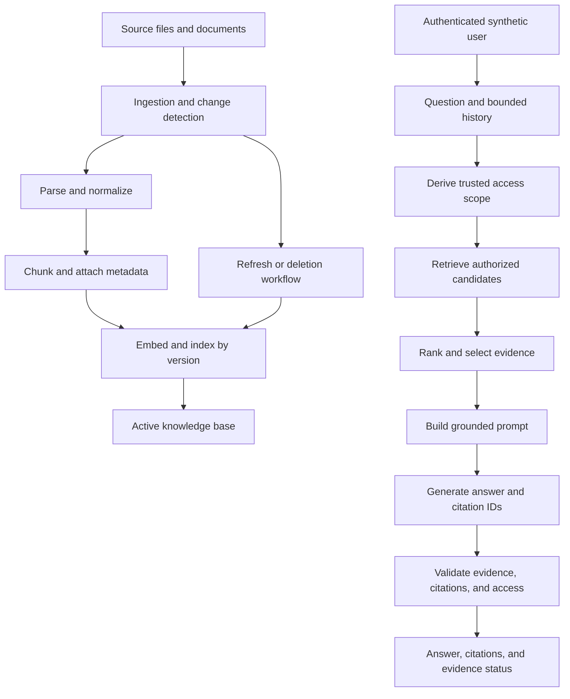

# Chapter 20: Knowledge-Base Assistant Project

## Project Overview

Build a small knowledge-base assistant that answers questions from multiple versioned sources while respecting user access scopes. Extend the PDF question-answering baseline into a maintainable RAG application with source metadata, updates, deletion, bounded conversation history, citations, and explicit insufficient-evidence behavior.

The objective is to demonstrate a complete, inspectable workflow—not simply a chat interface that produces plausible responses.

<br/>

## Learning Objectives

By completing this project, you should be able to:

- Ingest multiple source types or documents into one managed knowledge base.
- Track source versions, metadata, and active status.
- Implement two synthetic access scopes and return only authorized evidence.
- Compare baseline retrieval with at least one measured improvement.
- Refresh changed sources and remove deleted sources from active retrieval.
- Keep conversation history bounded and treat prior assistant answers as context rather than authoritative evidence.
- Return a structured answer with citations and an explicit insufficient-evidence status.
- Demonstrate both useful behavior and known limitations.

<br/>

## 1. Project Requirements

The assistant should support the following behavior.

| Requirement | Expected behavior |
|<br/>|<br/>|
| Multiple sources | Each document has a stable source ID and provenance |
| Versioning | Source changes can be detected and current versions distinguished from old versions |
| Metadata | Documents and chunks carry fields needed for filtering, freshness, and citations |
| Two access scopes | Synthetic User A and User B can access different sets of documents |
| Authorized retrieval | Dense, lexical, expansion, cache, and citation paths do not expose unauthorized content |
| Baseline comparison | At least one retrieval improvement is compared on a fixed evaluation set |
| Source refresh | Changed content replaces or deactivates affected old chunks |
| Source deletion | Deleted content is no longer eligible for active retrieval or current citations |
| Bounded history | Only a limited, relevant portion of prior conversation is used |
| Evidence-aware answer | The assistant answers, partially answers, clarifies, or abstains based on evidence |
| Observability | Query traces record useful metrics without leaking protected content |

<br/>

## 2. Reference Architecture



<br/>

### Main components

1. **Source registry:** tracks source IDs, versions, hashes, metadata, and processing status.
2. **Ingestion pipeline:** parses sources and creates chunks with provenance.
3. **Indexing layer:** stores vectors and searchable metadata.
4. **Authorization layer:** derives and enforces access scope.
5. **Retrieval layer:** searches only eligible source records.
6. **Context builder:** selects bounded, relevant evidence.
7. **Answer generator:** produces an evidence-grounded response.
8. **Validator:** checks citations, source versions, and permissions.
9. **Lifecycle worker:** refreshes changed sources and removes deleted sources from active retrieval.
10. **Evaluation harness:** compares configurations and tests expected behavior.

This is a reference architecture. A small prototype can implement several components in one module as long as their responsibilities remain explicit.

<br/>

## 3. Suggested Project Structure

```text
knowledge-base-assistant/
├── data/
│   ├── raw/
│   ├── manifests/
│   └── synthetic/
├── artifacts/
│   ├── chunks.jsonl
│   ├── index/
│   └── evaluation-results/
├── src/
│   ├── models.py
│   ├── ingest.py
│   ├── chunk.py
│   ├── index.py
│   ├── permissions.py
│   ├── retrieve.py
│   ├── context.py
│   ├── answer.py
│   ├── lifecycle.py
│   └── evaluate.py
├── tests/
│   ├── test_permissions.py
│   ├── test_citations.py
│   ├── test_refresh_delete.py
│   └── test_unanswerable.py
├── evaluation/
│   └── cases.jsonl
├── requirements.txt
└── README.md
```

Keep the implementation proportional to the project. A notebook is fine for an early prototype, but separate security and lifecycle logic from prompt text so those controls can be tested independently.

<br/>

## 4. Define a Versioned Source Schema

Every source should have a stable identity independent of its current contents.

### Example source record

```json
{
  "source_id": "leave-policy",
  "source_uri": "synthetic://tenant-a/leave-policy",
  "source_version": "rev-2",
  "content_hash": "illustrative-sha256",
  "title": "Leave Policy",
  "tenant_id": "tenant-a",
  "allowed_user_ids": ["user-a"],
  "status": "active",
  "published_at": "2026-10-01",
  "parser_version": "parser-v1",
  "chunking_version": "chunk-v1"
}
```

The hash is illustrative, not a real digest. Use a cryptographic hash such as SHA-256 to compare source bytes when appropriate.

<br/>

### Recommended metadata

- `source_id`: stable logical source identity.
- `source_version`: revision or application-assigned version.
- `content_hash`: helps detect byte-level changes.
- `title` and `source_uri`: provenance and source navigation.
- `tenant_id` and ACL fields: authorization scope.
- `status`: active, superseded, deleted, or failed, with semantics defined by the application.
- `published_at` and effective dates: freshness and applicability.
- `parser_version` and `chunking_version`: reproducibility.
- `index_version`: published index generation.

Do not trust ACL values extracted from arbitrary document text. Populate access metadata through a trusted ingestion or policy process.

<br/>

## 5. Build Two Synthetic Access Scopes

Use fictional users and documents so access-control behavior can be tested without exposing real data.

| Fixture | Tenant | Authorized user |
|<br/>|<br/>|<br/>|
| `leave-policy` | `tenant-a` | `user-a` |
| `expense-policy` | `tenant-b` | `user-b` |
| `travel-policy` | `tenant-a` | `user-a` |
| `onboarding-guide` | `tenant-b` | `user-b` |

Give each document a unique synthetic marker, such as `A-ONLY-413` or `B-ONLY-729`, to make leakage tests unambiguous.

### Access-control rules

- Derive the current user and tenant from authenticated application state.
- Do not let a request body choose an arbitrary tenant or user identity.
- Filter every retrieval branch using the trusted scope.
- Recheck access before loading source text, expanding parent documents, and resolving citations.
- Keep unauthorized content out of the prompt, reranker, external services, cache entries, and logs.
- Fail closed when required authorization metadata is missing or invalid.

<br/>

### Illustrative eligibility check

```python
def can_access(user: dict, source: dict) -> bool:
    tenant_id = user.get("tenant_id")
    user_id = user.get("user_id")

    # Fail closed when required identity or ACL fields are missing.
    if not tenant_id or not user_id:
        return False
    if not source.get("tenant_id") or "allowed_user_ids" not in source:
        return False

    allowed_users = source["allowed_user_ids"]
    if not isinstance(allowed_users, list):
        return False

    return (
        tenant_id == source["tenant_id"]
        and user_id in allowed_users
        and source.get("status") == "active"
    )
```

This example is deliberately simplified. A production application may need group membership, inherited permissions, public access rules, deny policies, service identities, and a dedicated policy engine. Implement the real policy explicitly; do not treat this function as a complete authorization system.

<br/>

## 6. Ingest, Chunk, and Index Multiple Sources

For each source:

1. Discover or receive the source.
2. Assign a stable `source_id`.
3. Compute a content hash and identify the current version.
4. Parse and normalize content.
5. Create chunks with source and version metadata.
6. Generate embeddings using the configured embedding contract.
7. Write records to the intended index or staging generation.
8. Validate record counts, IDs, metadata, and retrieval behavior.
9. Publish the new version.
10. Retire old records from active retrieval when appropriate.

<br/>

### Chunk schema

```json
{
  "chunk_id": "leave-policy:rev-2:chunk-003",
  "source_id": "leave-policy",
  "source_version": "rev-2",
  "chunk_index": 3,
  "text": "Employees must submit leave requests...",
  "tenant_id": "tenant-a",
  "allowed_user_ids": ["user-a"],
  "status": "active",
  "index_version": "kb-v2"
}
```

Each chunk should preserve the metadata needed for authorization, provenance, lifecycle, and citations. If permissions are stored separately, the retrieval path must still resolve them through a trusted and reliable mechanism.

<br/>

### Indexing checks

- Chunk IDs are unique under the chosen identity scheme.
- Every chunk references a valid source version.
- Embedding model and dimensions match the target index.
- Authorization metadata is present and validated.
- Superseded or deleted chunks are not eligible for default retrieval.
- Citation locators resolve to the intended source version.

<br/>

## 7. Compare Baseline Retrieval with an Improvement

Begin with a simple dense retrieval baseline. Then select one improvement based on a measured failure—for example, hybrid dense plus BM25 retrieval for exact identifiers.

### Controlled comparison

1. Create a fixed evaluation dataset with known relevant source/chunk IDs.
2. Freeze source versions, chunking, permissions, and generation settings.
3. Run dense-only retrieval.
4. Run the treatment configuration, such as hybrid retrieval.
5. Compare Precision@k, Recall@k, MRR, or nDCG as appropriate.
6. Keep the generation model and prompt fixed when evaluating downstream answers.
7. Compare answer correctness, faithfulness, completeness, citation support, and abstention separately.
8. Record latency, token usage, and estimated cost.
9. Inspect examples that improved and regressed.
10. Keep the improvement only if the benefit justifies its complexity and costs.

<br/>

### Example experiment table

| Metric | Dense baseline | Improved configuration |
|<br/>|<br/>:|<br/>:|
| Recall@5 | Measure | Measure |
| Precision@5 | Measure | Measure |
| Answer correctness | Measure | Measure |
| Citation support | Measure | Measure |
| False abstention rate | Measure | Measure |
| p95 latency | Measure | Measure |
| Cost per query | Measure | Measure |

Do not insert guessed values. Use the same evaluation cases and authorization rules for both configurations.

<br/>

## 8. Source Refresh and Deletion

### Refresh workflow

When a source changes:

1. Detect the changed content or source version.
2. Parse and chunk the new version.
3. Generate new embeddings if required.
4. Write and validate the candidate records.
5. Publish the new version coherently.
6. Make previous-version chunks ineligible for default retrieval.
7. Invalidate or version caches that depend on the old content.
8. Verify that current answers and citations reference the new version.

Do not append new chunks while leaving obsolete chunks active.

<br/>

### Deletion workflow

When a source is deleted:

1. Process the deletion event even if the source is no longer downloadable.
2. Remove or deactivate its active chunks, vectors, metadata, and relationships.
3. Invalidate affected retrieval and answer caches.
4. Recheck direct source loading and citation resolution.
5. Query using the original wording and paraphrases.
6. Verify the deleted content is not returned from active retrieval.
7. Record any retained backups or logs according to the applicable retention policy.

Distinguish removal from active search from complete physical erasure. Do not claim that every retained copy has been erased unless that has been verified.

<br/>

### Lifecycle invariants

- One intended active version per logical source for normal queries.
- Deleted sources cannot appear as current evidence.
- A cached answer cannot bypass active-version or authorization checks.
- Source changes and deletion events are observable and safe to retry.

<br/>

## 9. Bounded Conversation History

Conversation history can resolve references such as “Does that rule apply to contractors?” However, previous assistant answers may contain mistakes, outdated facts, or claims unsupported by the current source set.

### Recommended behavior

- Keep only a bounded number of recent turns or a bounded token budget.
- Preserve relevant user intent and necessary references.
- Treat prior assistant messages as conversational context, not as authoritative evidence.
- Retrieve current source evidence for factual follow-up questions.
- Do not carry evidence from one user's conversation into another user's session.
- Recheck permissions for any source referenced in conversation history.
- Summarize old turns cautiously and avoid converting unsupported claims into trusted facts.

<br/>

### Example history policy

```python
def bounded_history(messages: list[dict], max_turns: int = 6) -> list[dict]:
    if max_turns < 0:
        raise ValueError("max_turns must be non-negative")

    # A turn is represented here as one message for simplicity.
    # A real chat implementation should preserve user/assistant turn pairs.
    return messages[-max_turns:] if max_turns else []
```

This simple helper bounds message count, not tokens or semantic relevance. A production implementation should preserve complete turns and enforce a token budget.

<br/>

### Evidence priority

For factual answers, use this order:

1. Current, authorized source evidence.
2. Validated source metadata and version information.
3. The user's current question and relevant conversational context.
4. Prior assistant messages only as context to understand the conversation—not as proof of a factual claim.

<br/>

## 10. Structured Answer Contract

Return a predictable response structure so the client can display the answer, citations, and evidence status separately.

### Example answerable response

```json
{
  "answer": "The travel policy requires manager approval for bookings above the stated threshold.",
  "citations": [
    {
      "evidence_id": "E1",
      "source_id": "travel-policy",
      "source_version": "rev-4",
      "title": "Travel Policy",
      "locator": "Section 3.2"
    }
  ],
  "evidence_status": "sufficient",
  "limitations": []
}
```

<br/>

### Example insufficient-evidence response

```json
{
  "answer": "I could not verify the requested deadline in the available authorized sources.",
  "citations": [],
  "evidence_status": "insufficient",
  "limitations": [
    "The retrieved evidence does not establish the deadline."
  ]
}
```

These are illustrative schemas, not facts about any particular policy. The application should validate the response structure and ensure that source IDs and locators are populated from trusted metadata.

<br/>

### Suggested status values

- `sufficient`: evidence supports the requested answer.
- `partial`: some requested parts are supported, others are not.
- `insufficient`: available authorized evidence does not support an answer.
- `clarification_needed`: the question is materially ambiguous.
- `conflicting`: relevant sources disagree and the conflict is unresolved.

If the application uses different labels, document their semantics and test them consistently.

<br/>

## 11. Citation and Evidence Validation

After generation:

1. Confirm that each cited evidence ID was included in the selected evidence packet.
2. Resolve the citation to a known source ID and version.
3. Verify that the source version is active for the requested scope.
4. Recheck authorization for the current user.
5. Verify that the citation locator exists.
6. Assess whether the passage supports the associated claim.
7. Remove or revise invalid claims and citations before returning the response.

A citation that exists is not necessarily a citation that supports the claim. For stronger validation, evaluate claim-level support with human review or a validated evaluator in addition to deterministic ID checks.

Never allow the model to invent a URL, source title, version, or page locator. The application should map validated evidence IDs to stored provenance.

<br/>

## 12. Test Plan

Use a fixed set of synthetic documents, users, and questions.

| Test | Setup | Expected behavior |
|<br/>|<br/>|<br/>|
| Direct answer | Current authorized source directly supports the fact | Answer with a valid citation |
| Multi-source answer | Required facts are in two authorized sources | Answer with citations supporting both facts |
| Unanswerable question | No eligible source establishes the fact | Return `insufficient` and do not invent an answer |
| Partial answer | Only some requested details are supported | Answer supported parts and disclose missing details |
| Ambiguous question | Two interpretations produce different answers | Ask a focused clarification |
| Cross-tenant query | User A asks about a User B-only document | No restricted passage, metadata, or citation is exposed |
| Parent expansion | Child chunk is visible but parent has stricter access | Parent text is not loaded for the unauthorized user |
| Source update | A fact changes from an old to a new value | Current retrieval and citations use the new version |
| Source deletion | A previously indexed source is deleted | Active retrieval and citations no longer return it |
| Stale cache | An answer was cached before an update or ACL change | Cache cannot bypass current version or permission checks |
| Conversation follow-up | User asks “Does that also apply to contractors?” | History resolves the reference, but the factual answer is grounded in current evidence |
| Prior-answer trap | Earlier assistant answer contains a false claim | The assistant does not treat the prior answer as source evidence |
| Missing ACL metadata | A relevant record lacks required permission metadata | Access fails closed |
| Fabricated citation | Generator returns an unknown evidence ID | Validation rejects the citation |

<br/>

### Security testing note

Use synthetic data with unique markers to detect leakage. Test response content, citations, retrieved passages, prompt construction, caches, and logs—not only the final answer text.

<br/>

## 13. Practice: Demonstrate the Complete Assistant

Build a small demonstration with at least four synthetic sources split across two access scopes.

### Required demonstration

1. Show the source manifest with source IDs, versions, hashes, and status.
2. Ask one answerable question as User A and show the answer plus citations.
3. Ask User A about a User B-only fact and demonstrate that the content is not exposed.
4. Ask an unanswerable question and show the explicit insufficient-evidence status.
5. Update a source fact and prove that the new version is retrieved.
6. Delete a source and prove that it is no longer active evidence.
7. Compare dense baseline retrieval with one measured improvement.
8. Show retrieval metrics, answer evaluation, latency, and estimated cost.
9. Ask a conversational follow-up and demonstrate bounded history.
10. Show that a previous assistant answer is not treated as authoritative source evidence.
11. Demonstrate citation validation and source-version checks.
12. Document extraction, retrieval, and security limitations.

<br/>

### What to include in the README

- Problem statement and supported use cases.
- Architecture diagram.
- Setup and run instructions.
- Source schema and access-control assumptions.
- Retrieval and generation configuration.
- Evaluation dataset and measured results.
- Source refresh and deletion procedure.
- Example answerable and unanswerable interactions.
- Known limitations and future improvements.
- Data handling and security notes.

<br/>

## 14. Evaluation Checklist

| Area | Passing condition |
|<br/>|<br/>|
| Source management | Stable IDs, versions, hashes, and status are tracked |
| Provenance | Every chunk maps to a source and locator |
| Retrieval | Relevant evidence can be inspected and measured |
| Comparison | Baseline and treatment use the same evaluation cases |
| Authorization | Both synthetic users see only permitted evidence |
| Source refresh | New content replaces stale active evidence |
| Deletion | Deleted content is excluded from active retrieval and citations |
| History | History is bounded and cannot override current source evidence |
| Answer contract | Answer, citations, and evidence status are returned separately |
| Citation validation | Unknown, stale, or unauthorized citations are rejected |
| Abstention | Unsupported questions receive an explicit insufficient-evidence status |
| Observability | Latency, token usage, cost, and configuration versions are recorded |
| Reproducibility | A reviewer can trace an answer back to source evidence |
| Limitations | Unsupported formats and known failure cases are documented |

<br/>

## 15. Checkpoint: Explain Useful Behavior and Remaining Limitations

**Model answer:**

The assistant is useful when it retrieves current, relevant, authorized evidence from multiple sources, returns an answer with verifiable citations, handles follow-up questions using bounded conversational context, and explicitly reports when evidence is insufficient. Source versions, refresh workflows, deletion handling, and access controls help prevent stale or unauthorized content from being presented as current evidence. A controlled evaluation compares the baseline with a measured retrieval improvement.

The assistant still has limitations. Parsing can lose information, especially in tables or scanned documents; retrieval can miss relevant passages; ranking and context selection can omit needed evidence; generation can misinterpret or overstate what sources support; and citation validity does not guarantee factual support. Source updates, permission changes, caches, and backend consistency must be tested. Evaluation labels and human or model-based judgments are imperfect. The project should document these limits rather than claim that RAG eliminates hallucinations or guarantees correctness.

<br/>

### Self-check

You should be able to demonstrate:

1. An answer grounded in multiple versioned sources.
2. A permission-filtered response for two synthetic users.
3. A measured baseline-versus-improvement comparison.
4. Correct behavior after a source update and deletion.
5. A bounded follow-up that retrieves current evidence.
6. An explicit insufficient-evidence response.
7. A reproducible trace from answer to authorized source citations.
8. A clear explanation of what the system does not yet support.

<br/>

## 16. Key Takeaways

- Treat the knowledge base as a versioned system, not a static folder of documents.
- Keep source identity, provenance, metadata, and authorization attached to chunks.
- Derive access scope from trusted application state and enforce it across all paths.
- Compare retrieval improvements on a fixed evaluation set.
- Update and delete source-derived records, and invalidate affected caches.
- Use conversation history to resolve references, not as authoritative factual evidence.
- Return answer, citations, and evidence status as separate validated fields.
- Test answerable, partially answerable, ambiguous, conflicting, and unanswerable questions.
- Measure quality alongside latency, token usage, cost, permission correctness, and lifecycle behavior.
- Explain remaining limitations honestly.

<br/>

## 17. References

- [Retrieval-Augmented Generation for Knowledge-Intensive NLP Tasks](https://arxiv.org/abs/2005.11401)
- [Sentence Transformers — Semantic Search](https://www.sbert.net/examples/sentence_transformer/applications/semantic-search/README.html)
- [BEIR: A Heterogeneous Benchmark for Zero-shot Evaluation of Information Retrieval Models](https://arxiv.org/abs/2104.08663)
- [OWASP Top 10 for Large Language Model Applications](https://owasp.org/www-project-top-10-for-large-language-model-applications/)
- [OWASP Authorization Cheat Sheet](https://cheatsheetseries.owasp.org/cheatsheets/Authorization_Cheat_Sheet.html)
- [PyMuPDF Documentation](https://pymupdf.readthedocs.io/)
- [Ragas Documentation](https://docs.ragas.io/)

<br/>

## Next Chapter

**Chapter 21: Practice and Revision**

The final chapter consolidates the Level 8 RAG workflow through integrated exercises, design reviews, evaluation questions, and a capstone checklist.
