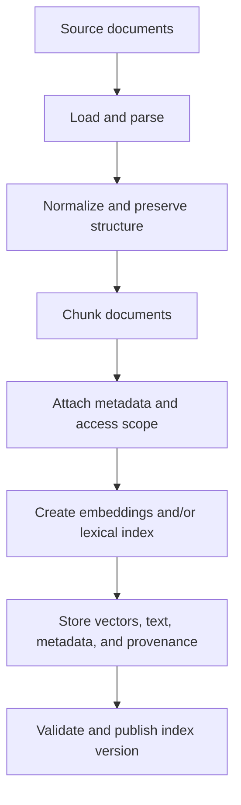
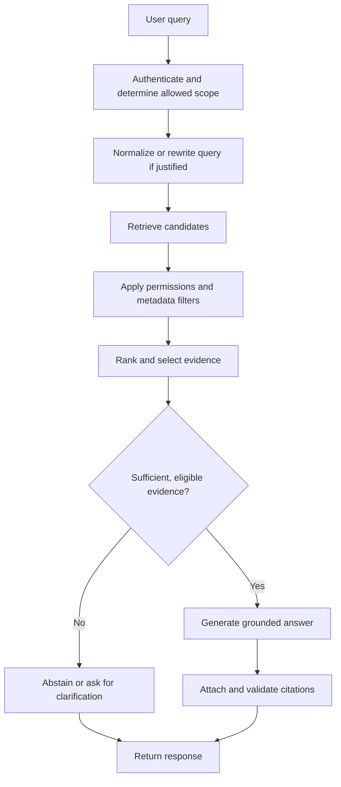
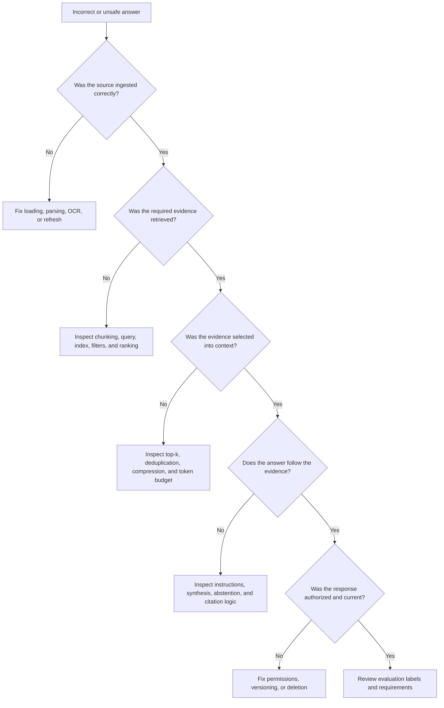

# Chapter 21: Practice and Revision

## Learning Objectives

By the end of this chapter, you should be able to:

- Trace the complete document-ingestion flow and the query-time RAG flow.
- Compare chunking and retrieval configurations using fixed, repeatable test cases.
- Verify that citations support claims, insufficient evidence leads to appropriate abstention, and access controls restrict retrieval.
- Test source updates and deletions without leaving stale or unauthorized content retrievable.
- Diagnose failures at the stage where they originate instead of judging a system by how fluent its answers sound.
- Produce a concise evaluation report and document both project demonstrations.

 

## 1. Review the Full RAG Pipeline

A Retrieval-Augmented Generation (RAG) system has two connected workflows: an **ingestion workflow**, which prepares the knowledge base, and a **query-time workflow**, which retrieves evidence and generates an answer.

### 1.1 Ingestion workflow

Review questions:

- Were all expected source files discovered and processed?
- Were tables, headings, page numbers, and other useful structures preserved?
- Are chunk boundaries appropriate for the document and query types?
- Does each chunk retain its source ID, version, location, and access scope?
- Are embedding and lexical indexes consistent with the same source version?
- Can a failed ingestion job be detected and retried safely?
- Can a source be updated or deleted without leaving stale records behind?

 

### 1.2 Query-time workflow

Review questions:

- Is the user's identity and authorization scope established by trusted application logic?
- Does retrieval search the correct corpus and apply filters consistently?
- Are the retrieved passages relevant, current, and sufficient?
- Does the context fit the model's token budget without losing essential evidence?
- Are claims grounded in the selected evidence?
- Do citations point to the correct source locations?
- Does the system avoid answering when the evidence is insufficient or inaccessible?

**Important:** The diagram is a conceptual baseline. A production pipeline may combine, reorder, or omit components when justified by measured requirements. Permission checks must remain enforced wherever data can be exposed.

 

## 2. Build a Fixed Evaluation Set

Comparisons are meaningful only when configurations are tested on the same cases.

Create a small **golden dataset** containing representative questions and expected evidence. Include ordinary questions as well as difficult and adversarial cases.

| Case type | Example test | What it checks |
| | | |
| Direct fact | “What is the documented refund window?” | Exact fact retrieval |
| Paraphrase | “How long do I have to get my money back?” | Semantic retrieval |
| Exact identifier | “What does error `E-104` mean?” | Lexical or hybrid retrieval |
| Multi-part question | “Who approves the request, and what is the deadline?” | Coverage of multiple facts |
| Missing evidence | Ask about a policy absent from the corpus | Abstention |
| Conflicting evidence | Include two sources with inconsistent statements | Conflict detection and source precedence |
| Outdated evidence | Retain an older version alongside the current version | Freshness and version filtering |
| Restricted content | Ask as a user who lacks access | Authorization enforcement |
| Deleted source | Query content after its deletion | Deletion correctness |
| Citation verification | Ask for an answer with source references | Claim-to-source support |

For each test case, record:

- A stable test ID and query.
- The expected supporting document or passage, when one exists.
- The expected answer or key facts.
- Whether the correct behavior is to answer, qualify, clarify, or abstain.
- The user's test identity and allowed access scope.
- The expected citation requirements.
- Any relevant source version or deletion state.

Keep evaluation questions separate from the examples used to tune prompts or retrieval settings when possible. Otherwise, repeated tuning can overfit the evaluation set.

 

## 3. Compare Chunking Strategies

Chunking determines the units that are embedded, indexed, retrieved, and passed to the language model. There is no universally best chunk size.

### 3.1 Strategies to compare

| Strategy | Potential advantage | Potential weakness |
| | | |
| Fixed-size chunks | Simple and reproducible | Can split a definition, table, or procedure |
| Fixed-size chunks with overlap | Preserves some boundary context | Adds index size and duplicate evidence |
| Structure-aware chunks | Respects headings, paragraphs, or sections | Depends on reliable parsing and document structure |
| Semantic chunks | Groups content by meaning | More complex and may produce inconsistent chunk lengths |
| Parent-child retrieval | Retrieves small units, then expands to a larger section | Requires parent-child metadata and context controls |

 

### 3.2 Controlled comparison procedure

1. Select a fixed set of documents and test questions.
2. Keep the embedding model, distance metric, retrieval settings, and generation prompt unchanged.
3. Build each chunking configuration from the same source snapshot.
4. Measure retrieval quality, answer correctness, citation support, context size, latency, and cost.
5. Inspect failures manually to understand why one strategy helped or hurt.
6. Record the configuration and index version used for each run.

Avoid changing chunk size, embedding model, reranker, prompt, and top-k simultaneously. If multiple variables change, it becomes difficult to attribute an improvement to a specific decision.

 

### 3.3 Chunking experiment record

| Field | Example value |
| | |
| Experiment ID | `chunk-exp-03` |
| Chunking strategy | Structure-aware |
| Chunk size / overlap | Record the actual values and units |
| Corpus snapshot | `docs-v2` |
| Embedding model | Record model name and version |
| Retrieval configuration | Dense, top-k and filters |
| Relevant evidence retrieved | Record count or metric |
| Answer/citation quality | Score against the fixed rubric |
| Latency and token use | Measured values |
| Decision | Keep, reject, or investigate |

Do not select a configuration merely because it produces longer or more confident answers. Select it because it retrieves better evidence and improves the required outcomes.

 

## 4. Compare Retrieval Strategies

Retrieval determines which indexed evidence is considered for answering a query.

| Strategy | Useful when | Common risk to test |
| | | |
| Dense retrieval | Questions use paraphrases or conceptual similarity | May miss exact codes, names, or rare terms |
| Sparse / lexical retrieval | Exact terms, identifiers, and phrases matter | May miss semantically equivalent wording |
| Hybrid retrieval | Both exact matching and semantic matching matter | Fusion settings can affect ranking and add complexity |
| Reranking | Initial retrieval returns relevant items but ranks them poorly | Extra latency and compute |
| Query rewriting | User queries are ambiguous or phrased differently from source text | Rewrite may change the original intent |
| Metadata filtering | Queries need a specific date, product, tenant, or document type | Incorrect or missing metadata can exclude valid evidence |
| Parent expansion | A small chunk lacks context needed to answer | Expanded context may become too large or include noise |

 

### 4.1 Suggested retrieval experiment

Use the same query set to compare:

- Dense retrieval alone.
- Lexical retrieval alone.
- Hybrid retrieval.
- Hybrid retrieval plus reranking, if reranking is justified.

For each configuration, record:

- **Recall@k:** whether relevant evidence appears in the first $k$ results.
- **Precision@k:** how many of the first $k$ results are relevant.
- **MRR:** how early the first relevant result appears.
- **nDCG@k:** how well results are ordered when relevance has multiple grades.
- Answer correctness and citation support after generation.
- Latency, token use, and estimated cost.

These metrics measure different properties. A retrieval configuration can improve Recall@k while reducing Precision@k, or improve ranking without improving the final answer. Interpret metrics together with failure examples.

 

### 4.2 Keep a result table

| Configuration | Recall@k | MRR / nDCG@k | Answer quality | Citation support | Latency / cost |
| | :| :| | | |
| Dense baseline | Measure | Measure | Score | Score | Measure |
| Lexical baseline | Measure | Measure | Score | Score | Measure |
| Hybrid | Measure | Measure | Score | Score | Measure |
| Hybrid + reranker | Measure | Measure | Score | Score | Measure |

Do not fill this table with assumed or illustrative results. Populate it with actual experiment outputs and document the evaluation method.

 

## 5. Verify Grounding, Citations, and Abstention

A fluent answer is not necessarily a grounded answer. Test the evidence behind each important claim.

### 5.1 Citation-support checks

For every answer that includes citations, verify:

1. **Source identity:** Does the reference point to the intended document?
2. **Location:** Does the page, section, URL, or passage identify the relevant location?
3. **Claim support:** Does the cited text actually support the associated claim?
4. **Coverage:** Are all important factual claims supported?
5. **Version:** Is the cited source current and applicable?
6. **Access:** Was the source eligible for the requesting user?
7. **Faithfulness:** Did the answer add details or conclusions not justified by the source?

A citation existing is not enough. A citation can point to a real passage that does not support the claim.

 

### 5.2 Abstention checks

Include cases where:

- The corpus contains no answer.
- Retrieval returns low-quality or irrelevant passages.
- Sources conflict and no reliable precedence rule resolves the conflict.
- The only relevant source is restricted to another user or tenant.
- A required source was deleted or superseded.
- The question is ambiguous enough to require clarification.

Define the expected behavior for each case. Depending on the evidence state, the system may answer, provide a qualified answer, ask a clarifying question, or state that the available sources do not establish the answer.

**Do not treat a raw similarity score as a calibrated probability of correctness.** Calibrate decision thresholds using representative evaluation data and monitor false-answer and unnecessary-abstention rates.

 

### 5.3 Minimal test matrix

| Test | Expected behavior |
| | |
| Relevant and sufficient evidence | Answer with supporting citations |
| Partial evidence | Answer only supported parts and state the limitation |
| No evidence | Abstain or request a useful clarification |
| Conflicting evidence | Explain the conflict or apply a documented precedence rule |
| Restricted evidence | Do not disclose it or cite it |
| Invalid citation location | Reject or repair the citation before returning the answer |
| Outdated source | Prefer an applicable current source or disclose uncertainty |

 

## 6. Verify Permissions, Updates, and Deletion

Security and lifecycle correctness are functional requirements, not optional improvements.

### 6.1 Permission tests

Use at least two synthetic users with different access scopes.

- User A can retrieve a document that User B cannot access.
- Run the same query as both users.
- Verify that restricted passages do not appear in retrieved results, expanded parent context, citations, caches, or final answers.
- Attempt a query that directly names the restricted document.
- Verify that missing, malformed, or unavailable authorization context fails closed.

Apply access restrictions before evidence is exposed to the model. Prompt instructions alone are not an access-control mechanism.

 

### 6.2 Update and deletion tests

For each source, test a complete lifecycle:

1. Ingest version 1 and verify its content is retrievable.
2. Change a factual statement and ingest version 2.
3. Verify that the new answer reflects version 2.
4. Check for duplicate or stale version 1 chunks.
5. Delete the source according to the documented policy.
6. Verify it can no longer be retrieved or cited through the active system.
7. Inspect dependent indexes, metadata, caches, and derived records as required by the retention policy.
8. Record the deletion result and any asynchronous cleanup delay.

Distinguish logical removal from physical erasure. State which behavior is promised, what retention rules apply, and how completion is verified.

 

## 7. Diagnose Failures by Pipeline Stage

Start with the observed failure and trace it to the earliest stage that could explain it. Do not jump directly to changing the prompt or model.

 

### 7.1 Stage-by-stage diagnostic table

| Symptom | Likely stage | Evidence to inspect | Candidate fix |
| | | | |
| Source content is missing from every query | Ingestion / parsing | Load logs, extracted text, page count, OCR output | Fix loader, parser, OCR, or ingestion error handling |
| Correct passage is not retrieved | Chunking / indexing / retrieval | Stored chunks, query, filters, ranked candidates | Adjust chunking, index, query handling, or retrieval strategy |
| Relevant passage appears too low | Ranking | Candidate ranks and relevance labels | Evaluate hybrid fusion or reranking |
| Retrieved passage is relevant but answer omits a fact | Context selection / generation | Final model context, token budget, prompt | Improve selection, context packing, or synthesis instructions |
| Answer contains unsupported details | Generation / grounding | Claim-to-passage comparison | Tighten grounding requirements and add claim-level checks |
| Citation points to the wrong page | Provenance / citation construction | Chunk metadata and source offsets | Correct metadata propagation and citation validation |
| Correct answer appears for an unauthorized user | Authorization | User scope, filter placement, retrieved payload, cache keys | Enforce server-side authorization throughout the retrieval path |
| Deleted content still appears | Lifecycle / caching | Source manifest, active index, caches, replicas | Repair deletion propagation and verify cleanup |
| The answer is correct only for old documents | Freshness / versioning | Source timestamps, version IDs, active index version | Fix update detection and index publication |
| Scores improve but users report worse answers | Evaluation design | Test distribution, labels, error examples | Check metric mismatch, data leakage, and missing cases |

**Diagnostic rule:** Collect evidence first. Change one major variable at a time, rerun the same fixed test set, and compare both aggregate metrics and individual failures.

 

## 8. Complete the Evaluation Report

Use the following template for the final report. Replace placeholders with measured results; do not invent values.

### RAG Evaluation Report

#### A. System summary

- **System / project name:**
- **Use case and intended users:**
- **Corpus and source types:**
- **Corpus snapshot / index version:**
- **Embedding model and version:**
- **Chunking strategy and parameters:**
- **Retrieval strategy and top-k:**
- **Reranking or query rewriting:**
- **Generation model and prompt version:**
- **Citation format:**
- **Authorization model:**

 

#### B. Evaluation design

- **Golden dataset size:**
- **Question categories:**
- **Expected evidence and answer labels:**
- **Answerable / unanswerable distribution:**
- **Permission and deletion test cases:**
- **Human review rubric:**
- **Reproducibility details:**

 

#### C. Results

| Measure | Result | Method / notes |
| | | |
| Recall@k | | |
| Precision@k | | |
| MRR or nDCG@k | | |
| Answer correctness | | |
| Groundedness / faithfulness | | |
| Citation support | | |
| Appropriate abstention | | |
| Unauthorized disclosure tests | | |
| Update / deletion tests | | |
| p50 / p95 latency | | |
| Token use / estimated cost | | |

Only report metrics that have a defined method and supporting evidence. If a measure was not tested, mark it **Not measured** rather than assuming success.

 

#### D. Failure analysis

For each major failure, record:

- Test ID and user-visible symptom.
- Pipeline stage where the failure originated.
- Evidence used to confirm the diagnosis.
- Root cause, or the leading hypothesis if not confirmed.
- Corrective change.
- Before-and-after results on the same test.
- Remaining risk.

 

#### E. Configuration decision

- **Chosen configuration:**
- **Why it was selected:**
- **Evidence supporting the decision:**
- **Trade-offs accepted:**
- **Largest remaining weakness:**
- **Next experiment:**
- **Conditions for deployment or rollback:**

 

## 9. Document Both Project Demonstrations

Use the same reporting discipline for the two practical projects from this level.

### 9.1 Project A: PDF Question-Answering System

Document:

- What PDF types are supported and what limitations exist.
- How text, page numbers, and source locations are extracted.
- How chunking and retrieval are configured.
- How answers cite pages or passages.
- What happens when a PDF does not contain the answer.
- How scanned pages, tables, extraction errors, and source changes are handled.
- Results from answerable, unanswerable, citation, and failure tests.

**Evidence to include:** A small set of representative questions, retrieved passages, final answers, citations, and evaluation outcomes. Include at least one failure and how you diagnosed it.

 

### 9.2 Project B: Knowledge-Base Assistant

Document:

- Supported source types and metadata fields.
- How ingestion, indexing, updates, and deletion work.
- How tenant or user permissions are enforced.
- How source freshness and conflicts are handled.
- How retrieval and answer quality are evaluated.
- How the assistant abstains when evidence is insufficient.
- Operational limitations, latency, cost, and monitoring needs.

**Evidence to include:** Results from a normal query, a paraphrased query, a missing-evidence query, a restricted-document query, and a source-update or deletion test.

 

### 9.3 Demonstration record

For each demonstration, preserve:

- Environment and dependency versions.
- Source snapshot and index version.
- Configuration file or recorded parameters.
- Test inputs and expected outcomes.
- Logs that are safe to retain.
- Actual outputs and citations.
- Metrics and known limitations.
- Instructions to reproduce the demonstration.

Do not include secrets, access tokens, or restricted source text in a report or repository.

 

## 10. Capstone Exercise: Defend a Pipeline Configuration

### Scenario

You have built a RAG assistant for internal technical documentation. It must answer questions accurately, cite sources, respect document permissions, and stop using deleted or superseded material. You have a limited latency and cost budget.

 

### Tasks

1. Define the source corpus and create a versioned snapshot.
2. Build a baseline ingestion pipeline and inspect extracted content.
3. Compare at least two chunking strategies on the same evaluation set.
4. Compare dense retrieval with at least one alternative, such as lexical or hybrid retrieval.
5. Evaluate whether reranking or query rewriting provides a measurable benefit.
6. Test answerable, partially answerable, and unanswerable questions.
7. Verify citations claim by claim.
8. Test two users with different permissions.
9. Update and delete a source, then verify the active system's behavior.
10. Complete the evaluation report and identify the largest remaining weakness.

 

### Deliverables

- Pipeline diagram and configuration summary.
- Golden dataset with expected evidence and behavior.
- Results table with actual metrics.
- Failure analysis with at least three examples.
- PDF Q&A demonstration report.
- Knowledge-base assistant demonstration report.
- Final configuration decision and next experiment.

 

### Assessment rubric

| Area | Evidence of competence |
| | |
| Ingestion | Correct source coverage, extraction, provenance, and repeatable indexing |
| Retrieval | Controlled comparisons with fixed cases and appropriate metrics |
| Grounding | Claims supported by cited evidence; uncertainty handled explicitly |
| Security | Server-enforced permissions and tests for unauthorized disclosure |
| Lifecycle | Updates and deletions verified against the active system |
| Diagnostics | Failures traced to a stage using logs and retrieved evidence |
| Evaluation | Reproducible results, clear labels, honest limitations |
| Engineering judgment | Configuration choice justified by evidence and trade-offs |

 

## 11. Checkpoint: Defend Your Configuration

**Question:** Defend a pipeline configuration with evidence and identify its largest remaining weakness.

A strong answer should include:

1. **Configuration:** Specify parsing, chunking, embeddings, retrieval, filtering, ranking, context selection, generation, citations, and authorization.
2. **Evidence:** Describe the fixed test set and report measured retrieval, answer, citation, security, lifecycle, latency, and cost results where applicable.
3. **Alternatives:** Explain which competing configurations were tested and why they were not selected.
4. **Trade-offs:** Explain the impact on recall, precision, context size, latency, cost, maintainability, and operational complexity.
5. **Weakness:** Identify the largest unresolved failure mode using actual test cases—not a generic statement such as “hallucinations may happen.”
6. **Next step:** Propose a targeted experiment or fix and state how success will be measured.

 

### Example structure (replace with your measured evidence)

> I selected **[configuration]** because it achieved **[measured result]** on **[fixed evaluation set]**, while meeting **[latency, cost, security, or other requirement]**. Compared with **[alternative]**, it improved **[specific metric or failure category]** but introduced **[trade-off]**. Permission, citation, and source-lifecycle checks **[passed / failed / were not measured]** under **[documented test conditions]**. The largest remaining weakness is **[specific observed failure]**, supported by **[test IDs and evidence]**. My next experiment is **[targeted change]**, and I will evaluate it using **[metric and regression checks]**.

This is a template, not a claim about results. Your defense is credible only when every result is backed by a reproducible experiment.

 

## 12. Final Revision Checklist

Use this checklist before calling the RAG pipeline ready for demonstration.

- [ ] Every intended source is ingested, and extraction errors are visible.
- [ ] Chunks preserve useful structure, provenance, and source versions.
- [ ] Embeddings and indexes correspond to the intended corpus snapshot.
- [ ] Chunking and retrieval choices were compared on fixed cases.
- [ ] Relevant evidence is retrieved and ranked adequately.
- [ ] The final context contains the evidence needed for the answer.
- [ ] Important factual claims are supported by valid citations.
- [ ] Missing, partial, conflicting, or stale evidence is handled appropriately.
- [ ] Permissions are enforced by trusted application logic.
- [ ] Unauthorized content cannot leak through retrieval, context expansion, citations, or caches.
- [ ] Source updates remove stale evidence from active retrieval.
- [ ] Deletion behavior is tested and matches the documented policy.
- [ ] Failures are diagnosed by stage with evidence.
- [ ] Metrics, latency, cost, and limitations are documented honestly.
- [ ] Both project demonstrations can be reproduced from recorded inputs and configuration.
- [ ] The largest remaining weakness and next experiment are clearly stated.

 

## Key Takeaways

- RAG quality depends on the complete pipeline, from source ingestion to final citation—not on the language model alone.
- Fixed evaluation cases make comparisons more trustworthy and help isolate the impact of configuration changes.
- Chunking and retrieval choices should be justified by measured evidence and representative failures.
- Citation presence is not the same as citation support; verify that each source actually entails the claim.
- Abstention, permissions, freshness, updates, and deletion are core correctness requirements.
- Diagnose the earliest failing stage before changing prompts or models.
- A defensible engineering decision explains measured benefits, accepted trade-offs, and the largest unresolved weakness.

 

## Further Reading

- [Sentence Transformers documentation](https://www.sbert.net/)
- [scikit-learn metrics documentation](https://scikit-learn.org/stable/modules/model_evaluation.html)
- [PyMuPDF documentation](https://pymupdf.readthedocs.io/)
- [OWASP Top 10 for LLM Applications](https://owasp.org/www-project-top-10-for-large-language-model-applications/)
- [NIST AI Risk Management Framework](https://www.nist.gov/itl/ai-risk-management-framework)

These references are optional supplementary resources. The chapter's core requirement is to perform and document reproducible tests on your own RAG pipeline.

 

**End of Level 8: Retrieval-Augmented Generation (RAG).**
