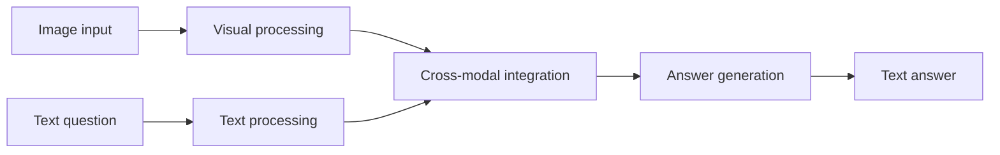
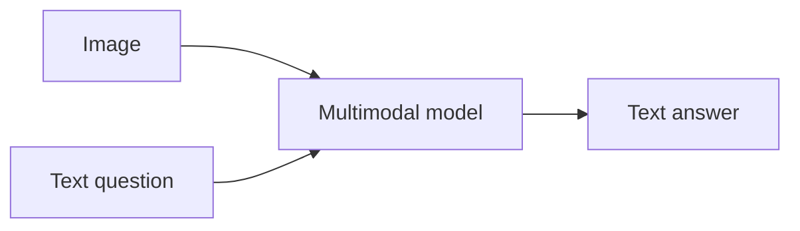
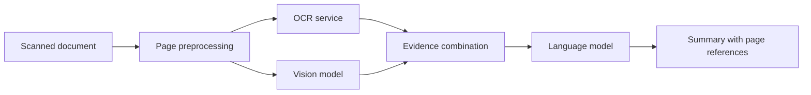
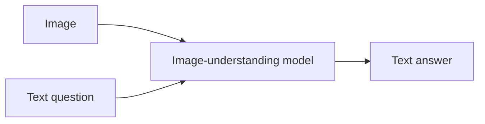
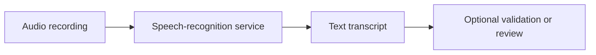

# 01. What Multimodal Models Are

## Learning Objectives

By the end of this chapter, you should be able to:

- Define a **modality** and identify common input and output modalities.
- Distinguish a model's supported input modalities from its supported output modalities.
- Explain modality-specific encoders, joint representations, and cross-modal integration at a high level.
- Compare a single multimodal model with a pipeline of specialized models.
- Distinguish understanding existing media from generating new media.
- Describe model capabilities precisely without assuming that every multimodal model supports every task.

 

## 1. What Is a Modality?

A **modality** is a form in which information is represented or communicated. In Generative AI applications, common modalities include:

| Modality | Example input | Example output |
|---|---|---|
| Text | A question, document, or transcript | An answer, summary, or generated text |
| Image | A photograph, chart, screenshot, or scanned page | A caption, visual answer, or generated image |
| Audio | A recording, speech clip, or sound | A transcript, spoken response, music, or sound effect |
| Video | A recorded clip or a sequence of frames | A summary, event description, or generated video |
| Structured data | JSON records, tables, or other structured values | Validated JSON, tables, or other structured values |

The table shows possible tasks, not a promise that one model supports all of them. For example, a model may accept images and text but produce only text.

 

### 1.1 Input and output are separate capabilities

When assessing a model, describe its capabilities in terms of **what it accepts** and **what it produces**.

- **Input modality:** The type of information supplied to the model.
- **Output modality:** The type of information the model returns or generates.
- **Task:** The operation performed on that information, such as classification, transcription, captioning, question answering, or generation.

A model that accepts an image and returns a textual description supports image input and text output. That does **not** mean it can generate images.

A model that converts written text into spoken audio supports text input and audio output. That does **not** automatically mean it can transcribe incoming audio.

 

### 1.2 Capability examples

| Application | Input | Output | Main task |
|---|---|---|---|
| Image question answering | Image + text question | Text | Interpret visual evidence and answer |
| Speech transcription | Audio | Text | Recognize spoken words |
| Text-to-speech | Text | Audio | Synthesize speech |
| Video summarization | Video, possibly with a prompt | Text | Describe events and key information |
| Text-to-image | Text prompt | Image | Generate a new image |
| Audio question answering | Audio + text question | Text or another supported format | Interpret audio and answer |

These are task patterns. Actual support depends on the model and its interface.

 

## 2. What Makes a Model Multimodal?

A **multimodal model** can process, generate, or otherwise work with more than one modality in a supported task. Some systems accept multiple modalities in one request; others connect specialized models into a multi-stage pipeline.

The term *multimodal* is broad. It does not specify:

- which modalities are supported;
- whether each modality is accepted as input, produced as output, or both;
- whether the model handles the modalities jointly or through separate stages;
- which tasks it can perform reliably;
- the supported file formats, sizes, durations, or limits.

Always inspect the documented capabilities of the specific model or service.

 

## 3. High-Level Concepts Behind Multimodal Systems

### 3.1 Modality-specific encoders

An **encoder** converts input data into a representation that later components can use.

Different input types often need different processing:

- A text encoder or tokenization path converts text into token-level representations.
- A vision encoder extracts representations from image pixels, patches, or crops.
- An audio encoder represents acoustic information.
- A video-processing path may sample frames and represent temporal information.

These are conceptual examples. The architecture and terminology vary by model. Some systems use separate encoders; others use a more unified design.

 

### 3.2 Representations and joint representations

A **representation** is an internal numerical form of information used by a model. A representation may capture task-relevant features without preserving every detail of the original input.

A **joint representation** is a representation space or internal form in which information from multiple modalities can be related. For example, a system may learn to associate an image of a dog with the phrase “a dog playing in a park.”

Joint representations can help a system connect visual content with language. They do not guarantee perfect understanding, exact counting, reliable spatial reasoning, or correct interpretation of every detail.

 

### 3.3 Cross-modal integration

**Cross-modal integration** is the process of combining or relating information from different modalities.

Consider a question-answering request containing an image and the text question, “What is written on the sign?”

1. The image is processed into a usable visual representation.
2. The text question is processed as language.
3. The system relates the question to the relevant visual evidence.
4. The model generates a textual answer, ideally limited to what can be read from the image.

The internal implementation differs among models. The sequence below is a conceptual view, not a universal architecture.

 

### 3.4 Why representations are useful

Raw pixels, audio waveforms, and text strings have very different structures. Representations make it possible for model components to process relevant information and, where supported, relate information across modalities.

However, a representation is not a complete copy of the source. Preprocessing, compression, patch selection, frame sampling, or learned representations may discard information. Important evidence can be missed before the model generates an answer.

 

## 4. One Multimodal Model vs. a Pipeline of Specialized Models

A multimodal application can be built in more than one way.

### 4.1 Single-model approach

A single model receives the supported inputs and produces the supported output.

Example: an image-question-answering service receives an image and a question, then returns a text answer.

**Potential advantages**
- Fewer application-level integration steps.
- Cross-modal relationships may be handled within the model.
- A simpler request flow when the model natively supports the required inputs.

**Potential limitations**
- Capabilities and file constraints depend on the selected model.
- Less control over individual processing stages.
- A model may still miss small text, visual details, or relevant evidence.
- Usage costs and latency depend on the provider and request.

 

### 4.2 Specialized-model pipeline

A pipeline connects services or models, each responsible for a specific operation.

Example: a document workflow uses OCR to extract text from scanned pages, a vision model to describe a chart, and a language model to combine the results into a summary.

**Potential advantages**
- Each stage can be selected and tested for a specific task.
- Intermediate outputs can be inspected and logged.
- Components may be replaced independently.

**Potential limitations**
- Integration and error handling become more complex.
- Errors from an early stage can propagate to later stages.
- Multiple services may increase latency, operational work, and cost.
- The application must preserve page identity and evidence provenance across stages.

 

### 4.3 Choosing between the approaches

| Consideration | Single multimodal model | Specialized pipeline |
|---|---|---|
| Architecture | Often simpler at application level | Multiple connected stages |
| Control | Depends on model interface | More control over each stage |
| Debugging | Internal reasoning may be difficult to inspect | Intermediate results can be inspected |
| Failure propagation | Model may miss or misinterpret evidence | Stage errors can propagate downstream |
| Latency and cost | Must be measured for the chosen model | Includes the cost and latency of each stage |
| Best fit | A supported task handled adequately by one model | A task requiring specialized processing or explicit intermediate evidence |

Neither approach is universally better. Choose based on task quality, evidence requirements, model capabilities, privacy constraints, latency, cost, and maintainability.

 

## 5. Understanding Existing Media vs. Generating New Media

Multimodal applications can **understand existing content** or **generate new content**. These are different tasks and may require different model capabilities.

### 5.1 Understanding existing media

The application receives media that already exists and extracts or interprets information from it.

Examples:
- Answering a question about a photograph.
- Transcribing speech from an audio recording.
- Summarizing events in a video.
- Extracting fields from a scanned document.

The output may be text, structured data, or another supported format. A correct answer should be grounded in the supplied evidence and should express uncertainty when the evidence is unclear.

 

### 5.2 Generating new media

The application creates new content conditioned on a prompt, input media, or other supported context.

Examples:
- Generating an image from a text prompt.
- Synthesizing speech from written text.
- Generating music or sound effects.
- Creating a video from a text prompt or an input image.

Generation does not imply factual accuracy. A generated image or video can look plausible without representing a real event or a verified fact.

 

### 5.3 Transformation tasks

Some applications transform one modality into another. These tasks are not always best described as either general understanding or unconstrained generation.

Examples:
- Speech recognition: audio → text.
- Text-to-speech: text → audio.
- Image captioning: image → text.
- Video summarization: video → text.

The direction of transformation is part of the model's capability specification.

 

## 6. Support for One Task Does Not Imply Support for Every Task

A modality label alone is insufficient for model selection. “Supports audio,” for example, could mean audio input for transcription, audio input for general understanding, audio output for speech synthesis, or some combination of these.

Check the following dimensions before implementation:

1. **Input/output direction:** Does the model accept the media, generate it, or both?
2. **Task support:** Is the exact task documented?
3. **Interface and format:** Which file types, payload formats, sample rates, image sizes, or video representations are accepted?
4. **Limits:** Are there limits on duration, dimensions, file size, number of images, or context?
5. **Output contract:** Does the service return text, audio bytes, a file URL, structured data, or another response?
6. **Quality:** Has performance been tested on cases similar to the intended application?
7. **Operational constraints:** What are the latency, usage units, cost, privacy, and retention requirements?

For example, a vision-language model may answer questions about an uploaded image but may not generate a new image. An audio service may transcribe speech but may not synthesize speech. A video-capable system may analyze sampled frames without supporting native video generation.

**Engineering rule:** State capabilities as specific input → task → output combinations, not as a broad label such as “multimodal model.”

 

## 7. Practical Capability Matrix

Use a matrix like this when evaluating candidate models. Fill it using current official documentation and tests; do not infer support from the model name or marketing category.

| Capability | Input | Output | Verify |
|---|---|---|---|
| Image question answering | Image + text | Text | Image formats, limits, visual accuracy |
| Image generation | Text and/or supported conditioning inputs | Image | Generation endpoint, dimensions, licensing |
| Speech recognition | Audio | Text, optionally timestamps or speaker labels | Languages, formats, duration, timestamp support |
| Text-to-speech | Text and optional controls | Audio | Voices, formats, language, usage limits |
| Audio understanding | Audio + optional text | Text or structured response | Supported tasks and audio constraints |
| Video understanding | Video or sampled frames + optional text | Text or structured response | Native video support, frame limits, timestamps |
| Video generation | Text and/or supported conditioning inputs | Video | Generation support, duration, resolution, availability |

This matrix is a checklist, not a claim that any one model supports every row.

 

## 8. Practice: Draw Input/Output Diagrams for Three Applications

For each application, draw the request flow and label every input and output modality.

### Exercise A: Image question answering

**Scenario:** A user uploads a photo of a street sign and asks what it says.

Check: Does the chosen model support image input and text output? What should the application do if the sign is blurry or unreadable?

 

### Exercise B: Speech transcription

**Scenario:** A user uploads a short recording and wants a transcript.

Check: Does the service accept the audio format and duration? How will uncertain words, background noise, or incomplete recordings be handled?

 

### Exercise C: Text-to-speech

**Scenario:** An application reads a written notification aloud.

Check: Does the service generate audio? What audio format does it return, and how will the application handle a failed or empty response?

 

### Exercise extension

Choose a fourth scenario, such as video summarization or mixed-document extraction. Draw its inputs, processing stages, and output. If using a pipeline, label the output of each stage.

 

## 9. Revision Questions and Answers

**Q1. What is a modality?**  
A modality is a form in which information is represented or communicated, such as text, image, audio, or video.

**Q2. Does accepting images mean a model can generate images?**  
No. Input support and output generation are separate capabilities.

**Q3. What is a modality-specific encoder?**  
It is a component that converts a particular type of input into a representation suitable for later processing.

**Q4. What is cross-modal integration?**  
It is the process of relating or combining information from different modalities, such as using an image and a text question to produce an answer.

**Q5. When might a specialized pipeline be preferable to one multimodal model?**  
When the application needs specialized processing, inspectable intermediate outputs, or explicit control over individual stages.

**Q6. What is one disadvantage of a pipeline?**  
It adds integration and error-handling complexity, and errors in one stage can affect later stages.

**Q7. Why is “supports audio” an incomplete capability statement?**  
It does not specify whether audio is an input or output, which tasks are supported, or what formats and limits apply.

**Q8. What should be verified before selecting a multimodal model?**  
The exact input/output combinations, task support, formats, limits, quality, latency, cost, and data-handling requirements.

 

## 10. Chapter Checkpoint

You should be able to explain a model's capabilities without assuming all multimodal models generate images, audio, and video.

Use this template:

> This system accepts **[input modality or modalities]**, performs **[specific task]**, and returns **[output modality or modalities]**. It supports **[documented formats and limits]**. Its key limitations are **[known or measured limitations]**. I will verify its quality, latency, cost, and data-handling requirements on representative examples before deployment.

 

### Completion checklist

- [ ] I can define modality and distinguish input from output.
- [ ] I can explain encoders, representations, and cross-modal integration conceptually.
- [ ] I can compare a single multimodal model with a specialized pipeline.
- [ ] I can distinguish media understanding, transformation, and generation.
- [ ] I can identify the exact capabilities that must be verified.
- [ ] I have drawn input/output diagrams for at least three applications.

 

## References

Use current official documentation to verify specific model capabilities before implementing an application.

- [OpenAI API documentation](https://platform.openai.com/docs/overview)
- [Hugging Face documentation](https://huggingface.co/docs)
- [Google AI for Developers](https://ai.google.dev/gemini-api/docs)
- [Anthropic documentation](https://docs.anthropic.com/)

These are general documentation entry points. They do not establish that a particular model supports every modality or task discussed in this chapter.
