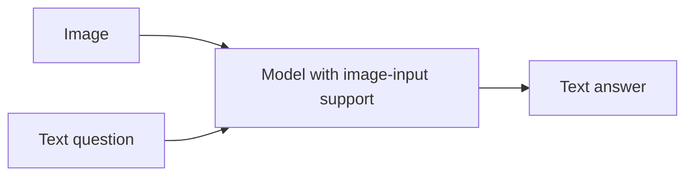
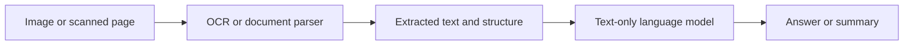
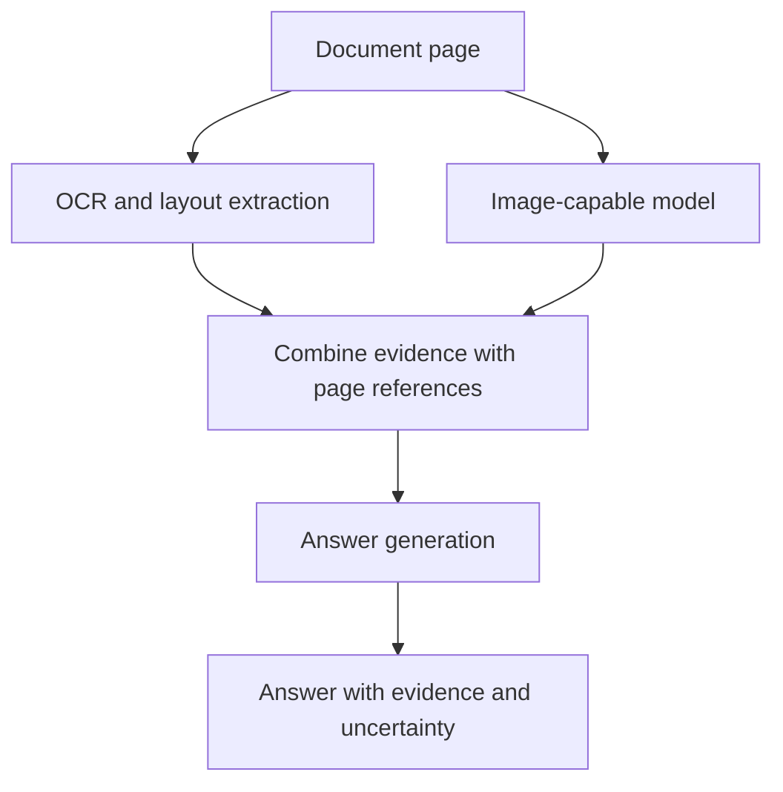

# 02. Text-Only versus Multimodal Capabilities

## Learning Objectives

By the end of this chapter, you should be able to:

- Compare a text description, an OCR transcript, and direct image input.
- Identify information that may be lost when media is converted into text.
- Map an application's input and output requirements to documented model capabilities.
- Compare native multimodal support with preprocessing pipelines that use separate services.
- Decide when a simpler text-only baseline is sufficient.
- Build a capability matrix based on documented features and practical tests, not marketing labels.

<br/>

## 1. Three Ways to Provide Information

Suppose an application must answer questions about a photograph of a restaurant menu. There are several ways to provide information to a model.

### 1.1 Text description

A person or another system describes the image in words.

Example:

> The menu lists soups, salads, and main courses. The lentil soup costs ₹180.

**Strengths**
- Compact and easy to process with a text-only model.
- Can focus the model on the information relevant to the task.
- May reduce media-upload and image-processing requirements.

**Limitations**
- Includes only details captured by the description.
- May omit exact wording, layout, visual relationships, small text, or unexpected details.
- Can introduce interpretation errors if the description was produced by a person or another model.

A text description is useful when the required information has already been extracted accurately and the omitted visual details do not matter.

<br/>

### 1.2 OCR transcript

**Optical character recognition (OCR)** converts text visible in an image or scanned document into machine-readable text.

Example OCR output:

```text
SOUPS
Tomato Soup       ₹150
Lentil Soup       ₹180

MAIN COURSE
Vegetable Curry   ₹240
```

**Strengths**
- Preserves recognized wording and numbers more directly than a short summary.
- Supports text search, indexing, and downstream text processing.
- Can be effective for forms, printed pages, and text-heavy documents.

**Limitations**
- Recognition errors can affect letters, digits, punctuation, and currency values.
- Reading order may be wrong in multi-column layouts.
- Spatial relationships, font emphasis, checkboxes, diagrams, and non-text visual content may be lost or represented incompletely.
- OCR may fail on handwriting, blur, low contrast, unusual fonts, or rotated pages.

OCR output is not the same as the original image. It is a textual interpretation produced by a separate processing step.

<br/>

### 1.3 Direct image input

The image itself is provided to a model that documents support for image input and the intended task.

Example question:

> Which item costs ₹180, and which section is it listed under?

The model can potentially use visible wording and visual relationships in the image. Its actual performance depends on image quality, model capability, preprocessing, and the task.

**Strengths**
- Retains visual evidence that may not appear in a text description or OCR transcript.
- Can help with charts, diagrams, spatial relationships, layout, visual comparisons, and non-text objects.
- Avoids relying exclusively on an earlier textual interpretation.

**Limitations**
- Small text and fine details may be missed.
- Images may be resized, cropped, tiled, or otherwise processed.
- The model can misread, miscount, or infer details that are not visible.
- Image inputs may increase latency, resource use, or cost.
- Direct image support must be verified for the exact model interface.

<br/>

## 2. What Can Be Lost When Media Becomes Text?

Converting an image, audio recording, or video into text can make information easier to search and process. However, the conversion is usually **lossy**: the text may not preserve every relevant property of the original media.

### 2.1 Image-to-text information loss

| Information in the image | What a text conversion may preserve | What may be lost |
|---|---|---|
| Printed words | Recognized words and numbers | Font details, exact positioning, uncertain characters |
| Page layout | Reading order or labels | Columns, grouping, alignment, hierarchy |
| Tables | Cell text, if extracted correctly | Row/column associations, merged cells, borders |
| Charts | Title, labels, possibly a generated description | Exact geometry, relative positions, visual trends, uncertain values |
| Diagrams | Extracted labels or a verbal description | Arrows, connections, spatial organization |
| Photographs | A caption or summary | Unmentioned objects, precise appearance, relationships, fine details |
| Handwriting | Recognized text when OCR supports it | Ambiguous strokes and uncertain characters |

The loss depends on the conversion method. A carefully structured extraction that preserves bounding boxes, coordinates, table cells, and page references may retain more information than plain OCR text, but it still does not necessarily preserve the entire visual scene.

<br/>

### 2.2 Audio-to-text information loss

A transcript can preserve spoken words while omitting or weakening information such as:

- Prosody, emphasis, pace, and pauses.
- Background sounds and environmental context.
- Speaker identity or turn boundaries, unless represented separately.
- Uncertainty in a poorly recognized word.
- Non-speech events such as a door closing or an alarm.

If the task is to answer “What words were spoken?”, a transcript may be enough. If the task is to determine whether a speaker sounded hesitant or whether an alarm occurred in the background, the original audio may contain essential evidence.

<br/>

### 2.3 Video-to-text information loss

A summary or transcript can preserve selected events and spoken content but may omit:

- Exact timing and event duration.
- Motion and changes between frames.
- Brief events not selected for description.
- Visual details that the summarizer did not mention.
- Synchronization between speech, sound, and on-screen actions.

A video represented by a few sampled frames can also miss events occurring between those frames.

<br/>

### 2.4 The practical principle

**A representation is sufficient only if it preserves the evidence needed for the task.** More information is not automatically better: unnecessary media can add complexity, cost, and privacy exposure. The objective is to provide the minimum sufficient evidence without discarding details the task depends on.

<br/>

## 3. Compare the Approaches on a Concrete Task

Imagine that a user asks:

> In this scanned report, what was the highest value in the chart, and which quarter did it occur in?

Consider three approaches.

| Approach | What the model receives | Likely advantage | Main risk |
|---|---|---|---|
| Text description | A short human- or model-written description of the chart | Efficient if the description contains the answer | The description may omit the highest value or misstate it |
| OCR transcript | Recognized chart title, labels, and numbers | Good when the answer is explicitly printed as text | OCR may miss labels or fail to capture bar-to-quarter relationships |
| Direct image input | The chart image and the question | May use bar heights, labels, and visual relationships together | Fine values, scales, or crowded labels may be misread |

No approach should be assumed correct without testing. If the report already includes a reliable table of exact values, extracting that table may be more dependable than estimating values from bar heights. If the chart contains only visual comparisons, direct image analysis may offer information absent from plain OCR.

<br/>

## 4. Map Requirements to Documented Capabilities

Start with the application task, not the model's marketing category.

### 4.1 Write the input/output contract

Specify:

1. **Inputs:** text, image, audio, video, or a combination.
2. **Operation:** OCR, classification, question answering, transcription, summarization, or generation.
3. **Output:** text, structured data, image, audio, video, or another defined response.
4. **Evidence requirement:** what source material must support the result?
5. **Constraints:** formats, size, duration, latency, privacy, and cost limits.
6. **Validation:** how will output quality and failure cases be checked?

Example contract for a chart-analysis service:

- Input: one supported chart image and one text question.
- Operation: answer a question using visible chart evidence.
- Output: JSON containing an answer, a short explanation, and an uncertainty flag.
- Evidence requirement: identify the relevant quarter and value; do not invent unreadable values.
- Validation: compare answers with a verified chart dataset on a fixed test set.

<br/>

### 4.2 Capability verification checklist

For each candidate model or service, verify from current documentation:

- Does the endpoint accept the required input modality?
- Does it support the exact task?
- Does it return the required output modality or schema?
- Which file formats and request structures are supported?
- What size, duration, count, or context limits apply?
- Are timestamps, bounding boxes, citations, or other evidence references available?
- What usage units and pricing rules apply?
- What are the data-retention and privacy terms?
- Does it pass representative tests for the intended task?

A model described as “vision-enabled” should not automatically be assumed to support image generation, video understanding, or every kind of document analysis.

<br/>

## 5. Native Multimodal Support vs. Preprocessing Services

### 5.1 Native multimodal approach

A model with documented image-input support receives the image and the question directly.



This can be a good fit when the model handles the task adequately and the application does not require separate, inspectable OCR or image-processing stages.

<br/>

### 5.2 Preprocessing pipeline

A pipeline uses one service to convert media into a representation that another model can process.



This can be useful for searchable archives, text-heavy documents, and applications that need explicit control over extraction. The pipeline must handle OCR errors, layout loss, page references, and downstream propagation of incorrect text.

<br/>

### 5.3 Combined approach

Some tasks benefit from both extracted text and direct visual evidence.



A combined pipeline can help when OCR is strong for printed text but visual interpretation is needed for diagrams, chart geometry, or layout. It also adds complexity, so its benefits should be measured rather than assumed.

<br/>

## 6. When Is a Text-Only Baseline Enough?

A **baseline** is a simpler approach used as a reference point for comparison. A text-only baseline helps determine whether multimodal processing adds enough value to justify its extra requirements.

Text-only processing may be sufficient when:

- The required information is already available as clean text.
- The task depends on wording or semantic relationships rather than visual appearance.
- OCR or structured extraction has been validated for the relevant document type.
- The source layout, spatial relations, and non-text details are not important.
- A text-only system meets the application's quality, latency, cost, and privacy requirements.

Examples:

- Summarizing a clean, accessible text document.
- Classifying support tickets from their text.
- Answering a question from a verified OCR transcript when layout is irrelevant.
- Extracting fields from a structured database record.

Direct media input may be valuable when:

- A chart's geometry or visual trend is important.
- A diagram's arrows and spatial relationships determine the answer.
- A photograph contains relevant objects or visual attributes missing from its caption.
- A form's checkboxes, columns, or field locations matter.
- Audio tone, background sounds, or timing matter.
- Video event order or motion matters.

**Do not use a more complex modality merely because it is available.** Choose the simplest approach that meets the requirements on representative tests.

<br/>

## 7. Build a Capability Matrix

Use the following template to compare candidate approaches. Complete it using current documentation and measured tests. The entries below describe typical approach characteristics, not guaranteed performance.

| Criterion | Text description | OCR + text model | Direct image-capable model | Combined OCR + vision |
|---|---|---|---|---|
| Original pixels available to answer model | No | No | Yes, subject to model processing | Yes, to vision stage |
| Exact printed text | Only if description includes it | Depends on OCR quality | Depends on visual reading quality | Can cross-check text and visual evidence |
| Layout and spatial relationships | Only if described | Often incomplete unless structure is preserved | Potentially available | Potentially available from vision and layout data |
| Non-text visual details | Only if described | Usually limited | Potentially available | Potentially available |
| Inspectable intermediate text | Depends on source | Yes | Not necessarily | Yes |
| Integration complexity | Low if description exists | Moderate | Often lower at application level | Higher |
| Main failure risk | Omitted or incorrect description | OCR/layout errors | Visual misinterpretation | Errors across multiple stages |
| Latency/cost | Often low for text processing | Includes OCR and language model | Depends on media handling and model | Includes multiple processing stages |

<br/>

### 7.1 Score candidates against requirements

A simple scoring rubric can help structure a decision. Use a scale such as:

- **0 — Unsupported:** the documented interface does not support the requirement.
- **1 — Weak:** supported in principle but fails many representative cases.
- **2 — Adequate:** meets minimum requirements with known limitations.
- **3 — Strong:** performs reliably on the tested cases.

Example criteria:

| Criterion | Weight | Candidate A score | Candidate B score |
|---|---:|---:|---:|
| Task correctness | 5 | Measure | Measure |
| Evidence support | 5 | Measure | Measure |
| Output validity | 3 | Measure | Measure |
| Latency | 2 | Measure | Measure |
| Cost | 2 | Measure | Measure |
| Privacy/operational fit | 4 | Assess | Assess |

Do not fill in scores from assumptions. Define how each criterion is measured, use the same test cases, and record the model identifier, prompt, preprocessing settings, and date. Weights should reflect the actual application's priorities.

<br/>

## 8. Practice Exercise: Compare Candidate Approaches

### Scenario

You are building an application that answers questions about public annual reports containing paragraphs, tables, and charts.

Compare these candidates:

- **A — Text-only:** use an existing text extraction or OCR transcript and a text model.
- **B — Direct visual:** send relevant page images to a model with documented image-input support.
- **C — Combined:** extract text and layout, then use visual analysis for pages where charts or diagrams matter.

<br/>

### Tasks

1. Define the input/output contract.
2. Create a capability matrix for A, B, and C.
3. Verify the supported interfaces and limits of the actual candidate services.
4. Prepare at least five questions whose answers can be checked against the source report.
5. Include:
   - a question answerable from ordinary text;
   - a question requiring a table's row/column relationships;
   - a question about a chart's visual trend;
   - an ambiguous or unreadable case;
   - an unanswerable question.
6. Record correctness, evidence support, output validity, latency, and cost where available.
7. Identify whether any improvement came from additional visual information, a different model, better preprocessing, or a combination of changes.

<br/>

### Suggested experiment table

| Test case | Expected evidence | A result | B result | C result | Notes |
|---|---|---|---|---|---|
| Paragraph fact | Paragraph and page | Record | Record | Record | |
| Table lookup | Table cells and headers | Record | Record | Record | |
| Chart trend | Chart and axis labels | Record | Record | Record | |
| Unreadable value | Source image region | Record | Record | Record | |
| Unanswerable question | No supporting evidence | Record | Record | Record | |

Use the same source document and equivalent questions. If the candidate models differ, label the experiment as a comparison of complete approaches rather than attributing every difference to modality alone.

<br/>

## 9. Revision Questions and Answers

**Q1. What is the difference between a text description and an OCR transcript?**  
A text description summarizes or interprets image content. An OCR transcript attempts to recognize the text visible in the image.

**Q2. Why can OCR lose information?**  
OCR may omit or misrecognize characters and may not preserve layout, spatial relationships, diagrams, or non-text visual content.

**Q3. When can direct image input help?**  
When the task depends on visual evidence not reliably represented in text, such as chart geometry, spatial relationships, non-text objects, or page layout.

**Q4. Is direct image input always better than OCR?**  
No. Clean extracted text or structured tables may be more efficient and sufficiently accurate for text-oriented tasks. The choice should be tested.

**Q5. What is a text-only baseline?**  
A simpler text-based approach used as a reference for measuring whether more complex multimodal processing adds value.

**Q6. Why compare matched test cases?**  
Matched cases reduce confounding from differences in questions or source material and make the comparison more meaningful.

**Q7. What should a capability matrix record?**  
The required inputs, task, outputs, documented limits, quality results, evidence support, latency, cost, and operational constraints.

**Q8. Why might a combined OCR-and-vision pipeline be useful?**  
It can combine text extraction with visual interpretation, although it adds integration complexity and new failure points.

<br/>

## 10. Chapter Checkpoint

You should be able to explain **when direct media inputs offer useful information beyond a text representation**.

Use this decision template:

> Direct media input is justified when the task depends on **[specific visual, acoustic, or temporal evidence]** that is missing or unreliable in **[the available text description or transcript]**. I will compare it with a text-only baseline using the same representative test cases. I will adopt the multimodal approach only if the measured improvement in task quality or evidence support justifies its latency, cost, complexity, and data-handling requirements.

<br/>

### Completion Checklist

- [ ] I can distinguish text descriptions, OCR transcripts, and direct image input.
- [ ] I can identify information that may be lost during media-to-text conversion.
- [ ] I can map task requirements to documented model capabilities.
- [ ] I can compare native multimodal support with a preprocessing pipeline.
- [ ] I can identify cases where a text-only baseline is sufficient.
- [ ] I have created a capability matrix based on documentation and tests.
- [ ] I can explain the measured value of direct media input for a specific task.

<br/>

## References

Verify current model features, file formats, limits, and pricing in the official documentation for the service you select.

- [OpenAI API documentation](https://platform.openai.com/docs/overview)
- [Google AI for Developers](https://ai.google.dev/gemini-api/docs)
- [Anthropic documentation](https://docs.anthropic.com/)
- [Hugging Face documentation](https://huggingface.co/docs)

These documentation entry points are starting points for verification. They do not establish that any particular model supports every capability described in this chapter.
