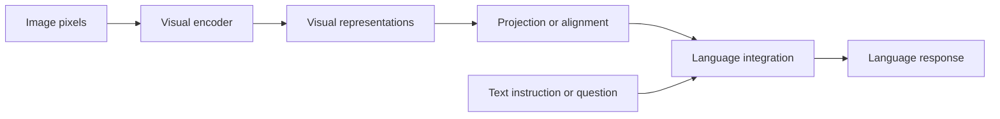
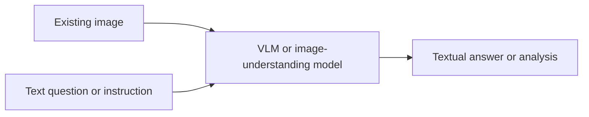
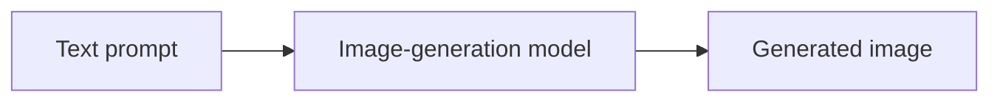
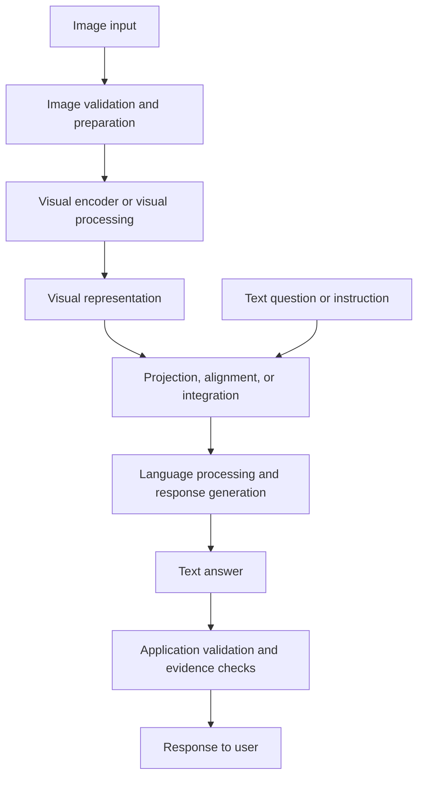

# 03. Vision-Language Models (VLMs)

## Learning Objectives

By the end of this chapter, you should be able to:

- Explain what a vision-language model (VLM) does.
- Describe visual encoders, representation projection, and language integration at a conceptual level.
- Identify common VLM tasks, including image captioning, visual question answering, document analysis, and image comparison.
- Distinguish image understanding from text-to-image generation.
- Explain visual grounding and recognize limits in spatial reasoning, counting, and fine-detail interpretation.
- Explain why model architectures and image-handling strategies vary.

 

## 1. What Is a Vision-Language Model?

A **vision-language model (VLM)** is a model or model system designed to work with both visual information and language. Depending on its capabilities, it may accept an image and a text prompt, connect visual evidence to a question, and produce a language response.

Examples of VLM tasks include:

- **Image captioning:** describe the main content of an image.
- **Visual question answering (VQA):** answer a question using evidence from an image.
- **Document analysis:** interpret page images containing text, tables, charts, or layout.
- **Image comparison:** describe similarities and differences between two or more images.
- **Visual classification or extraction:** identify categories or extract requested information from visual content, when supported.

The term *VLM* does not imply that every model supports every task, input format, or output type. Check the exact model documentation and test the intended use case.

 

## 2. A Conceptual VLM Architecture

VLM architectures differ, but a useful high-level mental model has three components:

1. **Visual encoder:** converts image pixels or image regions into numerical visual representations.
2. **Representation projection or alignment:** maps or adapts visual representations into a form that can interact with the language model.
3. **Language model or language-generation component:** uses the available visual information and text instructions to produce a response.

Some architectures use separate components; others integrate vision and language more tightly. This diagram is conceptual, not a claim that every VLM has exactly these modules.

 

### 2.1 Visual encoder

A visual encoder transforms an image into a representation that captures information useful for a downstream task. Depending on the model, image processing may involve resizing, crops, tiles, patches, or other operations.

The encoder's representation is not a perfect copy of the image. Fine details may be weakened or lost, and what is retained depends on the model and its preprocessing.

 

### 2.2 Projection and alignment

Visual and language components may use different internal representation formats. A **projection** or **alignment** component can map visual features into a representation space or interface that the language component can use.

At a high level, this helps the model relate visual information to language. The exact implementation varies: not every model uses a separate projection layer, and some systems use other forms of integration.

 

### 2.3 Language integration

The language component combines the text instruction with visual information made available by the model architecture. It then generates a response according to the task and supported output format.

For example, if the image shows a red bicycle beside a tree and the user asks, “What color is the bicycle?”, the model should use the image evidence to answer “Red.” It should not rely only on general language patterns.

 

### 2.4 A step-by-step conceptual flow

For a question about a chart:

1. The application validates and prepares the image.
2. The VLM processes the image using its supported image-handling path.
3. The model makes visual representations available to its language-processing components.
4. The text question directs attention to the relevant information.
5. The model produces an answer.
6. The application checks the answer for format, evidence support, and uncertainty where appropriate.

The steps describe the application-level idea. Actual internal computation may differ substantially across model families.

 

## 3. Common Vision-Language Tasks

### 3.1 Image captioning

**Goal:** Produce a concise description of visible image content.

Example prompt:

> Describe the main objects and actions visible in this image. Do not infer details that cannot be seen.

A useful caption identifies relevant content without adding unsupported claims. Captioning is not a guarantee that every object or relationship will be mentioned.

 

### 3.2 Visual question answering

**Goal:** Answer a specific question using image evidence.

Example:

- **Image:** A simple scene with three visible chairs.
- **Question:** “How many chairs are visible?”
- **Expected answer:** “Three,” if all chairs are clearly visible.

VQA can be more focused than open-ended captioning because the question defines the information required. However, a focused question does not eliminate counting or perception errors.

 

### 3.3 Document analysis

**Goal:** Extract or interpret information from a document page or document image.

Potential tasks include:

- Reading a field from a form.
- Summarizing a page.
- Interpreting a table or chart.
- Connecting a heading with the relevant paragraph.
- Comparing the content of two pages.

For high-stakes or numerical extraction, preserve page references and validate important values against the source. If a document is text-heavy, compare a VLM with OCR or a document parser; the VLM is not automatically the most accurate option.

 

### 3.4 Image comparison

**Goal:** Compare two or more images and report relevant similarities or differences.

Example prompt:

> Compare the two product photos. List only visible differences in color, shape, and included accessories. If a difference is unclear, label it uncertain.

Comparison quality depends on image alignment, lighting, viewing angle, resolution, and the requested level of detail. A difference in lighting should not automatically be treated as a change in the object itself.

 

### 3.5 Task and evidence table

| Task | Typical input | Typical output | Important failure risk |
|---|---|---|---|
| Captioning | Image | Text description | Omissions or unsupported details |
| Visual question answering | Image + question | Text or supported structured output | Incorrect interpretation of the evidence |
| Document analysis | Page image or document pages + instruction | Extracted fields, explanation, or summary | OCR-like errors, layout confusion, incorrect numbers |
| Image comparison | Multiple images + comparison criteria | Similarities and differences | Confusing viewpoint or lighting changes with actual object changes |

These are common patterns, not universal guarantees. Confirm that the selected model supports the desired input and output combination.

 

## 4. Image Understanding Is Not Text-to-Image Generation

Image understanding and image generation are different capabilities.

### Image understanding

The system receives an existing image and interprets it.

Examples include describing a photograph, answering a question about a chart, or extracting information from a scanned page.

 

### Text-to-image generation

The system receives a prompt and generates a new image using an image-generation model or service.

An image-generation model may use diffusion or another generative approach. The detailed mechanics of image generation are covered in the later image-generation level of this course.

A VLM that accepts image inputs does **not** automatically generate images. Likewise, a text-to-image model does not automatically understand and answer questions about an uploaded image. Some products combine these features, but each capability must be verified independently.

 

## 5. Visual Grounding

**Visual grounding** means connecting a response to specific visual evidence in the supplied image. Depending on the task and interface, evidence may be described in words or represented through regions, coordinates, bounding boxes, or other locators.

For example:

- Weakly grounded answer: “The chart shows strong growth.”
- More specific answer: “The plotted line rises from the first quarter to the fourth quarter.”

The second answer makes a more concrete claim, but it still needs to be checked against the chart. More detailed wording is not automatically more accurate.

 

### 5.1 Grounding practices

To improve evidence discipline:

- Ask questions that identify the requested evidence.
- Separate direct observations from explanations or inferences.
- Request an uncertainty statement when evidence is unreadable or ambiguous.
- Preserve source image and page identifiers in the application.
- For extracted values, record a page, region, or other source locator where feasible.
- Verify critical numerical or consequential claims independently.

A text answer alone may not prove that a model used the correct region. If the application requires auditable evidence, design explicit evidence checks rather than relying on confidence or fluency.

 

## 6. Known Challenges: Spatial Reasoning, Counting, and Fine Details

VLMs can perform well on many visual tasks while still failing on specific details.

### 6.1 Spatial relationships

Questions such as “Is the cup to the left of the plate?” depend on relative positions. The model may misinterpret the scene, especially when objects overlap, the image is crowded, or the viewpoint is unusual.

Be precise about the reference frame. “Left” may mean the viewer's left, not the object's left.

 

### 6.2 Counting

Models may miss, duplicate, or misclassify objects, particularly in dense scenes, repeated patterns, or partially occluded regions.

For reliable counting:

- Use clear images and a narrowly defined counting target.
- Specify whether partially visible objects count.
- Test on images with known counts.
- Use a specialized detector or other deterministic method if exact counts are a strict requirement and it performs better on the target data.

 

### 6.3 Fine details and small text

Small labels, low-resolution text, subtle visual differences, and tiny objects may be missed. Image resizing or internal crop selection can affect which details remain available.

Possible mitigations include:

- Supplying a higher-quality source image within supported limits.
- Cropping a relevant region while retaining enough context.
- Providing both a full page and a focused crop when supported.
- Using OCR or a specialized document parser for text extraction.
- Verifying important details against the source.

These steps may improve performance, but they do not guarantee correctness.

 

### 6.4 Hallucinated visual details

A model can produce a plausible answer that is not supported by the image. It may fill gaps using learned patterns or misread ambiguous evidence.

For example, if a photograph shows a person holding an object that is partly hidden, the model should not state the object's exact identity unless it is visible enough to support that conclusion.

Use explicit instructions such as:

> Answer only from visible evidence. If the requested detail cannot be determined from the image, say that it is unclear.

Prompt wording can encourage evidence discipline, but independent evaluation is still required.

 

## 7. Architecture and Image Handling Vary by Model

Do not assume that all VLMs process images in the same way.

Models may differ in:

- Whether vision and language components are separate or tightly integrated.
- How image pixels are encoded into internal representations.
- Whether they resize images, use crops or tiles, or process patches.
- How they handle multiple images and image ordering.
- Supported formats, dimensions, file sizes, and request structures.
- Whether they return only text or can produce structured outputs.
- Context, latency, and usage accounting.
- Performance on charts, documents, counting, spatial reasoning, and fine details.

The terms *patch*, *crop*, *visual token*, and *image token* may refer to different things in different implementations. Do not assume a universal image-token formula or billing rule. Use the selected provider's current documentation.

 

### Model selection checklist

Before selecting a VLM, verify:

1. **Input support:** Does the model accept the required image format and request structure?
2. **Task support:** Does it support the intended operation?
3. **Resolution and handling:** Are dimensions, crops, or image counts restricted?
4. **Output contract:** Can the application obtain the required text or structured result?
5. **Quality:** Does it perform adequately on representative images?
6. **Evidence:** Can the application preserve source references or validate important claims?
7. **Operations:** What are the measured latency, usage, and cost?
8. **Data handling:** Are upload, retention, privacy, and licensing requirements acceptable?

 

## 8. Practice: Annotate a Conceptual Image-to-Text Flow

Use the following diagram and annotate what each stage does. Remember that this is a conceptual architecture, not a universal implementation.

 

### Annotation guide

- **Image input:** Original media supplied by the user or application.
- **Validation and preparation:** Check format, size, orientation, and other supported constraints.
- **Visual processing:** Convert the image into information usable by the model.
- **Visual representation:** Internal numerical features; not a lossless copy of the original image.
- **Projection/alignment/integration:** Conceptually makes visual information usable alongside language; the actual architecture varies.
- **Text question:** Defines the requested task and evidence.
- **Response generation:** Produces the requested answer in the supported output format.
- **Application checks:** Validate structure, handle errors, preserve evidence references, and flag uncertainty where needed.

 

### Exercise

Imagine the input is a photograph of a street sign. The user asks, “What is the street name?”

1. Identify the visual evidence required.
2. State what could go wrong during image preparation or visual processing.
3. Write a response policy for a blurry or partially obscured sign.
4. Explain how you would verify the result on a set of test images.
5. Identify which parts of the diagram are conceptual and which are application-controlled.

**Expected design principle:** If the street name is unreadable, the system should report uncertainty rather than inventing a plausible name.

 

## 9. Revision Questions and Answers

**Q1. What is a VLM?**  
A vision-language model is a model or model system designed to relate visual information and language for supported tasks.

**Q2. What does a visual encoder do?**  
It converts image information into internal numerical representations that can be used by later components.

**Q3. Why might a projection or alignment stage be used?**  
Visual and language components may use different representation formats. A projection or alignment mechanism can make visual information usable by language-processing components.

**Q4. Does every VLM use the same encoder-projection-language architecture?**  
No. This is a high-level conceptual pattern. Architectures and integration methods vary.

**Q5. Name four common VLM tasks.**  
Image captioning, visual question answering, document analysis, and image comparison.

**Q6. How does image understanding differ from text-to-image generation?**  
Image understanding interprets existing visual content; text-to-image generation creates new visual content from a prompt or other supported conditioning input.

**Q7. What is visual grounding?**  
Connecting an answer or claim to specific visual evidence in the supplied image.

**Q8. Why can a VLM make counting errors?**  
It may miss, duplicate, or misclassify objects, especially in crowded or partially occluded scenes.

**Q9. How can an application handle uncertain visual evidence?**  
It can request explicit uncertainty, validate the output, preserve source references, and independently verify consequential details.

**Q10. Why must image handling be checked for each model?**  
Models differ in supported formats, resolution limits, preprocessing, multi-image behavior, output formats, usage accounting, and task performance.

 

## 10. Chapter Checkpoint

You should be able to explain how image information can influence a language response **without assuming a universal architecture**.

Use this template:

> The application supplies **[image input]** and **[text instruction or question]** to a model that documents support for the task. The model processes visual information into internal representations and combines it with the language request using its particular architecture. It generates **[required output]**. Because visual processing and image handling vary by model, I will verify supported formats and limits, test spatial and fine-detail cases, and require uncertainty or independent verification when the image does not clearly support an answer.

 

### Completion Checklist

- [ ] I can define a VLM and name its common tasks.
- [ ] I can explain visual encoders, projection/alignment, and language integration conceptually.
- [ ] I can distinguish image understanding from image generation.
- [ ] I can explain visual grounding and its importance.
- [ ] I understand common spatial, counting, and fine-detail limitations.
- [ ] I know why model architectures and image handling vary.
- [ ] I have annotated the conceptual image-to-text flow.

 

## References

Consult the current official documentation for the model being evaluated. These are general entry points, not proof that every listed model supports every task in this chapter.

- [OpenAI API documentation](https://platform.openai.com/docs/overview)
- [Google AI for Developers](https://ai.google.dev/gemini-api/docs)
- [Anthropic documentation](https://docs.anthropic.com/)
- [Hugging Face documentation](https://huggingface.co/docs)
