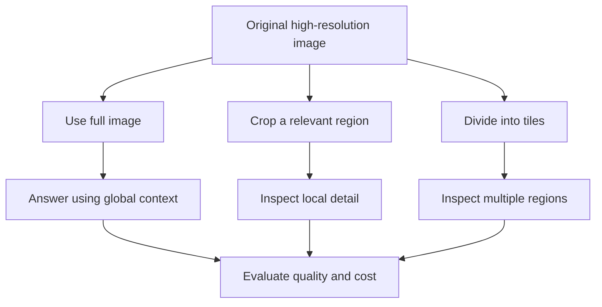
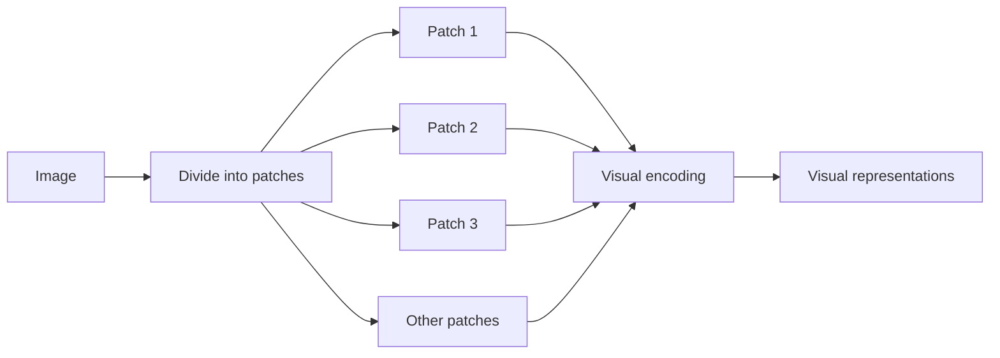

# 05. Image Resolution, Crops, Patches, and Visual Tokens

## Learning Objectives

By the end of this chapter, you should be able to:

- Explain image resizing, aspect ratio, cropping, tiling, and patch-based representations conceptually.
- Describe how downsampling can remove detail and how cropping can remove useful context.
- Understand visual-token and image-input accounting at a high level.
- Distinguish conceptual image patches from provider-specific processing units and billing units.
- Compare approaches using task quality, input size, latency, and resource use.
- Document preprocessing and accounting assumptions without inventing a universal image-token formula.

<br/>

## 1. Why Image Preparation Matters

A model does not necessarily process an uploaded image exactly as it was supplied. Depending on the model and service, the image may be resized, divided into crops or tiles, represented as patches, or processed through another provider-specific pathway.

Image preparation can affect:

- **Task quality:** whether small text, fine details, or relevant objects remain visible.
- **Context:** whether the model can relate a detail to the whole scene or page.
- **Latency:** how much preprocessing and model computation are required.
- **Resource use:** memory, compute, and transfer requirements.
- **Usage accounting:** how the provider measures image inputs for billing or limits.

There is no single image-preparation pipeline or accounting rule that applies to every model. Verify the behavior of the chosen provider and record the assumptions used in experiments.

<br/>

## 2. Resolution and Resizing

**Resolution** describes the dimensions of an image in pixels, commonly expressed as width × height. For example, an image that is 2400 pixels wide and 1600 pixels high has a resolution of 2400 × 1600 pixels.

**Resizing** changes the image dimensions.

<br/>

### 2.1 Downsampling

**Downsampling** reduces the number of pixels. It can make an image smaller and easier to transfer or process, but it can also remove useful information.

Potential effects include:

- Small printed text becoming unreadable.
- Thin lines disappearing from diagrams.
- Closely spaced objects blending together.
- Fine differences between similar objects becoming harder to detect.

For example, a chart may be readable at its original size but become ambiguous after the axis labels are reduced to only a few pixels in height.

<br/>

### 2.2 Upsampling

**Upsampling** increases the pixel dimensions, usually by estimating new pixel values from existing ones. It may improve compatibility with a processing pipeline or make an image easier to display, but it does not recover detail that was absent from the original.

Increasing a blurry image from 500 × 300 to 2000 × 1200 pixels does not restore the original text or details.

<br/>

### 2.3 Aspect ratio

The **aspect ratio** is the relationship between image width and height.

$$
\text{Aspect ratio} = \frac{\text{width}}{\text{height}}
$$

For example, a 1600 × 900 image has an aspect ratio of approximately 1.78:1.

When resizing, an application may preserve the aspect ratio, distort the image, or crop it. Distortion can change object proportions; cropping can remove relevant content. Preserve the aspect ratio unless there is a documented reason to do otherwise.

<br/>

## 3. Cropping and Tiling

### 3.1 Cropping

A **crop** selects a region of the original image and excludes the rest.

Cropping can help when the task focuses on a small area, such as a table cell, sign, chart legend, or form field.

**Potential benefits**
- Gives more of the model's input capacity to the region of interest.
- May make small text or details easier to inspect.
- Can reduce irrelevant background information.

**Potential risks**
- Removes context needed to interpret the region.
- Can exclude a label, axis, heading, or nearby object that explains the detail.
- May cause the model to mistake a local detail for the whole scene.
- Can make comparisons harder if corresponding regions are cropped inconsistently.

For chart analysis, cropping only the plotted bars may remove the axis labels and legend needed to interpret the values. A useful crop should include enough surrounding context to answer the question.

<br/>

### 3.2 Tiling

**Tiling** divides a larger image into multiple smaller regions. A system may process the tiles separately or use another provider-specific strategy.

Tiling can preserve local detail in high-resolution documents or large images, but it may increase the amount of processing. It can also create boundary problems: a word, object, or relationship that crosses tile boundaries may be harder to interpret.

Not every model or endpoint exposes tiling as a user-controlled option. Some services handle high-resolution images internally.

<br/>

### 3.3 Full image vs. crop vs. tiles



The best approach depends on whether the task needs global context, local detail, or both.

<br/>

## 4. Patch-Based Representations

Many vision systems transform an image into smaller regions or **patches** as part of internal processing. Conceptually, a patch is a small spatial portion of an image that can be represented numerically.

A simplified example:



This diagram is only an intuition-building illustration. Real systems may use overlapping patches, multiple crops, variable resolutions, learned resampling, or architectures that do not expose a simple patch grid.

<br/>

### 4.1 Why patches can help

A patch-based representation allows a vision system to process local image regions and relate them to other regions. This can be useful for objects, layout, and visual structure.

<br/>

### 4.2 Why patches are not a universal accounting unit

The word *patch* describes a possible representation concept. It does not automatically tell you:

- How many visual tokens a provider counts.
- How many tokens an API request consumes.
- How a particular image is resized or cropped.
- How much the request costs.
- Whether a model uses fixed-size patches at all.

A model's internal patches, visual tokens, provider usage units, and billable units may be related, but they are not interchangeable by definition.

<br/>

## 5. Visual Tokens and Image-Input Accounting

Language models often account for text using text tokens. Image-capable systems may account for image input using provider-specific rules, which can depend on factors such as dimensions, resolution mode, crops, tiles, or model family.

### 5.1 What to verify

For the exact model and endpoint, check the current documentation for:

- Whether image inputs contribute to a reported token or usage count.
- Whether image processing has separate usage units or pricing rules.
- Whether dimensions or resolution modes affect accounting.
- Whether multiple images are counted independently.
- Whether high-resolution handling creates additional crops or processing.
- Whether the response includes usage metadata.
- Whether documented limits apply to image size, count, or total request size.

Do not assume that an image has a fixed number of tokens or that every image is billed according to the same formula.

<br/>

### 5.2 Measure rather than guess

Where the service exposes usage metadata:

1. Record the model identifier and API version.
2. Submit a representative image with a fixed prompt.
3. Save the returned usage fields.
4. Repeat with the same image under a different documented resolution or preprocessing configuration, if supported.
5. Compare observed usage and latency.
6. Check the provider's current pricing page before calculating cost.

If usage metadata is unavailable, label cost as an estimate and state the assumptions. Do not present a speculative token count as a measured result.

<br/>

### 5.3 Separate the accounting concepts

| Concept | Meaning | What it does not automatically mean |
|---|---|---|
| Pixel dimensions | Width and height of the image | Number of model tokens |
| Patch | A conceptual or architectural image region | A provider billing unit |
| Visual token | A model-specific representation or accounting concept | A universal fixed unit across providers |
| API usage metadata | Usage reported by a particular service | A complete cost calculation unless pricing rules are applied |
| Billable unit | Unit defined by the provider's pricing | A universal unit for all models |

<br/>

## 6. Trade-offs: Quality, Input Size, Latency, and Resources

Preprocessing decisions should be evaluated against the actual task.

| Approach | Possible quality effect | Input/processing effect | Main risk |
|---|---|---|---|
| Original full image | Preserves broad context; small details may still be difficult | May require more image processing | Important details may be too small |
| Downsampled image | May retain overall scene but lose fine details | Smaller image dimensions | Text or thin lines become unreadable |
| Focused crop | May improve local detail | Processes a smaller region if supported | Context may be omitted |
| Multiple crops or tiles | May preserve details across a large image | May increase processing and latency | Cross-region relationships can be lost |
| OCR plus image | Can combine recognized text with visual evidence | Adds preprocessing and integration work | OCR errors or conflicting evidence |
| Provider-managed high-resolution mode | May improve access to details, depending on the model | Usage and latency depend on provider rules | Behavior and accounting may be opaque |

These are expected trade-offs, not guaranteed outcomes. Test the chosen method with representative inputs.

<br/>

## 7. Practical Preprocessing Example

The following Python example uses Pillow to inspect image dimensions and create a crop. It demonstrates local image preparation only; it does not call a model or calculate image tokens.

Install Pillow in your isolated environment:

```bash
pip install pillow
```

```python
from pathlib import Path
from PIL import Image

def inspect_image(path: str) -> None:
    image_path = Path(path)

    if not image_path.is_file():
        raise FileNotFoundError(f"Image not found: {image_path}")

    with Image.open(image_path) as image:
        width, height = image.size
        aspect_ratio = width / height

        print(f"Format: {image.format}")
        print(f"Dimensions: {width} x {height}")
        print(f"Aspect ratio: {aspect_ratio:.3f}")

def save_crop(
    source_path: str,
    output_path: str,
    box: tuple[int, int, int, int],
) -> None:
    # Coordinates are (left, upper, right, lower) in pixels.
    with Image.open(source_path) as image:
        image = image.convert("RGB")
        left, upper, right, lower = box

        if not (
            0 <= left < right <= image.width
            and 0 <= upper < lower <= image.height
        ):
            raise ValueError("Crop coordinates are outside the image.")

        crop = image.crop(box)
        crop.save(output_path, format="JPEG", quality=95)

inspect_image("chart.png")
save_crop(
    "chart.png",
    "chart_region.jpg",
    (200, 150, 1200, 900),
)
```

Important considerations:

- Choose crop coordinates based on the task and inspect the resulting crop.
- Keep chart titles, axis labels, legends, or other necessary context.
- Validate file content and dimensions before processing untrusted uploads in a production application.
- JPEG recompression may introduce artifacts; use an appropriate format for the content.
- This code does not determine whether a crop improves model performance. That must be measured.

<br/>

## 8. Practice: Compare Full-Image and Cropped Inputs

### Scenario

You need to answer questions about a high-resolution chart or a document containing small text.

Prepare:
- The original full image.
- A crop around the relevant text or chart region.
- Optionally, a second crop that retains more surrounding context.

<br/>

### Experiment procedure

1. Select a question with a verifiable answer.
2. Run the same model with the full image.
3. Run it again with the crop, keeping the prompt and other settings constant.
4. If supported, compare an additional documented resolution or image-handling mode.
5. Record the exact preprocessing and model settings.
6. Evaluate correctness and evidence support.
7. Measure latency and reported usage; calculate cost only with verified pricing.
8. Repeat across several cases, including a case where surrounding context is necessary.

<br/>

### Suggested experiment table

| Case | Input variant | Expected evidence | Answer correct? | Context preserved? | Latency | Usage/cost |
|---|---|---|---|---|---|---|
| Small chart label | Full image | Label and axis | Record | Record | Measure | Record if available |
| Small chart label | Focused crop | Label and axis | Record | Record | Measure | Record if available |
| Chart trend | Full image | Plot, axes, legend | Record | Record | Measure | Record if available |
| Chart trend | Crop | Plot plus sufficient labels | Record | Record | Measure | Record if available |
| Context-dependent question | Narrow crop | Surrounding heading or legend | Record | Record | Measure | Record if available |

Use the same task and equivalent evidence across variants. If you change the model, prompt, crop, and resolution at the same time, you cannot reliably attribute an improvement to one factor.

<br/>

### Reflection questions

- Did the crop make small text easier to read?
- Did it remove a heading, axis, legend, or nearby object needed for interpretation?
- Did resizing alter the answer?
- Did the provider report different usage for the variants?
- Was any quality gain worth the additional processing or complexity?

<br/>

## 9. Revision Questions and Answers

**Q1. What is downsampling?**  
Reducing image dimensions, which can lower processing requirements but may remove fine details.

**Q2. Why preserve aspect ratio?**  
Changing the width-to-height relationship can distort objects and visual relationships.

**Q3. What is the main risk of cropping?**  
It can remove context, such as headings, labels, legends, or surrounding objects that are necessary to interpret a detail.

**Q4. What is tiling?**  
Dividing a larger image into smaller regions for processing, potentially preserving local detail at the cost of additional work.

**Q5. What is a patch in vision processing?**  
A small spatial region of an image used by some architectures to create internal representations.

**Q6. Is a patch the same as a billable visual token?**  
Not necessarily. The relationship depends on the model and provider's implementation and accounting rules.

**Q7. Can upsampling recover missing detail?**  
No. It increases pixel dimensions by estimating values; it cannot reliably reconstruct information that was absent from the source.

**Q8. How should image-token usage be calculated?**  
Use the chosen provider's current documented accounting rules and available usage metadata. Do not apply a universal formula across providers.

**Q9. How should full-image and crop approaches be compared?**  
Keep the model and prompt fixed, use verifiable test cases, inspect whether context is preserved, and measure quality, latency, and usage.

<br/>

## 10. Chapter Checkpoint

You should be able to **state preprocessing and accounting assumptions rather than inventing a universal image-token formula**.

Use this reporting template:

> The source image is **[dimensions and format]**. I used **[full image, resize, crop, tiles, or provider-managed processing]** with **[documented settings]**. This choice was intended to preserve **[relevant detail and context]**. I evaluated it using **[test cases and quality criteria]** and recorded **[latency and available usage metadata]**. Any cost calculation uses the selected provider's current pricing and accounting rules; I do not assume a universal conversion from pixels or patches to image tokens.

<br/>

### Completion Checklist

- [ ] I can explain resizing, aspect ratio, cropping, and tiling.
- [ ] I understand how downsampling can remove fine details.
- [ ] I understand how cropping can remove surrounding context.
- [ ] I can describe patch-based representations conceptually.
- [ ] I can distinguish patches, visual tokens, usage metadata, and billable units.
- [ ] I know how to verify image accounting for a specific provider.
- [ ] I have compared full-image and cropped inputs using matched test cases.
- [ ] I have documented preprocessing, quality, latency, and usage assumptions.

<br/>

## References

Use current provider documentation for image limits, high-resolution handling, usage metadata, and pricing. The exact behavior is model- and endpoint-specific.

- [OpenAI API documentation](https://platform.openai.com/docs/overview)
- [Google AI for Developers](https://ai.google.dev/gemini-api/docs)
- [Anthropic documentation](https://docs.anthropic.com/)
- [Hugging Face documentation](https://huggingface.co/docs)
- [Pillow documentation](https://pillow.readthedocs.io/)

These are documentation entry points. Verify the specific model's image handling and accounting rules before relying on them in production.
