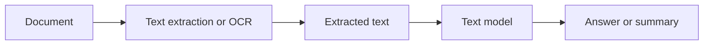
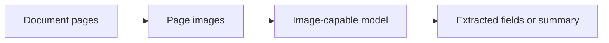
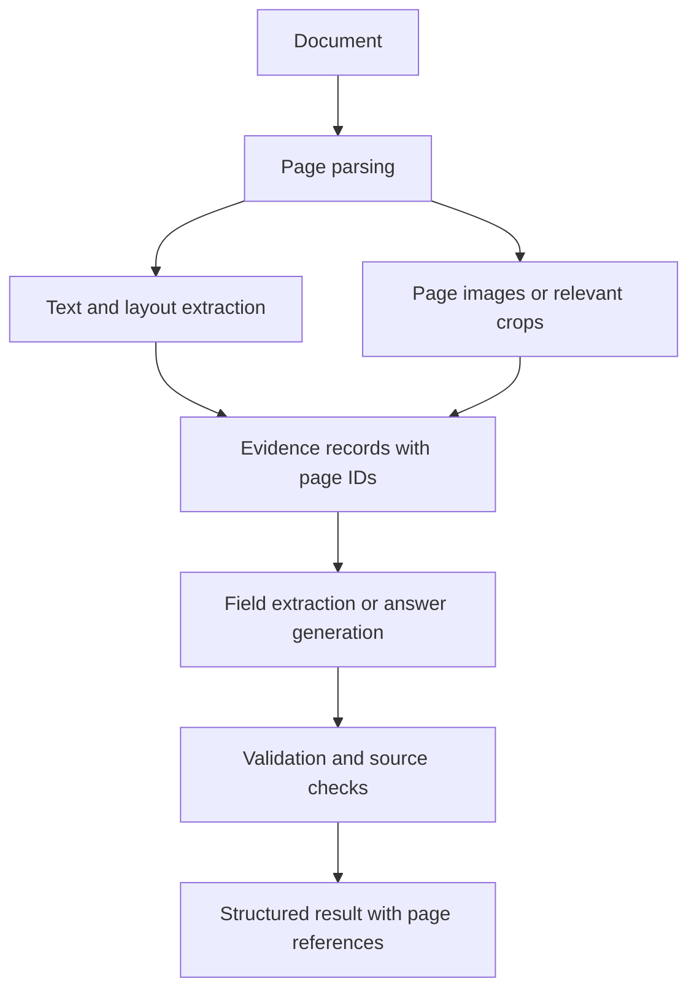

# 06. Document Understanding Using Text and Images

## Learning Objectives

By the end of this chapter, you should be able to:

- Combine extracted text with page images while preserving page identity.
- Explain how headings, columns, tables, charts, captions, and text-image relationships affect document interpretation.
- Compare OCR/text-only processing with visual and combined approaches.
- Preserve source locators and evidence for extracted fields.
- Handle unreadable regions, conflicting representations, and unsupported numerical interpretation.
- Extract fields and summarize a report while keeping results traceable to source evidence.

<br/>

## 1. What Is Document Understanding?

**Document understanding** is the process of extracting, organizing, and interpreting information from documents. A document may contain more than plain paragraphs: it can include headings, multi-column layouts, tables, charts, captions, diagrams, scanned pages, and images associated with nearby text.

A document-understanding workflow may need to answer questions such as:

- What is the report's publication date?
- What value appears in a particular table row?
- What trend does a chart show?
- Which paragraph explains a figure?
- What are the key findings, and which pages support them?

Different questions require different evidence. Clean digital text may be enough for a paragraph summary, while a chart's plotted values or a table's layout may require visual inspection or structured extraction.

<br/>

## 2. Preserve Page Identity and Source Provenance

When a document is split into extracted text, images, OCR results, or individual page records, preserve the relationship between every representation and its original source.

**Provenance** means being able to trace a result back to where its supporting evidence came from.

Useful source metadata may include:

- Document identifier or stable filename.
- Page number.
- Section or heading.
- Table or figure identifier.
- Text span or bounding box, if available.
- Image/crop identifier.
- Extraction method and version.
- Confidence or uncertainty information, when supplied by the extraction component.

<br/>

### 2.1 Example source record

```json
{
  "document_id": "annual_report_2025",
  "page": 7,
  "element_type": "table_cell",
  "element_id": "table_2_cell_revenue_q4",
  "text": "₹12.4 crore",
  "extraction_method": "table_parser",
  "source_image": "page_007.png"
}
```

This is an illustrative record. Real identifiers and fields should match the application's data model. The important idea is to keep the extracted value linked to the page and element from which it came.

<br/>

### 2.2 Why provenance matters

Without source references, a summary may be fluent but difficult to audit. Page-level provenance helps a reviewer:

- Verify a number against the original table or chart.
- Resolve conflicting OCR and visual interpretations.
- Find the location of an extracted field.
- Correct extraction errors without losing track of related outputs.
- Support citations in a document question-answering application.

Preserve source locators throughout ingestion, retrieval, extraction, and answer generation—not just in the final response.

<br/>

## 3. Document Structure: More Than Plain Text

### 3.1 Headings and hierarchy

Headings indicate document structure. A paragraph under “Limitations” should not be interpreted as if it were under “Results.” Preserve heading text and, where possible, the parent-child relationship between sections.

<br/>

### 3.2 Columns and reading order

Multi-column pages can confuse basic text extraction. A parser may read across columns instead of finishing one column first, interleave unrelated lines, or attach a footnote to the wrong paragraph.

When reading order matters, inspect the extracted order and compare it with the page image. Store layout information if the workflow needs to reconstruct relationships.

<br/>

### 3.3 Tables

Tables encode relationships between row labels, column headers, and cell values. Extracting the words without preserving these relationships can change the meaning.

For example:

| Region | 2024 revenue | 2025 revenue |
|---|---:|---:|
| East | 8.2 | 9.1 |
| West | 6.5 | 6.9 |

The value `9.1` is meaningful only when connected to the `East` row and `2025 revenue` column. A flat text string may preserve the number but lose the association.

For critical values, preserve table structure and verify the cell against the source page.

<br/>

### 3.4 Charts

Charts communicate information through a combination of labels, axes, marks, scales, legends, and spatial relationships.

A chart interpretation may need to identify:

- Chart title and units.
- Axis labels and scale.
- Legend-to-series mapping.
- Exact printed values, if present.
- Approximate visual trends.
- Missing or ambiguous labels.

Do not invent exact numerical values by visually estimating a chart unless the task explicitly permits approximation and the result is labeled accordingly. If exact values are required, look for a source table or accompanying text and verify the interpretation.

<br/>

### 3.5 Captions and text-image relationships

Captions often explain a figure, chart, or photograph. The caption may be separated from the image in extracted text, especially across page breaks or complex layouts.

Keep the association between a visual element and its caption, nearby paragraph, and page. A figure should not be interpreted without relevant explanatory text when that text changes its meaning.

<br/>

## 4. OCR/Text-Only vs. Visual vs. Combined Processing

There are three common approaches.

### 4.1 OCR or extracted text with a language model



**Useful when**
- The document is mostly text.
- Search and text indexing are important.
- The extracted text is accurate enough for the task.
- Layout and non-text visual details are not essential.

**Risks**
- OCR may misread characters or numbers.
- Reading order may be incorrect.
- Tables and columns may lose structure.
- Charts and diagrams may be reduced to incomplete text or omitted.

<br/>

### 4.2 Visual processing of page images



**Useful when**
- Layout, diagrams, charts, or visual relationships matter.
- Text extraction is poor or incomplete.
- A page's visual structure is essential to the question.

**Risks**
- Small text may be unreadable.
- The model may misinterpret numbers or spatial relationships.
- Output may be difficult to audit unless page references are explicitly preserved.
- Processing may require more resources or incur additional latency and cost.

<br/>

### 4.3 Combined text and image processing



A combined approach can use text extraction for exact printed wording and visual analysis for layout or non-text evidence. It requires careful source association and conflict handling.

**No approach is universally best.** Select based on document type, required evidence, measured quality, latency, cost, and audit requirements.

<br/>

## 5. A Practical Document Processing Workflow

A robust workflow can use the following stages:

1. **Validate the file:** confirm allowed file type, size, page count, and safe processing limits.
2. **Parse the document:** extract digital text where available.
3. **Render or obtain page images:** preserve page numbering and orientation.
4. **Extract layout and OCR:** identify text blocks, tables, captions, and other elements as supported.
5. **Create evidence records:** attach document ID, page number, element type, and source locator.
6. **Select relevant evidence:** use the task to decide which text, table, chart, or page image is needed.
7. **Extract or summarize:** request only supported fields and claims.
8. **Validate output:** check schema, data types, required fields, and business rules.
9. **Verify important claims:** compare critical numbers and consequential claims against source evidence.
10. **Return traceable results:** include page references and uncertainty when evidence is incomplete.

A document workflow should not silently treat extraction output as ground truth. Parsing, OCR, visual interpretation, and language generation can each introduce errors.

<br/>

## 6. Preserve Evidence for Extracted Fields

For structured extraction, return both the value and a source locator when possible.

Example:

```json
{
  "report_date": {
    "value": "2025-03-31",
    "page": 2,
    "evidence": "Reporting period ended 31 March 2025",
    "status": "supported"
  },
  "highest_chart_value": {
    "value": null,
    "page": 8,
    "evidence": "Chart label is too small to read reliably",
    "status": "uncertain"
  }
}
```

This example demonstrates an evidence-aware structure. The actual schema should be defined for the application.

Useful status values might include:
- `supported`: the source clearly supports the value.
- `uncertain`: the source is ambiguous or only partially readable.
- `not_found`: the field was not located in the reviewed source.
- `conflict`: two source representations disagree and require resolution.

Avoid using `null`, an empty string, and a guessed value interchangeably. Define what each status means and validate it.

<br/>

### 6.1 Evidence references should be inspectable

A page number alone may be insufficient when a page contains many tables and figures. Where feasible, add:
- Section heading.
- Table or figure number.
- Cell or text-span identifier.
- Bounding box or crop reference.
- Short evidence excerpt.
- Link to the original page or document, subject to access controls.

Do not expose a document or source link to a user who is not authorized to access it.

<br/>

## 7. Handling Unreadable and Conflicting Evidence

### 7.1 Unreadable regions

If a value is blurry, clipped, or too small, mark it as uncertain. Possible next steps include rendering the page at a suitable resolution, inspecting a focused crop that retains context, running an appropriate OCR tool, or asking a reviewer to inspect the original.

A larger crop can help only if the source contains enough detail. Upscaling alone does not restore information missing from the original.

<br/>

### 7.2 Conflicts between text and visual evidence

A document may contain a printed paragraph saying one thing while a table or chart appears to show something else. OCR may also disagree with the page image.

A safe workflow should:

1. Preserve both representations and their source locations.
2. Identify the exact conflict rather than silently choosing one.
3. Check for common causes such as OCR errors, a footnote, a different reporting period, rounding, or a mislabeled axis.
4. Prefer a verified primary source or request human review when the conflict remains unresolved.
5. Record the resolution and rationale.

Do not automatically assume that either OCR text or visual interpretation is always correct.

<br/>

### 7.3 Unsupported numerical interpretation

Charts can invite overconfident numerical claims. Distinguish:
- An exact number printed in the source.
- A value read from a table cell.
- An estimate inferred from a plotted mark and axis.
- A number calculated from other verified values.

Label estimates as estimates. Preserve units and scale. For important calculations, show the source values and calculation method, and validate the arithmetic independently.

<br/>

## 8. Practice: Extract and Summarize a Report

### Scenario

Use a public or synthetic report containing ordinary text plus at least one table or chart. Avoid uploading confidential documents unless the service and workflow are approved for that data.

<br/>

### Tasks

1. Record the document identifier, page count, and file type.
2. Extract the report title, reporting period, and two key findings.
3. Select one table and preserve its row/column relationships.
4. Select one chart and record its title, units, labels, and supported trend.
5. Extract at least three fields with page-level evidence.
6. Compare a text-only/OCR approach with a visual or combined approach.
7. Include one unreadable or ambiguous value and show how the workflow represents uncertainty.
8. Verify important numbers against the original page.
9. Produce a concise summary with page references.
10. Document extraction errors, conflicts, and any unresolved limitations.

<br/>

### Suggested output table

| Field or claim | Extracted result | Page/element | Evidence | Status |
|---|---|---|---|---|
| Report title | Record | Page | Title text | Supported/uncertain |
| Reporting period | Record | Page | Date statement | Supported/uncertain |
| Table value | Record | Page/table/cell | Row, column, and value | Supported/uncertain |
| Chart trend | Record | Page/figure | Visible trend and labels | Supported/uncertain |
| Key finding | Record | Page/section | Supporting excerpt | Supported/uncertain |

<br/>

### Comparison record

| Measure | OCR/text-only | Visual | Combined |
|---|---|---|---|
| Field extraction correctness | Measure | Measure | Measure |
| Table relationship accuracy | Measure | Measure | Measure |
| Chart interpretation | Measure | Measure | Measure |
| Evidence traceability | Assess | Assess | Assess |
| Latency | Measure | Measure | Measure |
| Usage/cost | Record if available | Record if available | Record if available |

Use the same document and equivalent questions. If the models or prompts differ, report the result as a comparison of complete approaches rather than attributing all differences to modality alone.

<br/>

## 9. Revision Questions and Answers

**Q1. Why preserve page identity when extracting document content?**  
It lets users and reviewers trace each result back to the original page and verify the supporting evidence.

**Q2. Why is flattening a table into plain text risky?**  
It can lose the relationships between row labels, column headers, and values, changing the meaning of a cell.

**Q3. When can OCR/text-only processing be sufficient?**  
When text extraction is reliable and the task does not depend on visual layout, charts, diagrams, or other non-text information.

**Q4. When can visual processing help?**  
When layout, chart geometry, diagrams, or text-image relationships are important, or when extracted text is incomplete.

**Q5. Why combine text extraction with page images?**  
Text can preserve searchable wording while images can supply visual evidence. Combining them can improve coverage if source identity and conflicts are handled carefully.

**Q6. What should happen when OCR and visual interpretation disagree?**  
Preserve both results and their source locators, investigate the discrepancy, and resolve it using verified evidence or human review.

**Q7. How should a chart value be reported when the exact value is not printed?**  
If it is estimated from the chart, label it as an estimate and retain the relevant scale and evidence. Do not present it as an exact source value.

**Q8. What makes an extracted field auditable?**  
A traceable source locator, supporting evidence, a clear status, and a reproducible extraction process.

**Q9. Why is a page number sometimes insufficient?**  
A page may contain multiple paragraphs, tables, and figures. A table/cell identifier, figure number, text span, or crop reference can make the evidence more precise.

<br/>

## 10. Chapter Checkpoint

You should be able to **trace extracted facts back to page evidence and identify where visual interpretation is uncertain**.

Use this reporting template:

> The extracted field or claim is **[value or claim]**. Its source is **[document ID, page, section/table/figure, and locator]**. The supporting evidence is **[short excerpt or visual description]**. The evidence status is **[supported, uncertain, not found, or conflict]**. Any number inferred from a chart is labeled as an estimate unless an exact value is available in the source. Conflicts are retained and investigated rather than silently resolved.

<br/>

### Completion Checklist

- [ ] I can preserve document and page identity through extraction.
- [ ] I understand how headings, columns, tables, charts, and captions affect interpretation.
- [ ] I can compare OCR/text-only, visual, and combined processing.
- [ ] I can attach evidence references to extracted fields.
- [ ] I can represent unreadable or ambiguous values without guessing.
- [ ] I can detect and investigate conflicting text and visual representations.
- [ ] I can distinguish exact source values from chart-based estimates.
- [ ] I have extracted fields and summarized a report with traceable evidence.

<br/>

## References

Use current documentation for the parser, OCR service, vision model, and file-processing libraries chosen for the application.

- [OpenAI API documentation](https://platform.openai.com/docs/overview)
- [Google AI for Developers](https://ai.google.dev/gemini-api/docs)
- [Anthropic documentation](https://docs.anthropic.com/)
- [Hugging Face documentation](https://huggingface.co/docs)
- [Pillow documentation](https://pillow.readthedocs.io/)

These are general documentation entry points. Verify exact file support, limits, and data-handling behavior for each service before implementation.
