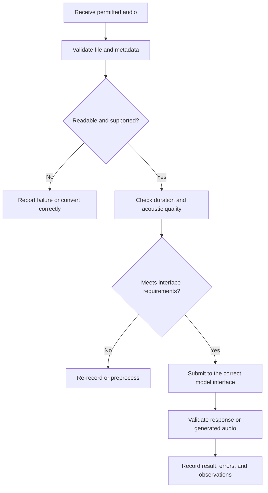

# 07. Audio Inputs and Outputs

## Learning Objectives

By the end of this chapter, you should be able to:

- Identify the audio properties that affect model compatibility and processing.
- Distinguish uploaded audio, streaming audio, and generated audio.
- Explain waveform-based and tokenized audio representations at a conceptual level.
- Check a model interface's accepted inputs, outputs, and limits before implementation.
- Recognize common audio-quality and file-integrity failures.

<br/>

## 1. Audio as a Model Input or Output

Audio is a time-varying acoustic signal. An audio-capable AI application may accept a recording, process a live stream, produce speech, or generate non-speech sounds.

| Direction | Example | Typical objective |
|---|---|---|
| Audio input | Upload a recorded question | Transcribe or understand speech |
| Streaming input | Send microphone audio in chunks | Respond during a live conversation |
| Audio output | Generate spoken narration | Produce speech or other audio |
| Audio-to-audio | Supply audio and receive audio | Support a speech interaction without requiring a text-only intermediate result |

These are different interface contracts. A model that accepts uploaded audio does not necessarily support real-time streaming, and a model that transcribes speech does not necessarily generate speech. Verify each capability independently.

<br/>

## 2. Essential Audio Properties

### 2.1 File format and container

A file extension is a useful clue, but it is not a complete description of the encoded audio.

- **WAV** commonly stores uncompressed PCM audio, although WAV is a container and can hold other encodings.
- **MP3** commonly uses lossy perceptual compression.
- **FLAC** uses lossless compression.
- **M4A** is a container commonly used for AAC-encoded audio, but the actual codec should be checked.
- **WebM** can contain audio encoded with codecs such as Opus.

A model API may accept only a documented subset. Renaming a file from one extension to another does not convert its encoding.

<br/>

### 2.2 Sample rate

The sample rate is the number of audio samples captured per second, measured in hertz (Hz).

Examples:

- 16,000 Hz (16 kHz): 16,000 samples per second.
- 44,100 Hz (44.1 kHz): common in consumer audio.
- 48,000 Hz (48 kHz): common in video and communication workflows.

The Nyquist limit is half the sample rate. For example, a 16 kHz recording cannot faithfully represent frequencies above 8 kHz. Resampling changes the sample grid; it cannot restore information that was never captured.

<br/>

### 2.3 Channels

A **mono** signal has one channel. **Stereo** audio usually has left and right channels. Some recordings contain more channels.

Channel count can affect file size, interface compatibility, and preprocessing. Converting stereo to mono may simplify a speech pipeline, but it can remove spatial information or create cancellation effects if channels are combined carelessly.

<br/>

### 2.4 Duration and sample count

Duration is the length of the recording. For uncompressed PCM audio, approximate raw payload size is:

$$
\text{bytes} \approx
\text{duration} \times \text{sample rate} \times
\text{channels} \times \frac{\text{bits per sample}}{8}
$$

For example, 10 seconds of mono, 16 kHz, 16-bit PCM audio requires approximately:

$$
10 \times 16000 \times 1 \times 2 = 320{,}000 \text{ bytes}
$$

This estimate excludes container headers and metadata. Compressed file size depends on the codec, bitrate, content, and encoding settings.

Duration may affect request limits, latency, cost, and whether an interface requires chunking. Always check the current endpoint's rules rather than assuming a universal maximum.

<br/>

### 2.5 Encoding and bit depth

**Encoding** describes how samples are represented or compressed. **Bit depth** describes the number of bits used to represent each uncompressed sample. Higher bit depth can represent a wider range of amplitude values, but it does not automatically make a noisy or poorly recorded signal clean.

Lossy compression can reduce file size by discarding information. Re-encoding an already compressed recording may introduce further degradation.

<br/>

## 3. Uploaded, Streaming, and Generated Audio

### Uploaded audio

A complete file is submitted in a request. This is convenient for transcription, recording analysis, and offline processing.

Considerations:
- Validate file type, size, duration, and integrity before upload.
- Respect endpoint-specific encoding requirements.
- Account for upload time and full-file processing latency.
- Avoid sending sensitive recordings unless the data-handling arrangement permits it.

<br/>

### Streaming audio

Audio is transmitted incrementally, often in chunks, while recording or playback is still in progress.

Considerations:
- Chunks must be ordered and framed correctly.
- The application may need timestamps, buffering, and end-of-stream signaling.
- Small chunks can reduce perceived latency but increase protocol overhead.
- Network jitter, dropped chunks, and backpressure can interrupt the interaction.
- Some streaming interfaces require a specific sample rate, channel layout, or encoding.

<br/>

### Generated audio

A model or speech system returns audio for playback or storage. The result may be streamed or delivered as a complete file.

Considerations:
- Check the returned format, sample rate, channel count, and encoding.
- Do not assume the output format matches the input format.
- Handle empty, truncated, or invalid responses.
- Ensure the playback component supports the returned media type.

<br/>

## 4. Waveform-Based and Tokenized Representations

### Waveform-based representation

A waveform representation stores or processes audio as a sequence of amplitude samples over time. Conventional signal-processing tools can inspect these samples directly.

Conceptually:

```text
Microphone / recording
        |
        v
Amplitude samples over time
        |
        v
Preprocessing or audio encoder
        |
        v
Model processing
```

A model may consume raw samples, features derived from samples, or an encoded representation. These approaches are not interchangeable.

<br/>

### Tokenized audio representation

Some audio models convert audio into discrete tokens or codec codes. The model processes or predicts token sequences, which can then be decoded into audio. A system may also combine text tokens and audio tokens.

```text
Audio waveform
      |
      v
Audio encoder / tokenizer
      |
      v
Discrete audio tokens
      |
      v
Model predicts or transforms tokens
      |
      v
Audio decoder
      |
      v
Output waveform
```

This is a conceptual pattern, not a guarantee that every audio model exposes tokens to the application developer. Tokenization, codecs, alignment, and text/audio interleaving vary by model family.

| Aspect | Waveform-oriented view | Tokenized view |
|---|---|---|
| Basic representation | Numerical samples over time | Discrete codes or tokens |
| Typical role | Signal input/output or preprocessing | Learned sequence modeling and generation |
| Human readability | Samples require tools to interpret | Tokens are generally not human-readable |
| Main concern | Sampling, amplitude, duration, signal quality | Tokenizer/codec compatibility and sequence length |
| Developer visibility | May be exposed as audio bytes or arrays | Often internal to the model or runtime |

Do not assume that a tokenized model accepts arbitrary audio tokens from another model. Its tokenizer and decoder may be specific to its training and architecture.

<br/>

## 5. Inspecting the Model Interface

Before coding, record the interface contract. Use the current official documentation for the exact model and endpoint.

| Requirement | Questions to answer |
|---|---|
| Task | Is the endpoint for transcription, perception, speech generation, or real-time audio? |
| Input | Which file formats, MIME types, codecs, and sample rates are accepted? |
| Channels | Is mono required, recommended, or optional? |
| Duration and size | What are the request, file-size, and audio-duration limits? |
| Streaming | Are chunks supported? What framing and end-of-stream signals are required? |
| Output | What format, sample rate, channels, and encoding are returned? |
| Errors | How are unsupported files, timeouts, and partial results reported? |
| Data handling | How are uploaded recordings retained, processed, and protected? |
| Usage | Is usage measured by audio duration, tokens, requests, or another unit? |

<br/>

### Example interface checklist

```python
audio_interface = {
    "task": "speech transcription",
    "input_format": "verify in endpoint documentation",
    "sample_rate_hz": "verify",
    "channels": "verify",
    "max_duration_seconds": "verify",
    "max_file_size_bytes": "verify",
    "streaming_supported": "verify",
    "output_format": "text",
}
```

This is a planning checklist, not an actual provider configuration. Replace every `"verify"` value with a value supported by the endpoint documentation before deployment.

<br/>

## 6. Inspecting a Local Audio File with Python

The following example uses `soundfile` to inspect common audio files. Install the dependencies first:

```bash
pip install soundfile numpy
```

```python
from pathlib import Path
import soundfile as sf

audio_path = Path("sample_audio.wav")

if not audio_path.is_file():
    raise FileNotFoundError(f"Audio file not found: {audio_path}")

try:
    info = sf.info(str(audio_path))
except (RuntimeError, OSError) as exc:
    raise ValueError(f"Could not read audio metadata: {exc}") from exc

print(f"File: {audio_path.name}")
print(f"Container / detected format: {info.format}")
print(f"Subtype / encoding: {info.subtype}")
print(f"Sample rate: {info.samplerate} Hz")
print(f"Channels: {info.channels}")
print(f"Frames: {info.frames}")
print(f"Duration: {info.duration:.2f} seconds")
```

The library supports particular formats depending on its installed audio backend. A failure to inspect a file may indicate an unsupported codec, a damaged file, or a missing backend—not necessarily that the file contains no audio.

For deeper inspection, load the samples and check for silence or clipping:

```python
import numpy as np
import soundfile as sf

samples, sample_rate = sf.read("sample_audio.wav", dtype="float32", always_2d=True)

if samples.size == 0:
    raise ValueError("The audio file contains no samples.")

peak_amplitude = float(np.max(np.abs(samples)))
rms_amplitude = float(np.sqrt(np.mean(np.square(samples))))
near_full_scale_fraction = float(np.mean(np.abs(samples) >= 0.999))

print(f"Sample rate: {sample_rate} Hz")
print(f"Peak amplitude: {peak_amplitude:.4f}")
print(f"RMS amplitude: {rms_amplitude:.4f}")
print(f"Near-full-scale sample fraction: {near_full_scale_fraction:.6%}")
```

Interpretation:
- **Peak amplitude** measures the largest absolute sample value.
- **RMS amplitude** provides a rough measure of signal level.
- A high fraction of samples near full scale can indicate clipping, but threshold checks alone do not prove audible distortion.
- Very low RMS may indicate silence, a quiet recording, or long silent intervals. Use a suitable threshold and inspect the signal before deciding.

The example assumes normalized floating-point samples. Other sample representations may use different numeric ranges.

<br/>

## 7. Common Audio Problems and Responses

| Problem | Possible symptom | Response |
|---|---|---|
| Clipping | Harsh distortion; flattened peaks | Re-record at a lower input gain when possible. Clipping cannot generally be fully repaired afterward. |
| Background noise | Recognition errors or unstable output | Improve microphone placement, reduce noise, or use suitable noise reduction. Test that processing does not damage speech. |
| Silence | Empty transcription or no meaningful response | Detect all-silent or near-silent input; distinguish intentional silence from a recording failure. |
| Incomplete file | Decoder error or unexpectedly short audio | Verify file size, container integrity, frame count, and whether recording finished. |
| Unsupported format | Request rejection or decoding error | Convert the audio using a real decoder/encoder; do not merely rename the extension. |
| Wrong sample rate | Rejection, speed/pitch changes, or quality loss | Inspect metadata and resample correctly if the interface requires it. |
| Wrong channel layout | Rejection or unexpected audio | Confirm channel requirements and convert carefully if needed. |
| Network or streaming interruption | Missing chunks or truncated output | Add timeouts, sequence/order checks, buffering, retries where safe, and explicit completion handling. |
| Excessive duration | Request rejection or high latency | Split at appropriate boundaries if supported; preserve timestamps and avoid cutting words mid-utterance. |

A technically valid file may still be acoustically unsuitable. File validation and signal-quality checks answer different questions.

<br/>

## 8. Practical Workflow



Keep preprocessing reproducible. Record the original file metadata, transformations applied, final input metadata, endpoint/model identifier, and any errors. This makes model results easier to reproduce and diagnose.

<br/>

## 9. Practice: Inspect a Short Permitted Audio File

Use a short audio recording that you are permitted to process. Avoid sensitive or private recordings unless you have authorization and an appropriate data-handling arrangement.

1. Record the file name, format, encoding/subtype, sample rate, channel count, frame count, and duration.
2. Run the inspection code above and note any decoding errors.
3. Check peak amplitude, RMS amplitude, and possible clipping or silence.
4. Choose a specific audio task, such as transcription or speech generation.
5. Find the official documentation for the intended model and endpoint.
6. Compare the file's metadata with the endpoint's accepted formats and limits.
7. Document whether conversion, resampling, channel conversion, chunking, or noise reduction is needed.
8. Record the expected output format and how the application will validate it.

<br/>

### Practice report template

| Field | Observation |
|---|---|
| File name | |
| Format and encoding | |
| Sample rate | |
| Number of channels | |
| Duration | |
| Peak / RMS | |
| Clipping or silence observed? | |
| Intended task and endpoint | |
| Accepted input requirements | |
| Required preprocessing | |
| Expected output format | |
| Remaining risks or uncertainties | |

<br/>

## 10. Revision Questions and Answers

**1. What is the difference between sample rate and bit depth?**  
Sample rate is the number of samples captured per second. Bit depth is the number of bits used to represent each uncompressed sample.

**2. Does changing a file extension convert its audio encoding?**  
No. Conversion requires decoding and encoding the audio into the target format.

**3. Why can two files of the same duration have different sizes?**  
They may differ in codec, bitrate, channel count, sample rate, bit depth, compression settings, or metadata.

**4. Why are uploaded and streaming audio different interface patterns?**  
Uploaded audio is usually submitted as a complete file. Streaming audio arrives incrementally and requires chunk ordering, buffering, and completion handling.

**5. What is the conceptual difference between waveform-based and tokenized audio?**  
Waveform-based representations use amplitude samples over time. Tokenized representations use discrete codes produced by an encoder or tokenizer and may require a compatible decoder.

**6. Does a high sample rate guarantee high audio quality?**  
No. Microphone quality, noise, clipping, compression, recording conditions, and the original signal also matter.

**7. What should you verify before sending audio to a model?**  
Task support, accepted format and encoding, sample rate, channels, size and duration limits, streaming behavior, output contract, error handling, and data-handling requirements.

**8. What should an application do if audio processing fails?**  
Return a useful error, preserve diagnostic metadata without exposing sensitive content, and distinguish unsupported input, invalid files, network failures, timeouts, and model-side failures.

<br/>

## Chapter Checkpoint

**Explain why file format, duration, and acoustic quality affect processing.**

A strong answer should explain that file format and encoding determine whether the interface can decode the recording; duration affects request limits, latency, usage, and possible chunking; and acoustic quality affects how much usable signal the model receives. A valid file can still contain clipping, noise, silence, or incomplete speech. Therefore, inspect the file, compare its properties with the exact endpoint contract, and validate both preprocessing and output.

<br/>

## Completion Checklist

- [ ] I can distinguish format/container, codec, sample rate, channels, duration, and bit depth.
- [ ] I can explain uploaded, streaming, and generated audio interfaces.
- [ ] I can describe waveform-based and tokenized representations.
- [ ] I know where to verify endpoint-specific input/output requirements.
- [ ] I can inspect a permitted audio file and document its model-interface requirements.
- [ ] I can recognize common file-integrity and acoustic-quality problems.

<br/>

## References

Use the current official documentation for the exact model and endpoint; supported formats and limits can change.

- [OpenAI Audio guide](https://platform.openai.com/docs/guides/audio)
- [OpenAI API reference](https://platform.openai.com/docs/api-reference)
- [Hugging Face Audio course](https://huggingface.co/learn/audio-course/)
- [Python SoundFile documentation](https://python-soundfile.readthedocs.io/)
- [NumPy documentation](https://numpy.org/doc/)
