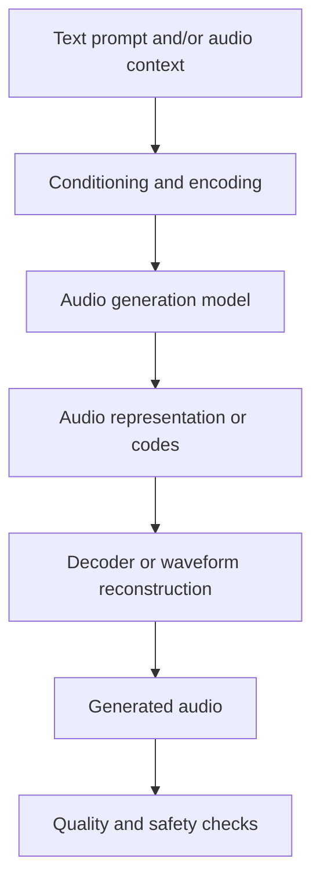

# 09. Audio Generation Fundamentals

## Learning Objectives

By the end of this chapter, you should be able to:

- Identify common audio-generation tasks, including speech, music, sound effects, and audio-to-audio transformation.
- Explain how text or audio can condition a generation process.
- Distinguish intelligibility, acoustic quality, prompt adherence, and output diversity.
- Describe the trade-offs among duration, continuity, compute, and latency.
- Apply basic consent, voice-use, attribution, and provenance principles.
- Design an audio-generation request and a task-specific evaluation rubric.

> **Depth boundary:** This chapter introduces the fundamentals and evaluation of audio generation. Detailed generation workflows, expressive speech, and real-time media techniques belong to Level 11.

 

## 1. What Is Audio Generation?

Audio generation creates a new audio signal from a prompt, conditioning input, or other model context. The output may contain spoken language, music, environmental sounds, or a transformation of supplied audio.

| Task | Typical conditioning | Output |
|---|---|---|
| Speech generation | Text, and sometimes voice or style settings | Spoken words |
| Music generation | Text description, musical constraints, or audio context | Music |
| Sound-effect generation | Text describing an event or sound | A sound effect |
| Audio-to-audio transformation | An existing audio signal and optional instructions | Modified or transformed audio |
| Audio continuation | An audio prefix or context | A continuation of the signal or composition |

These are broad task categories, not a guarantee that one model supports all of them. Confirm the selected model's documented capabilities, output formats, and restrictions.

 

## 2. Conditioning and High-Level Representations

### Text conditioning

A text prompt describes the desired content or constraints. For example:

> Generate a short, gentle ambient soundscape with soft rain, distant thunder, and no speech.

The prompt communicates a target, but it does not guarantee every requested detail will appear. Clear prompts separate the core task from optional qualities and constraints.

For speech generation, the text may specify the words to speak. For music or sound effects, the text often describes a scene, mood, instrumentation, rhythm, or acoustic event.

 

### Audio conditioning

Some systems accept existing audio as context. Depending on the model, it may use that context to continue a clip, transform its characteristics, or produce related audio. Audio conditioning may also be paired with text instructions.

The supported conditioning pattern is model-specific. Do not assume a model can clone a voice, preserve a melody, separate sources, or edit arbitrary audio unless the interface explicitly supports that task and the use is permitted.

 

### High-level representation

An audio-generation system may use internal representations such as learned features, latent variables, or discrete audio tokens. These representations allow a model to model temporal structure without requiring the developer to manipulate every waveform sample directly.

A simplified conceptual pipeline is:

This diagram is conceptual. Some systems combine or omit stages, stream output progressively, or expose only a simple API request and returned audio file.

 

## 3. Writing a Useful Audio-Generation Request

A good request makes the task and success criteria explicit. Include only details that help the model produce the intended result.

A practical prompt structure:

1. **Task:** What should be generated?
2. **Content:** What should the audio contain?
3. **Style or character:** What broad acoustic qualities are desired?
4. **Duration:** How long should it be, if the interface supports duration control?
5. **Constraints:** What must be excluded or preserved?
6. **Output requirements:** Which format or other settings are required by the application?

 

### Example A — Sound effect

> Generate a brief sound effect of light rain falling on a window, with a few distant low rumbles of thunder. No voices, music, or sudden loud impacts. Keep the overall level comfortable and the soundscape consistent.

 

### Example B — Spoken narration

> Read the supplied two-sentence announcement clearly at a moderate pace. Use neutral delivery and short pauses between sentences. Preserve the wording exactly.

The second example expresses a desired behavior, but exact wording preservation and pacing controls must be tested and may not be guaranteed by every TTS interface.

 

### Example C — Music concept

> Generate a calm instrumental background for a short study video, using a soft piano motif and restrained ambient textures. Avoid vocals and abrupt transitions.

If duration, instrumentation, or transitions cannot be controlled directly, treat them as prompt preferences and evaluate the actual result.

 

## 4. Evaluating Generated Audio

Do not use a single vague score such as “sounds good.” Choose criteria that match the task.

### 4.1 Intelligibility

Intelligibility concerns whether spoken words can be understood. It matters for narration, announcements, accessibility, and voice interfaces.

Questions:
- Can listeners understand the intended words?
- Are important names, numbers, and technical terms clear?
- Are words omitted, repeated, or pronounced ambiguously?

Intelligibility is not the same as factual correctness. A clearly spoken sentence may still contain false information.

 

### 4.2 Acoustic quality

Acoustic quality concerns the sound signal and listening experience.

Potential issues include:
- Clipping, distortion, or unwanted artifacts.
- Abrupt cuts, clicks, or dropouts.
- Unstable loudness or unpleasant noise.
- Unnatural timbre or inconsistent sound.
- Discontinuities between generated segments.

The relevant criteria depend on the task. A sound effect may intentionally contain rough or distorted sound, so quality must be judged against the intended use rather than a universal preference for smoothness.

 

### 4.3 Prompt adherence

Prompt adherence measures whether the output follows the requested content and constraints.

Examples:
- A request for instrumental music should not unexpectedly contain vocals.
- A request for rain should not produce a dominant unrelated sound.
- A narration task should preserve required wording if exact text is part of the requirement.
- A request to avoid sudden loud sounds should be checked for unexpected peaks.

Prompt adherence is not identical to general audio quality: a beautiful clip may still fail the request.

 

### 4.4 Diversity

Diversity describes meaningful variation across multiple generations for the same or similar prompt. It is useful when exploring creative alternatives.

Variation is not always desirable. A production asset may need consistency, while brainstorming may benefit from several distinct outputs. Evaluate diversity alongside the requirement for content and constraint adherence.

 

### 4.5 Task-specific evaluation matrix

| Task | Primary criteria | Additional checks |
|---|---|---|
| Spoken narration | Intelligibility, pronunciation, wording adherence | Pacing, pauses, loudness consistency |
| Music | Prompt adherence, musical coherence, acoustic quality | Transitions, unwanted vocals, variation |
| Sound effects | Correct event or texture, timing, acoustic quality | Unwanted events, abrupt peaks, duration |
| Audio transformation | Preservation of required content, transformation adherence | Artifacts, continuity, source changes |
| Creative alternatives | Prompt adherence and useful diversity | Repetition, constraint violations, usability |

Human listening is important for subjective qualities. Automated measures can help with objective properties, but no single metric reliably captures every dimension of audio quality.

 

## 5. Duration, Continuity, Compute, and Latency

Audio generation has operational trade-offs.

### Duration

Longer outputs generally require more generated content and may increase processing time, resource use, and failure exposure. Some interfaces impose duration or output-size limits. If a task requires long audio, determine whether the model supports it directly or whether segmentation is needed.

 

### Continuity

Generating one long clip may produce a different result from generating several short clips. Independently generated segments can differ in background, timbre, loudness, rhythm, or speaker characteristics. Joining them can introduce audible boundaries.

If segmentation is required:
- Define segment boundaries carefully.
- Preserve the intended order and timing.
- Check transitions and loudness between segments.
- Avoid assuming separately generated clips will match seamlessly.

Detailed continuity engineering and real-time media techniques are outside this chapter's scope and are covered at the stated Level 11 depth boundary.

 

### Compute and latency

Compute requirements depend on model architecture, output duration, resolution or representation, serving hardware, and decoding strategy. Latency depends on request setup, input processing, generation speed, network time, and whether output is returned progressively.

For an interactive use case, perceived time to first audio may matter as much as total completion time. For offline asset creation, a longer wait may be acceptable if quality is better.

 

### Choosing a practical strategy

| Requirement | Possible priority |
|---|---|
| Interactive response | Low time to first audio and predictable latency |
| Short notification | Correct wording, intelligibility, and quick generation |
| Background music | Prompt adherence, continuity, and acceptable acoustic quality |
| Many creative variants | Diversity and controlled comparison |
| Long narration | Wording consistency, segmentation behavior, and end-to-end review |

Do not assume that a shorter duration always yields better quality or that a larger model is always the most appropriate choice. Evaluate the actual task and deployment constraints.

 

## 6. Consent, Permitted Voice Use, Attribution, and Provenance

Generated audio can imitate or imply real people, reproduce protected material, or be mistaken for authentic recordings. Use audio-generation systems within the provider's terms, applicable law, and the permissions associated with the source material.

### Consent and voice use

- Obtain appropriate permission before using a person's voice or voice likeness where required.
- Do not imply that a real person said or endorsed something they did not say.
- Avoid deceptive impersonation or uses that could cause harm.
- Apply stricter review to sensitive, high-impact, or public-facing outputs.
- Confirm that the chosen model permits the intended voice-related use; do not infer permission from technical capability.

 

### Attribution and rights

- Check the model provider's terms for ownership, attribution, and commercial-use conditions.
- Confirm that prompts, supplied audio, samples, lyrics, and other source material may be used for the intended purpose.
- Do not assume that generated audio is automatically free of copyright, licensing, or other rights concerns.
- Keep records of relevant permissions and terms when the application requires an audit trail.

 

### Provenance and disclosure

**Provenance** is information about where an asset came from and how it was produced. Depending on the use case, maintain records such as:
- Model/provider and model version, when available.
- Generation date and relevant configuration.
- Prompt or prompt version, subject to privacy and retention requirements.
- Source assets and permissions.
- Human edits or post-processing.
- Required disclosure, labels, or metadata.

A provenance record does not itself prove that the content is lawful, authentic, or accurate. It improves traceability and supports review.

 

## 7. Practical Exercise: Design a Request and Evaluation Rubric

Choose one task: spoken narration, music, sound effects, or audio-to-audio transformation.

### Step 1 — Define the use case

Write down the audience, where the audio will be used, and what failure would matter most.

 

### Step 2 — Draft the generation request

Specify the content, desired qualities, duration if supported, and constraints. Avoid contradictory instructions.

 

### Step 3 — Verify the interface

Check that the selected model supports the task and review its accepted conditioning inputs, output format, duration limits, and usage restrictions. Record unsupported controls rather than assuming they exist.

 

### Step 4 — Create a rubric

Use a 1–5 scale for each criterion, where 1 means unacceptable and 5 means excellent. Define what a passing result means for your use case.

| Criterion | What to check | Score (1–5) |
|---|---|---:|
| Task/content correctness | Does the audio contain the intended content or event? | |
| Prompt adherence | Does it follow required and prohibited-content constraints? | |
| Acoustic quality | Are artifacts, clipping, dropouts, or unwanted peaks acceptable? | |
| Intelligibility (if speech) | Can listeners understand the spoken content? | |
| Continuity | Are timing and transitions acceptable for the task? | |
| Diversity (if needed) | Do multiple outputs offer useful alternatives without breaking constraints? | |
| Operational fit | Is duration and latency acceptable? | |

Do not score irrelevant criteria. For example, intelligibility is not applicable to a purely non-speech sound effect.

 

### Step 5 — Test and document

Generate one or more outputs using the documented interface. Listen to the complete result, score it against the rubric, and note the largest failure. If comparing prompts, change one major variable at a time.

 

### Practice report template

| Field | Notes |
|---|---|
| Intended use and audience | |
| Task category | |
| Model and interface | |
| Generation request | |
| Supported controls and limits | |
| Evaluation criteria | |
| Result summary | |
| Main quality or adherence failure | |
| Consent, rights, and provenance checks | |
| Next experiment | |

 

## 8. Revision Questions and Answers

**1. What kinds of tasks can audio generation support?**  
Depending on the model, it can generate speech, music, sound effects, or transform and continue existing audio.

**2. What does conditioning mean?**  
Conditioning is the text, audio, or other supported context used to guide generation.

**3. How is intelligibility different from acoustic quality?**  
Intelligibility is whether speech can be understood. Acoustic quality concerns the sound itself, including artifacts, distortion, loudness, and continuity.

**4. How is prompt adherence different from quality?**  
Prompt adherence measures whether the output follows the request. A technically polished result can still contain the wrong content or violate a constraint.

**5. Why can longer audio increase operational difficulty?**  
Longer output can require more generation work and time, encounter duration limits, and make continuity or segment failures more consequential.

**6. Why might separately generated segments sound inconsistent?**  
Each segment may be generated under slightly different conditions or produce different timbre, loudness, timing, or background characteristics.

**7. Does a clear, high-quality spoken output guarantee factual correctness?**  
No. Audio quality and intelligibility concern delivery; factual correctness concerns whether the content is true.

**8. Why are consent and provenance important?**  
They help ensure voice and source material are used with appropriate permission, reduce deceptive use, and make generated assets more traceable.

 

## Chapter Checkpoint

**Distinguish speech quality from factual correctness and general audio quality.**

A strong answer should explain that speech quality includes intelligibility, pronunciation, pacing, and prosody. General acoustic quality concerns signal properties such as distortion, artifacts, loudness consistency, and continuity. Factual correctness concerns whether the spoken claims are true, which cannot be established merely because the speech sounds natural or clear. Prompt adherence is a separate dimension: the output must also match the requested content and constraints.

 

## Completion Checklist

- [ ] I can identify speech, music, sound-effect, and audio-to-audio generation tasks.
- [ ] I understand text and audio conditioning at a conceptual level.
- [ ] I can distinguish intelligibility, acoustic quality, prompt adherence, and diversity.
- [ ] I can describe duration, continuity, compute, and latency trade-offs.
- [ ] I can design a task-specific generation request and evaluation rubric.
- [ ] I understand consent, permitted voice use, attribution, and provenance.
- [ ] I have kept detailed generation workflows and real-time media techniques within the Level 11 depth boundary.

 

## References

Capabilities, limits, and usage terms vary by provider and model. Check the current documentation and applicable terms for the exact interface and intended use.

- [OpenAI Audio guide](https://platform.openai.com/docs/guides/audio)
- [OpenAI API reference](https://platform.openai.com/docs/api-reference)
- [Hugging Face Audio course](https://huggingface.co/learn/audio-course/)
