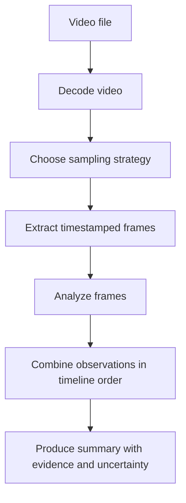

# 10. Video Understanding and Video Generation Fundamentals

## Learning Objectives

By the end of this chapter, you should be able to:

- Explain why temporal video understanding differs from analyzing isolated images.
- Describe frames, timestamps, sampling, motion, and event order.
- Identify what sparse frame sampling can miss or make ambiguous.
- Explain text-to-video and image-to-video generation at a conceptual level.
- Evaluate temporal consistency, motion coherence, and audio-video synchronization.
- Distinguish native video model support from application-controlled frame extraction.

 

## 1. Video Is More Than a Collection of Images

A video contains visual information that changes over time. A still image can show the state of a scene at one instant; a video can provide evidence about how the scene changed, how objects moved, and in what order events occurred.

| Capability | Still-image analysis | Temporal video understanding |
|---|---|---|
| Describe visible objects | Often possible | Often possible |
| Describe a single frame | Directly supported by the image | Possible after selecting a frame |
| Infer motion | Usually limited without additional context | Can use changes across frames |
| Establish event order | Usually cannot establish sequence alone | May establish sequence if the relevant moments are observed |
| Detect brief events | Only if visible in the supplied image | Depends on frame rate, sampling strategy, and model capability |
| Analyze audio-video relationships | Not from an image alone | Requires access to and support for the relevant audio and video streams |

A video model can still miss events or infer too much. A sequence of frames is evidence sampled from the clip, not a guarantee that every relevant moment has been observed.

 

## 2. Frames, Timestamps, and Sampling

### Frames

A frame is one image in a video sequence. A clip may contain many frames per second, but a model or application may process only a subset.

 

### Timestamps

A timestamp associates a frame or event with a position in the clip, for example `00:00:12.400` for 12.4 seconds. Timestamps make summaries auditable and help a reader find the supporting moment.

Record whether timestamps refer to the original clip timeline or to a transformed/trimmed version. If a clip is trimmed, resampled, or concatenated, maintain the mapping to the original timeline.

 

### Frame sampling

**Frame sampling** selects frames from a video for analysis. Common conceptual strategies include:

- **Uniform sampling:** Select frames at regular time intervals.
- **Fixed-rate sampling:** Select a target number of frames per second.
- **Event-driven sampling:** Select frames around detected scene changes or candidate events.
- **Adaptive sampling:** Increase sampling density in segments likely to contain important activity.

These strategies have different computational costs and failure modes. Event-driven and adaptive sampling also depend on the quality of the detector or heuristic that selects frames.

If a clip is sampled once every two seconds, an event lasting a fraction of a second may fall entirely between selected frames. A sampled frame before the event and another after it may show different states without revealing what happened in between.

 

## 3. Motion and Event Order

Temporal reasoning uses changes across time, not only the objects visible in individual frames.

For example, a summary may need to distinguish:
1. A person approaches a door.
2. The person opens the door.
3. The person enters the room.

A sparse set of images might show the person outside in one frame and inside in another. It may not show whether the person opened the door, whether someone else opened it, or whether the camera cut to a different moment.

 

### Evidence versus inference

When summarizing a clip, separate:
- **Directly observed:** What is visible or audible at a timestamp.
- **Temporal interpretation:** The likely order or relationship between observed moments.
- **Uncertain inference:** A plausible explanation not established by the sampled evidence.

Avoid describing an inferred cause as a directly observed fact. If the clip does not show the transition, say that the sequence is unclear.

 

## 4. What Sparse Sampling Can Miss

Sparse sampling reduces processing cost but can lose temporal detail.

| Sampling limitation | Possible consequence |
|---|---|
| Brief event occurs between sampled frames | Event is missed entirely |
| Fast movement between two frames | Direction, path, or action may be ambiguous |
| Important transition is not sampled | Event order or cause may be unclear |
| Occlusion occurs between frames | Object/person movement may be misinterpreted |
| Camera cut occurs between samples | Two scenes may be incorrectly treated as one continuous event |
| Small visual detail is lost after resizing | Text, gestures, or small objects may be missed |
| Audio is not supplied or analyzed | Spoken context and sound cues are unavailable |
| Timestamps are discarded | Claims become difficult to verify against the source |

Increasing sampling density can improve temporal coverage, but it does not guarantee correctness. More frames increase processing requirements and may still miss the decisive instant. The right strategy depends on the clip, task, and required precision.

 

## 5. Native Video Support vs. Application-Controlled Frame Extraction

These are two distinct integration patterns.

### Native video support

The application supplies video through an interface that explicitly accepts video input. The model or service may process temporal information according to its own documented design.

Before relying on this pattern, verify:
- Supported video container and codec, if specified.
- Whether audio is included and analyzed.
- Duration, size, frame-rate, or resolution limits.
- How timestamps and temporal order are represented.
- Whether the endpoint returns timestamped evidence or only a general response.

Do not assume that every multimodal model accepts a video file directly.

 

### Application-controlled frame extraction

The application decodes the video and selects frames itself, then submits those images to an image-capable model or another analysis component.

This approach gives the application explicit control over sampling and timestamps, but the model may see only isolated images rather than native temporal input. If audio matters, it must be processed through a supported audio path and aligned with the video timeline.

 

### Comparison

| Consideration | Native video interface | Application-controlled frames |
|---|---|---|
| Temporal processing | Depends on the model's supported video pathway | The application controls which frames are supplied |
| Sampling control | May be internal or interface-dependent | Explicitly configurable by the application |
| Timestamp handling | Depends on interface and output contract | Can be recorded during extraction |
| Audio access | Must be verified | Requires a separate supported audio path if needed |
| Implementation effort | May be simpler when directly supported | Requires decoding, sampling, and evidence assembly |
| Main risk | Assuming undocumented temporal/audio capabilities | Losing events between sampled frames |

A frame-extraction pipeline is not automatically equivalent to native video understanding.

 

## 6. Video Generation Fundamentals

Video generation creates a sequence of frames that should form a coherent moving scene. The generated result must satisfy both per-frame visual requirements and temporal requirements across frames.

### Text-to-video

Text-to-video uses a text prompt to guide the generation of a video. The prompt may describe:
- Main subjects and their actions.
- Environment and visual style.
- Camera viewpoint or movement, if supported.
- Desired scene progression.
- Duration or other constraints, if the interface supports them.

Prompt adherence should be evaluated across the whole clip, not only from a visually appealing frame.

 

### Image-to-video

Image-to-video conditions video generation on an input image. The image may provide an initial scene, subject appearance, composition, or style. The generated motion should preserve the relevant elements of the reference image while introducing plausible change.

The degree of control varies by model. Do not assume that an input image will be preserved exactly or that a particular camera motion can be enforced unless documented and tested.

 

## 7. Evaluating Generated Video

### Temporal consistency

Temporal consistency concerns whether visual properties remain stable when they should. Examples of failures include a subject's clothing changing unexpectedly, a background object appearing and disappearing, or an object changing shape without explanation.

 

### Motion coherence

Motion coherence concerns whether movement is plausible and consistent with the prompt and scene. Watch for:
- Sudden jumps in object position.
- Limbs or objects deforming unexpectedly.
- Movement that reverses without a cause.
- Inconsistent speed or direction.
- Actions that do not complete as described.

A frame can look convincing in isolation while the motion across frames looks implausible.

 

### Audio-video synchronization

For clips with sound, assess whether speech, impacts, music, or other audio events align with the visible action. A visible impact occurring well before or after its corresponding sound is a synchronization problem.

Check whether the generation interface actually supports audio output and synchronization. A silent video-generation endpoint cannot be assumed to produce synchronized sound.

 

### Task-specific quality matrix

| Dimension | Evaluation question |
|---|---|
| Prompt adherence | Does the clip show the requested subjects, actions, and setting? |
| Temporal consistency | Do subjects and scene details remain stable across time? |
| Motion coherence | Is the movement plausible and continuous? |
| Event order | Do actions occur in the requested sequence? |
| Visual quality | Are frames clear enough for the intended use? |
| Audio-video sync | If audio exists, does it align with visible events? |
| Operational fit | Are duration, resolution, format, and latency acceptable? |

 

## 8. Practical Exercise: Plan a Timestamped Video Summary

Use a short video clip that you are permitted to analyze. Choose a clip with a clear beginning, middle, and end. If it contains people, avoid making identity claims from appearance alone.

### Step 1 — Define the question

Write one clear question, such as: “What actions occur, and in what order?” Keep the task narrow enough to evaluate.

 

### Step 2 — Plan sampling

Choose a sampling interval appropriate to the clip. For a first pass, uniform sampling can help establish the scene, but add closer inspection around likely transitions or brief actions if permitted and supported by the tools.

Record the chosen interval and why it is adequate for the task. Do not describe a sampled frame as proof that no event occurred between samples.

 

### Step 3 — Build an evidence timeline

| Timestamp | Directly observed evidence | Interpretation | Confidence / uncertainty |
|---|---|---|---|
| 00:00:00 | | | |
| 00:00:05 | | | |
| 00:00:10 | | | |

Use actual timestamps from the selected clip. The example rows are placeholders, not claims about a real video.

 

### Step 4 — Identify sampling blind spots

List at least two events or details that your chosen sampling strategy might miss. Consider brief gestures, fast motion, scene cuts, occlusions, small text, and audio-only cues.

 

### Step 5 — Write a timestamped summary

For each major claim, include the supporting timestamp or interval. Mark ambiguous event order and distinguish observed evidence from interpretation.

 

### Practice report template

| Field | Notes |
|---|---|
| Clip description and permission status | |
| Intended question | |
| Duration and available audio | |
| Sampling strategy and interval | |
| Key timestamps | |
| Summary of observed events | |
| Potential missed events | |
| Ambiguities or unsupported inferences | |
| Native video or extracted-frame pathway | |
| Main limitation and next step | |

 

## 9. Revision Questions and Answers

**1. Why is video understanding different from analyzing a still image?**  
Video can provide temporal evidence about motion, transitions, and event order. A still image represents only one moment.

**2. What is frame sampling?**  
It is the selection of frames from a video for analysis. Sampling reduces the amount of data processed but may omit important moments.

**3. Why can sparse sampling make event order ambiguous?**  
The frames before and after an event may be observed while the transition itself is missed, leaving several possible explanations.

**4. Does seeing an object in one frame and in a different position later prove how it moved?**  
Not necessarily. The path and cause may be unobserved, especially when sampling is sparse or the camera cuts.

**5. What is the difference between native video support and frame extraction?**  
Native support uses an interface documented to accept video. Frame extraction is application-controlled preprocessing that sends selected images for analysis.

**6. What are temporal consistency and motion coherence in generated video?**  
Temporal consistency concerns stable visual properties across frames; motion coherence concerns plausible movement and transitions over time.

**7. Why evaluate audio-video synchronization?**  
When sound and picture are both present, their timing should match the relevant speech or event. Misalignment can make a clip confusing or unusable.

**8. Can a set of still images always establish an event sequence?**  
No. Still images may show states at sampled moments without showing the transitions, brief events, or causal relationships between them.

 

## Chapter Checkpoint

**Explain why a set of still images may be insufficient to establish an event sequence.**

A strong answer should explain that still images provide observations at selected moments, while an event sequence depends on transitions over time. Sparse sampling can omit brief actions, fast movement, occlusions, and scene cuts. The same pair of frames may be consistent with multiple possible sequences. A reliable summary should preserve timestamps, distinguish direct observations from inferences, and state when the available frames do not establish what happened between them.

 

## Completion Checklist

- [ ] I can explain the difference between still-image analysis and temporal video understanding.
- [ ] I understand frames, timestamps, sampling, motion, and event order.
- [ ] I can identify events that sparse sampling might miss.
- [ ] I can distinguish native video support from application-controlled frame extraction.
- [ ] I can explain text-to-video and image-to-video conceptually.
- [ ] I can evaluate temporal consistency, motion coherence, and audio-video synchronization.
- [ ] I can create a timestamped summary that separates observations from inferences.

 

## References

Video support, accepted formats, duration limits, and audio-video features vary by provider and model. Check current documentation for the exact interface before implementation.

- [OpenAI API documentation](https://platform.openai.com/docs/api-reference)
- [OpenAI platform documentation](https://platform.openai.com/docs/overview)
- [Hugging Face documentation](https://huggingface.co/docs)
- [FFmpeg documentation](https://ffmpeg.org/documentation.html)
