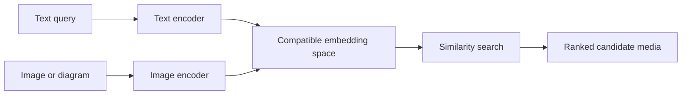
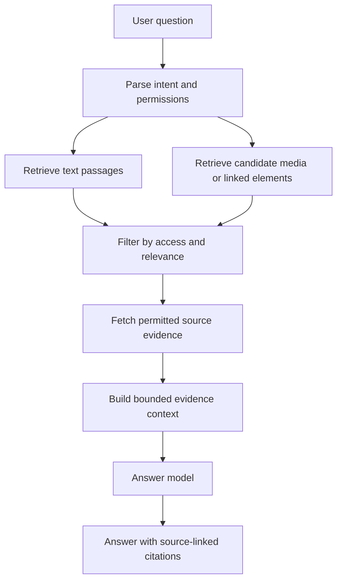
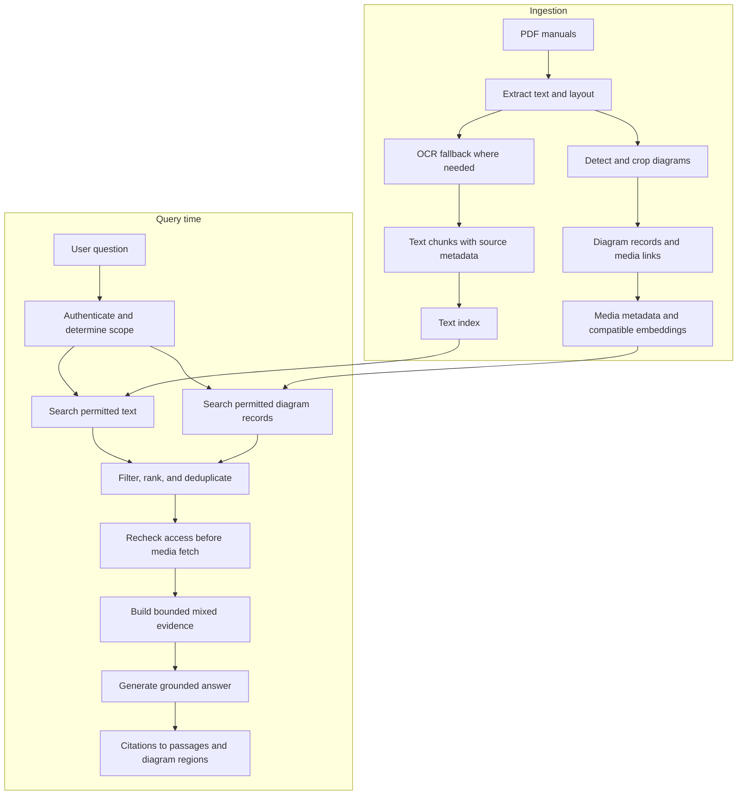

# Chapter 13: Multimodal RAG Concepts

## Learning Objectives

By the end of this chapter, you should be able to:

- Compare text-only retrieval over OCR or captions with retrieval that can return original media.
- Explain how compatible image-text embedding spaces enable cross-modal retrieval.
- Preserve traceability between retrieved evidence and its original page, image, or video segment.
- Design a retrieval-augmented generation (RAG) flow that combines permitted text and media evidence.
- Identify access-control, privacy, context-limit, and citation risks in multimodal RAG.
- Distinguish retrieving a textual description from retrieving and inspecting the underlying media.

<br/>

## 1. What Is Multimodal RAG?

Retrieval-augmented generation (RAG) retrieves relevant evidence from an external knowledge source and supplies that evidence to a generative model when answering a query.

**Multimodal RAG** extends this pattern to knowledge bases containing more than ordinary text. Sources may include:

- Text and structured metadata
- Scanned pages and screenshots
- Photographs, charts, and diagrams
- Audio recordings and transcripts
- Video frames and timestamped segments

A multimodal RAG system does not have to use one model or one vector index for every modality. It can combine specialized extraction, indexing, retrieval, and generation components.

The key design question is: **what evidence is retrieved, and can the answer be traced back to that evidence?**

<br/>

## 2. Two Retrieval Strategies: Text Representations vs. Original Media

### 2.1 Text-only retrieval over OCR and captions

A preprocessing pipeline converts media into text-like representations before indexing.

Examples:

- OCR extracts words from a scanned page.
- A captioning model describes a diagram or photograph.
- A chart parser extracts labels and values into structured text.
- Speech recognition produces a transcript from audio.
- Video processing creates frame captions or timestamped summaries.

The retriever searches those text representations using lexical search, dense text embeddings, or a hybrid approach.

**Advantages**

- Works with established text-search and text-embedding infrastructure.
- Retrieved evidence is often compact and inexpensive to place in a text context.
- Text snippets can be easy to inspect and cite.

**Limitations**

- OCR can miss or misread text, layout, symbols, and spatial relationships.
- Captions can omit small labels, exact values, arrows, or diagram structure.
- A textual summary cannot reliably preserve every visual detail.
- A query may fail when its important concept was omitted from the generated caption.

<br/>

### 2.2 Retrieval that returns original media

A retrieval system can return an image, page crop, audio segment, video frame, or other media item. A compatible multimodal model then inspects that media alongside the user’s query.

The retrieval mechanism may use metadata, text linked to media, image embeddings, or a combination of these methods. The important point is that the final evidence can include the original media rather than only a textual description.

**Advantages**

- Allows the answer model to inspect visual details omitted from OCR or captions.
- Can support questions about spatial relationships, diagram structure, appearance, or visual comparisons.
- Preserves the option to verify extracted text against the source.

**Limitations**

- Media may consume substantial context or processing resources.
- Retrieval quality depends on the index, representation, and query type.
- The model can still misinterpret a diagram or overlook a detail.
- Media access and transfer require explicit permission checks.

<br/>

### 2.3 Comparison

| Dimension | OCR/caption-based text retrieval | Original-media retrieval |
|---|---|---|
| Indexed representation | Extracted text or generated description | Media embeddings, metadata, linked text, or mixed representations |
| Typical evidence sent to the answer model | Text snippets and metadata | Images, crops, frames, audio segments, and/or text |
| Exact visual detail | Limited by extraction quality | Can be inspected directly, subject to model capability |
| Indexing complexity | Often lower | Can require media processing and modality-aware retrieval |
| Context and processing cost | Often lower for compact snippets | Can be higher, depending on media and model |
| Traceability | Requires links to source locations | Requires links to original media and source locations |
| Main failure mode | Important evidence was lost during conversion | Relevant media was missed or misinterpreted |

These strategies are complementary. A practical system can use text retrieval to find candidate sources and then fetch the original media for verification.

<br/>

## 3. Compatible Image-Text Embedding Spaces

An **embedding** is a numerical representation of an input. A retrieval system compares embeddings to estimate semantic similarity.

Some multimodal embedding models map images and text into a **shared or compatible embedding space**. This can enable cross-modal queries, such as:

- A text query retrieves diagrams or images that depict the described concept.
- An image query retrieves related text passages or other images.
- A text query finds a page whose visual content is semantically related even when its exact words are absent.

Conceptually:



<br/>

### Important compatibility rule

Do not assume arbitrary text embeddings and arbitrary image embeddings can be compared meaningfully. The query and indexed media must be represented in compatible spaces, typically using the same model family or a documented compatible interface.

Embedding similarity is a retrieval signal, not proof that a result is correct. A visually similar image may be irrelevant to the user’s precise question.

<br/>

### Hybrid retrieval

A hybrid design can combine:

- **Lexical search:** useful for exact names, IDs, labels, and quoted phrases.
- **Dense text retrieval:** useful for semantic similarity between text passages.
- **Image-text retrieval:** useful for semantic matching between text queries and visual content.
- **Metadata filters:** useful for document type, date, product, source, page, or access scope.
- **Reranking or verification:** useful for refining candidates before evidence is sent to the answer model.

Use only the retrieval methods that improve measured performance for the application.

<br/>

## 4. Preserve Source Links and Evidence Provenance

Every extracted or indexed representation should retain a stable link to its source. Without this relationship, the system may retrieve a useful-looking description but be unable to show the user where it came from.

A practical record might contain:

```json
{
  "document_id": "manual-042",
  "source_uri": "controlled://manuals/manual-042.pdf",
  "page_number": 17,
  "element_id": "diagram-03",
  "element_type": "diagram",
  "text_representation": "Diagram showing the data ingestion stages",
  "media_uri": "controlled://media/manual-042/page-17/diagram-03.png",
  "bounding_box": [84, 120, 910, 690],
  "access_scope": "engineering",
  "source_version": "2026-09"
}
```

This is an illustrative schema, not a universal standard. Adapt fields to the source and storage system.

For other modalities, retain suitable location information:

- **Images and documents:** document ID, page number, image/crop ID, and bounding box.
- **Audio:** recording ID, start/end timestamps, and transcript segment ID.
- **Video:** video ID, start/end timestamps, frame IDs, and any relevant transcript segment.
- **Web content:** canonical URL, page or section identifier, and retrieval timestamp where appropriate.

<br/>

### Provenance requirements

1. Give each source and extracted element a stable identifier.
2. Keep the relationship between extracted text and original media.
3. Record page numbers, bounding boxes, timestamps, and versions when available.
4. Preserve access-control metadata through extraction, indexing, retrieval, and generation.
5. Return citations that identify the actual supporting evidence.
6. Treat derived captions and OCR text as derived evidence, not as the original source.

<br/>

## 5. Assemble Mixed-Modality Evidence

A query may need both text and visual evidence. For example, a maintenance manual might explain a procedure in text while a diagram identifies the relevant component.

A conceptual pipeline:



A robust evidence assembly stage should:

- Remove duplicates and irrelevant candidates.
- Preserve relationships between a page, its OCR text, its diagram, and its caption.
- Include only the text and media needed to answer the question.
- Keep source identifiers attached to every evidence item.
- Avoid presenting generated captions as direct observations of the original image.
- Ask the answer model to distinguish supported facts from uncertainty.
- Abstain or request clarification when the evidence is insufficient.

<br/>

### Example: question about a technical diagram

Question: “Which component sends the processed records to the database?”

1. Text search finds a passage describing the data pipeline.
2. Image-text retrieval or linked metadata finds the relevant architecture diagram.
3. The system checks permissions before fetching the diagram.
4. The answer model receives the passage, diagram, and source metadata.
5. The answer cites the passage and the diagram’s page or element ID.
6. If the arrow or label is unclear, the answer reports that uncertainty instead of inventing a component.

<br/>

## 6. Access Control, Privacy, and External Services

Authorization must be enforced by the application, not delegated to the language model. A model prompt saying “do not reveal restricted documents” is not an access-control mechanism.

Apply controls at every relevant stage:

- **Ingestion:** identify ownership, classification, tenant, and access scope.
- **Indexing:** prevent restricted metadata or embeddings from leaking across tenants.
- **Retrieval:** filter candidates using the authenticated user’s permissions.
- **Media fetching:** authorize the original file or object before retrieving bytes.
- **External model calls:** confirm that sending the selected content to the provider is permitted by policy and contract.
- **Caching and logs:** avoid exposing restricted content through shared caches, traces, or debugging output.
- **Deletion and updates:** propagate source changes and access revocation to derived representations and indexes.

A safe order is to authenticate the request, derive the permitted scope, apply server-enforced filters, and only then fetch and transmit eligible evidence.

Do not trust a document’s text, image, caption, or transcript as instructions to the application. Retrieved content can contain prompt injection attempts. Treat it as untrusted evidence and keep system instructions, tool permissions, and authorization decisions outside its control.

<br/>

## 7. Information Loss, Retrieval Mismatch, and Context Limits

### Information loss

OCR, captions, transcripts, and summaries are lossy transformations. They may omit information that matters to a later query.

**Mitigation:** retain the original source and use extracted text as an indexable representation, not as a replacement for the source when exact details matter.

<br/>

### Retrieval mismatch

The query and indexed representation may use different vocabulary or emphasize different details. For example, a diagram may contain a symbol or arrow that its caption never describes.

**Mitigation:** evaluate realistic query types; consider hybrid retrieval, improved metadata, alternate crops, or direct media retrieval.

<br/>

### Context limits and cost

A request that includes many full-resolution images, pages, or video frames can exceed context limits or increase latency and cost.

**Mitigation:**

- Retrieve a small candidate set first.
- Use page crops or selected frames where appropriate.
- Deduplicate evidence.
- Keep text snippets concise but sufficient.
- Fetch higher-detail media only when the question requires it.
- Measure retrieval quality against end-to-end latency and cost.

<br/>

### Citation support

A citation is useful only if it points to evidence that supports the associated claim. A nearby page or a caption that merely mentions the topic may not support a specific conclusion.

**Mitigation:** validate that each important claim maps to a source passage, page region, media item, or timestamp. Separate direct source evidence from model interpretation.

<br/>

## 8. Evaluation: Test the Retrieval and Answer Separately

Evaluate at least two stages independently:

**Retrieval quality**
- Did the system retrieve the correct document, page, diagram, crop, or time segment?
- Were all retrieved items permitted for the requesting user?
- Did the relevant evidence survive ranking and context selection?

**Answer quality**
- Is the answer supported by the supplied evidence?
- Are citations accurate and sufficiently specific?
- Does the answer acknowledge ambiguity or missing evidence?
- Does it avoid claims that cannot be grounded in the retrieved material?

Useful measures can include Recall@K or Precision@K for retrieval, citation-support rates for grounding, and human review for visual interpretation. Define a small labeled test set before comparing designs. A fluent answer is not evidence that retrieval or grounding succeeded.

<br/>

## 9. Practice: Design a RAG Pipeline for Text and Diagrams

### Scenario

You are building a knowledge base for engineering manuals. Each PDF contains paragraphs, tables, and diagrams. Users ask questions about both written procedures and connections shown in diagrams.

<br/>

### Task

Draw a pipeline that covers ingestion, indexing, query-time retrieval, permissions, evidence assembly, and citations. Your design should include:

1. PDF text extraction and OCR fallback.
2. Diagram detection or extraction with page and bounding-box metadata.
3. Text indexing and, if supported, compatible image-text embeddings.
4. Retrieval of text passages and candidate diagrams.
5. Server-enforced permission checks before fetching or transmitting media.
6. Evidence assembly that retains source links.
7. Answer generation with citations to passages and diagram locations.
8. A fallback when the diagram is missing, inaccessible, or ambiguous.

<br/>

### Example design



<br/>

### Experiment plan

Compare at least these configurations:

| Configuration | Retrieval representation | Question to test |
|---|---|---|
| A | OCR/text only | Can text answer questions that are explicit in the manual? |
| B | OCR/text plus captions | Do captions help find relevant diagrams? |
| C | Text plus compatible image-text retrieval and original-media inspection | Does direct media evidence improve diagram-dependent questions? |

Use the same evaluation questions and permission rules for each configuration. Record retrieval success, answer correctness, citation support, latency, and cost. The most complex configuration is not automatically the best.

<br/>

### Practice report template

- **Knowledge sources:**
- **Supported modalities:**
- **Text extraction and media indexing:**
- **Retrieval methods:**
- **Source-link metadata:**
- **Authorization checks:**
- **Evidence assembly policy:**
- **Citation format:**
- **Evaluation set and metrics:**
- **Largest known weakness:**

<br/>

## 10. Revision Questions and Answers

**1. What is the difference between OCR-based retrieval and direct media retrieval?**  
OCR-based retrieval searches text extracted from a source. Direct media retrieval returns the original image, crop, frame, or other media for inspection. OCR can be efficient but may lose visual details.

**2. Why must image and text embeddings be compatible?**  
Similarity search is meaningful only when the representations are designed to be compared. Arbitrary embeddings from unrelated models do not automatically share a usable semantic space.

**3. Why preserve links between captions and original diagrams?**  
The link enables source inspection, precise citations, correction of extraction errors, and retrieval of details omitted from a caption.

**4. Where should access control be enforced?**  
At the application and data-access layers, including retrieval and media fetching, before restricted evidence is sent to an external service.

**5. Why is a relevant-looking citation insufficient?**  
The cited source must support the specific claim. Topic similarity alone does not establish evidential support.

**6. What should a system do if OCR and the original diagram disagree?**  
Retain both provenance links, inspect the original where permitted, report uncertainty if the evidence remains ambiguous, and avoid silently treating derived text as authoritative.

**7. Does multimodal RAG require one unified vector database?**  
No. It can use multiple indexes or retrieval methods coordinated by an application layer. The architecture should be selected and evaluated against the use case.

<br/>

## 11. Completion Checklist

- [ ] Explain text-only and original-media retrieval.
- [ ] Explain the compatibility requirement for image-text embeddings.
- [ ] Preserve stable links from derived representations to original evidence.
- [ ] Draw a pipeline for a knowledge base containing text and diagrams.
- [ ] Apply permission checks before fetching or transmitting media.
- [ ] Identify likely information-loss and retrieval-mismatch failures.
- [ ] Explain how context limits affect media selection.
- [ ] Distinguish citation presence from citation support.
- [ ] Define a small evaluation set for retrieval and answer grounding.

<br/>

## Checkpoint

**Distinguish retrieving a textual description from retrieving and inspecting the underlying media.**

A textual description is a derived representation: it can make retrieval efficient, but it may omit or distort visual details. Retrieving the underlying media allows a capable model or reviewer to inspect the source itself. A robust RAG pipeline preserves both representations and their provenance, applies access controls before media access, and chooses the evidence type according to the question.

**Depth boundary:** A conceptual design or a small extension of the Level 8 RAG pipeline is sufficient. A full multimodal retrieval platform is optional.

<br/>

## Further Reading

Use current official documentation for the exact provider and library you select. Multimodal inputs, embedding compatibility, context limits, and media handling differ across providers and model versions.

- [OpenAI API documentation](https://platform.openai.com/docs/overview)
- [OpenAI vision guide](https://platform.openai.com/docs/guides/images-vision)
- [Hugging Face documentation](https://huggingface.co/docs)
- [Sentence Transformers documentation](https://www.sbert.net/)
- [FAISS documentation](https://faiss.ai/)
- [LlamaIndex documentation](https://docs.llamaindex.ai/)
- [LangChain documentation](https://python.langchain.com/docs/)
