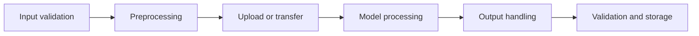

# Chapter 14: Modality-Specific Limitations, Latency, Cost, and Responsible Use

## Learning Objectives

By the end of this chapter, you should be able to:

- Categorize common visual, speech-recognition, temporal, and cross-modal failures.
- Measure preprocessing, upload, model processing, and output handling as separate stages.
- Distinguish measured usage from estimated usage and verify pricing before calculating cost.
- Identify privacy, consent, licensing, provenance, and retention risks in multimodal applications.
- Design logging and source-link practices that avoid exposing sensitive media or extracted content.
- Compare task quality with operational and data-handling costs rather than accuracy alone.

<br/>

## 1. Why Multimodal Quality Is More Than Accuracy

A multimodal application can produce a correct answer but still be unsuitable for production if it is too slow, too expensive, difficult to audit, or unsafe for the data it processes.

A practical evaluation should consider several dimensions:

| Dimension | Questions to ask |
|---|---|
| Task quality | Is the output correct, complete, and grounded in the input? |
| Reliability | Does performance remain stable across input quality, accents, lighting, layouts, and durations? |
| Latency | How long does each processing stage take? What are median and tail latencies? |
| Cost | What was actually consumed, and what is the estimated cost per request? |
| Privacy and security | Was the data authorized for processing, storage, logging, and external transmission? |
| Provenance | Can outputs be traced to the source media and the model or processing version? |
| Human oversight | Are uncertain or consequential outputs reviewed appropriately? |
| Accessibility and fairness | Does the system fail disproportionately for particular users or input conditions? |

No single score captures all these dimensions. Define acceptance criteria for the application before choosing a model or declaring it production-ready.

<br/>

## 2. Modality-Specific Failure Categories

### 2.1 Visual-detail failures

Common failures include:

- Small text, fine symbols, or low-contrast labels being overlooked.
- OCR confusing similar characters or missing text in unusual layouts.
- Charts being misread because of axes, legends, units, or scale.
- Diagrams being interpreted without respecting arrows, spatial relationships, or connections.
- Cropping, resizing, or compression removing important details.
- A model describing a plausible object or relationship that is not actually visible.

**Detection and mitigation**

- Test multiple resolutions and realistic input conditions.
- Compare OCR or generated descriptions with the original media.
- Use targeted crops when the task depends on small regions.
- Require page, region, or image references for important claims.
- Record uncertainty and route ambiguous or consequential cases to a human reviewer.

<br/>

### 2.2 Speech-recognition failures

Common failures include:

- Incorrect words caused by accents, background noise, reverberation, or overlapping speakers.
- Errors with names, technical vocabulary, numbers, dates, and code-switching.
- Missing punctuation or sentence boundaries that change interpretation.
- Incorrect speaker attribution or timestamps where those features are used.
- Silent segments, clipped recordings, unsupported formats, or incorrect channel handling.
- A transcript being treated as verified fact rather than an imperfect recognition result.

**Detection and mitigation**

- Test with representative accents, recording devices, noise levels, and vocabulary.
- Inspect sample rate, channel count, duration, clipping, and silence.
- Evaluate transcription with an appropriate metric such as word error rate (WER), while reviewing critical entities separately.
- Preserve links from transcript segments to audio timestamps.
- Confirm critical values or names before using them in consequential workflows.

<br/>

### 2.3 Temporal failures in audio and video

Temporal tasks require the system to understand order, duration, timing, and change.

Examples of failure:

- Sparse video-frame sampling misses a brief but important event.
- A summary reverses the order of two events.
- A model infers motion from a few unrelated still frames.
- Audio and video are misaligned.
- A speaker’s words are attributed to the wrong time segment.
- A short audio excerpt loses context needed to interpret the event.

**Detection and mitigation**

- Test events of different durations and frequencies.
- Preserve timestamps and source-segment identifiers.
- Compare frame-sampling strategies against the application’s timing requirements.
- Check audio/video synchronization where relevant.
- Evaluate event order and timestamp accuracy, not only summary fluency.

<br/>

### 2.4 Cross-modal failures

Cross-modal failures occur when information from different modalities is combined incorrectly.

Examples:

- The image suggests one value while OCR reports another, and the system silently chooses one.
- A transcript is paired with the wrong video segment.
- A caption is treated as though it were a direct observation of the original image.
- Text and media are retrieved from different document versions.
- A model uses context from one image to answer a question about another.
- The generated answer cites a source that mentions the topic but does not support the specific claim.

**Detection and mitigation**

- Keep stable source IDs and explicit links between related media and text.
- Preserve ordering, page numbers, bounding boxes, and timestamps.
- Test conflicting or incomplete evidence deliberately.
- Require citations at the claim level for high-value facts.
- Make uncertainty visible instead of forcing a single answer when sources conflict.

<br/>

## 3. Build a Stage-by-Stage Measurement Plan

Measure the application as a pipeline rather than treating the full request as one opaque model call.



Possible measurements for each stage:

| Stage | Useful measurements |
|---|---|
| Input validation | Rejection rate, validation duration, unsupported-format rate |
| Preprocessing | Duration, CPU/GPU time where available, temporary storage, output size |
| Upload or transfer | Bytes transferred, transfer duration, retry count, timeout rate |
| Model processing | Provider-reported latency, time to first output where available, total generation time, reported usage |
| Output handling | Decoding or parsing duration, validation failures, serialization time |
| End-to-end | Total latency, success rate, timeout rate, cost per successful request |

<br/>

### Measurement principles

1. Use a consistent request or trace ID across stages.
2. Record timestamps with a consistent clock and measure durations using a monotonic timer where available.
3. Separate queueing, preprocessing, network transfer, provider processing, and post-processing when instrumentation permits.
4. Measure a representative workload, not only a single successful request.
5. Report median and tail latency, such as p95, alongside averages.
6. Track failures, retries, timeouts, and partial outputs.
7. Avoid logging raw media or sensitive text merely to improve observability.

<br/>

### Example: stage timing in Python

This example measures local stages with `time.perf_counter()`. It does not measure provider-side processing unless that call is instrumented separately.

```python
from time import perf_counter

def timed(stage_name, fn, *args, **kwargs):
    start = perf_counter()
    result = fn(*args, **kwargs)
    elapsed_seconds = perf_counter() - start
    return result, {
        "stage": stage_name,
        "elapsed_seconds": round(elapsed_seconds, 4),
    }

# Example:
# processed_image, preprocessing_metric = timed(
#     "preprocessing", preprocess_image, input_path
# )
# print(preprocessing_metric)
```

In production, ensure that exceptions are measured too; a failed stage should not disappear from the latency report. Avoid including sensitive input values in metric labels.

<br/>

## 4. Usage Units and Cost Estimation

Different modalities may use different usage units. The exact billing rules depend on the provider, model, endpoint, input representation, and product version.

Possible units include:

- **Text:** input tokens, output tokens, cached tokens, or other provider-defined token categories.
- **Images:** image tokens, image processing units, resolution-dependent usage, or other documented units.
- **Audio:** audio tokens, input/output audio units, or duration-related units.
- **Video:** frame or image processing, audio processing, tokens, duration, or provider-specific units.
- **Other processing:** storage, transfer, preprocessing infrastructure, or additional service charges.

Do not assume every provider charges by seconds, frames, pixels, or tokens in the same way. Inspect the documentation for the exact model and endpoint being used.

<br/>

### Measured usage versus estimated usage

**Measured usage** is reported by the service or calculated from observed system telemetry, such as a response’s usage fields or actual transferred bytes.

**Estimated usage** is a forecast based on assumptions, sample requests, documented rules, or approximations. It is useful for planning, but should not be presented as an actual bill.

A sound cost report labels each number as measured or estimated and documents its assumptions.

<br/>

### Cost calculation workflow

1. Identify the exact model, endpoint, region if relevant, and pricing date.
2. Read the current official pricing page and usage documentation.
3. Capture actual usage fields from representative requests when available.
4. Estimate missing usage only with explicit assumptions.
5. Multiply each usage category by its corresponding documented rate.
6. Add relevant non-model costs, such as storage, transfer, preprocessing, retries, and human review.
7. Calculate cost per request and cost per successful task.
8. Recheck prices and model behavior before using the estimate for a purchasing or deployment decision.

Illustrative formula:

$$
\text{Estimated request cost}
=
\sum_i \left(\text{usage}_i \times \text{rate}_i\right)
+
\text{other attributable costs}
$$

Do not insert a rate until it has been verified against the current provider pricing page.

<br/>

### Example cost ledger

| Item | Value | Classification | Evidence or assumption |
|---|---:|---|---|
| Input text usage | Fill in | Measured or estimated | Response usage field or documented estimate |
| Image usage | Fill in | Measured or estimated | Provider usage report or documented approximation |
| Audio usage | Fill in | Measured or estimated | Provider usage report or duration assumption |
| Output usage | Fill in | Measured or estimated | Response usage field |
| Preprocessing compute | Fill in | Measured or estimated | Runtime and infrastructure rate |
| Storage/transfer | Fill in | Measured or estimated | Actual bytes and applicable rates |
| Human review | Fill in | Measured or estimated | Review time and internal cost assumption |
| Total | Calculate | Mixed, clearly labeled | Record pricing date and calculation method |

The table is a template, not a price quote.

<br/>

## 5. Privacy and Responsible Handling of Media

Images, audio, video, and documents can contain sensitive information even when the user’s question appears harmless.

Examples include:

- Faces, names, addresses, badges, or location clues in images.
- Voices, identity clues, and private conversations in audio.
- Bystanders, homes, workplaces, or confidential activities in video.
- Medical, financial, employment, legal, or personal information in documents.
- Extracted text that exposes information not obvious in the original media.

<br/>

### Data-handling controls

- **Purpose limitation:** collect and process only what the application needs.
- **Authorization:** verify that the user is allowed to submit and process the material.
- **Minimization:** crop, redact, downsample, or omit unnecessary content where suitable.
- **Retention:** define how long originals, derived text, embeddings, caches, and logs are retained.
- **Deletion:** ensure deletion requests reach source storage and relevant derived data according to policy.
- **External processing:** verify contractual, organizational, and jurisdictional requirements before sending data to a third-party service.
- **Access control:** apply least-privilege access to media, transcripts, indexes, and output records.
- **Secure transfer and storage:** use appropriate protections for data in transit and at rest.
- **Logging:** capture operational metadata without defaulting to raw media or full extracted content.

An embedding or caption should not automatically be assumed harmless. Derived representations may still reveal sensitive information or remain linkable to a person or source.

<br/>

## 6. Consent, Licensing, Provenance, and Human Review

### Consent and rights

Before using media, determine whether the application has an appropriate basis to process it. For voice or face-related applications, consider consent, applicable law, organizational policy, and the expectations of people depicted or recorded.

<br/>

### Licensing and permitted use

Confirm that source media, model outputs, and any datasets may be used for the intended purpose. A publicly accessible image or recording is not automatically licensed for every use.

<br/>

### Provenance

Record enough non-sensitive metadata to answer:

- Where did the media originate?
- Which version was processed?
- Which preprocessing and model versions were used?
- When was it processed?
- Which derived artifacts were created?
- Which evidence supports the resulting claim?

Provenance should help audit the system without unnecessarily duplicating sensitive content.

<br/>

### Consequential interpretations

Use stronger review requirements when outputs may influence medical, legal, employment, financial, safety, identity, or other consequential decisions. Multimodal models can miss context, misread evidence, or express unwarranted confidence.

For high-impact uses:

- Define which outputs require qualified human review.
- Show the reviewer the relevant source evidence and uncertainty.
- Do not present model interpretation as a verified fact.
- Keep a record of review outcomes and corrections, subject to retention policy.
- Provide a safe fallback when the source is unclear or the model is not suitable for the task.

<br/>

## 7. Logging and Source-Link Hygiene

Observability is important, but logs and citations can become a secondary exposure path.

Prefer recording:

- Pseudonymous request or trace IDs.
- Model and preprocessing versions.
- Stage durations, status codes, retries, and error categories.
- Usage quantities and whether they are measured or estimated.
- Redacted validation outcomes.
- Access decisions and policy outcomes without unnecessary sensitive details.

Avoid by default:

- Raw image, audio, or video payloads.
- Full OCR output, transcripts, or document text.
- Signed URLs, access tokens, credentials, or internal storage paths.
- Sensitive values in exception messages or metric labels.
- Public source links to private documents.
- Broadly shared debugging traces containing media or prompts.

Use short-lived, access-controlled links where appropriate. A citation should provide the minimum access needed for an authorized reader to verify the claim. Test links under different user permissions to ensure they do not bypass authorization.

<br/>

## 8. Practice: Failure/Risk Matrix and Measurement Plan

### Scenario

Choose one application, such as:

- Visual question answering over equipment photos.
- Speech recognition for customer-support recordings.
- Video summarization for training footage.
- Extraction from scanned forms.
- A multimodal RAG assistant for technical manuals.

Complete the matrix below for at least four realistic failure modes.

| Failure mode | Modality or stage | Impact | Detection method | Mitigation | Residual risk |
|---|---|---|---|---|---|
| Example: small diagram label missed | Vision / preprocessing | Incorrect component identification | Compare against labeled examples | Targeted crop and review | Label may remain ambiguous |
|  |  |  |  |  |  |
|  |  |  |  |  |  |
|  |  |  |  |  |  |
|  |  |  |  |  |  |

<br/>

### Measurement plan

Define how you will measure:

1. **Quality:** task-specific correctness, completeness, grounding, and uncertainty handling.
2. **Latency:** preprocessing, upload, model processing, output handling, and end-to-end duration.
3. **Usage and cost:** actual usage fields, documented rates, estimation assumptions, and cost per successful task.
4. **Reliability:** errors, timeouts, retries, partial results, and unsupported inputs.
5. **Privacy:** permitted data fields, retention period, access controls, redaction, and deletion behavior.
6. **Review:** conditions that require human verification and how review time is counted.
7. **Reporting:** median and p95 latency, failure rate, quality metrics, cost, and residual risk.

<br/>

### Report template

- **Application and intended users:**
- **Input types and sensitivity:**
- **Quality metric and acceptance threshold:**
- **Representative test cases:**
- **Stage-by-stage timing method:**
- **Measured usage fields:**
- **Cost assumptions and pricing source/date:**
- **Logging and retention policy:**
- **Human-review triggers:**
- **Largest residual risk:**
- **Decision:** deploy, revise, or reject — with evidence.

<br/>

## 9. Revision Questions and Answers

**1. Why is accuracy alone insufficient for evaluating a multimodal application?**  
It does not describe latency, cost, reliability, privacy, provenance, fairness, or the amount of human review required.

**2. Why measure pipeline stages separately?**  
It helps identify whether delays come from preprocessing, transfer, provider processing, or output handling, so optimization targets the actual bottleneck.

**3. What is the difference between measured usage and estimated usage?**  
Measured usage comes from observed telemetry or provider-reported values. Estimated usage is calculated from assumptions or approximations and must be labeled accordingly.

**4. Why should current pricing be verified before calculating cost?**  
Rates and billing units can vary by model, endpoint, modality, and time. An outdated or mismatched rate can invalidate the estimate.

**5. What makes cross-modal failures difficult to diagnose?**  
The text, media, timestamps, extracted representations, and generated answer can become misaligned. Stable provenance links and stage-specific tests help locate the failure.

**6. Why can embeddings and captions still pose privacy risks?**  
Derived data can preserve or reveal sensitive information and may remain linkable to the original person or source.

**7. What should happen when a multimodal interpretation could affect a consequential decision?**  
Apply the relevant policy and legal requirements, provide source evidence, route uncertain or high-impact cases to qualified human review, and avoid presenting model output as verified fact.

**8. What is cost per successful task?**  
It is the attributable cost divided by the number of successfully completed tasks. It can be more informative than cost per request when retries and failures are common.

<br/>

## 10. Completion Checklist

- [ ] Categorize visual, speech, temporal, and cross-modal failure modes.
- [ ] Design stage-by-stage latency and reliability measurements.
- [ ] Identify the documented usage units for the chosen model and endpoint.
- [ ] Label usage and cost figures as measured or estimated.
- [ ] Verify pricing against a current official source.
- [ ] Define privacy, access, retention, and deletion controls.
- [ ] Address consent, licensing, provenance, and human review.
- [ ] Avoid exposing raw media or sensitive extracted content in logs and source links.
- [ ] Compare quality, latency, cost, reliability, and data-handling risks.

<br/>

## Checkpoint

**Compare task quality with operational and data-handling costs rather than accuracy alone.**

A deployment decision should combine task-specific quality with latency distributions, reliability, cost per successful task, privacy and access-control requirements, provenance, and the need for human review. The best design is the one that meets the application’s quality and safety requirements within its operational constraints—not necessarily the one with the highest isolated accuracy score.

<br/>

## Further Reading

Check the current official documentation and pricing for the exact model, endpoint, and service you use. Do not treat one provider's units or policies as universal.

- [OpenAI API documentation](https://platform.openai.com/docs/overview)
- [OpenAI image and vision guide](https://platform.openai.com/docs/guides/images-vision)
- [OpenAI audio guide](https://platform.openai.com/docs/guides/audio)
- [OpenAI API pricing](https://openai.com/api/pricing/)
- [NIST AI Risk Management Framework](https://www.nist.gov/itl/ai-risk-management-framework)
- [NIST Privacy Framework](https://www.nist.gov/privacy-framework)
