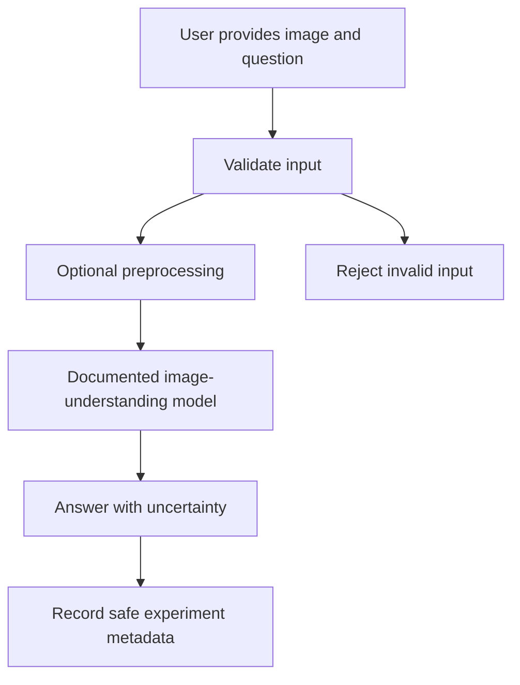

# Chapter 15: Image-Question-Answering Application

## Learning Objectives

By the end of this chapter, you should be able to:

- Build a small image-question-answering (Image QA) application using a notebook, command-line interface, or API.
- Validate image inputs before sending them to a model.
- Select a documented image-understanding model and configure its supported image-input method.
- Return answers that acknowledge uncertainty and distinguish visible evidence from inference.
- Test unsupported files, unreadable content, absent evidence, and misleading questions.
- Record preprocessing choices, model configuration, and observed results.

<br/>

## 1. What Is an Image-Question-Answering Application?

An Image QA application accepts an image and a natural-language question, then uses an image-capable model to generate an answer grounded in the image.

Example questions:

- “What objects are visible on the table?”
- “Which label appears beside the blue connector?”
- “What is the total shown in this chart?”
- “Does the image contain enough evidence to answer the question?”

The application should not assume that every question has an answer in the image. A reliable system can say that a detail is unclear, too small to read, or not visible.

<br/>

### Basic architecture



This chapter builds a small experiment, not a production-ready service. The same core logic can later be wrapped in a CLI, notebook, or FastAPI endpoint.

<br/>

## 2. Define the Input Contract

A minimal request has two required fields:

- **Image:** a supported image file or provider-supported image reference.
- **Question:** a non-empty natural-language question.

Decide and document the allowed file types, maximum file size, image dimensions, and any preprocessing behavior. Limits should be chosen for the target environment rather than assumed to be universal.

<br/>

### Validation checklist

1. Confirm that the file exists and is readable.
2. Check the file extension, but do not rely on the extension alone.
3. Decode the image using a trusted image library.
4. Enforce file-size and pixel-count limits.
5. Reject empty questions and excessively long input.
6. Handle corrupt files and unsupported formats with a clear error.
7. Avoid logging raw image bytes or sensitive image contents.

For a small local prototype, Pillow can validate that an image can be decoded:

```python
from pathlib import Path
from PIL import Image, UnidentifiedImageError

ALLOWED_FORMATS = {"JPEG", "PNG", "WEBP"}
MAX_FILE_BYTES = 10 * 1024 * 1024
MAX_PIXELS = 20_000_000  # Example project limit; tune for your environment.

def validate_image(path: str) -> dict:
    image_path = Path(path)

    if not image_path.is_file():
        raise ValueError("Image file does not exist.")

    if image_path.stat().st_size > MAX_FILE_BYTES:
        raise ValueError("Image exceeds the configured file-size limit.")

    try:
        with Image.open(image_path) as image:
            image_format = image.format
            width, height = image.size
            image.verify()
    except (UnidentifiedImageError, OSError) as exc:
        raise ValueError("File is not a supported, readable image.") from exc

    if image_format not in ALLOWED_FORMATS:
        raise ValueError(f"Unsupported image format: {image_format}")

    if width * height > MAX_PIXELS:
        raise ValueError("Image exceeds the configured pixel-count limit.")

    return {
        "format": image_format,
        "width": width,
        "height": height,
        "size_bytes": image_path.stat().st_size,
    }
```

These are example limits, not model-provider limits. Check the selected model's current documentation for supported formats, dimensions, payload methods, and request-size constraints.

<br/>

## 3. Select and Configure a Documented Model

Choose a model that explicitly supports image input through the API or interface you intend to use. Verify:

- The model identifier and availability.
- Supported image formats and image-input methods.
- Whether local files, encoded images, or URLs are accepted.
- Any image-resolution, payload-size, or context constraints.
- The response format and usage fields returned by the endpoint.
- Current pricing, privacy, and data-retention terms relevant to the application.

Do not assume that a model name, endpoint, or parameter remains unchanged indefinitely. Pin the model identifier and configuration in your experiment record, and check current official documentation before running the code.

For the example below, use the official OpenAI Python SDK with an image-capable model available to your account. The model name is supplied through an environment variable so that it can be changed after checking current documentation.

Reference: [OpenAI image and vision guide](https://platform.openai.com/docs/guides/images-vision)

<br/>

## 4. Build a Small Command-Line Prototype

### 4.1 Install dependencies

```bash
pip install openai pillow
```

Set the API key through the environment rather than hard-coding it into the script.

**Windows PowerShell**

```powershell
$env:OPENAI_API_KEY = "your_api_key"
$env:VISION_MODEL = "your_documented_image_capable_model"
```

**macOS/Linux shell**

```bash
export OPENAI_API_KEY="your_api_key"
export VISION_MODEL="your_documented_image_capable_model"
```

Use a model identifier confirmed in the current provider documentation and available to your account. Do not commit API keys to source control.

<br/>

### 4.2 Encode the validated image

This helper converts a validated image file to a data URL. It does not resize or otherwise alter the image.

```python
import base64
import mimetypes
from pathlib import Path

def image_to_data_url(path: str) -> str:
    image_path = Path(path)
    mime_type, _ = mimetypes.guess_type(image_path.name)

    allowed_mime_types = {"image/jpeg", "image/png", "image/webp"}
    if mime_type not in allowed_mime_types:
        raise ValueError("Unsupported image MIME type.")

    encoded = base64.b64encode(image_path.read_bytes()).decode("ascii")
    return f"data:{mime_type};base64,{encoded}"
```

The MIME type is inferred from the filename in this simple example, so use it only after decoding and validating the actual image format. A hardened implementation should derive the MIME type from the validated format rather than trust a filename.

<br/>

### 4.3 Ask a question with explicit uncertainty instructions

The following is an illustrative request pattern for the Responses API. Confirm the current SDK syntax and supported model before running it.

```python
import os
from openai import OpenAI

client = OpenAI()

MODEL = os.environ["VISION_MODEL"]

SYSTEM_INSTRUCTIONS = """
Answer the question using only evidence visible in the supplied image.
If the relevant detail is absent, too small, obscured, or ambiguous, say so.
Separate direct observations from reasonable inferences.
Do not invent labels, values, objects, or relationships.
Be concise and identify uncertainty explicitly.
"""

def answer_image_question(image_path: str, question: str) -> dict:
    question = question.strip()
    if not question:
        raise ValueError("Question must not be empty.")

    image_metadata = validate_image(image_path)
    image_url = image_to_data_url(image_path)

    response = client.responses.create(
        model=MODEL,
        instructions=SYSTEM_INSTRUCTIONS,
        input=[{
            "role": "user",
            "content": [
                {"type": "input_text", "text": question},
                {"type": "input_image", "image_url": image_url},
            ],
        }],
    )

    return {
        "answer": response.output_text,
        "image_metadata": image_metadata,
        "model": MODEL,
        "response_id": getattr(response, "id", None),
        "usage": getattr(response, "usage", None),
    }
```

Provider APIs can change, and supported image detail settings may vary by model. Consult the current [image and vision guide](https://platform.openai.com/docs/guides/images-vision) and [API reference](https://platform.openai.com/docs/api-reference/responses) for the exact request contract. Treat the model's answer as a prediction, not a guarantee that every claim is visually grounded.

<br/>

### 4.4 Add a command-line interface

```python
import argparse
import json

def main():
    parser = argparse.ArgumentParser(
        description="Ask a question about a supported image."
    )
    parser.add_argument("--image", required=True, help="Path to the image")
    parser.add_argument("--question", required=True, help="Question about the image")
    args = parser.parse_args()

    result = answer_image_question(args.image, args.question)
    print(json.dumps(result, indent=2, default=str))

if __name__ == "__main__":
    main()
```

Save the helpers and CLI in one file, such as `image_qa.py`, and run:

```bash
python image_qa.py \
  --image samples/diagram.png \
  --question "Which component is connected to the output?"
```

On Windows Command Prompt or PowerShell, enter the command on one line or use the shell's appropriate line-continuation syntax.

The CLI output includes answer text, basic image metadata, model identifier, response ID if available, and usage if returned. Avoid writing sensitive prompts, image data, or private source URLs to logs.

<br/>

## 5. Optional Preprocessing

Preprocessing can make an image easier to inspect, but it can also remove evidence.

Potential operations include:

- Correcting orientation using image metadata.
- Converting supported color modes.
- Resizing an image while preserving aspect ratio.
- Cropping a region relevant to the question.
- Improving contrast for a known OCR-style task.

Record each transformation and retain the original source when policy permits. For small labels or diagram details, compare the original and processed versions. Do not assume that a larger image or a sharper-looking crop necessarily improves model accuracy.

A useful experiment compares:

1. Original image.
2. Resized image, with the dimensions recorded.
3. Targeted crop, with the crop coordinates recorded.

Use the same question and scoring rubric across these variants.

<br/>

## 6. Uncertainty and Evidence Grounding

Prompt instructions can encourage cautious answers, but they do not guarantee calibrated uncertainty. Add explicit evaluation and, for important applications, independent verification.

A useful response format is:

```json
{
  "answer": "The label appears to read 'OUT'.",
  "evidence": "The text is visible beside the right-hand connector.",
  "uncertainty": "The label is small, so the reading is not fully certain."
}
```

This is an example of a desired output shape, not a claim that the model will always return valid JSON. If machine-readable output is required, use a documented structured-output feature where supported and validate the result in application code.

For stronger traceability, the application can ask for a short evidence description, but a model-generated description is not independent proof. Compare the answer with the actual image during evaluation.

<br/>

### Suggested answer categories

- **Supported:** the relevant object, label, or value is clearly visible.
- **Partially supported:** some evidence is visible, but a detail is ambiguous.
- **Not visible:** the image does not contain the requested information.
- **Unreadable:** the information may be present but cannot be read reliably.
- **Input rejected:** the file is unsupported, corrupt, or outside configured limits.

These categories help the application distinguish missing evidence from a technical input failure.

<br/>

## 7. Test Strategy and Failure Cases

Create a small test set with expected answers or expected answer categories. Include positive and adversarial cases.

| Test case | Example | Expected behavior |
|---|---|---|
| Clear visual evidence | A photo with three distinct objects | Identify visible objects without adding unsupported details |
| Diagram with labels | A synthetic block diagram | Describe only readable labels and visible connections |
| Text-containing image | A clear sign or chart title | Transcribe carefully and acknowledge ambiguous characters |
| Unsupported file | A renamed PDF or arbitrary binary file | Reject before model submission |
| Corrupt image | Truncated or invalid image bytes | Return a controlled validation error |
| Unreadable content | Tiny, blurred, or obscured text | Say that the text cannot be read reliably |
| Absent evidence | Ask for a serial number not shown | State that the information is not visible |
| Misleading question | “Which red switch is active?” when no red switch is present | Challenge the unsupported premise |
| Conflicting evidence | OCR-like text conflicts with a visible label | Acknowledge the conflict; do not silently invent a resolution |
| Oversized input | Image exceeds configured size or pixel limit | Reject or route through an explicitly documented preprocessing policy |

<br/>

### Evaluation measures

For a small project, begin with:

- **Answer correctness:** does the response match the labeled evidence?
- **Evidence grounding:** are the claims supported by visible content?
- **Abstention quality:** does the system decline to guess when evidence is absent or unclear?
- **Unsupported-claim rate:** how often does it state details not present in the image?
- **Input rejection correctness:** are invalid files rejected safely?
- **Latency and usage:** what are the observed response time and reported usage?
- **Repeatability:** does the answer remain acceptably stable across repeated runs where relevant?

Do not evaluate only the percentage of questions answered. A system that guesses confidently on impossible questions can appear productive while being unreliable.

<br/>

## 8. Experiment Log

Record enough information to reproduce the experiment without storing unnecessary sensitive data.

| Field | Example or guidance |
|---|---|
| Case ID | `imgqa-001` |
| Image source | Synthetic/public sample identifier; avoid exposing private URLs |
| Image format and dimensions | Captured by validation |
| Preprocessing | None, resize dimensions, or crop coordinates |
| Question | Store only if permitted; otherwise use a redacted form |
| Model identifier | Exact model ID used |
| Request settings | Image detail or other documented settings |
| Expected behavior | Expected answer or answer category |
| Observed answer | Redacted or summarized when necessary |
| Grounding result | Supported / partial / unsupported |
| Uncertainty behavior | Appropriate / insufficient |
| Latency | End-to-end duration and stage breakdown if available |
| Usage | Provider-reported values, clearly labeled |
| Outcome | Pass / fail / needs review |
| Notes | Failure mode and next experiment |

For repeatability, also record the date, SDK version, prompt version, and relevant environment configuration. Never include API keys or credentials in the experiment log.

<br/>

## 9. Practice: Demonstrate the Application

Use public or synthetic scenes, diagrams, and text-containing images. Avoid uploading sensitive personal media unless you have the appropriate authorization and a clear need.

### Required demonstration

1. Ask a question about a clear synthetic scene.
2. Ask a question about a diagram with labeled components.
3. Ask a question about text inside an image.
4. Ask about a detail that is absent.
5. Ask about a detail that is too small or blurred to read.
6. Submit an unsupported or corrupt file and confirm safe rejection.
7. Ask a misleading question that assumes an object or property exists when it does not.
8. Record the model configuration, preprocessing, observed result, and pass/fail judgment for each case.

<br/>

### Practice report template

- **Application type:** CLI, notebook, or API
- **Model and documentation checked:**
- **Input contract and limits:**
- **Preprocessing choices:**
- **Test case IDs:**
- **Expected versus observed answers:**
- **Unsupported-claim or abstention failures:**
- **Latency and usage observations:**
- **Known limitations:**
- **Next improvement:**

<br/>

## 10. Troubleshooting

| Problem | Possible cause | First check |
|---|---|---|
| Image rejected | Unsupported format, corrupt bytes, or limit exceeded | Validate actual format, decoding, file size, and dimensions |
| API request fails | Incorrect model ID, authentication, payload format, or unsupported input method | Compare request with current API documentation |
| Small text is wrong | Insufficient visual detail or compression | Test a higher-quality source or targeted crop |
| Answer invents a detail | Ambiguous evidence or weak grounding | Add absent-evidence cases and score unsupported claims |
| Output cannot be parsed | Model did not follow the requested structure | Validate output; use supported structured outputs where available |
| Latency is high | Large payload, preprocessing, network transfer, or provider processing | Measure each stage separately |
| Cost is unexpected | Usage unit or pricing assumption is wrong | Inspect actual usage fields and current pricing |
| Logs expose content | Excessive debug logging or unsafe URLs | Redact content and restrict access to traces |

<br/>

## 11. Revision Questions and Answers

**1. Why validate an image before calling the model?**  
Validation catches missing, corrupt, unsupported, or oversized inputs early, reducing avoidable failures and resource use.

**2. Does an uncertainty instruction guarantee that the model will abstain correctly?**  
No. It encourages cautious behavior, but abstention quality must be tested with absent, unreadable, and misleading cases.

**3. Why keep preprocessing details?**  
Image resizing, cropping, orientation correction, and compression can change the evidence available to the model. Recording them supports reproducibility and diagnosis.

**4. Why include questions whose answers are absent from the image?**  
They test whether the application recognizes insufficient evidence rather than inventing an answer.

**5. What should be recorded for each experiment?**  
At minimum, the case ID, input metadata, preprocessing, question or safe representation, model configuration, expected behavior, observed output, grounding result, latency, usage, and outcome.

**6. Is a model-generated evidence explanation proof of correctness?**  
No. It is another model output. Verify claims against the original image or independently labeled evidence.

**7. When should the application use structured output?**  
When downstream code needs stable fields, such as an answer, evidence summary, and uncertainty note. Validate the output and business rules independently.

<br/>

## 12. Completion Checklist

- [ ] Build a working notebook, CLI, or API accepting an image and question.
- [ ] Validate actual image format, decoding, size, and pixel count.
- [ ] Select a documented image-capable model and record its identifier.
- [ ] Keep credentials outside source code.
- [ ] Handle unclear or absent evidence explicitly.
- [ ] Test unsupported files, corrupt images, unreadable text, and misleading questions.
- [ ] Compare outputs with visible evidence.
- [ ] Record preprocessing, model settings, results, latency, and usage.
- [ ] Avoid logging sensitive media or credentials.
- [ ] Document the cases the application cannot handle reliably.

<br/>

## Checkpoint

**Trace each answer to visible evidence and document cases the model cannot handle reliably.**

For each test case, identify the image region or visible content that supports the answer. Mark claims that are only inferred, and record when the model should have abstained. Keep a failure log and use it to guide the next iteration.

<br/>

## Further Reading

Check current official documentation before running the example; model identifiers, supported inputs, SDK interfaces, and pricing can change.

- [OpenAI image and vision guide](https://platform.openai.com/docs/guides/images-vision)
- [OpenAI Responses API reference](https://platform.openai.com/docs/api-reference/responses)
- [OpenAI API pricing](https://openai.com/api/pricing/)
- [Pillow documentation](https://pillow.readthedocs.io/)
- [FastAPI documentation](https://fastapi.tiangolo.com/)
